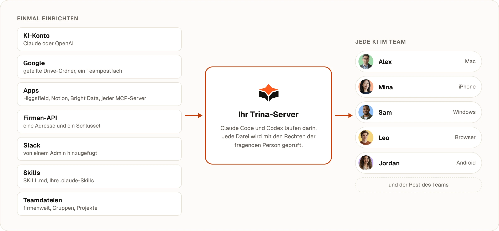
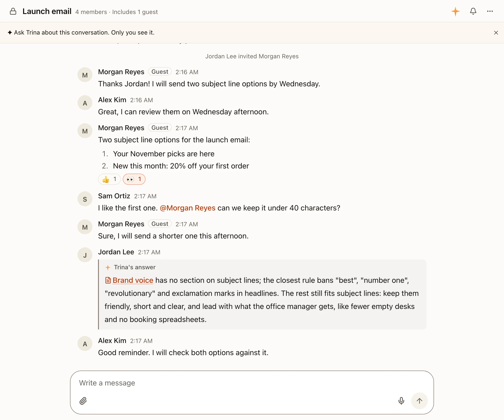
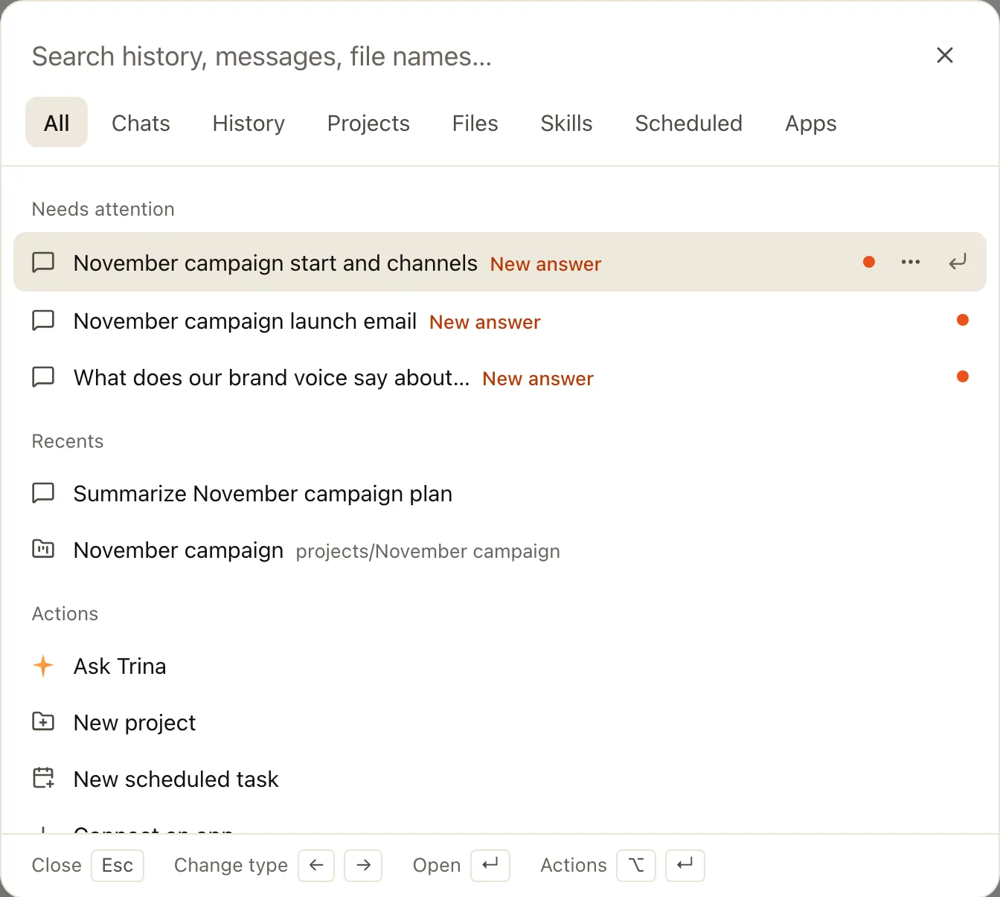

<div align="center">

<picture><source media="(prefers-color-scheme: dark)" srcset="editions/trina/branding/logo/mark-dark.svg"></picture>

<h1>Trina AX</h1>

<b>Die KI, die sich dein ganzes Team teilt.</b><br>
Trina AX bündelt die Dateien, Skills und Tools deines Teams auf einem Server. Jede KI im Team baut darauf auf,<br>und jede Datei, die sie öffnet, wird mit den Rechten der fragenden Person geprüft.

<a href="https://ax.trina.app/download"></a>&nbsp;&nbsp;<a href="https://ax.trina.app/download"></a>&nbsp;&nbsp;<a href="https://apps.apple.com/app/trina-ax/id6829192435"></a>&nbsp;&nbsp;<a href="https://play.google.com/store/apps/details?id=app.trina.ax"></a><br>
<sub>Linux: .deb und AppImage (x64, arm64) auf der <a href="https://ax.trina.app/download">Download-Seite</a></sub>

[Website](https://ax.trina.app) · [Dokumentation](docs/README.md) · [Preise](https://ax.trina.app/pricing) · [Discord](https://discord.gg/zUVfSR8MVk)

[English](README.md) · [한국어](README.ko.md) · [日本語](README.ja.md) · [Español](README.es.md) · [简体中文](README.zh-CN.md) · [繁體中文](README.zh-TW.md) · [Português](README.pt-BR.md) · [Français](README.fr.md) · Deutsch · [Italiano](README.it.md) · [Русский](README.ru.md) · [Türkçe](README.tr.md) · [Tiếng Việt](README.vi.md) · [Bahasa Indonesia](README.id.md)

</div>

https://github.com/user-attachments/assets/52012c91-d598-42d4-b966-afa49467fb51

<p align="center"><sub>Was die KI einer neuen Kollegin schon am ersten Tag kann. Die Geschichte in 80 Sekunden.</sub><br>Open Source (AGPL-3.0) · Kostenlos selbst hosten, ohne Nutzerlimit<br><br><a href="https://github.com/trina-app/trina-ax?tab=readme-ov-file"></a><br><sub>Klick danach oben auf der Seite auf ☆ Star. Ein Stern hilft weiteren Teams, Trina AX zu finden.</sub></p>

<br>

<picture><source media="(prefers-color-scheme: dark)" srcset="docs/images/readme/v4/divider-dark.png"></picture>

## Einmal einrichten. Für dein ganzes Team.

**Ein KI-Konto für das ganze Team.** Verbinde einen API-Schlüssel von Claude oder OpenAI oder einen Plan, dessen Nutzungsbedingungen das erlauben. Alle im Team nutzen ihn – mit Token-Limits pro Person, Gruppe oder Team.

Eine Person richtet alles auf dem Teamserver ein. Ab der ersten Frage arbeitet jede KI im Team damit, im Browser oder in den Apps. Sonst muss niemand Claude Code installieren oder Skills kopieren. Höchstens melden sich die anderen bei ihren eigenen Konten an.

<picture><source media="(prefers-color-scheme: dark)" srcset="docs/images/readme/v4/set-up-once-de-dark.webp"></picture>

| Einmal einrichten | Alle bekommen |
| --- | --- |
| **KI-Konto.** Der Inhaber oder ein Admin verbindet einen API-Schlüssel von Claude oder OpenAI oder einen Plan, dessen Nutzungsbedingungen das erlauben. | Antworten für das ganze Team, mit Token-Limits pro Person, Gruppe oder Team. |
| **Google.** Teile Drive-Ordner mit dem Team oder verbinde ein Teamkonto (ein gemeinsames Postfach oder einen gemeinsamen Kalender) für Gmail, Calendar, Docs und Sheets. | Die Teammitglieder, die du auswählst, nutzen sie in ihren Chats. Alle können trotzdem ihr eigenes Google-Konto verbinden. |
| **Apps.** Higgsfield, Notion, Linear, Figma und mehr aus der App-Liste oder jeder MCP-Server über seine Adresse, etwa Bright Data. | Die Tools der App in allen Chats: eine Anmeldung für das Team, oder alle melden sich mit dem eigenen Konto an. |
| **Deine Firmen-API.** Eine Adresse, ein Schlüssel und ein paar Hinweise. | Die KI ruft dein eigenes System auf, nur unter dieser Adresse. |
| **Slack.** Der Inhaber oder ein Admin fügt es einmal hinzu. | Frag Trina per Direktnachricht oder in jedem Channel, in den sie eingeladen ist – mit deinen eigenen Rechten. |
| **Skills.** Schreib eine `SKILL.md` oder bring die Skills aus deinem Ordner `.claude` oder `.codex` mit. | Jede KI im Team folgt denselben Schritten. Tippe `/`, um einen Skill zu nutzen. |
| **Teamdateien.** Ein Laufwerk: firmenweit, Gruppen, Projekte, Team-Skills und persönliche Ordner. | Jede KI im Team baut auf den Dateien des Teams auf und öffnet nur, was die jeweilige Person öffnen darf. |

<table>
<tr>
<td colspan="2"><br><sub>Admin › Connected apps: einmal für alle im Team einrichten</sub></td>
</tr>
<tr>
<td width="50%"><br><sub>Ein Teamlaufwerk</sub></td>
<td width="50%"><br><sub>Team-Skills oder eigene mitbringen</sub></td>
</tr>
</table>

<br>

<picture><source media="(prefers-color-scheme: dark)" srcset="docs/images/readme/v4/divider-dark.png"></picture>

## Was alle damit machen

**Nebenher fragen, mit einem Klick senden.** Neben jedem Raum gibt es einen Seitenchat, den nur du siehst. Ein Klick schickt Trinas Antwort in den Raum.


**Deine KI sieht nur, was du öffnen darfst.** Mina kann Finance nicht öffnen, also auch ihre KI nicht. [So funktionieren Berechtigungen](docs/PERMISSIONS.md)


**Die KI-Session eines Teammitglieds im Teamprojekt fortsetzen.** Sessions in einem Teamprojekt werden mit allen Projektmitgliedern geteilt: Öffne die Session eines Teammitglieds und mach weiter – mit deinen eigenen Rechten. Jede andere Session kannst du mit Personen oder Gruppen teilen, wie eine Datei in Google Drive.


**Dateien nach ihrem Inhalt finden.** Jede Nacht liest die KI des Teams neue und geänderte Dateien in geteilten Ordnern, Gruppen- und Projektordnern. Für jede Datei hält sie in einer Zeile fest, worum es sich handelt. Dafür nutzt sie das KI-Konto des Teams und liest nie persönliche Ordner. So findest du auch einen Scan namens `temp.pdf` oder ein Foto namens `IMG_2031.jpg` über seinen Inhalt. In einem Test mit 2.238 fiktiven Dateien fand Claude Code mit diesen Zeilen bei 181 von 184 Fragen die richtige Datei, ohne sie bei 172.

<table>
<tr>
<td width="50%"><b>Geplante Aufgaben.</b> Einmal fragen, und Trina wiederholt die Aufgabe nach deinem Zeitplan – in der Zeitzone deines Teams.<br><br></td>
<td width="50%"><b>Gäste.</b> Lade Externe in einen Gruppenchat oder ein Projekt ein und leg fest, ob sie die KI nutzen dürfen.<br><br></td>
</tr>
<tr>
<td width="50%"><b>Nutzung und Limits.</b> Antworten, Tokens und geschätzte Kosten pro Person. Token-Limits pro Person, Gruppe oder Team.<br><br></td>
<td width="50%"><b>Alles durchsuchen.</b> Mit ⌘K in Chats, Verlauf, Projekten, Dateien, Skills und geplanten Aufgaben.<br><br></td>
</tr>
<tr>
<td colspan="2"><b>Teamchat wie Slack, aber mit Trina als KI.</b> Channels für alle und für jede Gruppe, private Channels, Direktnachrichten, Gruppenchats, Threads und @Erwähnungen – im Web, auf dem Desktop und auf dem Handy. Neben jedem davon fragst du Trina in einem Seitenchat, den nur du siehst.<br><br></td>
</tr>
</table>

- **Jede Änderung bleibt erhalten.** Ob von einer Person oder ihrer KI: Jede Version lässt sich wiederherstellen.
- **Browser in der App.** In der Desktop-App öffnet Trina Websites in einem Bereich neben deinem Chat, liest sie, klickt und füllt Formulare aus, während du zusiehst. Mit Stop brichst du ab. Vor jeder neuen Website fragt Trina nach, außer du erlaubst alle Websites.
- **App-Updates im Raum.** Updates von Sentry, GitHub, Stripe, Jira und HubSpot kommen als Karten an.
- **Arbeitsdateien finden.** Die Desktop-App findet zuletzt genutzte Arbeitsdateien auf deinem Computer und fügt hinzu, was du auswählst.
- **Dokumente.** Trina liest Text aus Hangul-Dateien (HWP/HWPX) und zeigt Vorschauen von PDF und PowerPoint.
- **Alle Geräte.** Mac, Windows, Linux, iPhone, Android und jeder Browser, in sechs Sprachen.

<br>

<picture><source media="(prefers-color-scheme: dark)" srcset="docs/images/readme/v4/divider-dark.png"></picture>

## Loslegen

- **Im Browser ausprobieren:** ohne Installation, mit einem fiktiven Team und ausgeschalteter KI. [Demo öffnen](https://ax.trina.app/demo/)
- **Trina-Hosting:** kein eigener Server nötig. 14 Tage kostenlos testen, danach ein Monatsabo. [Preise](https://ax.trina.app/pricing)
- **Apps:** [Mac, Windows, Linux, iPhone, Android](https://ax.trina.app/download) oder in jedem Browser.
- **Selbst hosten:** auf deinem eigenen Linux-Server, mit Docker oder auf einem Mac im Büro. Kostenlos. [Linux](docs/INSTALL-LINUX.en.md) · [Docker](docs/INSTALL-DOCKER.md) · [Büro-Mac](docs/OFFICE.en.md) · [Mit deinem KI-Agenten installieren](docs/INSTALL-LINUX.en.md#install-with-your-ai-agent)

<b>Mit Docker selbst hosten</b> (Linux oder ein Mac mit OrbStack)

```sh
git clone https://github.com/trina-app/trina-ax.git && cd trina-ax/docker
cp env.example .env && docker compose up -d --build
docker compose exec trina-ax trina-ax-setup-link   # open the link and create the owner
```

Neuer und weniger getestet als die Linux-Installation. Auf einem Server mit Ubuntu 24.04 musst du vorher eine Einstellung auf dem Host anpassen. [Docker-Anleitung](docs/INSTALL-DOCKER.md)

<b>In 10 Minuten auf deinem Computer ausprobieren</b> (fiktives Team, KI aus)

```sh
git clone https://github.com/trina-app/trina-ax.git && cd trina-ax
bun install --frozen-lockfile && bun run demo   # → http://127.0.0.1:19760 · alice / teamax-demo-1
```

Du brauchst Bun 1.3.12 und Go 1.27+. Nicht für den Produktivbetrieb gedacht. [Schritt für Schritt](docs/QUICKSTART.md)

<br>

<picture><source media="(prefers-color-scheme: dark)" srcset="docs/images/readme/v4/divider-dark.png"></picture>

## So funktioniert es

Auf einem Server laufen Claude Code und Codex als Engine. Jede Dateianfrage, ob von einer Person oder ihrer KI, durchläuft auf dem Server eine einzige Rechteprüfung. Auf einem Linux-Server läuft die Engine unter einem eigenen Benutzerkonto in einer Sandbox aus bubblewrap, Landlock und seccomp. Shell und eingebaute Dateitools der Engine sind abgeschaltet: An Dateien kommt sie nur über die Tools von Trina. [Sicherheit und Berechtigungen](docs/security-and-permissions.md)

Trina liefert den Workspace, nicht die KI: Verbinde Claude- oder OpenAI-Konten und -Pläne, die für deine Nutzung zugelassen sind. Abgerechnet wird die KI-Nutzung über das Konto, das du verbindest.

<details>
<summary><b>Daten, Grenzen und was wir nicht versprechen</b></summary>

### Was wir nicht versprechen

- Selbst gehostet heißt nicht offline: Der Kontext, den eine Anfrage braucht, geht an den KI-Anbieter, den du verbindest, und eingerichtete Integrationen erhalten ihre Anfragen. Jede Websuche von Codex schickt das bisherige Gespräch an den Suchdienst von OpenAI. Erlaubt ein Admin OpenRouter für die Spracherkennung, geht der Ton von Video- und Audiodateien an OpenRouter. Der Server fragt alle 30 Minuten bei `updates.trina.app` seine eigene öffentliche Adresse ab (`MYCEL_EXIT_ADDRESS_CHECK=off` schaltet das ab). [Details](docs/security-and-permissions.md)
- Wer den Server betreibt, kann gespeicherte Dateien und Chats lesen, beim Hosting also auch die Betreiber von Trina. App-Admins bekommen keine Ansicht, in der sie die privaten Unterhaltungen aller durchsehen können.
- Wer den Zugriff auf einen Ordner entzieht, löscht damit keine früheren Antworten. Die Rückfrage beim Teilen mit mehr Personen ist kein umfassender Schutz vor Datenabfluss (DLP).
- Keine Sicherheitszertifizierung, keine perfekten Antworten, keine garantierten Einsparungen und keine automatischen Entscheidungen in Rechts-, Finanz- oder Personalfragen. Prüfe die Ergebnisse und die Grenzen deiner Installation.
- Auf Linux-Servern läuft keine OCR: Die KI sieht Fotos und gescannte Seiten als Bilder, aber sie sind nicht als Text durchsuchbar. Büro-Macs können noch keine Videos lesen.
- HWP/HWPX-Text funktioniert in jedem Team. Für [Vorschauen und das Erstellen von Hangul-Dokumenten](resources/hwp/README.md) brauchst du das optionale Plugin HWP Preview (macOS oder Linux mit glibc 2.39+, nicht Debian 12).
- Verbindungen: Zuerst kommt die eigene berechtigte Verbindung einer Person, dann eine, die der Person, einer Gruppe oder dem ganzen Team zugewiesen ist – in dieser Reihenfolge. In neuen Trina-Teams kann standardmäßig eine Firmenverbindung das ganze Team versorgen. Bereits gespeicherte Einstellungen bleiben bestehen. **Diese Softwareeinstellung erteilt keine Erlaubnis nach den Nutzungsbedingungen von Anthropic oder OpenAI.** [Details zu Verbindungen](docs/FAQ.md)
- Zum Selbsthosten unter Linux brauchst du Debian 12/13 oder Ubuntu 24.04, systemd mit cgroup v2, amd64 oder arm64, 4 GB RAM und 20 GB Speicherplatz. Installation, Updates und das Wiederherstellen von Backups übernimmt dein IT-Team.

</details>

<br>

<picture><source media="(prefers-color-scheme: dark)" srcset="docs/images/readme/v4/divider-dark.png"></picture>

## Community

Hilft Trina AX deinem Team? Dann hilft ein ⭐ auf GitHub anderen Teams, es zu finden.

[Discord](https://discord.gg/zUVfSR8MVk) · [X](https://x.com/trina_ax) · [Releases](https://github.com/trina-app/trina-ax/releases/latest) · [Änderungen](CHANGELOG.md) · [Support](SUPPORT.md) · [Mitwirken](CONTRIBUTING.md) · [Sicherheit](SECURITY.md) · [Entwicklung](docs/DEVELOPMENT.md) · [Konfiguration](docs/CONFIGURATION.md) · [llms.txt](llms.txt)

Die App gibt es auf Englisch, Koreanisch, Indonesisch, Japanisch, Spanisch und vereinfachtem Chinesisch. Firma und Personen auf allen Bildern sind fiktiv.

<br>

<picture><source media="(prefers-color-scheme: dark)" srcset="docs/images/readme/v4/divider-dark.png"></picture>

## Lizenz

Kostenlos nutzbar, auch kommerziell, unter [AGPL-3.0-only](LICENSE). Wenn du eine geänderte Version über ein Netzwerk anbietest, stell deren Nutzern den Quellcode bereit. Das Cloud-Protokoll steht unter MIT ([Lizenz](shared/src/cloud-protocol/LICENSE)). [Hinweise](NOTICE) · [Hinweise zu Drittanbietern](docs/THIRD-PARTY-NOTICES.md)

Claude Code und Codex haben eigene Nutzungsbedingungen. Dieses Projekt wird weder von Anthropic noch von OpenAI offiziell unterstützt. Claude ist eine Marke von Anthropic.
