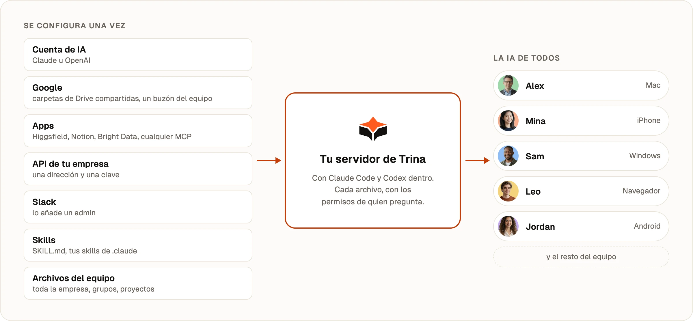
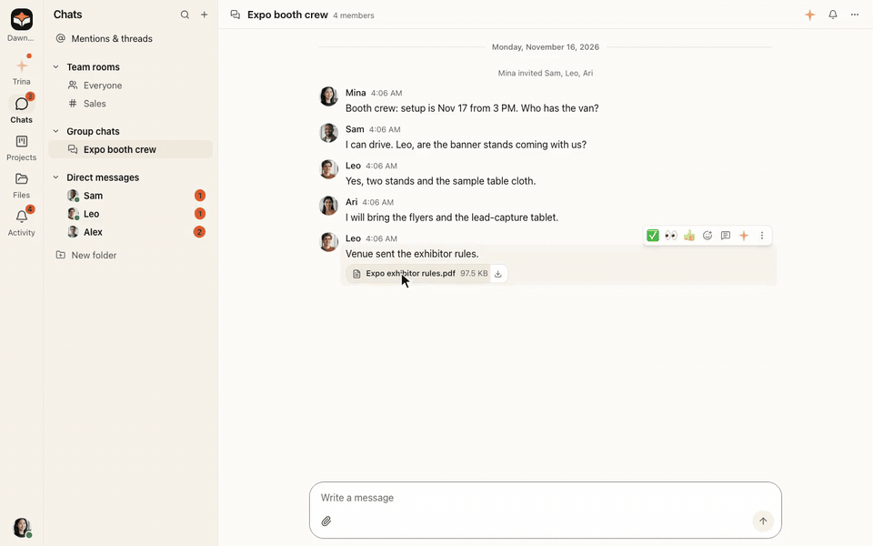

<div align="center">

<picture><source media="(prefers-color-scheme: dark)" srcset="editions/trina/branding/logo/mark-dark.svg"></picture>

<h1>Trina AX</h1>

<b>La IA que comparte todo tu equipo.</b><br>
Trina AX reúne los archivos, las skills y las herramientas de tu equipo en un solo servidor. La IA de cada persona empieza desde ahí,<br>y cada archivo que abre se comprueba con los permisos de quien preguntó.

<a href="https://ax.trina.app/download"></a>&nbsp;&nbsp;<a href="https://ax.trina.app/download"></a>&nbsp;&nbsp;<a href="https://apps.apple.com/app/trina-ax/id6829192435"></a>&nbsp;&nbsp;<a href="https://play.google.com/store/apps/details?id=app.trina.ax"></a><br>
<sub>Linux: .deb y AppImage (x64, arm64) en la <a href="https://ax.trina.app/download">página de descargas</a></sub>

[Sitio web](https://ax.trina.app) · [Documentación](docs/README.md) · [Planes](https://ax.trina.app/pricing) · [Discord](https://discord.gg/zUVfSR8MVk)

[English](README.md) · [한국어](README.ko.md) · [日本語](README.ja.md) · Español · [简体中文](README.zh-CN.md) · [繁體中文](README.zh-TW.md) · [Português](README.pt-BR.md) · [Français](README.fr.md) · [Deutsch](README.de.md) · [Italiano](README.it.md) · [Русский](README.ru.md) · [Türkçe](README.tr.md) · [Tiếng Việt](README.vi.md) · [Bahasa Indonesia](README.id.md)

</div>

https://github.com/user-attachments/assets/9511e013-c497-4113-9862-e50f061beae8

<p align="center"><sub>Lo que puede hacer la IA de un nuevo empleado el primer día. La historia en 80 segundos.</sub><br>Código abierto (AGPL-3.0) · Autoalojamiento gratis, sin límite de personas<br><br><a href="https://github.com/trina-app/trina-ax?tab=readme-ov-file"></a><br><sub>Después pulsa ☆ Star arriba de la página. Una estrella ayuda a que más equipos encuentren Trina AX.</sub></p>

<br>

<picture><source media="(prefers-color-scheme: dark)" srcset="docs/images/readme/v4/divider-dark.png"></picture>

## Se configura una vez. Lo usa todo tu equipo.

**Una sola cuenta de IA para todo el equipo.** Conecta una clave de API de Claude u OpenAI, o un plan cuyas condiciones lo permitan, y todo el equipo pregunta con ella, con límites de tokens por persona, grupo o equipo.

Una persona lo configura en el servidor del equipo. La IA de todos lo tiene desde la primera pregunta, en el navegador o en las apps. Nadie más instala Claude Code ni copia skills; como mucho, inicia sesión en sus propias cuentas.

<picture><source media="(prefers-color-scheme: dark)" srcset="docs/images/readme/v4/set-up-once-es-dark.webp"></picture>

| Se configura una vez | Lo que recibe cada uno |
| --- | --- |
| **Cuenta de IA.** El propietario o un admin conecta una clave de API de Claude u OpenAI, o un plan cuyas condiciones lo permitan. | Respuestas para todo el equipo, con límites de tokens por persona, grupo o equipo. |
| **Google.** Comparte carpetas de Drive con el equipo, o conecta una cuenta del equipo (un buzón o un calendario compartido) para Gmail, Calendar, Docs y Sheets. | Las personas que elijas lo usan en sus chats. Cada uno puede conectar además su propia cuenta de Google. |
| **Apps.** Higgsfield, Notion, Linear, Figma y más desde la lista de apps, o cualquier servidor MCP por su dirección, como Bright Data. | Las herramientas de la app en los chats de todos: un inicio de sesión del equipo, o cada persona con el suyo. |
| **La API de tu empresa.** Una dirección, una clave y unas notas. | La IA llama a tu propio sistema, solo bajo esa dirección. |
| **Slack.** El propietario o un admin lo añade una vez. | Pregunta a Trina por mensaje directo o en cualquier canal al que la hayas invitado, con tus propios permisos. |
| **Skills.** Escribe un `SKILL.md`, o trae las skills de tu carpeta `.claude` o `.codex`. | La IA de todos sigue los mismos pasos. Escribe `/` para usar una. |
| **Archivos del equipo.** Una sola unidad: toda la empresa, grupos, proyectos, skills del equipo y carpetas personales. | La IA de todos empieza desde los archivos del equipo y abre solo lo que esa persona puede abrir. |

<table>
<tr>
<td colspan="2"><br><sub>Administración › Apps conectadas: se configura una vez para todo el equipo</sub></td>
</tr>
<tr>
<td width="50%"><br><sub>Una sola unidad del equipo</sub></td>
<td width="50%"><br><sub>Skills del equipo, o trae las tuyas</sub></td>
</tr>
</table>

<br>

<picture><source media="(prefers-color-scheme: dark)" srcset="docs/images/readme/v4/divider-dark.png"></picture>

## Lo que hace cada uno con ello

**Pregunta junto a cualquier conversación y envía con un clic.** Un chat lateral que solo ves tú; con un clic, la respuesta de Trina llega a la conversación.



**La IA de cada persona ve solo lo que esa persona puede abrir.** Si Mina no puede abrir Finance, su IA tampoco. [Cómo funcionan los permisos](docs/PERMISSIONS.md)


**Retoma la sesión de trabajo de un compañero en un proyecto del equipo.** Las sesiones de un proyecto del equipo se comparten con sus miembros: abre la de un compañero y sigue, con tus propios permisos. Cualquier otra sesión la puedes compartir con personas o grupos, como un archivo de Google Drive.


**Encuentra archivos por lo que son.** Cada noche, la IA del equipo lee los archivos nuevos y modificados de las carpetas compartidas, de grupo y de proyecto, y guarda una línea por archivo que dice qué es, así que un escaneo llamado `temp.pdf` o una foto llamada `IMG_2031.jpg` se encuentran por su contenido. Usa la cuenta de IA del equipo y nunca lee las carpetas personales. En una prueba con 2.238 archivos ficticios, Claude Code encontró el archivo correcto en 181 de 184 preguntas con estas líneas, y en 172 sin ellas.

<table>
<tr>
<td width="50%"><b>Tareas programadas.</b> Pídelo una vez y Trina lo repite según tu calendario, en la zona horaria del equipo.<br><br></td>
<td width="50%"><b>Invitados.</b> Invita a personas de fuera de la empresa a un chat de grupo o a un proyecto, y decide si pueden usar la IA.<br><br></td>
</tr>
<tr>
<td width="50%"><b>Uso y límites.</b> Respuestas, tokens y coste estimado por persona; límites de tokens por persona, grupo o equipo.<br><br></td>
<td width="50%"><b>Busca en todo.</b> ⌘K en chats, historial, proyectos, archivos, skills y tareas programadas.<br><br></td>
</tr>
<tr>
<td colspan="2"><b>Chat de equipo como Slack, pero con Trina AI.</b> Canales para todos y para cada grupo, canales privados, mensajes directos, chats de grupo, hilos y @menciones, en la web, el escritorio y el móvil. Pregunta a Trina junto a cualquiera de ellas, en un chat lateral que solo ves tú.<br><br></td>
</tr>
</table>

- **Se guarda cada cambio.** Lo haga una persona o su IA, puedes recuperar cualquier versión.
- **Navegador integrado.** En la app de escritorio, Trina abre sitios web en un panel junto a tu chat, los lee, hace clic y rellena formularios mientras miras; Stop lo detiene. Pregunta antes de abrir un sitio nuevo, salvo que permitas todos los sitios.
- **Las apps publican en las conversaciones.** Las novedades de Sentry, GitHub, Stripe, Jira y HubSpot llegan como tarjetas.
- **Notas de reuniones.** La app de Mac (macOS 14.4 o posterior) toma notas de las llamadas de Zoom, Meet y Teams.
- **Encuentra archivos de trabajo.** La app de escritorio encuentra archivos de trabajo recientes en tu ordenador y añade los que elijas.
- **Documentos.** Lee el texto de documentos hangul (HWP/HWPX) y previsualiza PDF y PowerPoint.
- **En cualquier dispositivo.** Mac, Windows, Linux, iPhone, Android y cualquier navegador, en seis idiomas.

<br>

<picture><source media="(prefers-color-scheme: dark)" srcset="docs/images/readme/v4/divider-dark.png"></picture>

## Cómo empezar

- **Hosting de Trina:** sin servidor que gestionar. Prueba gratis de 14 días y luego un plan mensual. [Planes](https://ax.trina.app/pricing)
- **Apps:** [Mac, Windows, Linux, iPhone, Android](https://ax.trina.app/download), o cualquier navegador.
- **Autoalojamiento:** en tu propio servidor Linux, con Docker o en un Mac de la oficina. Gratis. [Linux](docs/INSTALL-LINUX.en.md) · [Docker](docs/INSTALL-DOCKER.md) · [Mac de oficina](docs/OFFICE.en.md) · [Instalar con tu agente de IA](docs/INSTALL-LINUX.en.md#install-with-your-ai-agent)

<b>Autoalojamiento con Docker</b> (Linux, o un Mac con OrbStack)

```sh
git clone https://github.com/trina-app/trina-ax.git && cd trina-ax/docker
cp env.example .env && docker compose up -d --build
docker compose exec trina-ax trina-ax-setup-link   # abre el enlace y crea el propietario
```

Es más nuevo y está menos probado que la instalación en Linux; un servidor Ubuntu 24.04 necesita antes un ajuste del host. [Guía de Docker](docs/INSTALL-DOCKER.md)

<b>Pruébalo en tu ordenador en 10 minutos</b> (equipo ficticio, IA desactivada)

```sh
git clone https://github.com/trina-app/trina-ax.git && cd trina-ax
bun install --frozen-lockfile && bun run demo   # → http://127.0.0.1:19760 · alice / teamax-demo-1
```

Requiere Bun 1.3.12 y Go 1.27+. No es una instalación para producción. [Guía paso a paso](docs/QUICKSTART.md)

<br>

<picture><source media="(prefers-color-scheme: dark)" srcset="docs/images/readme/v4/divider-dark.png"></picture>

## Cómo funciona

Un servidor ejecuta Claude Code y Codex como motor. Cada petición de archivos, de una persona o de su IA, pasa por una única comprobación de permisos en el servidor. En un servidor Linux, el motor corre con su propia cuenta dentro de un sandbox de bubblewrap, Landlock y seccomp, con su shell y sus herramientas de archivos integradas desactivadas: solo llega a los archivos con las herramientas de Trina. [Seguridad y permisos](docs/security-and-permissions.md)

Trina ofrece el espacio de trabajo, no la IA: conecta cuentas y planes de Claude u OpenAI cuyo uso tengas autorizado. El uso de IA lo factura la cuenta que conectes.

<details>
<summary><b>Datos, límites y lo que no prometemos</b></summary>

### Lo que no prometemos

- Autoalojar no significa funcionar sin conexión: el contexto que necesita cada petición se envía al proveedor de IA que conectes, y las integraciones configuradas reciben sus propias peticiones. Cada búsqueda web de Codex envía la conversación hasta ese momento al servicio de búsqueda de OpenAI. Si un administrador permite OpenRouter para la voz, el sonido de los archivos de video y audio se envía a OpenRouter. Cada 30 minutos, el servidor consulta a `updates.trina.app` cuál es su propia dirección pública (se desactiva con `MYCEL_EXIT_ADDRESS_CHECK=off`). [Detalles](docs/security-and-permissions.md)
- Quienes operan el servidor pueden leer los archivos y chats almacenados; en el hosting, eso incluye a los operadores de Trina. Los administradores de la app no tienen un visor para consultar las conversaciones privadas de todos.
- Quitar el acceso a una carpeta no borra las respuestas anteriores. La confirmación al compartir con más personas no es una solución universal de prevención de pérdida de datos.
- No ofrecemos certificaciones de seguridad, respuestas perfectas, ahorros garantizados ni decisiones automáticas en materia legal, financiera o de RR. HH. Revisa los resultados y los límites de tu despliegue.
- Los servidores Linux no hacen OCR: la IA ve las fotos y las páginas escaneadas como imágenes, pero no se pueden buscar como texto. Los Mac de oficina todavía no leen video.
- El texto de HWP/HWPX funciona para cualquier equipo; las [vistas previas y la creación de documentos Hangul](resources/hwp/README.md) necesitan el plugin opcional HWP Preview (macOS, o Linux con glibc 2.39 o posterior; no Debian 12).
- Conexiones: primero va la conexión propia elegible de cada persona; después, una asignada a esa persona, a un grupo y, por último, a todo el equipo. En los equipos de Trina recién creados, una conexión de la empresa puede servir a todo el equipo por defecto; las opciones ya guardadas se conservan. **Este ajuste del software no concede ningún permiso conforme a los términos de Anthropic u OpenAI.** [Detalles de conexión](docs/FAQ.md)
- El autoalojamiento en Linux requiere Debian 12/13 o Ubuntu 24.04, systemd con cgroup v2, amd64 o arm64, 4 GB de RAM y 20 GB de disco. Tu equipo de TI se encarga de la instalación, las actualizaciones y la restauración de copias de seguridad.

</details>

<br>

<picture><source media="(prefers-color-scheme: dark)" srcset="docs/images/readme/v4/divider-dark.png"></picture>

## Comunidad

Si Trina AX le sirve a tu equipo, una ⭐ en GitHub ayuda a que otros equipos lo encuentren.

[Discord](https://discord.gg/zUVfSR8MVk) · [X](https://x.com/trina_ax) · [Versiones](https://github.com/trina-app/trina-ax/releases/latest) · [Cambios](CHANGELOG.md) · [Soporte](SUPPORT.md) · [Cómo contribuir](CONTRIBUTING.md) · [Seguridad](SECURITY.md) · [Desarrollo](docs/DEVELOPMENT.md) · [Configuración](docs/CONFIGURATION.md) · [llms.txt](llms.txt)

La app está en inglés, coreano, indonesio, japonés, español y chino simplificado. La empresa y las personas de todas las imágenes son ficticias.

<br>

<picture><source media="(prefers-color-scheme: dark)" srcset="docs/images/readme/v4/divider-dark.png"></picture>

## Licencia

Puedes usarlo libremente, también con fines comerciales, bajo la licencia [AGPL-3.0-only](LICENSE). Si ofreces una versión modificada a través de una red, pon su código fuente a disposición de esos usuarios. El protocolo de nube se distribuye por separado bajo la licencia MIT ([licencia](shared/src/cloud-protocol/LICENSE)). [Avisos](NOTICE) · [Avisos de terceros](docs/THIRD-PARTY-NOTICES.md)

Claude Code y Codex tienen sus propios términos; este proyecto no cuenta con el respaldo de Anthropic ni de OpenAI. Claude es una marca comercial de Anthropic.
