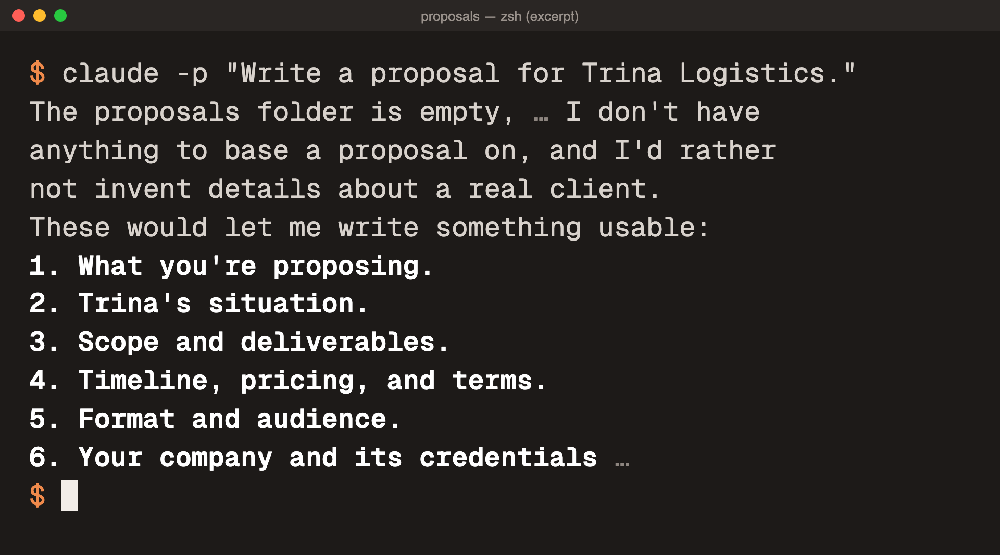
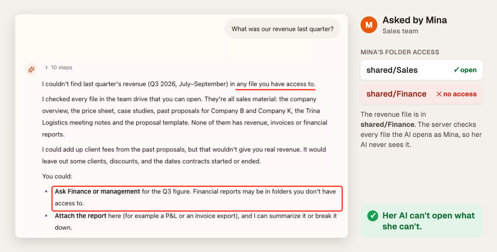
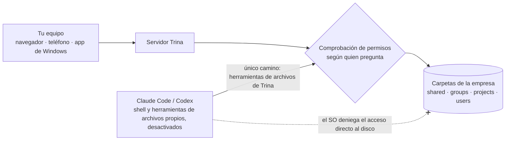

<div align="center">


# Trina AX

**Configura Claude Code una vez y lo tendrá toda tu empresa.**

Claude Code y Codex en un servidor de tu empresa, con tus archivos, las skills de tu equipo y los permisos de carpeta de cada persona. Los demás solo tienen que abrir el navegador.

[Sitio web](https://ax.trina.app) · [Pruébalo en 10 minutos](#pruébalo-en-10-minutos) · [Autoalojamiento](docs/for-admins.md) · [Documentación](docs/README.md)

[English](README.md) · [한국어](README.ko.md) · [日本語](README.ja.md) · Español · [简体中文](README.zh-CN.md)

https://github.com/user-attachments/assets/566eb7b0-9e21-4898-9c25-e4399e8d3e74

<sub><b>97 segundos, con sonido (en inglés).</b> Un líder de equipo configura Claude una vez y, en su primer día, la propuesta de una nueva integrante sale como la suya.<br>Historia animada con la app real en el 1:15. Empresa ficticia.</sub>

</div>

## La misma petición, dos respuestas

<table>
<tr>
<td width="50%" valign="top"><b>Claude Code en una carpeta vacía</b><br><sub>No tiene forma de conocer tu empresa, así que primero hace seis preguntas.</sub></td>
<td width="50%" valign="top"><b>Trina AX, con la misma línea</b><br><sub>Parte de los archivos del equipo y de la skill de propuestas del CEO.</sub></td>
</tr>
<tr>
<td></td>
<td></td>
</tr>
</table>

<sub>Resultados reales del 31 de octubre de 2026 con una empresa ficticia, Dawnroute. Claude Code hace bien en preguntar: en una carpeta vacía no hay nada que le diga quién eres. Trina le da la carpeta.</sub>

## Cómo funciona

1. **Lo guardas una sola vez.** Los archivos de la empresa van en `shared/`. Tu forma de escribir propuestas, en `skills/proposal/SKILL.md`.
2. **Todos preguntan.** Desde una app de chat en el navegador, en el escritorio o en el teléfono. Sin terminal y sin instalar nada en el portátil.
3. **Cada persona mantiene sus propios accesos.** El servidor comprueba cada archivo que abre la IA con los permisos de quien pregunta. Una carpeta que tú no puedes ver tampoco existe para tu IA.



<sub><b>La misma pregunta, distintas personas.</b> Mina es de Ventas. El archivo de ingresos está en <code>shared/Finance</code>, una carpeta que ella no puede abrir, así que su IA tampoco.</sub>

## Pruébalo en 10 minutos

```sh
git clone https://github.com/trina-app/trina-ax.git && cd trina-ax
bun install --frozen-lockfile
bun run demo        # → http://127.0.0.1:19760 · inicia sesión como alice / teamax-demo-1
```

Un equipo ficticio con seis skills iniciales. La IA está desactivada, así que no hace falta ninguna cuenta de IA. Inicia sesión como `bob` en una ventana privada: cada usuario ve una carpeta de grupo distinta. Requiere Git, Bun 1.3.12 y Go 1.27+. Esto **no es una instalación de producción**. [Guía paso a paso](docs/QUICKSTART.md)

## Qué incluye

| | En la práctica |
|---|---|
| **Agentes reales de Claude Code y Codex** | Se ejecutan en tu servidor: hasta 150 rondas de herramientas por respuesta (por defecto), hasta 4 subagentes a la vez, búsqueda web y tareas programadas. |
| **El conocimiento está en las carpetas de la empresa** | `shared/`, `groups/`, `projects/` y carpetas personales, con historial de versiones. Extracción de texto de archivos PDF, Office y HWP/HWPX. |
| **Skills del equipo, gestionadas como archivos** | Una skill es un archivo `SKILL.md`. Las reglas de la carpeta deciden quién puede usarla, y la IA pide confirmación a una persona antes de modificar alguna. |
| **Permisos en cada llamada a archivos** | Los archivos a los que no tienes acceso no aparecen en Archivos, las respuestas de la IA, la búsqueda, las vistas previas, el historial de versiones ni la papelera. |
| **Tu conexión de IA** | Conecta una vez la cuenta de Claude u OpenAI de la empresa, o deja que cada persona conecte la suya. Uso por persona, con límites. Si lo alojas tú, Claude Code también puede usar otros modelos, como DeepSeek, Kimi o GLM, a través de una [pasarela compatible con Anthropic](docs/CONFIGURATION.md#anthropic-compatible-gateway). |
| **Autoalojado o con el hosting de Trina** | Un servidor Linux, un Mac de la oficina o el hosting de Trina en AWS (Seúl). En el navegador de escritorio y del teléfono, además de un instalador para Windows. |

## Por dentro



- **El agente es real.** Los subagentes actúan en nombre de la misma persona, pasan las mismas comprobaciones y dejan los mismos registros de actividad.
- **Un acceso muy acotado.** El propio shell del motor y sus herramientas de archivos están desactivados, y hay pruebas de regresión que lo cubren en cada motor. Llega a tus carpetas a través de las herramientas de archivos de Trina, que se comprueban en cada llamada.
- **Las claves quedan fuera de alcance.** Los tokens se sellan en el navegador antes de enviarse. El motor recibe un token sustituto para cada turno, y un proxy de modelos añade el real.
- **Los administradores no pueden leer tus chats.** Ven qué archivos leyó la IA, no la conversación. Quienes operan el servidor sí pueden leer los datos almacenados, y lo indicamos [más abajo](#datos-y-límites).

<sub>El aislamiento a nivel de SO (una cuenta dedicada para el motor) se aplica en las instalaciones de Linux y en las de Mac con cuentas de rol. El modo Mac de oficina se ejecuta con el usuario que tiene la sesión iniciada, y la demo local no tiene aislamiento de SO. → <a href="docs/security-and-permissions.md">Seguridad y permisos</a> · <a href="docs/PERMISSIONS.md">Modelo de permisos (en coreano)</a></sub>

## La primera semana de tu equipo

Crea la cuenta de propietario y luego sigue este orden: **permisos → conexión de IA → invitar al equipo → primera skill → primera copia de seguridad**. Estas skills iniciales usan datos ficticios:

| Rol | Una tarea real | Skill lista para copiar |
|---|---|---|
| CEO / líder de equipo | Convertir notas semanales en decisiones, riesgos y próximos pasos | [Weekly report](examples/skills/weekly-team-report/SKILL.md) |
| Ventas | Redactar el mensaje de seguimiento de una reunión sin inventar compromisos | [Sales follow-up](examples/skills/sales-follow-up/SKILL.md) |
| Marketing | Preparar un brief de campaña a partir de notas de marca aprobadas | [Brand brief](examples/skills/brand-brief/SKILL.md) |
| Finanzas | Marcar para revisión los recibos que faltan y las cantidades dudosas | [Expense review](examples/skills/expense-review/SKILL.md) |
| RR. HH. | Responder dudas de incorporación con las políticas a las que se tiene acceso | [New-hire guide](examples/skills/new-hire-guide/SKILL.md) |
| Todos | Extraer decisiones y tareas de las notas de una reunión | [Meeting summary](examples/skills/meeting-summary/SKILL.md) |

Una skill es un conjunto reutilizable de instrucciones: no entrena el modelo ni da acceso adicional. Una persona revisa los resultados antes de usarlos. [Checklist para líderes de equipo](docs/for-teams.md) · [Todos los ejemplos](examples/README.md)

## Cómo ejecutarlo

| | Hosting de Trina | Autoalojado en Linux | Mac de oficina | Demo local |
|---|---|---|---|---|
| Ideal para | Equipos sin personal de TI | Equipos con un responsable de TI | Una oficina pequeña con un Mac dedicado | Echar un vistazo |
| Quién lo gestiona | Trina, en AWS (Seúl) | Tu equipo de TI | Quien se encarga de la oficina | Tú |
| IA | Tu conexión autorizada de Claude u OpenAI | Igual | Claude (sin Codex) | Desactivada |
| Precio | Gratis hasta 3 personas, luego desde 39 USD/mes + uso de IA | Software gratuito + tu servidor | Software gratuito | Gratis |
| Cómo empezar | [Ver los planes](https://ax.trina.app/#pricing) | [Guía de Linux](docs/INSTALL-LINUX.en.md) | [Guía de Mac de oficina](docs/OFFICE.en.md) | [Inicio rápido](docs/QUICKSTART.md) |

Trina ofrece el espacio de trabajo, no la IA: usa solo cuentas y planes de Claude y OpenAI cuyo uso tengas autorizado. Planes de hosting (consultados el 2 de noviembre de 2026; precios en USD sin impuestos): **Gratis (hasta 3 personas, plazas limitadas), Starter 39 USD/mes (hasta 5 personas), Team 69 (15), Business 129 (40)**, y presupuesto a partir de 40 personas. El uso de IA va aparte. [Precios actuales](https://ax.trina.app/#pricing)

El autoalojamiento en Linux requiere Debian 12/13 o Ubuntu 24.04, systemd con cgroup v2, amd64 o arm64, 4 GB de RAM (recomendado) y al menos 20 GB de disco. Tu equipo de TI se encarga de la instalación, las actualizaciones y la restauración de copias de seguridad.

## Datos y límites

Autoalojar no significa funcionar sin conexión: el contexto que necesita cada petición se envía al proveedor de IA que conectes. Quienes operan el servidor (incluida Trina, si usas su hosting) pueden leer los archivos y chats almacenados; los administradores de la app no pueden explorar conversaciones privadas.

<details>
<summary><b>Qué sale del servidor, reglas de conexión y lo que no prometemos</b></summary>

<br>

- El contexto seleccionado se envía al proveedor de IA elegido, y las integraciones configuradas reciben sus propias peticiones. Cada búsqueda web de Codex envía la conversación hasta ese momento al servicio de búsqueda de OpenAI. Si el equipo eligió OpenRouter para la voz y lo permitió, el sonido de los archivos de video y audio que lee la IA se envía a OpenRouter. Cada 30 minutos, el servidor consulta a `updates.trina.app` cuál es su propia dirección pública (se desactiva con `MYCEL_EXIT_ADDRESS_CHECK=off`). [Detalles](docs/security-and-permissions.md)
- Quienes operan el servidor pueden leer los archivos y chats almacenados; en el hosting, eso incluye a los operadores de Trina. Los administradores de la app no tienen un visor para consultar las conversaciones privadas de todos.
- Quitar el acceso a una carpeta no borra las respuestas anteriores. La confirmación al compartir con más personas no es una solución universal de prevención de pérdida de datos.
- No ofrecemos certificaciones de seguridad, respuestas perfectas, ahorros garantizados ni decisiones automáticas en materia legal, financiera o de RR. HH. Revisa los resultados y los límites de tu despliegue.
- La IA ve las fotos y las páginas escaneadas de PDF como imágenes (un administrador puede desactivarlo), pero los servidores Linux no hacen OCR: en ellos, los documentos escaneados y las fotos no se pueden buscar como texto.
- En los servidores Linux, la IA también lee archivos de video y audio: los fotogramas, repartidos a intervalos regulares, se envían al proveedor de IA como imágenes, y el sonido lo convierte en texto el proveedor de voz del equipo solo si un administrador lo permite ("Convertir el sonido de los videos en texto"). Si el proveedor de voz es OpenRouter, el sonido de los archivos del equipo va a OpenRouter y a su proveedor; los chats confidenciales nunca lo envían. Los Mac de oficina todavía no leen video.
- Se puede extraer el texto de archivos HWP/HWPX. Las [vistas previas visuales](resources/hwp/README.md) se ofrecen con el plugin opcional HWP Preview, que requiere macOS o Linux con glibc 2.39 o posterior, así que Debian 12 **no** las admite.
- En las instalaciones gestionadas, tienen prioridad las conexiones personales elegibles; después, las asignadas a una persona, a un grupo y, por último, a todo el equipo. En los equipos de Trina recién creados, una conexión de la empresa puede servir a todo el equipo por defecto; las opciones ya guardadas se conservan. El consentimiento a nivel de cada conexión se sigue aplicando. **Este ajuste del software no concede ningún permiso conforme a los términos de Anthropic u OpenAI.** La demo local desactiva la IA; los modos de desarrollo y de inicio de sesión local de Mac de oficina gestionan las conexiones de otra manera. [Detalles de conexión](docs/FAQ.md)

</details>

## Preguntas frecuentes

<details>
<summary><b>¿En qué se diferencia de dar a cada persona una licencia de Claude?</b></summary>

<br>Con una licencia, cada persona tiene su propio espacio de trabajo vacío. Trina da a todos las mismas carpetas de la empresa y las mismas skills del equipo en un solo servidor, que comprueba los permisos de carpeta de cada persona. Aun así, puedes conectar una cuenta para cada persona.

</details>

<details>
<summary><b>¿Necesitamos una cuenta de IA para probarlo?</b></summary>

<br>No. La [demo local](docs/QUICKSTART.md) funciona con la IA desactivada y datos ficticios, así que puedes ver primero los archivos, las skills y los permisos.

</details>

<details>
<summary><b>¿Pueden los administradores leer nuestros chats?</b></summary>

<br>No. Cada chat solo lo ve su propietario. Los registros de actividad muestran qué archivos leyó la IA, no la conversación. Quienes operan el servidor o su almacenamiento sí pueden leer los datos guardados.

</details>

<details>
<summary><b>¿Funciona con archivos HWP coreanos?</b></summary>

<br>Con el texto, sí: la IA puede leer el texto de archivos HWP/HWPX. Las vistas previas visuales requieren el plugin opcional, que no funciona en Debian 12. Más información en las [preguntas frecuentes](docs/FAQ.md).

</details>

## Comunidad y cómo contribuir

[Última versión y sumas de verificación](https://github.com/trina-app/trina-ax/releases/latest) · [Registro de cambios](CHANGELOG.md) · [Soporte](SUPPORT.md) · [Contribuir](CONTRIBUTING.md) · [Informes de seguridad](SECURITY.md) · [Desarrollo](docs/DEVELOPMENT.md) · [Configuración](docs/CONFIGURATION.md) · [Índice legible por máquinas](llms.txt)

La app está disponible en inglés, coreano, indonesio, japonés y español. Los instaladores publicados pueden ir por detrás de los cambios en el código fuente; consulta sus notas de versión.

## Licencia

Puedes usarlo libremente, también con fines comerciales, bajo la licencia [AGPL-3.0-only](LICENSE). Si ofreces una versión modificada a través de una red, pon su código fuente a disposición de esos usuarios. El protocolo de nube se distribuye por separado bajo la licencia MIT ([licencia](shared/src/cloud-protocol/LICENSE)). [Avisos](NOTICE) · [Avisos de terceros](docs/THIRD-PARTY-NOTICES.md)

Claude Code y Codex tienen sus propios términos; este proyecto no cuenta con el respaldo de Anthropic ni de OpenAI. Claude es una marca comercial de Anthropic.
