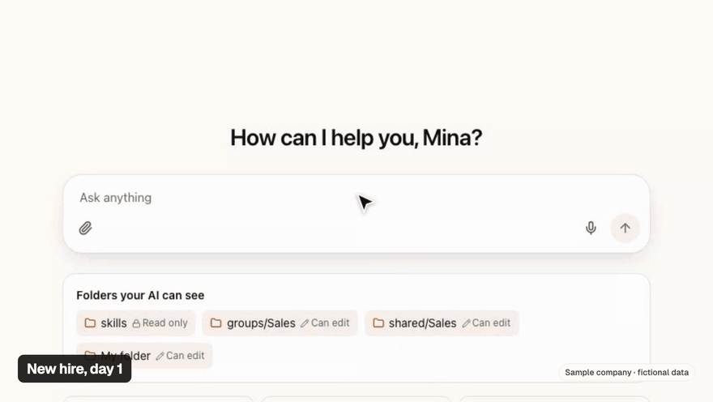
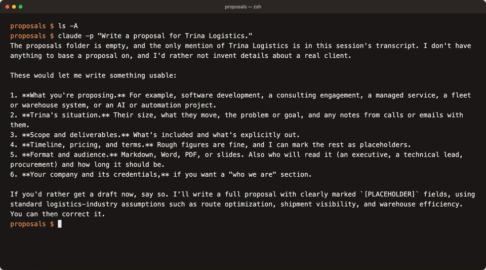
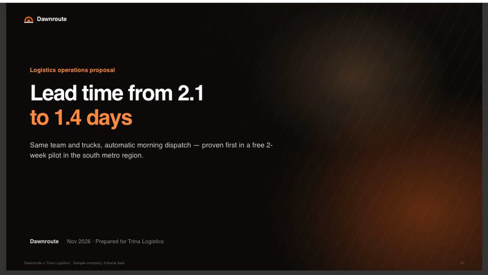
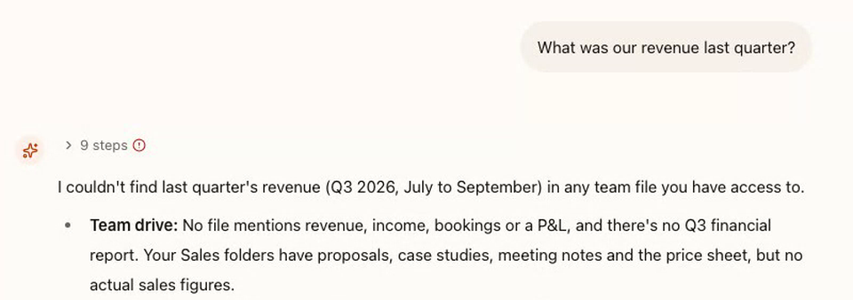
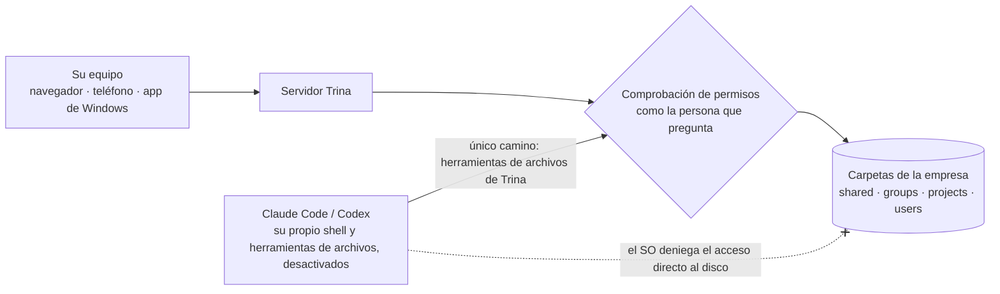

<div align="center">


# Trina AX

**Configure Claude Code una vez. Toda su empresa lo usa.**

Claude Code y Codex en un servidor de la empresa, con sus archivos, las skills del equipo y los permisos de carpeta de cada persona. Los demás solo abren el navegador.

[Sitio web](https://ax.trina.app) · [Pruébelo en 10 minutos](#pruébelo-en-10-minutos) · [Autoalojar](docs/for-admins.md) · [Documentación](docs/README.md)

[English](README.md) · [한국어](README.ko.md) · [日本語](README.ja.md) · Español



<sub><b>Primer día, una línea:</b> “Write a proposal for Trina Logistics.” La IA leyó los archivos de ventas del equipo, siguió la skill <code>proposal</code> del CEO y guardó una presentación de 7 páginas.<br>App real (en inglés), empresa ficticia. Tardó 81 segundos; el video está acelerado.</sub>

</div>

## La misma petición, dos respuestas

<table>
<tr>
<td width="50%" valign="top"><b>Claude Code en una carpeta vacía</b><br><sub>No puede conocer su empresa, así que primero hace seis preguntas.</sub></td>
<td width="50%" valign="top"><b>Trina AX, la misma línea</b><br><sub>Empieza con los archivos del equipo y la skill de propuestas del CEO.</sub></td>
</tr>
<tr>
<td></td>
<td></td>
</tr>
</table>

<sub>Resultados reales del 2026-10-31 con una empresa ficticia, Dawnroute. Claude Code hace bien en preguntar: en una carpeta vacía nada le dice quién es usted. Trina le da la carpeta.</sub>

## Cómo funciona

1. **Póngalo una vez.** Los archivos de la empresa van en `shared/`. Su forma de escribir propuestas va en `skills/proposal/SKILL.md`.
2. **Cualquiera pregunta.** En un chat en el navegador, en el ordenador o el teléfono. Sin terminal ni nada que instalar en su portátil.
3. **Cada persona conserva su acceso.** El servidor comprueba cada archivo que abre la IA como la persona que pregunta. Una carpeta que usted no ve tampoco existe para su IA.



<sub><b>La misma pregunta, otras personas.</b> Mina está en Ventas. El archivo de ingresos está en <code>shared/Finance</code>, que ella no puede abrir, así que su IA tampoco.</sub>

## Pruébelo en 10 minutos

```sh
git clone https://github.com/trina-app/trina-ax.git && cd trina-ax
bun install --frozen-lockfile
bun run demo        # → http://127.0.0.1:19760 · entre como alice / teamax-demo-1
```

Un equipo ficticio con seis skills iniciales. La IA está apagada, así que no necesita cuenta de IA. Entre como `bob` en una ventana privada: cada uno ve otra carpeta de grupo. Necesita Git, Bun 1.3.12 y Go 1.27+. **No es una instalación de producción.** [Guía](docs/QUICKSTART.md)

## Qué obtiene

| | En la práctica |
|---|---|
| **Agentes reales de Claude Code y Codex** | Funcionan en su servidor: hasta 150 rondas de herramientas por respuesta por defecto, hasta 4 subagentes a la vez, búsqueda web y tareas programadas. |
| **Las carpetas de la empresa son el conocimiento** | `shared/`, `groups/`, `projects/` y carpetas personales, con historial de versiones. Texto de PDF, Office y HWP/HWPX. |
| **Skills del equipo, gestionadas como archivos** | Una skill es un archivo `SKILL.md`. Las reglas de carpeta deciden quién la usa, y la IA pide confirmación a una persona antes de cambiarla. |
| **Permisos en cada llamada a archivos** | Lo que usted no puede abrir no aparece en Archivos, respuestas de la IA, búsqueda, vistas previas, historial de versiones ni papelera. |
| **Su conexión de IA** | Claude u OpenAI, por suscripción o clave de API, para una persona, un grupo o todo el equipo. Uso por persona, con límites. |
| **Autoalojado o gestionado** | Un servidor Linux, un Mac de oficina o el hosting de Trina en AWS Seúl. Navegador en ordenador y teléfono, y un instalador para Windows. |

## Por dentro



- **El agente es real.** Los subagentes trabajan como la misma persona, pasan las mismas comprobaciones y dejan los mismos registros de actividad.
- **La entrada es estrecha.** El shell y las herramientas de archivos propias del motor están desactivados, con pruebas de regresión para cada motor. Su camino a las carpetas son las herramientas de Trina, comprobadas en cada llamada.
- **Las claves quedan fuera de su alcance.** Los tokens se sellan en el navegador antes de enviarse. El motor recibe un token sustituto por turno y un proxy de modelos añade el real.
- **Los administradores no leen sus chats.** Ven qué archivos leyó la IA, no la conversación. Quien opera el servidor sí puede leer los datos guardados, y lo decimos [abajo](#datos-y-límites).

<sub>El aislamiento del SO (una cuenta dedicada al motor) existe en instalaciones Linux y Mac con cuentas por rol. El Mac de oficina funciona como el usuario con sesión iniciada y la demo local no tiene aislamiento del SO. → <a href="docs/security-and-permissions.md">Security and permissions</a> · <a href="docs/PERMISSIONS.md">Modelo de permisos (coreano)</a></sub>

## Su primera semana

Cree la cuenta de propietario y siga **permisos → conexión de IA → invitar al equipo → primera skill → primera copia de seguridad**. Estas skills iniciales usan datos ficticios:

| Rol | Una tarea real | Skill para copiar |
|---|---|---|
| CEO / líder de equipo | Convertir notas semanales en decisiones, riesgos y próximos pasos | [Weekly report](examples/skills/weekly-team-report/SKILL.md) |
| Ventas | Redactar un seguimiento de una reunión sin inventar promesas | [Sales follow-up](examples/skills/sales-follow-up/SKILL.md) |
| Marketing | Preparar un brief de campaña con notas de marca aprobadas | [Brand brief](examples/skills/brand-brief/SKILL.md) |
| Finanzas | Señalar recibos que faltan e importes dudosos | [Expense review](examples/skills/expense-review/SKILL.md) |
| RR. HH. | Responder dudas de incorporación con políticas permitidas | [New-hire guide](examples/skills/new-hire-guide/SKILL.md) |
| Todos | Extraer decisiones y tareas de un acta | [Meeting summary](examples/skills/meeting-summary/SKILL.md) |

Una skill es un conjunto de instrucciones reutilizables, no entrenamiento de modelos ni acceso adicional. Las personas revisan los resultados antes de usarlos. [Lista para líderes de equipo](docs/for-teams.md) · [Todos los ejemplos](examples/README.md)

## Cómo ejecutarlo

| | Hosting de Trina | Autoalojar en Linux | Mac de oficina | Demo local |
|---|---|---|---|---|
| Ideal para | Equipos sin TI | Equipos con responsable de TI | Una oficina pequeña con un Mac dedicado | Echar un vistazo |
| Quién lo opera | Trina, en AWS Seúl | Su TI | Su responsable de oficina | Usted |
| IA | Su conexión autorizada de Claude u OpenAI | Igual | Claude (sin Codex) | Apagada |
| Coste | Desde 39 USD/mes + uso de IA | Software gratis + su servidor | Software gratis | Gratis |
| Empezar | [Contactar](https://ax.trina.app/#contact) | [Guía Linux](docs/INSTALL-LINUX.en.md) | [Guía de oficina](docs/OFFICE.en.md) | [Inicio rápido](docs/QUICKSTART.md) |

Trina ofrece el espacio de trabajo, no la IA: conecte solo cuentas y planes de Claude y OpenAI autorizados para su uso. Planes gestionados, revisados el 2026-10-30, en USD antes de impuestos: **Starter 39 USD/mes (hasta 5 personas), Team 69 (15), Business 129 (40)**. El uso de IA va aparte. El hosting empieza con una consulta; no hay prueba gratuita inmediata. [Precios actuales](https://ax.trina.app/#pricing)

Autoalojar en Linux requiere Debian 12/13 o Ubuntu 24.04, systemd con cgroup v2, amd64 o arm64, 4 GB de RAM recomendados y 20 GB de disco como mínimo. Su equipo de TI instala, actualiza y restaura copias.

## Datos y límites

Autoalojar no significa trabajar sin conexión: el contexto que necesita una petición va al proveedor de IA que conecte. Quien opera el servidor, incluida Trina en el hosting, puede leer archivos y chats guardados; los administradores de la app no pueden abrir conversaciones privadas.

<details>
<summary><b>Qué sale del servidor, reglas de conexión y lo que no prometemos</b></summary>

<br>

- El contexto seleccionado va al proveedor de IA elegido, y las integraciones configuradas reciben sus peticiones. Cada búsqueda web de Codex envía la conversación hasta ese momento al servicio de búsqueda de OpenAI. El servidor pregunta a `updates.trina.app` su propia dirección pública cada 30 minutos (`MYCEL_EXIT_ADDRESS_CHECK=off` lo desactiva). [Detalles](docs/security-and-permissions.md)
- Quien opera el servidor puede leer archivos y chats guardados, incluidos los operadores de Trina en el hosting. Los administradores de la app no tienen una pantalla para leer conversaciones privadas.
- Quitar el acceso a una carpeta no borra respuestas anteriores. La confirmación para compartir más no es una prevención universal de fugas de datos.
- No prometemos certificaciones de seguridad, respuestas perfectas, ahorros garantizados ni decisiones legales, financieras o de RR. HH. automáticas. Revise los resultados y los límites del despliegue.
- La IA ve fotos y páginas de PDF escaneadas como imágenes (un administrador puede desactivarlo), pero los servidores Linux no hacen OCR: allí los documentos escaneados y las fotos no se pueden buscar como texto.
- La extracción de texto de HWP/HWPX está disponible. Las [vistas previas](resources/hwp/README.md) son el plugin opcional HWP Preview, que necesita macOS o Linux con glibc 2.39 o posterior, así que Debian 12 **no** las admite.
- En instalaciones gestionadas, primero se usan las conexiones personales elegibles, luego las asignadas a una persona, a un grupo y a todo el equipo. Los equipos nuevos de Trina permiten suscripciones compartidas por defecto; las opciones ya guardadas se mantienen. El consentimiento de cada conexión sigue aplicándose. **Este ajuste del software no concede permiso según los términos de Anthropic u OpenAI.** La demo local desactiva la IA; los modos de desarrollo y de inicio de sesión local de oficina conectan de otra forma. [Detalles de conexión](docs/FAQ.md)

</details>

## Preguntas frecuentes

<details>
<summary><b>¿En qué se diferencia de dar a cada persona un asiento de Claude?</b></summary>

<br>Un asiento da a cada persona su propio espacio vacío. Trina hace que todos empiecen desde las mismas carpetas de la empresa y skills del equipo en un servidor, y el servidor comprueba los permisos de carpeta de cada persona. También puede conectar cuentas por persona.

</details>

<details>
<summary><b>¿Necesitamos una cuenta de IA para probarlo?</b></summary>

<br>No. La [demo local](docs/QUICKSTART.md) funciona con la IA apagada y datos ficticios, así que puede ver primero archivos, skills y permisos.

</details>

<details>
<summary><b>¿Pueden los administradores leer nuestros chats?</b></summary>

<br>No. Cada chat lo ve solo su dueño. Los registros de actividad muestran qué archivos leyó la IA, no la conversación. Quien opera el servidor o su almacenamiento puede leer los datos guardados.

</details>

<details>
<summary><b>¿Funciona con archivos HWP coreanos?</b></summary>

<br>Para el texto, sí: la IA puede leer el texto de archivos HWP/HWPX. Las vistas previas necesitan el plugin opcional, que no funciona en Debian 12. Más en las [preguntas frecuentes](docs/FAQ.md).

</details>

## Comunidad y contribuciones

[Última versión y sumas de verificación](https://github.com/trina-app/trina-ax/releases/latest) · [Cambios](CHANGELOG.md) · [Soporte](SUPPORT.md) · [Contribuir](CONTRIBUTING.md) · [Informes de seguridad](SECURITY.md) · [Desarrollo](docs/DEVELOPMENT.md) · [Configuración](docs/CONFIGURATION.md) · [Índice legible por máquinas](llms.txt)

La app está en inglés, coreano, indonesio, japonés y español. Los instaladores publicados pueden ir por detrás del código; revise sus notas de versión.

## Licencia

Uso libre, también comercial, bajo [AGPL-3.0-only](LICENSE). Si ofrece una versión modificada por red, ofrezca su código fuente a esos usuarios. El protocolo de nube tiene una licencia MIT aparte ([licencia](shared/src/cloud-protocol/LICENSE)). [Avisos](NOTICE) · [Avisos de terceros](docs/THIRD-PARTY-NOTICES.md)

Claude Code y Codex tienen sus propios términos; este proyecto no está respaldado por Anthropic ni OpenAI. Claude es una marca comercial de Anthropic.
