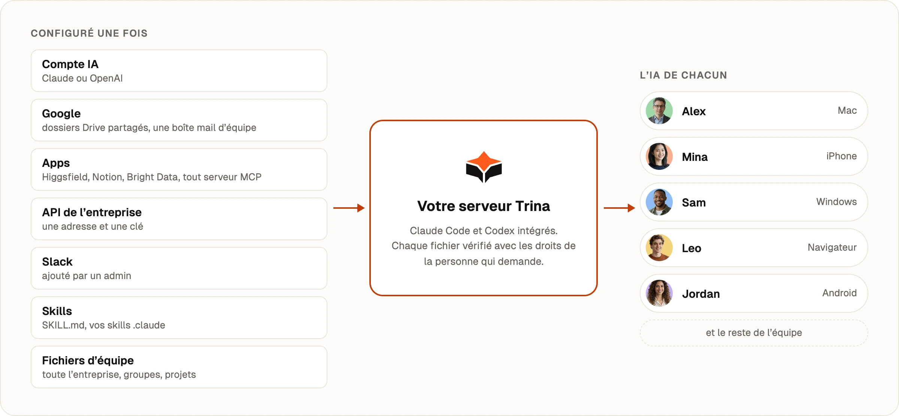

<div align="center">

<picture><source media="(prefers-color-scheme: dark)" srcset="editions/trina/branding/logo/mark-dark.svg"></picture>

<h1>Trina AX</h1>

<b>L'IA que toute votre équipe partage.</b><br>
Trina AX réunit les fichiers, les skills et les outils de votre équipe sur un seul serveur. L'IA de chacun part de cette base,<br>et chaque fichier qu'elle ouvre est vérifié avec les droits de la personne qui a demandé.

<a href="https://ax.trina.app/download"></a>&nbsp;&nbsp;<a href="https://ax.trina.app/download"></a>&nbsp;&nbsp;<a href="https://apps.apple.com/app/trina-ax/id6829192435"></a>&nbsp;&nbsp;<a href="https://play.google.com/store/apps/details?id=app.trina.ax"></a><br>
<sub>Linux : .deb et AppImage (x64, arm64) sur la <a href="https://ax.trina.app/download">page de téléchargement</a></sub>

[Site web](https://ax.trina.app) · [Documentation](docs/README.md) · [Tarifs](https://ax.trina.app/pricing) · [Discord](https://discord.gg/zUVfSR8MVk)

[English](README.md) · [한국어](README.ko.md) · [日本語](README.ja.md) · [Español](README.es.md) · [简体中文](README.zh-CN.md) · [繁體中文](README.zh-TW.md) · [Português](README.pt-BR.md) · Français · [Deutsch](README.de.md) · [Italiano](README.it.md) · [Русский](README.ru.md) · [Türkçe](README.tr.md) · [Tiếng Việt](README.vi.md) · [Bahasa Indonesia](README.id.md)

</div>

https://github.com/user-attachments/assets/82df4b34-d548-4c6c-b3e7-0618ab83a5c9

<p align="center"><sub>Ce que l'IA d'une nouvelle recrue sait faire dès le premier jour. L'histoire en 80 secondes.</sub><br>Open source (AGPL-3.0) · Auto-hébergement gratuit, sans limite d'utilisateurs<br><br><a href="https://github.com/trina-app/trina-ax?tab=readme-ov-file"></a><br><sub>Cliquez ensuite sur ☆ Star en haut de la page. Une étoile aide davantage d'équipes à découvrir Trina AX.</sub></p>

<br>

<picture><source media="(prefers-color-scheme: dark)" srcset="docs/images/readme/v4/divider-dark.png"></picture>

## Configurez une seule fois. Toute votre équipe en profite.

**Un seul compte IA pour toute l'équipe.** Connectez une clé API Claude ou OpenAI, ou un forfait dont les conditions le permettent : tout le monde s'en sert pour poser ses questions, avec des limites de tokens par personne, par groupe ou par équipe.

Une seule personne configure tout sur le serveur de l'équipe. L'IA de chacun en dispose dès sa première question, dans le navigateur ou dans les apps. Personne d'autre n'installe Claude Code ni ne copie de skills ; tout au plus, chacun se connecte à ses propres comptes.

<picture><source media="(prefers-color-scheme: dark)" srcset="docs/images/readme/v4/set-up-once-fr-dark.webp"></picture>

| Configuré une fois | Ce que chacun obtient |
| --- | --- |
| **Compte IA.** Le propriétaire ou un admin connecte une clé API Claude ou OpenAI, ou un forfait dont les conditions le permettent. | Des réponses pour toute l'équipe, avec des limites de tokens par personne, par groupe ou par équipe. |
| **Google.** Partagez des dossiers Drive avec l'équipe, ou connectez un compte d'équipe (une boîte mail ou un agenda partagés) pour Gmail, Calendar, Docs et Sheets. | Les personnes que vous choisissez s'en servent dans leurs chats. Chacun peut aussi connecter son propre compte Google. |
| **Apps.** Higgsfield, Notion, Linear, Figma et d'autres depuis la liste des apps, ou n'importe quel serveur MCP via son adresse, comme Bright Data. | Les outils de l'app dans les chats de chacun : une connexion pour toute l'équipe, ou chacun se connecte avec son propre compte. |
| **L'API de votre entreprise.** Une adresse, une clé et quelques notes. | L'IA appelle votre propre système, uniquement sous cette adresse. |
| **Slack.** Le propriétaire ou un admin l'ajoute une fois. | Posez vos questions à Trina en message direct ou dans tout canal où elle est invitée, avec vos propres accès. |
| **Skills.** Écrivez un `SKILL.md`, ou importez les skills de votre dossier `.claude` ou `.codex`. | L'IA de chacun suit les mêmes étapes. Tapez `/` pour les utiliser. |
| **Fichiers d'équipe.** Un seul drive : toute l'entreprise, groupes, projets, skills d'équipe et dossiers personnels. | L'IA de chacun part des fichiers de l'équipe, et n'ouvre que ce que cette personne peut ouvrir. |

<table>
<tr>
<td colspan="2"><br><sub>Admin › Apps connectées : configurées une fois pour toute l'équipe</sub></td>
</tr>
<tr>
<td width="50%"><br><sub>Un seul drive d'équipe</sub></td>
<td width="50%"><br><sub>Les skills d'équipe, ou importez les vôtres</sub></td>
</tr>
</table>

<br>

<picture><source media="(prefers-color-scheme: dark)" srcset="docs/images/readme/v4/divider-dark.png"></picture>

## Ce que chacun en fait

**Demandez en marge de n'importe quelle conversation, envoyez en un clic.** Un chat latéral visible uniquement par vous ; un clic envoie la réponse de Trina dans la conversation.


**L'IA de chacun ne voit que ce qu'il peut ouvrir.** Mina ne peut pas ouvrir Finance, son IA non plus. [Comment fonctionnent les permissions](docs/PERMISSIONS.md)


**Reprenez la session IA d'un collègue dans un projet d'équipe.** Les sessions d'un projet d'équipe sont partagées avec ses membres : ouvrez celle d'un collègue et continuez, avec vos propres accès. Toute autre session peut être partagée avec des personnes ou des groupes, comme un fichier dans Google Drive.


**Des fichiers retrouvés d'après ce qu'ils sont.** Chaque nuit, l'IA de l'équipe lit les fichiers nouveaux et modifiés des dossiers partagés, de groupe et de projet, et garde une ligne par fichier qui dit ce qu'il est : un scan nommé `temp.pdf` ou une photo nommée `IMG_2031.jpg` se retrouve ainsi par son contenu. Elle utilise le compte IA de l'équipe et ne lit jamais les dossiers personnels. Lors d'un test sur 2 238 fichiers fictifs, Claude Code a trouvé le bon fichier pour 181 questions sur 184 avec ces lignes, et pour 172 sans elles.

<table>
<tr>
<td width="50%"><b>Tâches planifiées.</b> Demandez une fois ; Trina le refait à la fréquence que vous choisissez, dans le fuseau horaire de votre équipe.<br><br></td>
<td width="50%"><b>Invités.</b> Invitez des personnes extérieures à l'entreprise dans une conversation de groupe ou un projet, et choisissez si elles peuvent utiliser l'IA.<br><br></td>
</tr>
<tr>
<td width="50%"><b>Utilisation et limites.</b> Réponses, tokens et coût estimé par personne ; limites de tokens par personne, par groupe ou par équipe.<br><br></td>
<td width="50%"><b>Cherchez partout.</b> ⌘K dans les chats, l'historique, les projets, les fichiers, les skills et les tâches planifiées.<br><br></td>
</tr>
<tr>
<td colspan="2"><b>Un chat d'équipe comme Slack, mais avec Trina AI.</b> Des canaux pour tous et pour chaque groupe, des canaux privés, des messages directs, des conversations de groupe, des fils et des @mentions, sur le web, sur ordinateur et sur mobile. Interrogez Trina à côté de chacun d'eux, dans un chat latéral visible uniquement par vous.<br><br></td>
</tr>
</table>

- **Chaque modification est conservée.** Faite par une personne ou par son IA ; restaurez n'importe quelle version.
- **Navigateur intégré.** Dans l'app de bureau, Trina ouvre des sites web dans un panneau à côté de votre chat, les lit, clique et remplit des formulaires sous vos yeux ; Stop l'arrête. Elle demande avant d'ouvrir un nouveau site, sauf si vous autorisez tous les sites.
- **Les apps publient dans les conversations.** Les mises à jour de Sentry, GitHub, Stripe, Jira et HubSpot arrivent sous forme de cartes.
- **Retrouvez vos fichiers de travail.** L'app de bureau trouve les fichiers de travail récents sur votre ordinateur et ajoute ceux que vous choisissez.
- **Documents.** Lit le texte des documents Hangul (HWP/HWPX) ; affiche un aperçu des PDF et des PowerPoint.
- **Tous les appareils.** Mac, Windows, Linux, iPhone, Android et n'importe quel navigateur, en six langues.

<br>

<picture><source media="(prefers-color-scheme: dark)" srcset="docs/images/readme/v4/divider-dark.png"></picture>

## Démarrer

- **Essayez-le dans votre navigateur :** rien à installer ; une équipe fictive, IA désactivée. [Ouvrir la démo](https://ax.trina.app/demo/)
- **Hébergement par Trina :** aucun serveur à gérer. Essai gratuit de 14 jours, puis un abonnement mensuel. [Tarifs](https://ax.trina.app/pricing)
- **Apps :** [Mac, Windows, Linux, iPhone, Android](https://ax.trina.app/download), ou n'importe quel navigateur.
- **Auto-hébergement :** votre propre serveur Linux, Docker ou un Mac du bureau. Gratuit. [Linux](docs/INSTALL-LINUX.en.md) · [Docker](docs/INSTALL-DOCKER.md) · [Mac du bureau](docs/OFFICE.en.md) · [Installer avec votre agent IA](docs/INSTALL-LINUX.en.md#install-with-your-ai-agent)

<b>Auto-hébergement avec Docker</b> (Linux, ou un Mac avec OrbStack)

```sh
git clone https://github.com/trina-app/trina-ax.git && cd trina-ax/docker
cp env.example .env && docker compose up -d --build
docker compose exec trina-ax trina-ax-setup-link   # ouvrez le lien et créez le compte propriétaire
```

Plus récent et moins éprouvé que l'installation Linux ; un serveur Ubuntu 24.04 demande d'abord un réglage sur l'hôte. [Guide Docker](docs/INSTALL-DOCKER.md)

<b>Essayez-le sur votre ordinateur en 10 minutes</b> (équipe fictive, IA désactivée)

```sh
git clone https://github.com/trina-app/trina-ax.git && cd trina-ax
bun install --frozen-lockfile && bun run demo   # → http://127.0.0.1:19760 · alice / teamax-demo-1
```

Nécessite Bun 1.3.12 et Go 1.27+. Ce n'est pas une installation de production. [Guide pas à pas](docs/QUICKSTART.md)

<br>

<picture><source media="(prefers-color-scheme: dark)" srcset="docs/images/readme/v4/divider-dark.png"></picture>

## Comment ça marche

Un serveur fait tourner Claude Code et Codex comme moteur. Chaque demande de fichier, qu'elle vienne d'une personne ou de son IA, passe par une seule vérification des droits sur le serveur. Sur un serveur Linux, le moteur s'exécute sous son propre compte dans une sandbox bubblewrap, Landlock et seccomp, avec son shell et ses outils de fichiers intégrés désactivés : il n'accède aux fichiers que par les outils de Trina. [Sécurité et permissions](docs/security-and-permissions.md)

Trina fournit l'espace de travail, pas l'IA : connectez des comptes et des forfaits Claude ou OpenAI dont l'usage vous est autorisé. L'utilisation de l'IA est facturée sur le compte que vous connectez.

<details>
<summary><b>Données, limites et ce que nous ne promettons pas</b></summary>

### Ce que nous ne promettons pas

- Auto-héberger ne veut pas dire hors ligne : le contexte dont une requête a besoin part chez le fournisseur d'IA que vous connectez, et les intégrations configurées reçoivent leurs requêtes. Chaque recherche web de Codex envoie l'historique de la conversation au service de recherche d'OpenAI. Si un admin autorise OpenRouter pour la reconnaissance vocale, le son des fichiers vidéo et audio part chez OpenRouter. Toutes les 30 minutes, le serveur demande sa propre adresse publique à `updates.trina.app` (`MYCEL_EXIT_ADDRESS_CHECK=off` le désactive). [Détails](docs/security-and-permissions.md)
- Les opérateurs du serveur peuvent lire les fichiers et les chats stockés ; avec l'hébergement par Trina, cela inclut les opérateurs de Trina. Les admins de l'app n'ont pas d'outil pour parcourir les conversations privées de chacun.
- Retirer l'accès à un dossier n'efface pas les réponses précédentes. La vérification avant un partage plus large n'est pas une solution universelle de prévention des pertes de données.
- Pas de certification de sécurité, de réponses parfaites, d'économies garanties ni de décisions juridiques, financières ou RH automatiques. Vérifiez les résultats et les limites de votre déploiement.
- Les serveurs Linux ne font pas d'OCR : l'IA voit les photos et les pages scannées comme des images, mais on ne peut pas y rechercher de texte. Les Mac du bureau ne traitent pas encore les vidéos.
- La lecture du texte HWP/HWPX fonctionne pour toutes les équipes ; les [aperçus et la création de documents Hangul](resources/hwp/README.md) nécessitent le plugin optionnel HWP Preview (macOS, ou Linux avec glibc 2.39+ ; pas Debian 12).
- Connexions : la connexion éligible propre à la personne passe en premier, puis celle qui lui est attribuée, puis celle d'un groupe, puis celle de toute l'équipe. Dans les nouvelles équipes Trina, une connexion de l'entreprise peut servir toute l'équipe par défaut ; les choix déjà enregistrés sont conservés. **Ce réglage du logiciel n'accorde aucune autorisation au regard des conditions d'Anthropic ou d'OpenAI.** [Détails des connexions](docs/FAQ.md)
- L'auto-hébergement sous Linux nécessite Debian 12/13 ou Ubuntu 24.04, systemd avec cgroup v2, amd64 ou arm64, 4 Go de RAM et 20 Go de disque. Votre équipe informatique se charge de l'installation, des mises à jour et de la restauration des sauvegardes.

</details>

<br>

<picture><source media="(prefers-color-scheme: dark)" srcset="docs/images/readme/v4/divider-dark.png"></picture>

## Communauté

Si Trina AX est utile à votre équipe, une ⭐ sur GitHub aide d'autres équipes à le découvrir.

[Discord](https://discord.gg/zUVfSR8MVk) · [X](https://x.com/trina_ax) · [Versions](https://github.com/trina-app/trina-ax/releases/latest) · [Changements](CHANGELOG.md) · [Support](SUPPORT.md) · [Contribuer](CONTRIBUTING.md) · [Sécurité](SECURITY.md) · [Développement](docs/DEVELOPMENT.md) · [Configuration](docs/CONFIGURATION.md) · [llms.txt](llms.txt)

L'app est disponible en anglais, coréen, indonésien, japonais, espagnol et chinois simplifié. L'entreprise et les personnes de toutes les images sont fictives.

<br>

<picture><source media="(prefers-color-scheme: dark)" srcset="docs/images/readme/v4/divider-dark.png"></picture>

## Licence

Libre d'utilisation, y compris commerciale, sous [AGPL-3.0-only](LICENSE). Si vous proposez une version modifiée sur un réseau, mettez son code source à la disposition de ses utilisateurs. Le protocole cloud est sous licence MIT ([licence](shared/src/cloud-protocol/LICENSE)). [Mentions](NOTICE) · [Mentions tierces](docs/THIRD-PARTY-NOTICES.md)

Claude Code et Codex ont leurs propres conditions ; ce projet n'est approuvé ni par Anthropic ni par OpenAI. Claude est une marque d'Anthropic.
