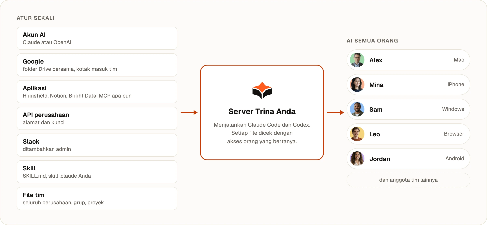
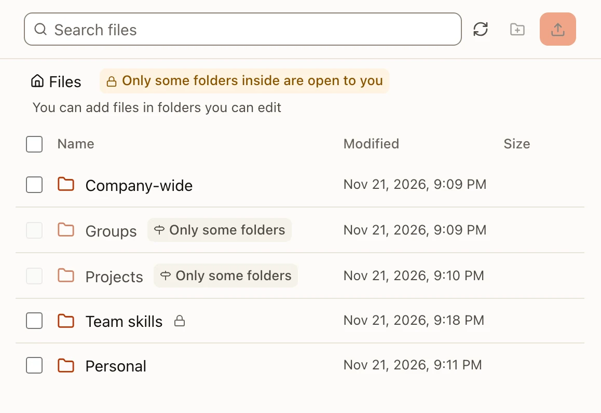
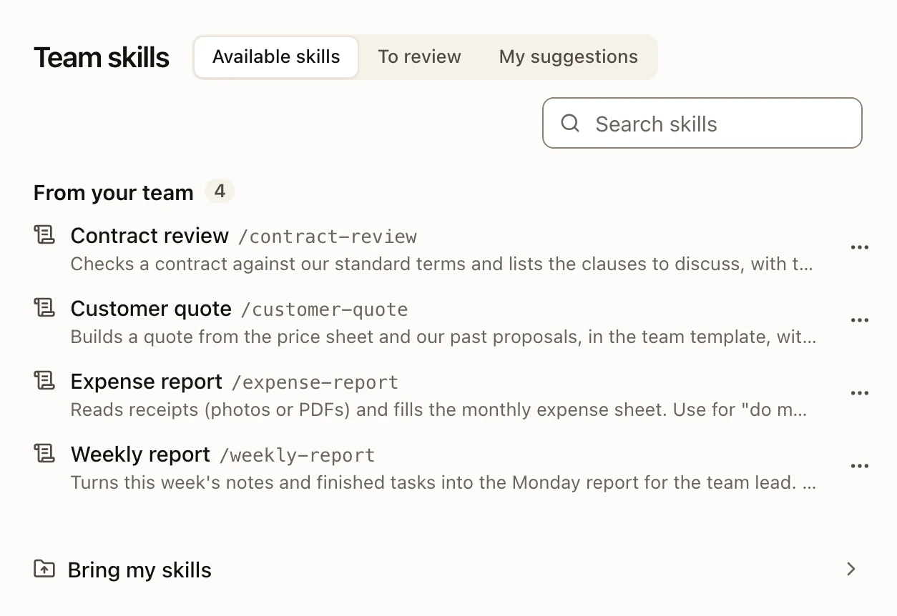
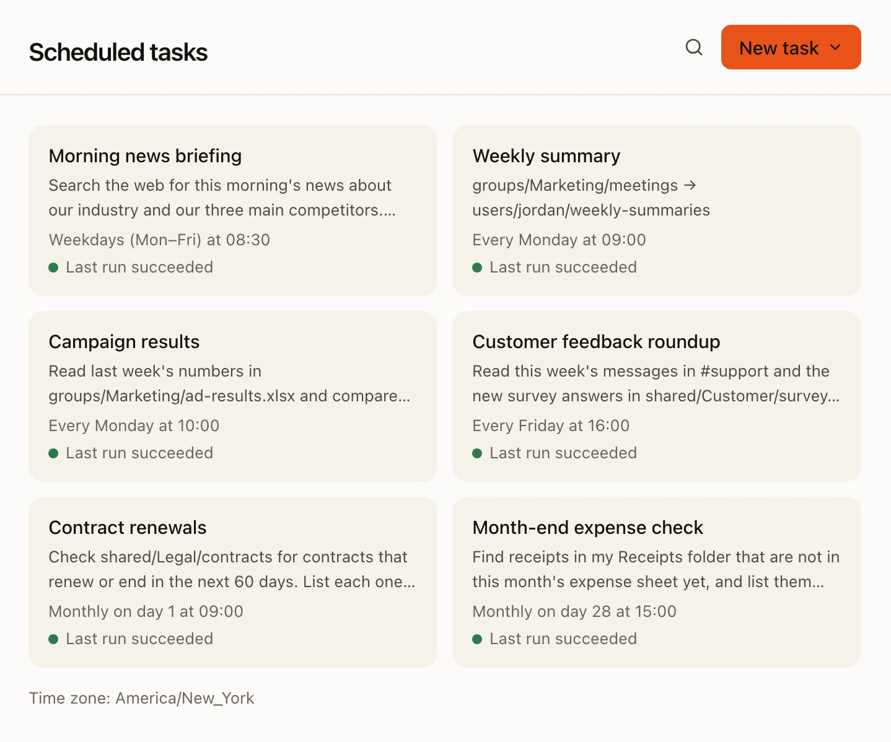
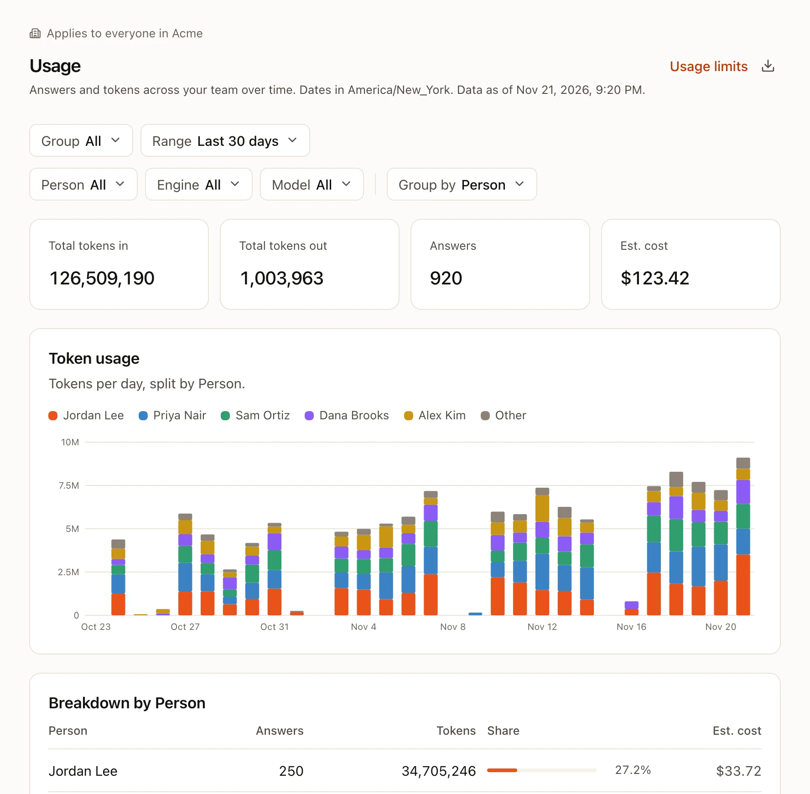

<div align="center">

<picture><source media="(prefers-color-scheme: dark)" srcset="editions/trina/branding/logo/mark-dark.svg"></picture>

<h1>Trina AX</h1>

<b>AI yang dipakai seluruh tim Anda.</b><br>
Trina AX menyatukan file, skill, dan alat tim Anda di satu server. AI setiap orang mulai dari situ.<br>Lanjutkan sesi AI rekan kerja dari titik terakhirnya. Setiap file yang dibuka AI dicek dengan akses orang yang bertanya.

<a href="https://ax.trina.app/download"></a>&nbsp;&nbsp;<a href="https://ax.trina.app/download"></a>&nbsp;&nbsp;<a href="https://apps.apple.com/app/trina-ax/id6829192435"></a>&nbsp;&nbsp;<a href="https://play.google.com/store/apps/details?id=app.trina.ax"></a><br>
<sub>Linux: .deb dan AppImage (x64, arm64) di <a href="https://ax.trina.app/download">halaman unduhan</a></sub>

[Situs web](https://ax.trina.app/id/) · [Dokumentasi](docs/README.md) · [Harga](https://ax.trina.app/pricing) · [Discord](https://discord.gg/zUVfSR8MVk)

[English](README.md) · [한국어](README.ko.md) · [日本語](README.ja.md) · [Español](README.es.md) · [简体中文](README.zh-CN.md) · Bahasa Indonesia

</div>

https://github.com/user-attachments/assets/b1837bf4-0ea6-442c-8404-a72e9962057b

<p align="center"><sub>80 detik: apa yang bisa dilakukan AI karyawan baru di hari pertama.</sub><br>Open source (AGPL-3.0) · Pasang sendiri gratis, tanpa batas jumlah pengguna<br><br><a href="https://github.com/trina-app/trina-ax?tab=readme-ov-file"></a><br><sub>Lalu tekan ☆ Star di bagian atas halaman. Bintang dari Anda membantu lebih banyak tim menemukan Trina AX.</sub></p>

<br>

<picture><source media="(prefers-color-scheme: dark)" srcset="docs/images/readme/v4/divider-dark.png"></picture>

## Atur sekali, dipakai seluruh tim Anda.

**Satu akun AI untuk seluruh tim.** Hubungkan satu kunci API Claude atau OpenAI, atau paket yang ketentuannya mengizinkan. Semua orang bertanya lewat akun itu, dengan batas token per orang, grup, atau tim.

Satu orang mengatur semuanya di server tim. AI setiap orang sudah bisa memakainya sejak pertanyaan pertama, di browser atau di aplikasi. Orang lain tidak perlu memasang Claude Code atau menyalin skill. Paling-paling, mereka hanya perlu masuk ke akun masing-masing.

<picture><source media="(prefers-color-scheme: dark)" srcset="docs/images/readme/v4/set-up-once-id-dark.webp"></picture>

| Atur sekali | Yang didapat semua orang |
| --- | --- |
| **Akun AI.** Owner atau admin menghubungkan kunci API Claude atau OpenAI, atau paket yang ketentuannya mengizinkan. | Jawaban untuk seluruh tim, dengan batas token per orang, grup, atau tim. |
| **Google.** Bagikan folder Drive ke tim, atau hubungkan satu akun tim (kotak masuk atau kalender bersama) untuk Gmail, Calendar, Docs, dan Sheets. | Orang yang Anda pilih memakainya di chat mereka. Siapa pun tetap bisa menghubungkan akun Google-nya sendiri. |
| **Aplikasi.** Higgsfield, Notion, Linear, Figma, dan lainnya dari daftar aplikasi, atau server MCP apa pun lewat alamatnya, seperti Bright Data. | Alat dari aplikasi itu ada di chat semua orang: satu login untuk tim, atau setiap orang masuk dengan akunnya sendiri. |
| **API perusahaan Anda.** Alamat, kunci, dan beberapa catatan. | AI memanggil sistem Anda sendiri, hanya di bawah alamat itu. |
| **Slack.** Owner atau admin menambahkannya sekali. | Tanya Trina lewat pesan langsung atau di kanal mana pun tempat Trina diundang, dengan akses Anda sendiri. |
| **Skill.** Tulis `SKILL.md`, atau bawa skill dari folder `.claude` atau `.codex` Anda. | AI semua orang mengikuti langkah yang sama. Ketik `/` untuk memakai salah satunya. |
| **File tim.** Satu drive: seluruh perusahaan, grup, proyek, skill tim, dan folder pribadi. | AI setiap orang mulai dari file tim, dan hanya membuka apa yang boleh dibuka orang itu. |

<table>
<tr>
<td colspan="2"><br><sub>Admin › Aplikasi terhubung: atur sekali untuk semua orang di tim</sub></td>
</tr>
<tr>
<td width="50%"><br><sub>Satu drive tim</sub></td>
<td width="50%"><br><sub>Skill tim, atau bawa skill Anda sendiri</sub></td>
</tr>
</table>

<br>

<picture><source media="(prefers-color-scheme: dark)" srcset="docs/images/readme/v4/divider-dark.png"></picture>

## Cara semua orang memakainya

**Lanjutkan pekerjaan rekan dari titik terakhirnya.** Buka sesi AI rekan kerja di proyek tim, lalu lanjutkan. Seluruh percakapan dan semua jawaban sejauh ini tetap terlihat. AI menjawab setiap pertanyaan baru dengan akses orang yang bertanya. Bagikan sesi lain ke orang atau grup, seperti file di Google Drive.


**Tanya di samping ruang mana pun, kirim dengan satu klik.** Chat samping yang hanya Anda lihat. Cukup satu klik untuk mengirim jawaban Trina ke ruang itu.


**AI setiap orang hanya melihat apa yang boleh dibuka orang itu.** Mina tidak bisa membuka Finance, jadi AI-nya juga tidak bisa. [Cara kerja izin](docs/PERMISSIONS.md)


**File ditemukan dari isinya.** Setiap malam, AI tim membaca file baru dan yang berubah di folder bersama, grup, dan proyek, lalu menulis keterangan satu baris untuk setiap file. Jadi, hasil pindai bernama `temp.pdf` atau foto bernama `IMG_2031.jpg` tetap ditemukan dari isinya. Fitur ini memakai akun AI tim dan tidak pernah membaca folder pribadi. Dalam pengujian dengan 2.238 file fiktif, Claude Code menemukan file yang tepat untuk 181 dari 184 pertanyaan dengan keterangan ini, dan 172 tanpa keterangan.

<table>
<tr>
<td width="50%"><b>Tugas terjadwal.</b> Minta sekali, lalu Trina mengulanginya sesuai jadwal Anda, di zona waktu tim.<br><br></td>
<td width="50%"><b>Tamu.</b> Undang orang dari luar perusahaan ke obrolan grup atau proyek, dan tentukan apakah mereka boleh memakai AI.<br><br></td>
</tr>
<tr>
<td width="50%"><b>Pemakaian dan batas.</b> Jawaban, token, dan perkiraan biaya per orang. Batas token per orang, grup, atau tim.<br><br></td>
<td width="50%"><b>Cari apa saja.</b> ⌘K di seluruh chat, riwayat, proyek, file, skill, dan tugas terjadwal.<br><br></td>
</tr>
<tr>
<td colspan="2"><b>Chat tim seperti Slack, tetapi dengan Trina AI.</b> Saluran untuk semua orang dan untuk setiap grup, saluran privat, pesan langsung, obrolan grup, utas, dan @mention, di web, desktop, dan ponsel. Tanya Trina di samping obrolan mana pun, di chat samping yang hanya Anda lihat.<br><br></td>
</tr>
</table>

- **Setiap perubahan tersimpan.** Dari orang maupun AI-nya, dan versi mana pun bisa dikembalikan.
- **Browser di dalam aplikasi.** Di aplikasi desktop, Trina membuka situs web di panel samping chat Anda, membacanya, mengeklik, dan mengisi formulir sambil Anda melihat. Tekan Stop untuk menghentikannya. Trina bertanya dulu sebelum membuka situs baru, kecuali Anda mengizinkan semua situs web.
- **Aplikasi mengirim kabar ke ruang.** Pembaruan dari Sentry, GitHub, Stripe, Jira, dan HubSpot masuk sebagai kartu.
- **Temukan file kerja.** Aplikasi desktop menemukan file kerja terbaru di komputer, lalu menambahkan yang Anda pilih.
- **Dokumen.** Membaca teks Hangul (HWP/HWPX) dan menampilkan pratinjau PDF serta PowerPoint.
- **Semua perangkat.** Mac, Windows, Linux, iPhone, Android, dan browser apa pun, dalam enam bahasa.

<br>

<picture><source media="(prefers-color-scheme: dark)" srcset="docs/images/readme/v4/divider-dark.png"></picture>

## Mulai

- **Coba di browser Anda:** tanpa memasang apa pun. Tim fiktif, AI nonaktif. [Buka demo](https://ax.trina.app/demo/)
- **Hosting Trina:** Anda tidak perlu menjalankan server. Uji coba gratis 14 hari, lalu paket bulanan. [Harga](https://ax.trina.app/pricing)
- **Aplikasi:** [Mac, Windows, Linux, iPhone, Android](https://ax.trina.app/download), atau browser apa pun.
- **Pasang sendiri:** di server Linux Anda sendiri, Docker, atau Mac kantor. Gratis. [Linux](docs/INSTALL-LINUX.en.md) · [Docker](docs/INSTALL-DOCKER.md) · [Mac kantor](docs/OFFICE.en.md) · [Pasang dengan agen AI Anda](docs/INSTALL-LINUX.en.md#install-with-your-ai-agent)

<b>Pasang sendiri dengan Docker</b> (Linux, atau Mac dengan OrbStack)

```sh
git clone https://github.com/trina-app/trina-ax.git && cd trina-ax/docker
cp env.example .env && docker compose up -d --build
docker compose exec trina-ax trina-ax-setup-link   # buka tautannya, lalu buat akun owner
```

Lebih baru dan belum diuji sebanyak pemasangan Linux. Server Ubuntu 24.04 perlu satu pengaturan host lebih dulu. [Panduan Docker](docs/INSTALL-DOCKER.md)

<b>Coba di komputer Anda dalam 10 menit</b> (tim fiktif, AI nonaktif)

```sh
git clone https://github.com/trina-app/trina-ax.git && cd trina-ax
bun install --frozen-lockfile && bun run demo   # → http://127.0.0.1:19760 · alice / teamax-demo-1
```

Perlu Bun 1.3.12 dan Go 1.27+. Bukan untuk produksi. [Panduan langkah demi langkah](docs/QUICKSTART.md)

<br>

<picture><source media="(prefers-color-scheme: dark)" srcset="docs/images/readme/v4/divider-dark.png"></picture>

## Cara kerjanya

Satu server menjalankan Claude Code dan Codex sebagai mesinnya. Setiap permintaan file, dari orang atau AI-nya, melewati satu pengecekan izin di server. Di server Linux, mesin berjalan dengan akunnya sendiri di dalam sandbox bubblewrap, Landlock, dan seccomp, dengan shell dan alat file bawaannya dimatikan. Mesin hanya bisa menjangkau file lewat alat Trina. [Keamanan dan izin](docs/security-and-permissions.md)

Trina menyediakan ruang kerjanya, bukan AI-nya. Hubungkan akun dan paket Claude atau OpenAI yang memang diizinkan untuk Anda pakai. Pemakaian AI ditagih lewat akun yang Anda hubungkan.

<details>
<summary><b>Data, batasan, dan yang tidak kami janjikan</b></summary>

### Yang tidak kami janjikan

- Memasang sendiri tidak berarti offline: konteks yang dibutuhkan setiap permintaan dikirim ke penyedia AI yang Anda hubungkan, dan integrasi yang sudah diatur menerima permintaan yang ditujukan kepadanya. Setiap pencarian web Codex mengirim percakapan sejauh ini ke layanan pencarian OpenAI. Jika admin mengizinkan OpenRouter untuk suara, suara dari file video dan audio dikirim ke OpenRouter. Server menanyakan alamat publiknya sendiri ke `updates.trina.app` setiap 30 menit (`MYCEL_EXIT_ADDRESS_CHECK=off` mematikannya). [Detail](docs/security-and-permissions.md)
- Pengelola server bisa membaca file dan chat yang tersimpan, termasuk pengelola Trina untuk hosting. Admin aplikasi tidak mendapat alat untuk menelusuri percakapan pribadi semua orang.
- Mencabut akses folder tidak menghapus jawaban sebelumnya. Pengecekan saat membagikan ke lebih banyak orang bukan DLP (pencegahan kebocoran data) yang menyeluruh.
- Tidak ada sertifikasi keamanan, jawaban sempurna, jaminan penghematan, atau keputusan hukum, keuangan, atau SDM yang otomatis. Tinjau hasilnya dan batas penerapan Anda.
- Server Linux tidak menjalankan OCR: AI melihat foto dan halaman hasil pindai sebagai gambar, tetapi teksnya tidak bisa dicari. Mac kantor belum bisa membaca video.
- Teks HWP/HWPX berfungsi untuk setiap tim; [pratinjau dan pembuatan dokumen Hangul](resources/hwp/README.md) memerlukan plugin opsional HWP Preview (macOS, atau Linux dengan glibc 2.39+; bukan Debian 12).
- Koneksi: koneksi pribadi orang itu yang memenuhi syarat dipakai lebih dulu, lalu koneksi yang ditetapkan untuk orang itu, untuk grup, lalu untuk seluruh tim. Di tim Trina yang baru, satu koneksi perusahaan bisa melayani seluruh tim secara default; pilihan yang sudah tersimpan tetap berlaku. **Pengaturan perangkat lunak ini tidak memberi izin menurut ketentuan Anthropic atau OpenAI.** [Detail koneksi](docs/FAQ.md)
- Memasang sendiri di Linux memerlukan Debian 12/13 atau Ubuntu 24.04, systemd dengan cgroup v2, amd64 atau arm64, RAM 4 GB, dan disk 20 GB. Tim IT Anda yang memasang, memperbarui, dan memulihkan cadangan.

</details>

<br>

<picture><source media="(prefers-color-scheme: dark)" srcset="docs/images/readme/v4/divider-dark.png"></picture>

## Komunitas

Kalau Trina AX membantu tim Anda, beri ⭐ di GitHub agar tim lain juga bisa menemukannya.

[Discord](https://discord.gg/zUVfSR8MVk) · [X](https://x.com/trina_ax) · [Rilis](https://github.com/trina-app/trina-ax/releases/latest) · [Perubahan](CHANGELOG.md) · [Dukungan](SUPPORT.md) · [Kontribusi](CONTRIBUTING.md) · [Keamanan](SECURITY.md) · [Pengembangan](docs/DEVELOPMENT.md) · [Konfigurasi](docs/CONFIGURATION.md) · [llms.txt](llms.txt)

Aplikasinya tersedia dalam bahasa Inggris, Korea, Indonesia, Jepang, Spanyol, dan Tionghoa Sederhana. Perusahaan dan orang di semua gambar ini fiktif.

<br>

<picture><source media="(prefers-color-scheme: dark)" srcset="docs/images/readme/v4/divider-dark.png"></picture>

## Lisensi

Gratis dipakai, termasuk untuk keperluan komersial, di bawah [AGPL-3.0-only](LICENSE). Jika Anda menawarkan versi yang dimodifikasi lewat jaringan, sediakan kode sumbernya untuk para pengguna itu. Protokol cloud berlisensi MIT ([lisensi](shared/src/cloud-protocol/LICENSE)). [Pemberitahuan](NOTICE) · [Pemberitahuan pihak ketiga](docs/THIRD-PARTY-NOTICES.md)

Claude Code dan Codex punya ketentuannya sendiri. Proyek ini tidak didukung secara resmi oleh Anthropic atau OpenAI. Claude adalah merek dagang Anthropic.
