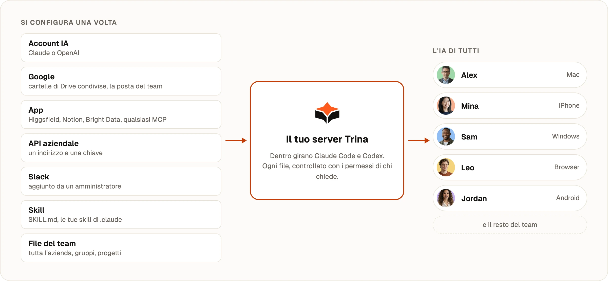
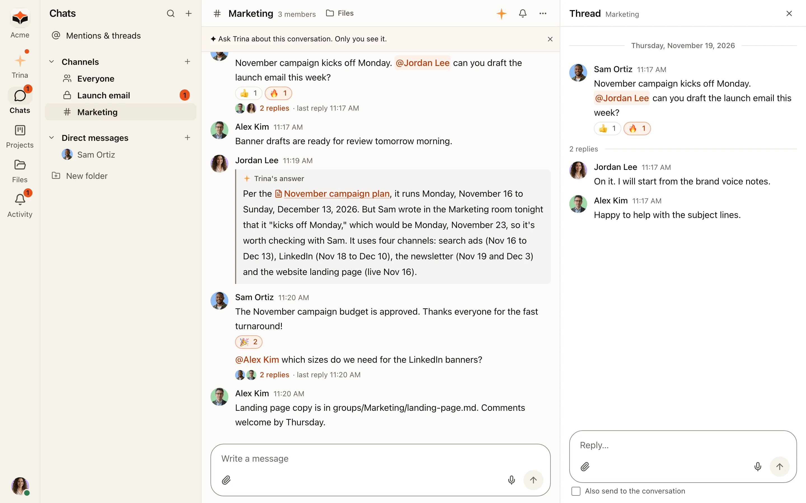

<div align="center">

<picture><source media="(prefers-color-scheme: dark)" srcset="editions/trina/branding/logo/mark-dark.svg"></picture>

<h1>Trina AX</h1>

<b>L'IA condivisa da tutto il tuo team.</b><br>
Trina AX riunisce i file, le skill e gli strumenti del tuo team su un unico server. L'IA di ognuno parte da lì,<br>e ogni file che apre viene controllato con i permessi di chi ha chiesto.

<a href="https://ax.trina.app/download"></a>&nbsp;&nbsp;<a href="https://ax.trina.app/download"></a>&nbsp;&nbsp;<a href="https://apps.apple.com/app/trina-ax/id6829192435"></a>&nbsp;&nbsp;<a href="https://play.google.com/store/apps/details?id=app.trina.ax"></a><br>
<sub>Linux: .deb e AppImage (x64, arm64) nella <a href="https://ax.trina.app/download">pagina di download</a></sub>

[Sito web](https://ax.trina.app) · [Documentazione](docs/README.md) · [Prezzi](https://ax.trina.app/pricing) · [Discord](https://discord.gg/zUVfSR8MVk)

[English](README.md) · [한국어](README.ko.md) · [日本語](README.ja.md) · [Español](README.es.md) · [简体中文](README.zh-CN.md) · [繁體中文](README.zh-TW.md) · [Português](README.pt-BR.md) · [Français](README.fr.md) · [Deutsch](README.de.md) · Italiano · [Русский](README.ru.md) · [Türkçe](README.tr.md) · [Tiếng Việt](README.vi.md) · [Bahasa Indonesia](README.id.md)

</div>

https://github.com/user-attachments/assets/d5e92b68-a846-4e23-b0c4-1cd6b16407b7

<p align="center"><sub>Cosa può fare l'IA di un neoassunto il primo giorno. La storia in 80 secondi.</sub><br>Open source (AGPL-3.0) · Self-hosting gratuito, senza limiti di utenti<br><br><a href="https://github.com/trina-app/trina-ax?tab=readme-ov-file"></a><br><sub>Poi premi ☆ Star in cima alla pagina. Una stella aiuta più team a trovare Trina AX.</sub></p>

<br>

<picture><source media="(prefers-color-scheme: dark)" srcset="docs/images/readme/v4/divider-dark.png"></picture>

## Si configura una volta. Vale per tutto il team.

**Un solo account IA per tutto il team.** Collega una chiave API di Claude o OpenAI, oppure un piano le cui condizioni lo consentano. Tutti lo usano per fare domande, con limiti di token per persona, gruppo o team.

Una persona configura tutto sul server del team. Dalla prima domanda l'IA di ognuno ha già tutto, nel browser o nelle app. Nessun altro installa Claude Code né copia skill: al massimo, ognuno accede ai propri account.

<picture><source media="(prefers-color-scheme: dark)" srcset="docs/images/readme/v4/set-up-once-it-dark.webp"></picture>

| Si configura una volta | Cosa riceve ognuno |
| --- | --- |
| **Account IA.** Il proprietario o un amministratore collega una chiave API di Claude o OpenAI, oppure un piano le cui condizioni lo consentano. | Risposte per tutto il team, con limiti di token per persona, gruppo o team. |
| **Google.** Condividi cartelle di Drive con il team, oppure collega un account del team (una casella di posta o un calendario condivisi) per Gmail, Calendar, Docs e Sheets. | Le persone che scegli li usano nelle loro chat. Chiunque può comunque collegare il proprio account Google. |
| **App.** Higgsfield, Notion, Linear, Figma e altre dall'elenco delle app, oppure qualsiasi server MCP, come Bright Data, indicandone l'indirizzo. | Gli strumenti dell'app nelle chat di tutti: un unico accesso per il team, oppure ognuno accede con il proprio account. |
| **L'API della tua azienda.** Un indirizzo, una chiave e qualche nota. | L'IA chiama il tuo sistema, solo sotto quell'indirizzo. |
| **Slack.** Il proprietario o un amministratore lo aggiunge una volta. | Chiedi a Trina in un messaggio diretto o in qualsiasi canale in cui è stata invitata, con i tuoi permessi. |
| **Skill.** Scrivi un file `SKILL.md`, oppure importa le skill dalla tua cartella `.claude` o `.codex`. | L'IA di tutti segue gli stessi passaggi. Digita `/` per usarne una. |
| **File del team.** Un unico drive: tutta l'azienda, gruppi, progetti, skill del team e cartelle personali. | L'IA di ognuno parte dai file del team e apre solo ciò che quella persona può aprire. |

<table>
<tr>
<td colspan="2"><br><sub>Amministrazione › App collegate: si configurano una volta per tutto il team</sub></td>
</tr>
<tr>
<td width="50%"><br><sub>Un unico drive del team</sub></td>
<td width="50%"><br><sub>Skill del team, o importa le tue</sub></td>
</tr>
</table>

<br>

<picture><source media="(prefers-color-scheme: dark)" srcset="docs/images/readme/v4/divider-dark.png"></picture>

## Come lo usa ognuno

**Chiedi accanto a qualsiasi conversazione, invia con un clic.** Una chat laterale che vedi solo tu. Con un clic, la risposta di Trina arriva nella conversazione.


**L'IA di ogni persona vede solo ciò che quella persona può aprire.** Mina non può aprire Finance, quindi nemmeno la sua IA. [Come funzionano i permessi](docs/PERMISSIONS.md)


**Riprendi la sessione di un collega in un progetto del team.** Le sessioni di un progetto del team sono condivise con i suoi membri: apri quella di un collega e vai avanti, con i tuoi permessi. Qualsiasi altra sessione puoi condividerla con persone o gruppi, come un file su Google Drive.


**Trovi ogni file per quello che contiene.** Ogni notte l'IA del team legge i file nuovi e modificati nelle cartelle condivise, di gruppo e di progetto, e per ogni file annota in una riga cos'è. Così anche una scansione chiamata `temp.pdf` o una foto chiamata `IMG_2031.jpg` si trova in base al contenuto. Usa l'account IA del team e non legge mai le cartelle personali. In un test con 2.238 file fittizi, Claude Code ha trovato il file giusto in 181 domande su 184 con queste righe, e in 172 senza.

<table>
<tr>
<td width="50%"><b>Attività programmate.</b> Chiedilo una volta e Trina lo ripete con la cadenza che scegli, nel fuso orario del tuo team.<br><br></td>
<td width="50%"><b>Ospiti.</b> Invita persone esterne all'azienda in una chat di gruppo o in un progetto, e scegli se possono usare l'IA.<br><br></td>
</tr>
<tr>
<td width="50%"><b>Utilizzo e limiti.</b> Risposte, token e costo stimato per persona. Limiti di token per persona, gruppo o team.<br><br></td>
<td width="50%"><b>Cerca ovunque.</b> Con ⌘K cerchi tra chat, cronologia, progetti, file, skill e attività programmate.<br><br></td>
</tr>
<tr>
<td colspan="2"><b>Chat di team come Slack, ma con Trina AI.</b> Canali per tutti e per ogni gruppo, canali privati, messaggi diretti, chat di gruppo, thread e @menzioni, sul web, su desktop e sul telefono. Chiedi a Trina accanto a ciascuno, in una chat laterale che vedi solo tu.<br><br></td>
</tr>
</table>

- **Ogni modifica viene conservata.** Che sia di una persona o della sua IA, puoi ripristinare qualsiasi versione.
- **Browser integrato.** Nell'app desktop, Trina apre i siti web in un pannello accanto alla chat, li legge, clicca e compila moduli mentre guardi. Con Stop la fermi. Chiede prima di aprire un sito nuovo, a meno che tu non consenta tutti i siti.
- **Le app pubblicano nelle conversazioni.** Gli aggiornamenti di Sentry, GitHub, Stripe, Jira e HubSpot arrivano come schede.
- **Trova i file di lavoro.** L'app desktop trova i file di lavoro recenti sul tuo computer e aggiunge quelli che scegli.
- **Documenti.** Legge il testo dei file Hangul (HWP/HWPX) e mostra l'anteprima di PDF e PowerPoint.
- **Su ogni dispositivo.** Mac, Windows, Linux, iPhone, Android e qualsiasi browser, in sei lingue.

<br>

<picture><source media="(prefers-color-scheme: dark)" srcset="docs/images/readme/v4/divider-dark.png"></picture>

## Per iniziare

- **Provalo nel browser:** nessuna installazione, un team fittizio e l'IA disattivata. [Apri la demo](https://ax.trina.app/demo/)
- **Hosting di Trina:** nessun server da gestire. 14 giorni di prova gratuita, poi un piano mensile. [Prezzi](https://ax.trina.app/pricing)
- **App:** [Mac, Windows, Linux, iPhone, Android](https://ax.trina.app/download), o qualsiasi browser.
- **Self-hosting:** il tuo server Linux, Docker o un Mac in ufficio. Gratis. [Linux](docs/INSTALL-LINUX.en.md) · [Docker](docs/INSTALL-DOCKER.md) · [Mac in ufficio](docs/OFFICE.en.md) · [Installa con il tuo agente IA](docs/INSTALL-LINUX.en.md#install-with-your-ai-agent)

<b>Self-hosting con Docker</b> (Linux, o un Mac con OrbStack)

```sh
git clone https://github.com/trina-app/trina-ax.git && cd trina-ax/docker
cp env.example .env && docker compose up -d --build
docker compose exec trina-ax trina-ax-setup-link   # apri il link e crea l'account del proprietario
```

Più recente e meno testato dell'installazione su Linux. Su un server Ubuntu 24.04 serve prima un'impostazione sull'host. [Guida Docker](docs/INSTALL-DOCKER.md)

<b>Provalo sul tuo computer in 10 minuti</b> (team fittizio, IA disattivata)

```sh
git clone https://github.com/trina-app/trina-ax.git && cd trina-ax
bun install --frozen-lockfile && bun run demo   # → http://127.0.0.1:19760 · alice / teamax-demo-1
```

Richiede Bun 1.3.12 e Go 1.27+. Non è un'installazione di produzione. [Guida passo passo](docs/QUICKSTART.md)

<br>

<picture><source media="(prefers-color-scheme: dark)" srcset="docs/images/readme/v4/divider-dark.png"></picture>

## Come funziona

Un server esegue Claude Code e Codex come motore. Ogni richiesta di file, da una persona o dalla sua IA, passa per un unico controllo dei permessi sul server. Su un server Linux il motore gira con un proprio account dentro una sandbox bubblewrap, Landlock e seccomp, con la shell e gli strumenti integrati per i file disattivati: raggiunge i file solo tramite gli strumenti di Trina. [Sicurezza e permessi](docs/security-and-permissions.md)

Trina fornisce lo spazio di lavoro, non l'IA: collega account e piani di Claude o OpenAI che sei autorizzato a usare. L'uso dell'IA viene addebitato sull'account che colleghi.

<details>
<summary><b>Dati, limiti e cosa non promettiamo</b></summary>

### Cosa non promettiamo

- Il self-hosting non significa offline: il contesto che serve a una richiesta va al fornitore di IA che colleghi, e le integrazioni configurate ricevono le richieste che le riguardano. Ogni ricerca web di Codex invia la conversazione fino a quel momento al servizio di ricerca di OpenAI. Se un amministratore consente OpenRouter per il riconoscimento vocale, l'audio dei file video e audio va a OpenRouter. Ogni 30 minuti il server chiede a `updates.trina.app` il proprio indirizzo pubblico (`MYCEL_EXIT_ADDRESS_CHECK=off` lo disattiva). [Dettagli](docs/security-and-permissions.md)
- Chi gestisce il server può leggere i file e le chat salvati. Con l'hosting di Trina, questo vale anche per gli operatori di Trina. Gli amministratori dell'app non hanno uno strumento per sfogliare le conversazioni private di tutti.
- Togliere l'accesso a una cartella non cancella le risposte date prima. Il controllo che scatta quando condividi con più persone non è un sistema universale di prevenzione della perdita di dati.
- Niente certificazioni di sicurezza, risposte perfette, risparmi garantiti né decisioni automatiche in materia legale, finanziaria o di risorse umane. Verifica i risultati e i limiti della tua installazione.
- I server Linux non eseguono OCR: l'IA vede foto e pagine scansionate come immagini, ma non si possono cercare come testo. I Mac in ufficio non leggono ancora i video.
- Il testo HWP/HWPX funziona per ogni team. [Le anteprime e la creazione di documenti Hangul](resources/hwp/README.md) richiedono il plugin opzionale HWP Preview (macOS, o Linux con glibc 2.39+, non Debian 12).
- Connessioni: prima viene la connessione idonea della persona stessa, poi una assegnata alla persona, a un gruppo e infine a tutto il team. Nei nuovi team Trina, una connessione aziendale può servire tutto il team per impostazione predefinita. Le scelte già salvate restano. **Questa impostazione del software non concede alcun permesso ai sensi dei termini di Anthropic o OpenAI.** [Dettagli sulle connessioni](docs/FAQ.md)
- Il self-hosting su Linux richiede Debian 12/13 o Ubuntu 24.04, systemd con cgroup v2, amd64 o arm64, 4 GB di RAM e 20 GB di disco. Il tuo team IT si occupa di installazione, aggiornamenti e ripristino dei backup.

</details>

<br>

<picture><source media="(prefers-color-scheme: dark)" srcset="docs/images/readme/v4/divider-dark.png"></picture>

## Comunità

Se Trina AX è utile al tuo team, una ⭐ su GitHub aiuta altri team a trovarlo.

[Discord](https://discord.gg/zUVfSR8MVk) · [X](https://x.com/trina_ax) · [Versioni](https://github.com/trina-app/trina-ax/releases/latest) · [Novità](CHANGELOG.md) · [Supporto](SUPPORT.md) · [Come contribuire](CONTRIBUTING.md) · [Sicurezza](SECURITY.md) · [Sviluppo](docs/DEVELOPMENT.md) · [Configurazione](docs/CONFIGURATION.md) · [llms.txt](llms.txt)

L'app è disponibile in inglese, coreano, indonesiano, giapponese, spagnolo e cinese semplificato. L'azienda e le persone di tutte le immagini sono di fantasia.

<br>

<picture><source media="(prefers-color-scheme: dark)" srcset="docs/images/readme/v4/divider-dark.png"></picture>

## Licenza

Puoi usarlo liberamente, anche a scopo commerciale, con licenza [AGPL-3.0-only](LICENSE). Se offri una versione modificata attraverso una rete, metti il suo codice sorgente a disposizione di quegli utenti. Il protocollo cloud è MIT ([licenza](shared/src/cloud-protocol/LICENSE)). [Avvisi](NOTICE) · [Avvisi di terze parti](docs/THIRD-PARTY-NOTICES.md)

Claude Code e Codex hanno i propri termini. Questo progetto non è approvato da Anthropic né da OpenAI. Claude è un marchio di Anthropic.
