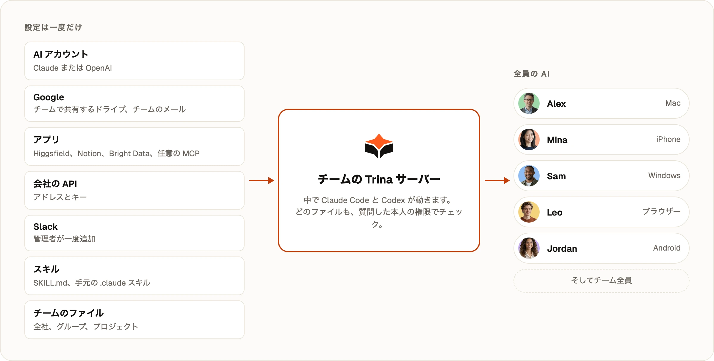
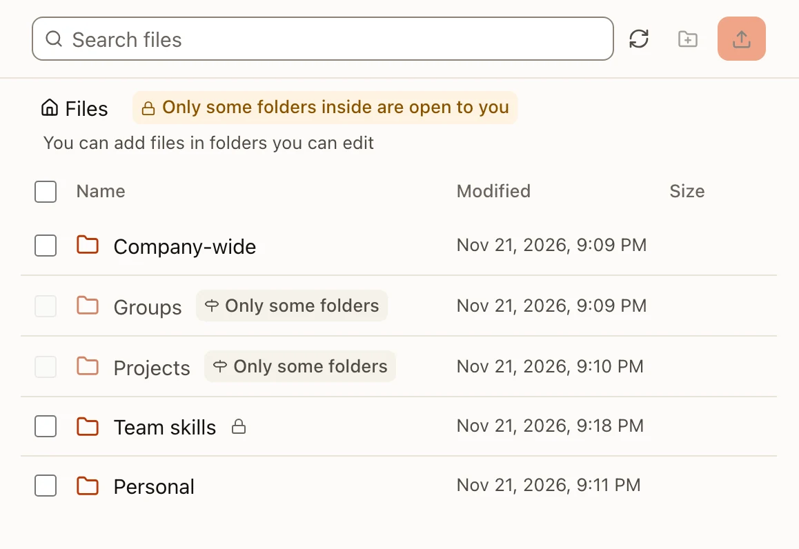

<div align="center">

<picture><source media="(prefers-color-scheme: dark)" srcset="editions/trina/branding/logo/mark-dark.svg"></picture>

<h1>Trina AX</h1>

<b>チーム全員で使うAI。</b><br>
Trina AXは、チームのファイル・スキル・ツールを1台のサーバーにまとめます。全員のAIが、そこから仕事を始めます。<br>同僚のAIセッションをそのまま引き継げます。AIが開くファイルはすべて、質問した本人の権限でチェックされます。

<a href="https://demo.trina.app"></a>

<a href="https://ax.trina.app/download"></a>&nbsp;&nbsp;<a href="https://ax.trina.app/download"></a>&nbsp;&nbsp;<a href="https://apps.apple.com/app/trina-ax/id6829192435"></a>&nbsp;&nbsp;<a href="https://play.google.com/store/apps/details?id=app.trina.ax"></a><br>
<sub>Linux版（.deb、AppImage／x64・arm64）は<a href="https://ax.trina.app/download">ダウンロードページ</a>にあります</sub>

[Webサイト](https://ax.trina.app) · [ドキュメント](docs/README.md) · [料金](https://ax.trina.app/pricing) · [Discord](https://discord.gg/zUVfSR8MVk)

[English](README.md) · [한국어](README.ko.md) · 日本語 · [Español](README.es.md) · [简体中文](README.zh-CN.md) · [Bahasa Indonesia](README.id.md)

</div>

https://github.com/user-attachments/assets/ec5f648a-7417-4e31-94df-e860b353b709

<p align="center"><sub>80秒でわかる、新入社員のAIが初日にできること。</sub><br>オープンソース（AGPL-3.0）・セルフホストなら無料、人数制限なし<br><br><a href="https://github.com/trina-app/trina-ax?tab=readme-ov-file"></a><br><sub>そのあと、ページ上部の［☆ Star］を押してください。スターが増えると、ほかのチームもTrina AXを見つけやすくなります。</sub></p>

<br>

<picture><source media="(prefers-color-scheme: dark)" srcset="docs/images/readme/v4/divider-dark.png"></picture>

## 設定は一度だけ。チーム全員が使える。

**AIアカウントは、チームで1つ。** ClaudeかOpenAIのAPIキー1つ（または規約で認められたプラン）を接続すれば、チーム全員がそのアカウントで質問できます。トークンの上限は、人・グループ・チームごとに設定できます。

1人がチームのサーバーで一度設定すれば、ブラウザーでもアプリでも、全員のAIが最初の質問からそれを使えます。ほかの人がClaude Codeをインストールしたり、スキルをコピーしたりする必要はありません。各自がするのは、多くても自分のアカウントへのサインインだけです。

<picture><source media="(prefers-color-scheme: dark)" srcset="docs/images/readme/v4/set-up-once-ja-dark.webp"></picture>

| 一度だけ設定するもの | 全員が使えるもの |
| --- | --- |
| **AIアカウント**：オーナーか管理者が、ClaudeかOpenAIのAPIキー、または規約で認められたプランを接続します。 | チーム全員がAIに質問できます。トークンの上限は、人・グループ・チームごとに設定できます。 |
| **Google**：ドライブのフォルダーをチームと共有するか、チーム用のアカウント（共有のメールボックスやカレンダー）を1つ、Gmail・Calendar・Docs・Sheetsに接続します。 | 選んだ人が、自分のチャットで使えます。自分のGoogleアカウントを個別に接続することもできます。 |
| **アプリ**：アプリ一覧にあるHiggsfield、Notion、Linear、Figmaなど。アドレスがあれば、どのMCPサーバーでも追加できます（例：Bright Data）。 | 全員のチャットで、そのアプリのツールが使えます。サインインは、チーム共通のアカウント1つでも、各自のアカウントでもできます。 |
| **会社のAPI**：アドレス、キー、使い方のメモ。 | AIが自社のシステムを呼び出します。呼び出せるのは、そのアドレスの配下だけです。 |
| **Slack**：オーナーか管理者が一度追加します。 | DMや、トリナを招待したチャンネルで、自分の権限のままトリナに聞けます。 |
| **スキル**：`SKILL.md`を書くか、`.claude`や`.codex`フォルダーにあるスキルをそのまま持ち込みます。 | 全員のAIが同じ手順で動きます。`/`で呼び出せます。 |
| **チームのファイル**：全社・グループ・プロジェクト・チームスキル・個人フォルダーを、1つのドライブに。 | 全員のAIがチームのファイルから仕事を始め、その人が開けるものだけを開きます。 |

<table>
<tr>
<td colspan="2"><br><sub>管理 › 連携サービス：一度設定すれば、チーム全員が使えます</sub></td>
</tr>
<tr>
<td width="50%"><br><sub>チームのドライブは1つ</sub></td>
<td width="50%"><br><sub>チームスキル（自分のスキルも持ち込めます）</sub></td>
</tr>
</table>

<br>

<picture><source media="(prefers-color-scheme: dark)" srcset="docs/images/readme/v4/divider-dark.png"></picture>

## みんなでできること

**同僚が進めていた仕事を、そのまま続きから。** チームプロジェクトで同僚のAIセッションを開くと、これまでの会話と回答がすべて見えて、すぐに続けて質問できます。新しい回答は、質問した本人の権限で処理されます。それ以外のセッションも、Googleドライブのファイルと同じように人やグループに共有できます。


**どのトークの横でも聞けて、ワンクリックで送れる。** 自分にだけ見えるサイドチャットでトリナに聞き、その回答をワンクリックでトークに送れます。


**一人ひとりのAIに見えるのは、本人が開けるものだけ。** MinaがFinanceを開けなければ、MinaのAIも開けません。[権限のしくみ](docs/PERMISSIONS.md)


**ファイルを中身で探せる。** 毎晩、チームのAIが共有・グループ・プロジェクトのフォルダーにある新しいファイルと変更されたファイルを読み、何のファイルかをファイルごとに1行で書き残します。そのため、`temp.pdf`という名前のスキャンデータや`IMG_2031.jpg`という写真も、中身から見つかります。使うのはチームのAIアカウントで、個人フォルダーは読みません。架空のファイル2,238件でテストしたところ、Claude Codeが正しいファイルを見つけたのは184問中、この1行があると181問、ないと172問でした。

<table>
<tr>
<td width="50%"><b>予約タスク</b>：一度頼めば、指定したスケジュールどおりにトリナが繰り返します。時刻はチームのタイムゾーンに合わせます。<br><br></td>
<td width="50%"><b>ゲスト</b>：社外の人をグループトークやプロジェクトに招待できます。AIを使えるかどうかも選べます。<br><br></td>
</tr>
<tr>
<td width="50%"><b>使用量と上限</b>：メンバーごとの回答数・トークン・推定コストがわかります。トークンの上限は、人・グループ・チームごとに設定できます。<br><br></td>
<td width="50%"><b>まとめて検索</b>：⌘Kで、チャット・履歴・プロジェクト・ファイル・スキル・予約タスクから探せます。<br><br></td>
</tr>
<tr>
<td colspan="2"><b>Slackのようなチームチャットに、トリナが付いています。</b> 全員用・グループ用のチャンネル、プライベートチャンネル、DM、グループトーク、スレッド、@メンションまでそろっています。Web・デスクトップ・スマホで使えて、どのトークでも、自分にだけ見えるサイドチャットでトリナに聞けます。<br><br></td>
</tr>
</table>

- **変更履歴**：人が変えても、その人のAIが変えても、変更はすべて残ります。どのバージョンにも戻せます。
- **アプリ内ブラウザー**：デスクトップアプリでは、チャットの横のパネルでトリナがWebサイトを開いて読み、クリックやフォーム入力までこなします。その様子を見ながら、［Stop］でいつでも止められます。［すべてのWebサイトを許可］をオンにしていなければ、新しいサイトを開く前に確認します。
- **アプリの通知をトークに**：Sentry、GitHub、Stripe、Jira、HubSpotからの通知が、カードになって届きます。
- **仕事のファイルを探す**：デスクトップアプリが、パソコンにある最近の仕事のファイルを見つけます。追加するのは、選んだものだけです。
- **ドキュメント**：ハングル文書（HWP/HWPX）の本文を読めます。PDFとPowerPointはプレビューできます。
- **どの端末でも**：Mac、Windows、Linux、iPhone、Android、どのブラウザーからでも使えます。6つの言語に対応しています。

<br>

<picture><source media="(prefers-color-scheme: dark)" srcset="docs/images/readme/v4/divider-dark.png"></picture>

## はじめる

- **ブラウザーで試す**：インストール不要。架空のチームで試せます（AIはオフ）。[デモを開く](https://ax.trina.app/demo/ja/)
- **Trinaホスティング**：サーバーの運用は不要です。14日間は無料で試せて、そのあとは月額プランです。[料金プラン](https://ax.trina.app/pricing)
- **アプリ**：[Mac、Windows、Linux、iPhone、Android](https://ax.trina.app/download)。どのブラウザーからでも使えます。
- **セルフホスト**：自社のLinuxサーバー、Docker、オフィスのMacで動かせます。無料です。[Linux](docs/INSTALL-LINUX.en.md) · [Windows PC](docs/INSTALL-WINDOWS.md) · [Docker](docs/INSTALL-DOCKER.md) · [オフィスMac](docs/OFFICE.en.md) · [AIエージェントでインストール](docs/INSTALL-LINUX.en.md#install-with-your-ai-agent)

<b>Dockerでセルフホスト</b>（Linux、またはOrbStackを入れたMac）

```sh
git clone https://github.com/trina-app/trina-ax.git && cd trina-ax/docker
cp env.example .env && docker compose up -d --build
docker compose exec trina-ax trina-ax-setup-link   # リンクを開いてオーナーのアカウントを作成
```

Linux版のインストールより新しい方法で、まだテストは少なめです。Ubuntu 24.04のサーバーでは、先にホスト側の設定が1つ必要です。[Dockerガイド](docs/INSTALL-DOCKER.md)

<b>自分のパソコンで10分で試す</b>（架空のチーム・AIはオフ）

```sh
git clone https://github.com/trina-app/trina-ax.git && cd trina-ax
bun install --frozen-lockfile && bun run demo   # → http://127.0.0.1:19760 · alice / teamax-demo-1
```

Bun 1.3.12とGo 1.27以上が必要です。本番環境向けのインストールではありません。[詳しい手順](docs/QUICKSTART.md)

<br>

<picture><source media="(prefers-color-scheme: dark)" srcset="docs/images/readme/v4/divider-dark.png"></picture>

## しくみ

1台のサーバーで、Claude CodeとCodexがエンジンとして動きます。ファイルへのリクエストは、人からでもその人のAIからでも、すべてサーバー上の1つの権限チェックを通ります。Linuxサーバーでは、エンジンは専用のアカウントで、bubblewrap・Landlock・seccompのサンドボックスの中で動きます。シェルと組み込みのファイルツールはオフなので、エンジンがファイルを開けるのはTrinaのツール経由だけです。[セキュリティと権限](docs/security-and-permissions.md)

Trinaが提供するのはワークスペースで、AIそのものではありません。自社の用途での利用が認められたClaudeやOpenAIのアカウント・プランを接続してください。AIの利用料は、接続したアカウントに請求されます。

<details>
<summary><b>データの扱い、制限、保証しないこと</b></summary>

### 保証しないこと

- セルフホストでも、オフラインで動くわけではありません。依頼に必要なコンテキストは、接続したAIプロバイダーに送られます。設定済みの外部連携には、その連携に関わるリクエストが送られます。CodexがWeb検索をするたびに、それまでの会話がOpenAIの検索サービスに送られます。管理者が許可して音声認識にOpenRouterを使う場合、動画・音声ファイルの音声はOpenRouterに送られます。サーバーは30分ごとに、自身の公開アドレスを`updates.trina.app`に問い合わせます（`MYCEL_EXIT_ADDRESS_CHECK=off`で無効にできます）。[詳細](docs/security-and-permissions.md)
- サーバーの運用者は、保存されたファイルとチャットを読めます。ホスティングでは、Trinaの運用者もこれに含まれます。アプリの管理者には、全員の個人的な会話を閲覧する機能はありません。
- フォルダーへのアクセス権を外しても、それ以前の回答は消えません。共有範囲を広げるときの確認は、包括的な情報漏えい対策（DLP）ではありません。
- セキュリティ認証の取得、完璧な回答、確実なコスト削減、法務・財務・人事判断の自動化は、いずれもうたっていません。出力内容と導入範囲は、人が確認してください。
- LinuxサーバーではOCRを実行しません。AIは写真やスキャンしたページを画像として見ますが、テキストでは検索できません。オフィスMacは、まだ動画を読めません。
- HWP/HWPXのテキストは、どのチームでも使えます。[プレビューとハングル文書の作成](resources/hwp/README.md)には、オプションの「HWPプレビュー」プラグインが必要です（macOS、またはglibc 2.39以降のLinux。Debian 12は非対応）。
- 接続の優先順位：本人が使える個人の接続が最優先で、その次は本人、グループ、チーム全体に割り当てられた接続の順に使われます。新規のTrinaチームでは、会社の接続1つをチーム全体で使えるのが既定です。既存の保存済み設定は、そのまま維持されます。**このソフトウェアの設定によって、AnthropicやOpenAIの規約上の許可が得られるわけではありません。** [接続の詳細](docs/FAQ.md)
- Linuxでのセルフホストには、Debian 12/13またはUbuntu 24.04、systemdとcgroup v2、amd64またはarm64、RAM 4GB、ディスク20GBが必要です。インストール、アップデート、バックアップからの復元は、社内のIT担当者が対応します。

</details>

<br>

<picture><source media="(prefers-color-scheme: dark)" srcset="docs/images/readme/v4/divider-dark.png"></picture>

## コミュニティ

Trina AXがチームの役に立ったら、GitHubで⭐を付けて応援してください。ほかのチームにも見つけてもらいやすくなります。

[Discord](https://discord.gg/zUVfSR8MVk) · [X](https://x.com/trina_ax) · [リリース](https://github.com/trina-app/trina-ax/releases/latest) · [変更履歴](CHANGELOG.md) · [サポート](SUPPORT.md) · [貢献ガイド](CONTRIBUTING.md) · [セキュリティ](SECURITY.md) · [開発](docs/DEVELOPMENT.md) · [設定](docs/CONFIGURATION.md) · [llms.txt](llms.txt)

アプリは英語、韓国語、インドネシア語、日本語、スペイン語、簡体字中国語に対応しています。画像に登場する会社と人物は、すべて架空のものです。

<br>

<picture><source media="(prefers-color-scheme: dark)" srcset="docs/images/readme/v4/divider-dark.png"></picture>

## ライセンス

[AGPL-3.0-only](LICENSE)のもとで、商用利用も含めて自由に使えます。改変版をネットワーク経由で提供する場合は、その利用者にソースコードを提供してください。クラウドプロトコルには、別途MITライセンスが適用されます（[ライセンス](shared/src/cloud-protocol/LICENSE)）。[NOTICE](NOTICE) · [サードパーティ通知](docs/THIRD-PARTY-NOTICES.md)

Claude CodeとCodexには、それぞれ独自の規約があります。本プロジェクトは、AnthropicおよびOpenAIの公認を受けたものではありません。ClaudeはAnthropicの商標です。
