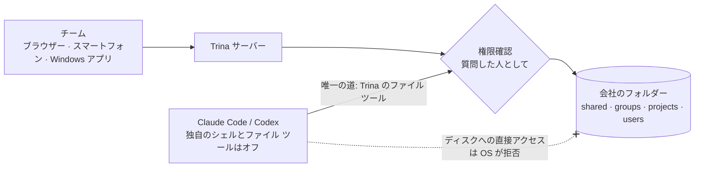

<div align="center">


# Trina AX

**Claude Code を一度整えれば、会社全員が使える。**

会社のサーバー1台で Claude Code と Codex が動きます。会社のファイル、チームのスキル、一人ひとりのフォルダー権限もそのサーバーに。メンバーはブラウザーを開くだけです。

[Webサイト](https://ax.trina.app) · [10分で試す](#10分で試す) · [セルフホスト](docs/for-admins.md) · [ドキュメント](docs/README.md)

[English](README.md) · [한국어](README.ko.md) · 日本語 · [Español](README.es.md)


<sub><b>入社初日、1行だけ:</b> “Write a proposal for Trina Logistics.” AI がチームの営業資料を読み、代表の <code>proposal</code> スキルどおりに7ページの提案書を保存しました。<br>実際のアプリ(英語画面)と架空の会社のデータです。生成に81秒かかり、動画は早送りしています。</sub>

</div>

## 同じ依頼、違う答え

<table>
<tr>
<td width="50%" valign="top"><b>空のフォルダーで開いた Claude Code</b><br><sub>会社のことがわからないので、まず6つ質問を返します。</sub></td>
<td width="50%" valign="top"><b>Trina AX に同じ1行</b><br><sub>チームのファイルと代表の提案書スキルから始めます。</sub></td>
</tr>
<tr>
<td></td>
<td></td>
</tr>
</table>

<sub>2026-10-31、架空の会社 Dawnroute のデータで実際に動かした結果です。Claude Code が聞き返すのは正しい動きです。空のフォルダーには会社のことが何もないからです。Trina はそのフォルダーを用意します。</sub>

## しくみ

1. **一度入れておく。** 会社の資料は `shared/` に、提案書の書き方は `skills/proposal/SKILL.md` に置きます。
2. **誰でも聞くだけ。** パソコンやスマートフォンのブラウザーでチャットします。ターミナルも、ノートPCへのインストールも要りません。
3. **権限は人ごと。** AI がファイルを開くたびに、サーバーが質問した人の権限で確認します。自分に見えないフォルダーは、自分の AI にも存在しません。


<sub><b>同じ質問でも、人によって答えが違います。</b> 営業の Mina は売上ファイルがある <code>shared/Finance</code> を開けません。だから Mina の AI も開けません。</sub>

## 10分で試す

```sh
git clone https://github.com/trina-app/trina-ax.git && cd trina-ax
bun install --frozen-lockfile
bun run demo        # → http://127.0.0.1:19760 · alice / teamax-demo-1 でログイン
```

架空のチームと6つのスターター スキル入りです。AI はオフなので AI アカウントは不要です。シークレット ウィンドウで `bob` としてもログインすると、見えるグループ フォルダーが違います。Git、Bun 1.3.12、Go 1.27 以上が必要です。**本番用のインストールではありません。** [手順](docs/QUICKSTART.md)

## できること

| | 実際には |
|---|---|
| **本物の Claude Code・Codex エージェント** | 会社のサーバーで動きます。1回の回答でツールを既定で150回まで使い、サブエージェントを同時に4つまで動かし、Web 検索と予約タスクも実行します。 |
| **会社のフォルダーがそのまま知識** | `shared/`、`groups/`、`projects/`、個人フォルダー。バージョン履歴付き。PDF、Office、HWP/HWPX のテキストも読みます。 |
| **ファイルとして管理するチーム スキル** | スキルは `SKILL.md` ファイル1つ。誰が使えるかはフォルダーのルールで決まり、AI が変更するときは人の確認が必要です。 |
| **ファイルを開くたびに権限確認** | 見られないファイルは、ファイル画面、AI の回答、検索、プレビュー、バージョン履歴、ごみ箱のどこにも出てきません。 |
| **AI の接続は会社が選ぶ** | Claude または OpenAI をサブスクリプションか API キーで接続し、人・グループ・チーム全体に割り当てます。人ごとの使用量と上限も設定できます。 |
| **セルフホストかホスティング** | Linux サーバー、オフィスの Mac、AWS ソウルの Trina ホスティングから選べます。パソコンとスマートフォンのブラウザー、Windows インストーラーで使えます。 |

## 中身



- **エージェントは本物です。** サブエージェントも同じ人として働き、同じ確認を通り、同じ操作記録を残します。
- **入り口は狭く。** エンジン自身のシェルとファイル ツールはオフにし、エンジンごとの回帰テストで確かめています。フォルダーへの道は Trina のファイル ツールだけで、呼び出しのたびに権限を確認します。
- **キーはエンジンに渡しません。** トークンはブラウザーで封印してから送ります。エンジンはターンごとの代理トークンだけを受け取り、本物の値はモデル プロキシが付けます。
- **管理者も他人のチャットは見られません。** AI がどのファイルを読んだかだけが見えます。ただしサーバーの運用者は保存データを読めます。[下](#データと制限)に書いています。

<sub>OS 分離(エンジン専用アカウント)は Linux とロール アカウントの Mac インストールだけです。オフィス Mac はログイン中のユーザーとして動き、ローカル デモには OS 分離がありません。→ <a href="docs/security-and-permissions.md">Security and permissions</a> · <a href="docs/PERMISSIONS.md">権限モデル(韓国語)</a></sub>

## 最初の1週間

オーナー アカウントを作り、**権限 → AI 接続 → メンバー招待 → 最初のスキル → 最初のバックアップ** の順に進めます。下のスターター スキルは架空のデータで始めます。

| 役割 | 実際の仕事 | コピーして使うスキル |
|---|---|---|
| 代表・チームリーダー | 週次メモを決定事項・リスク・次の作業に整理 | [Weekly report](examples/skills/weekly-team-report/SKILL.md) |
| 営業 | 会議にない約束を作らずにフォローアップを下書き | [Sales follow-up](examples/skills/sales-follow-up/SKILL.md) |
| マーケティング | 承認済みのブランド資料からキャンペーン案を作成 | [Brand brief](examples/skills/brand-brief/SKILL.md) |
| 経理 | 抜けている領収書と確認が必要な金額を指摘 | [Expense review](examples/skills/expense-review/SKILL.md) |
| 人事 | 見られる規程から新入社員の質問に回答 | [New-hire guide](examples/skills/new-hire-guide/SKILL.md) |
| 全員 | 議事録から決定事項とタスクを抽出 | [Meeting summary](examples/skills/meeting-summary/SKILL.md) |

スキルは繰り返す仕事のための指示です。モデルを学習させたり権限を増やしたりはしません。結果は使う前・共有する前に人が確認してください。[チームリーダー向けチェックリスト](docs/for-teams.md) · [すべての例](examples/README.md)

## 運用方法

| | Trina ホスティング | Linux にセルフホスト | オフィス Mac | ローカル デモ |
|---|---|---|---|---|
| 向いているチーム | IT 担当がいないチーム | IT 担当がいるチーム | 専用 Mac がある小さなオフィス | 見て回る |
| 運用 | Trina(AWS ソウル) | 社内 IT | オフィスの担当者 | 自分 |
| AI | 利用が認められた Claude・OpenAI 接続 | 同じ | Claude のみ(Codex なし) | オフ |
| 費用 | 月 $39 から + AI 利用料 | 無料ソフトウェア + サーバー費 | 無料ソフトウェア | 無料 |
| 始める | [お問い合わせ](https://ax.trina.app/#contact) | [Linux ガイド](docs/INSTALL-LINUX.en.md) | [オフィス ガイド](docs/OFFICE.en.md) | [クイックスタート](docs/QUICKSTART.md) |

Trina が提供するのはワークスペースで、AI ではありません。Claude と OpenAI のアカウントとプランは、用途に対して認められたものだけを接続してください。ホスティング料金(2026-10-30 確認、米ドル、税抜き): **Starter 月 $39(5人まで)、Team $69(15人)、Business $129(40人)**。AI 利用料は別です。ホスティングは相談から始まり、すぐ使える無料トライアルはありません。[最新の料金](https://ax.trina.app/#pricing)

Linux のセルフホストには Debian 12/13 または Ubuntu 24.04、systemd と cgroup v2、amd64 か arm64、RAM 4 GB(推奨)、ディスク 20 GB(最小)が必要です。インストール、更新、バックアップからの復元は社内 IT が担当します。

## データと制限

セルフホストでもオフラインにはなりません。依頼に必要な内容は接続した AI 事業者に送られます。サーバーの運用者(ホスティングでは Trina を含む)は保存されたファイルとチャットを読めます。アプリの管理者は他人の会話を開けません。

<details>
<summary><b>サーバーの外に出るもの、接続のルール、約束しないこと</b></summary>

<br>

- 選ばれた内容は選んだ AI 事業者に送られ、設定した外部連携もリクエストを受け取ります。Codex の Web 検索は、それまでの会話を OpenAI の検索サービスに送ります。サーバーは30分ごとに `updates.trina.app` に自分の公開アドレスを問い合わせます(`MYCEL_EXIT_ADDRESS_CHECK=off` で止められます)。[詳細](docs/security-and-permissions.md)
- サーバーの運用者は保存されたファイルとチャットを読めます。ホスティングでは Trina の運用者も含みます。アプリの管理者には他人の会話を見る画面はありません。
- フォルダーの権限を外しても、以前の回答に引用された内容は消えません。共有範囲を広げるときの確認は、すべての情報漏えいを防ぐものではありません。
- セキュリティ認証、完璧な回答、コスト削減、法務・財務・人事の判断の自動化は約束しません。結果と運用の範囲は人が確認してください。
- AI は写真やスキャンした PDF のページを画像として見ます(管理者がオフにできます)。ただし Linux サーバーには OCR がないため、スキャン文書や写真は文字で検索できません。
- HWP/HWPX のテキスト抽出はできます。[画面プレビュー](resources/hwp/README.md)は任意のプラグインで、macOS か glibc 2.39 以上の Linux が必要なため、Debian 12 では**使えません**。
- 管理されたインストールでは、個人の接続が最優先で、次に人、グループ、チーム全体に割り当てた接続の順に使われます。新しい Trina チームではサブスクリプションの共有が既定でオンで、保存済みの選択はそのまま残ります。接続ごとの同意も引き続き適用されます。**この設定は Anthropic や OpenAI の規約上の許可を意味しません。** ローカル デモは AI をオフにし、開発モードとオフィスのローカル ログイン モードは接続の動きが異なります。[接続の詳細](docs/FAQ.md)

</details>

## よくある質問

<details>
<summary><b>メンバーごとに Claude の席を買うのと何が違いますか?</b></summary>

<br>席は一人ひとりに空のワークスペースを渡します。Trina は1台のサーバーで、全員が同じ会社のフォルダーとチーム スキルから始められるようにし、人ごとのフォルダー権限をサーバーが確認します。人ごとのアカウントを接続することもできます。

</details>

<details>
<summary><b>試すのに AI アカウントは必要ですか?</b></summary>

<br>いいえ。[ローカル デモ](docs/QUICKSTART.md)は AI をオフにして架空のデータで動くので、ファイル・スキル・権限を先に見られます。

</details>

<details>
<summary><b>管理者は私たちのチャットを読めますか?</b></summary>

<br>いいえ。チャットは本人だけが見られます。操作記録には AI が読んだファイルだけが出て、会話の内容は出ません。サーバーやストレージを運用する人は保存データを読めます。

</details>

<details>
<summary><b>韓国の HWP ファイルも使えますか?</b></summary>

<br>テキストは使えます。AI が HWP/HWPX のテキストを読みます。画面プレビューには任意のプラグインが必要で、Debian 12 では動きません。詳しくは [FAQ](docs/FAQ.md) へ。

</details>

## コミュニティと貢献

[最新リリースとチェックサム](https://github.com/trina-app/trina-ax/releases/latest) · [変更履歴](CHANGELOG.md) · [サポート](SUPPORT.md) · [貢献](CONTRIBUTING.md) · [セキュリティ報告](SECURITY.md) · [開発](docs/DEVELOPMENT.md) · [設定](docs/CONFIGURATION.md) · [機械可読の索引](llms.txt)

アプリは英語、韓国語、インドネシア語、日本語、スペイン語に対応しています。配布中のインストーラーはソースより遅れることがあるので、リリースノートを確認してください。

## ライセンス

[AGPL-3.0-only](LICENSE) のもとで、商用を含めて自由に使えます。改変版をネットワーク越しに提供する場合は、その利用者にソースを提供してください。クラウド プロトコルは別途 MIT ライセンスです([ライセンス](shared/src/cloud-protocol/LICENSE))。[告知](NOTICE) · [サードパーティの告知](docs/THIRD-PARTY-NOTICES.md)

Claude Code と Codex にはそれぞれの規約があり、このプロジェクトは Anthropic や OpenAI の保証を受けていません。Claude は Anthropic の商標です。
