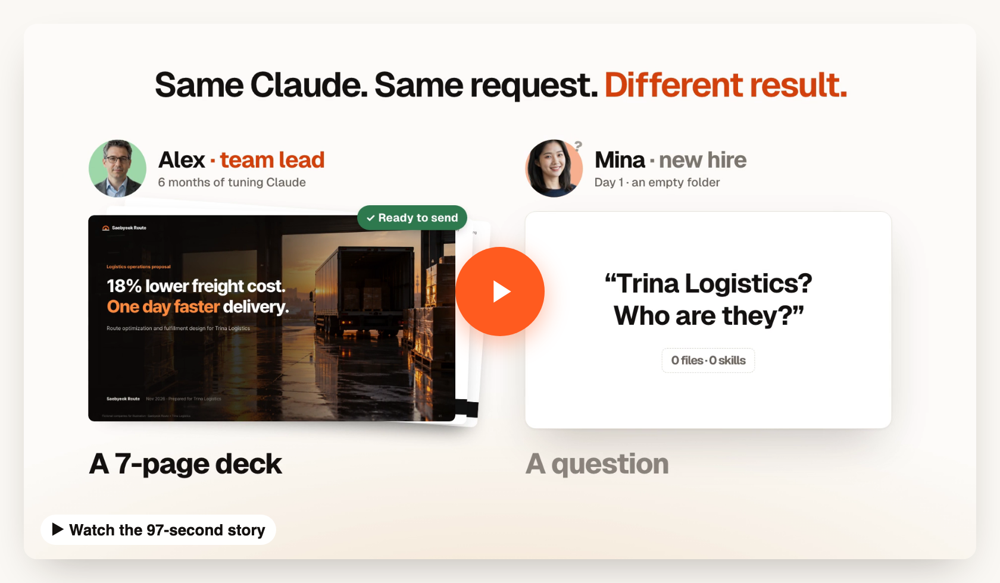
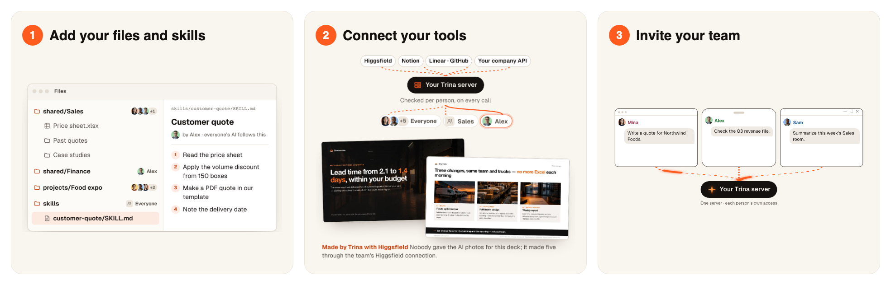
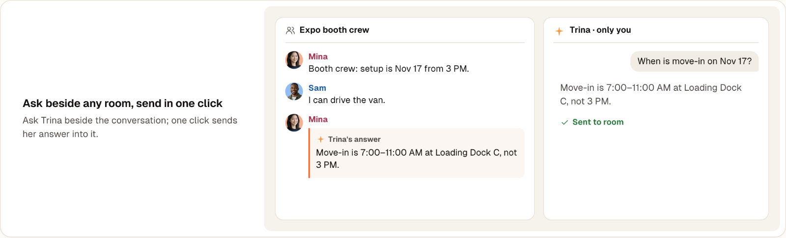
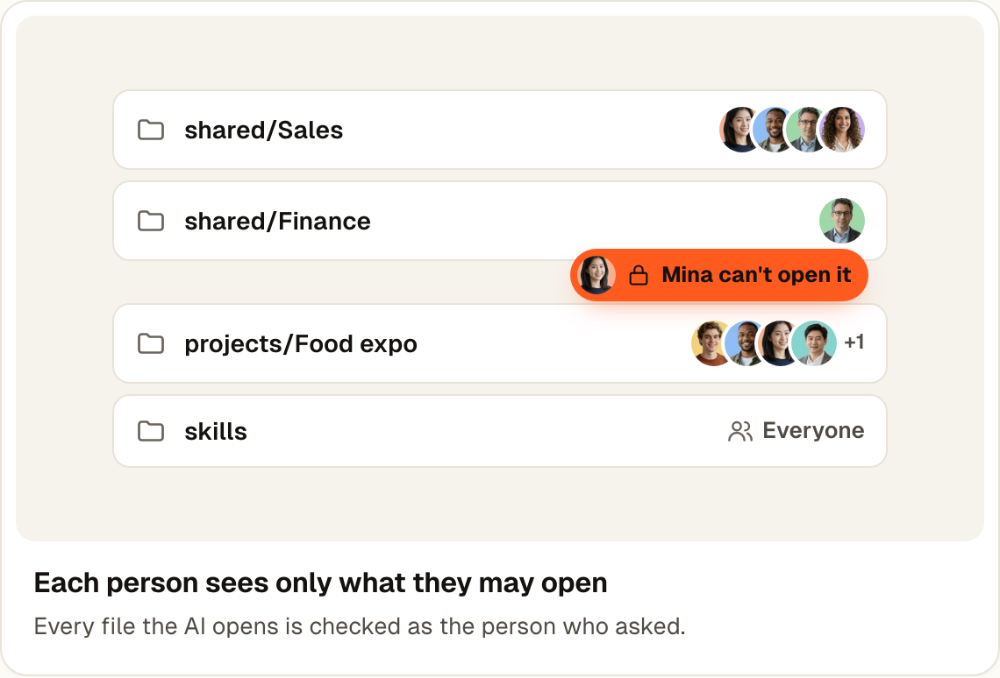
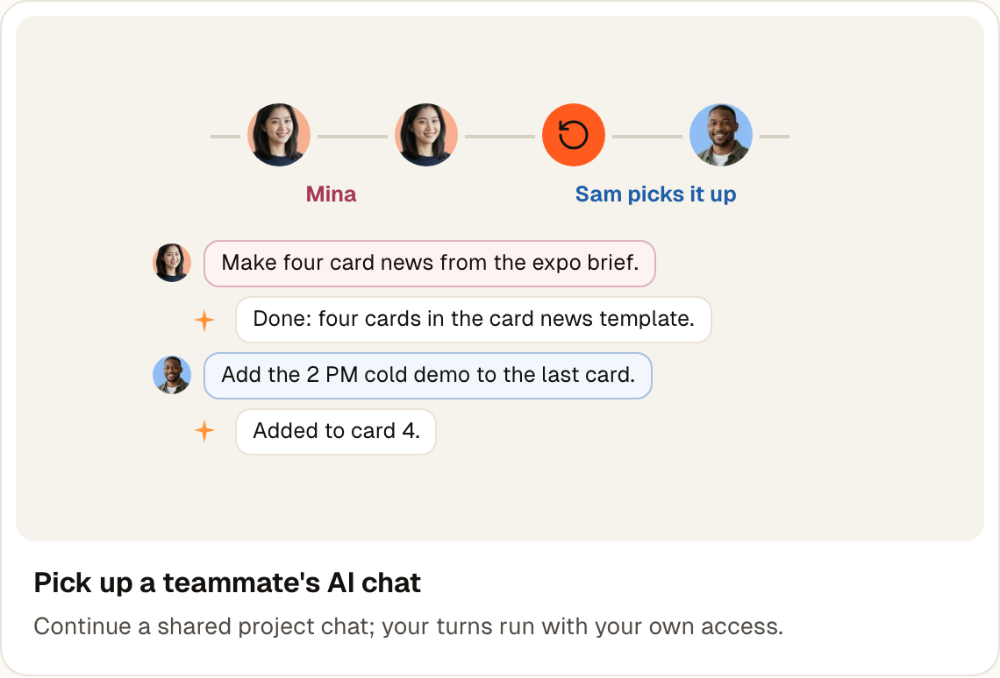
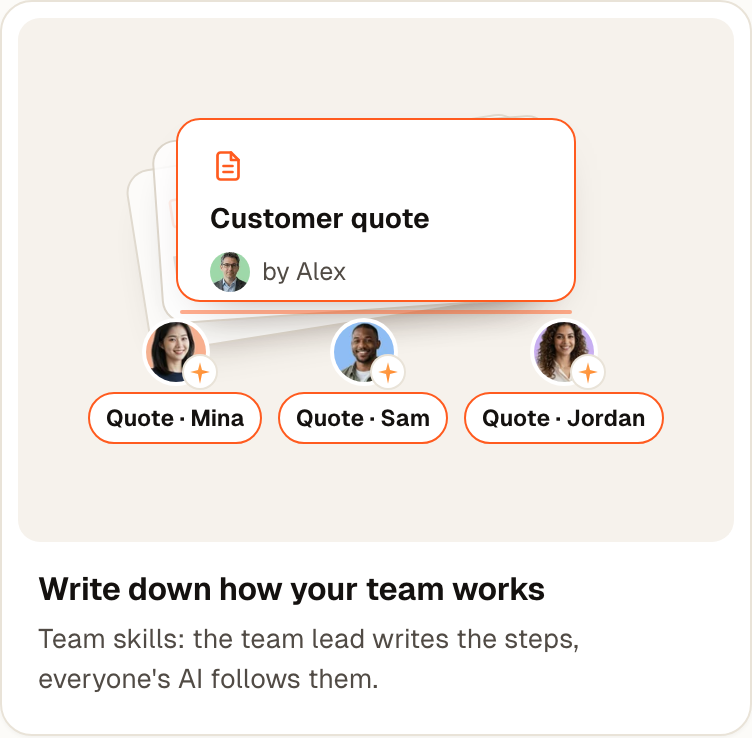
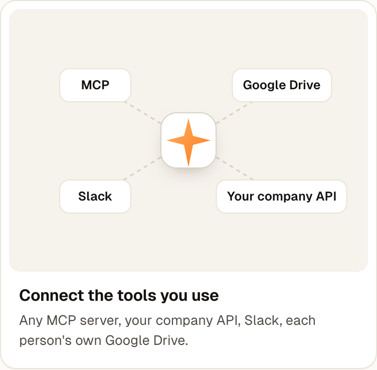
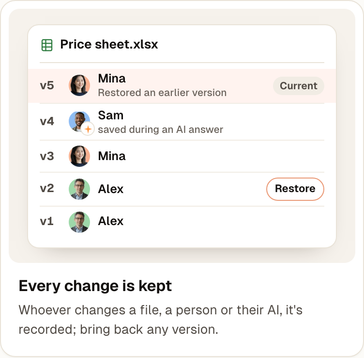
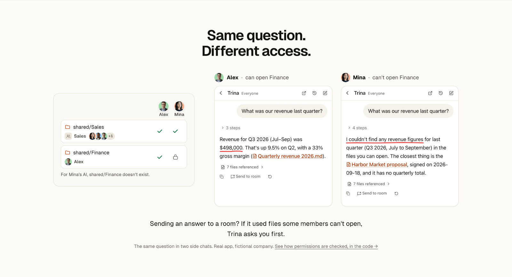

<div align="center">


# Trina AX

**チーム全員で使う AI。**

チームのファイル、スキル、ツールを1台のサーバーに。みんなの AI がそこから始まります。

[Web サイト](https://ax.trina.app) · [ダウンロード](https://ax.trina.app/download) · [ドキュメント](docs/README.md) · [Discord](https://discord.gg/zUVfSR8MVk) · [X](https://x.com/trina_ax)

<a href="https://apps.apple.com/app/trina-ax/id6829192435"></a>&nbsp;<a href="https://play.google.com/store/apps/details?id=app.trina.ax"></a>

[English](README.md) · [한국어](README.ko.md) · 日本語 · [Español](README.es.md) · [简体中文](README.zh-CN.md)

</div>

<br>

<a href="https://ax.trina.app/#watch"></a>

<p align="center"><sub>新しく入った人の AI は、空のフォルダーから始まります。Trina は、そこにチームのフォルダーを渡します。</sub></p>

## しくみ



## チームでできること



<p>


</p>

<p>



</p>



AI が開くファイルは、すべて質問した本人の権限でチェックされます。[権限のしくみ](docs/PERMISSIONS.md)

## はじめる

- **Trina ホスティング：** サーバーの運用は要りません。14日間の無料トライアルのあと、月額プランになります。[プラン](https://ax.trina.app/#pricing)
- **アプリ：** Mac、iPhone、Android、Windows、またはどのブラウザーからでも。[ダウンロード](https://ax.trina.app/download)
- **セルフホスト：** 自社の Linux サーバー、Docker、オフィスの Mac で。無料です。[Linux](docs/INSTALL-LINUX.en.md) · [Docker](docs/INSTALL-DOCKER.md) · [オフィス Mac](docs/OFFICE.en.md)

<details>
<summary><b>自分のパソコンで10分で試す</b>（架空のチーム、AI はオフ）</summary>

<br>

```sh
git clone https://github.com/trina-app/trina-ax.git && cd trina-ax
bun install --frozen-lockfile && bun run demo   # → http://127.0.0.1:19760 · alice / teamax-demo-1
```

Bun 1.3.12 と Go 1.27 以上が必要です。本番環境向けのインストールではありません。[詳しい手順](docs/QUICKSTART.md)

</details>

Trina が提供するのはワークスペースで、AI そのものではありません。自分たちの使い方が認められている Claude や OpenAI のアカウントとプランを接続してください。AI の利用料は、接続したアカウントに請求されます。

<details>
<summary><b>データ、制限、保証しないこと</b></summary>

### 保証しないこと

- セルフホストでも、オフラインで動くわけではありません。依頼に必要なコンテキストは接続した AI プロバイダーに送られ、設定済みの外部連携もそれぞれのリクエストを受け取ります。Codex が Web 検索をするたびに、それまでの会話が OpenAI の検索サービスに送られます。管理者の許可のもとで音声認識に OpenRouter を使う場合、動画・音声ファイルの音声は OpenRouter に送られます。サーバーは30分ごとに、自身の公開アドレスを `updates.trina.app` に問い合わせます（`MYCEL_EXIT_ADDRESS_CHECK=off` で無効にできます）。[詳細](docs/security-and-permissions.md)
- サーバーの運用者は、保存されたファイルとチャットを読めます。ホスティングの場合は Trina の運用者も含まれます。アプリの管理者には、全員の個人的な会話を閲覧する機能はありません。
- フォルダーへのアクセス権を外しても、それ以前の回答は消えません。共有範囲を広げるときの確認は、包括的な情報漏えい対策（DLP）ではありません。
- セキュリティ認証、完璧な回答、確実なコスト削減、法務・財務・人事判断の自動化は、いずれもうたっていません。出力内容と導入範囲は人が確認してください。
- Linux サーバーでは OCR を実行しません。AI は写真やスキャンしたページを画像として見ますが、テキスト検索はできません。オフィス Mac はまだ動画を読めません。
- HWP/HWPX のテキストはどのチームでも使えます。[プレビューとハングル文書の作成](resources/hwp/README.md)には、オプションの HWP Preview プラグインが必要です（macOS、または glibc 2.39 以降の Linux。Debian 12 は不可）。
- 接続：本人の条件を満たす接続が最優先で、その次は本人、グループ、チーム全体に割り当てられた接続の順に使われます。新規の Trina チームでは、会社の接続ひとつをチーム全体で使えるのが既定です。既存の保存済み設定はそのまま維持されます。**このソフトウェアの設定によって、Anthropic や OpenAI の規約上の許可が得られるわけではありません。** [接続の詳細](docs/FAQ.md)
- Linux でのセルフホストには、Debian 12/13 または Ubuntu 24.04、systemd と cgroup v2、amd64 または arm64、RAM 4 GB、ディスク 20 GB が必要です。インストール、アップデート、バックアップからの復元は社内の IT 担当者が行います。

</details>

## コミュニティ

[Discord](https://discord.gg/zUVfSR8MVk) · [X](https://x.com/trina_ax) · [リリース](https://github.com/trina-app/trina-ax/releases/latest) · [変更履歴](CHANGELOG.md) · [サポート](SUPPORT.md) · [貢献ガイド](CONTRIBUTING.md) · [セキュリティ](SECURITY.md) · [開発](docs/DEVELOPMENT.md) · [設定](docs/CONFIGURATION.md) · [llms.txt](llms.txt)

アプリは英語、韓国語、インドネシア語、日本語、スペイン語に対応しています。画像に出てくる会社と人物はすべて架空です。

## ライセンス

[AGPL-3.0-only](LICENSE) のもとで、商用利用も含めて自由に使えます。改変版をネットワーク経由で提供する場合は、その利用者にソースコードを提供してください。クラウドプロトコルは別途 MIT ライセンスで提供しています（[ライセンス](shared/src/cloud-protocol/LICENSE)）。[NOTICE](NOTICE) · [サードパーティ通知](docs/THIRD-PARTY-NOTICES.md)

Claude Code と Codex にはそれぞれ独自の規約があります。本プロジェクトは Anthropic および OpenAI の公認を受けたものではありません。Claude は Anthropic の商標です。
