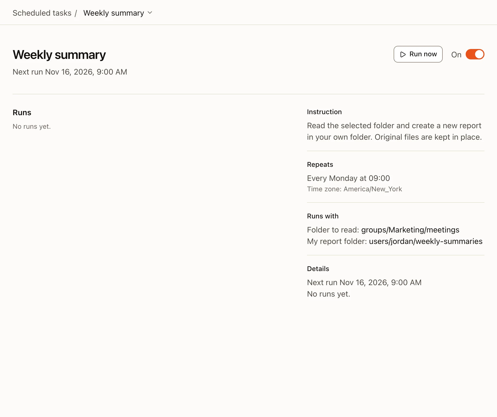

<div align="center">

<picture><source media="(prefers-color-scheme: dark)" srcset="editions/trina/branding/logo/mark-dark.svg"></picture>

<h1>Trina AX</h1>

<b>チーム全員で使う AI。</b><br>
Trina AX は、チームのファイル、スキル、ツールを1台のサーバーにまとめます。みんなの AI がそこから始まり、<br>AI が開くファイルは、すべて質問した本人の権限でチェックされます。

<a href="https://ax.trina.app/download"></a>&nbsp;&nbsp;<a href="https://ax.trina.app/download"></a>&nbsp;&nbsp;<a href="https://apps.apple.com/app/trina-ax/id6829192435"></a>&nbsp;&nbsp;<a href="https://play.google.com/store/apps/details?id=app.trina.ax"></a>

[Web サイト](https://ax.trina.app) · [ドキュメント](docs/README.md) · [プラン](https://ax.trina.app/pricing) · [Discord](https://discord.gg/zUVfSR8MVk)

[English](README.md) · [한국어](README.ko.md) · 日本語 · [Español](README.es.md) · [简体中文](README.zh-CN.md)

</div>

https://github.com/user-attachments/assets/4d795cf7-202c-4299-9d74-d0d569a1869f

<p align="center"><sub>同じ Claude、同じ依頼、違う結果。97秒のストーリー。</sub><br>オープンソース（AGPL-3.0）・セルフホストは無料、人数制限なし</p>

## 設定は一度だけ。チーム全員が使える。

1人がチームのサーバーで設定すれば、全員の AI が最初の質問からそれを使えます。ブラウザーでもアプリでも。ほかの人は Claude Code を入れたり、キーを貼ったり、スキルをコピーしたりする必要はありません。

<picture><source media="(prefers-color-scheme: dark)" srcset="docs/images/readme/v4/set-up-once-ja-dark.webp"></picture>

| 一度だけ設定 | 全員が使えるもの |
| --- | --- |
| **AI アカウント。** オーナーが Claude か OpenAI の API キー、または規約上許されるプランを接続します。 | チーム全員が回答を受け取れます。トークン上限は人、グループ、チームごとに設定できます。 |
| **Google。** ドライブのフォルダーをチームと共有するか、チームのアカウント（共有メールボックスやカレンダー）を1つ Gmail、Calendar、Docs、Sheets に接続します。 | 選んだ人が自分のチャットで使えます。各自の Google アカウントを別に接続することもできます。 |
| **アプリ。** アプリ一覧の Higgsfield、Notion、Linear、Figma など、またはアドレスで追加する MCP サーバー（例：Bright Data）。 | 全員のチャットでそのアプリのツールが使えます。チームで1つのサインインか、各自のサインインかを選べます。 |
| **会社の API。** アドレス、キー、使い方のメモ。 | AI が自社のシステムを呼び出します。そのアドレスの配下だけです。 |
| **Slack。** 管理者が一度追加します。 | どのチャンネルや DM でも Trina に聞けます。自分の権限で。 |
| **スキル。** `SKILL.md` を書くか、`.claude` や `.codex` フォルダーのスキルをそのまま持ち込みます。 | 全員の AI が同じ手順で動きます。`/` で呼び出せます。 |
| **チームのファイル。** 1つのドライブ：全社、グループ、プロジェクト、チームのスキル、個人フォルダー。 | 全員の AI がチームのファイルから始め、その人が開けるものだけを開きます。 |

<table>
<tr>
<td width="50%" rowspan="2"><br><sub>チーム全体にアプリを追加</sub></td>
<td width="50%"><br><sub>チームのドライブは1つ</sub></td>
</tr>
<tr>
<td width="50%"><br><sub>チームのスキル、手元のスキルも持ち込める</sub></td>
</tr>
</table>

## みんなでできること

**どのトークの横でも聞けて、ワンクリックで送れる。** 自分にだけ見えるサイドチャットで聞いて、ワンクリックで Trina の回答をトークに送れます。


**それぞれ、開けるものだけが見える。** Mina が Finance を開けなければ、Mina の AI も開けません。[権限のしくみ](docs/PERMISSIONS.md)


**同僚のセッションを引き継げる。** 同僚のプロジェクトセッションを開いて続きを進められます。自分の質問は自分の権限で処理されます。


<table>
<tr>
<td width="50%"><b>予約タスク。</b> 一度頼めば、Trina が決めたスケジュールで繰り返します。時刻はチームのタイムゾーンです。<br><br></td>
<td width="50%"><b>ゲスト。</b> 社外の人をグループトークやプロジェクトに招待し、AI を使えるかどうかを決められます。<br><br></td>
</tr>
<tr>
<td width="50%"><b>使用量と上限。</b> 人ごとの回答数、トークン、推定コスト。トークン上限は人、グループ、チームごとに。<br><br></td>
<td width="50%"><b>すべてを検索。</b> ⌘K でチャット、履歴、プロジェクト、ファイル、スキル、予約タスクを探せます。<br><br></td>
</tr>
</table>

- **変更はすべて残る。** 人が変えても、その人の AI が変えても、どのバージョンにも戻せます。
- **アプリの更新をトークに。** Sentry、GitHub、Stripe、Jira、HubSpot の更新がカードで届きます。
- **議事録。** Mac アプリが Zoom、Meet、Teams の通話を書き起こします。
- **仕事のファイルを探す。** デスクトップアプリが手元のパソコンから最近の仕事のファイルを見つけ、選んだものだけ追加します。
- **ドキュメント。** ハングル（HWP/HWPX）の本文を読み、PDF と PowerPoint をプレビューできます。
- **どの端末でも。** Mac、Windows、iPhone、Android、そしてどのブラウザーからでも。6つの言語で。

## はじめる

- **Trina ホスティング：** サーバーの運用は要りません。14日間の無料トライアルのあと、月額プランになります。[プラン](https://ax.trina.app/pricing)
- **アプリ：** [Mac、iPhone、Android、Windows](https://ax.trina.app/download)、またはどのブラウザーからでも。
- **セルフホスト：** 自社の Linux サーバー、Docker、オフィスの Mac で。無料です。[Linux](docs/INSTALL-LINUX.en.md) · [Docker](docs/INSTALL-DOCKER.md) · [オフィス Mac](docs/OFFICE.en.md) · [AI エージェントでインストール](docs/INSTALL-LINUX.en.md#install-with-your-ai-agent)

<b>自分のパソコンで10分で試す</b>（架空のチーム、AI はオフ）

```sh
git clone https://github.com/trina-app/trina-ax.git && cd trina-ax
bun install --frozen-lockfile && bun run demo   # → http://127.0.0.1:19760 · alice / teamax-demo-1
```

Bun 1.3.12 と Go 1.27 以上が必要です。本番環境向けのインストールではありません。[詳しい手順](docs/QUICKSTART.md)

## しくみ

1台のサーバーで Claude Code と Codex がエンジンとして動きます。アプリからのリクエストは、すべて1つの権限チェックを通ります。Linux サーバーでは、エンジンは専用アカウントで bubblewrap、Landlock、seccomp のサンドボックス内で動きます。シェルと組み込みのファイルツールはオフなので、ファイルは Trina のツール経由でしか開けません。[セキュリティと権限](docs/security-and-permissions.md)

Trina が提供するのはワークスペースで、AI そのものではありません。自分たちの使い方が認められている Claude や OpenAI のアカウントとプランを接続してください。AI の利用料は、接続したアカウントに請求されます。

<details>
<summary><b>データ、制限、保証しないこと</b></summary>

### 保証しないこと

- セルフホストでも、オフラインで動くわけではありません。依頼に必要なコンテキストは接続した AI プロバイダーに送られ、設定済みの外部連携もそれぞれのリクエストを受け取ります。Codex が Web 検索をするたびに、それまでの会話が OpenAI の検索サービスに送られます。管理者の許可のもとで音声認識に OpenRouter を使う場合、動画・音声ファイルの音声は OpenRouter に送られます。サーバーは30分ごとに、自身の公開アドレスを `updates.trina.app` に問い合わせます（`MYCEL_EXIT_ADDRESS_CHECK=off` で無効にできます）。[詳細](docs/security-and-permissions.md)
- サーバーの運用者は、保存されたファイルとチャットを読めます。ホスティングの場合は Trina の運用者も含まれます。アプリの管理者には、全員の個人的な会話を閲覧する機能はありません。
- フォルダーへのアクセス権を外しても、それ以前の回答は消えません。共有範囲を広げるときの確認は、包括的な情報漏えい対策（DLP）ではありません。
- セキュリティ認証、完璧な回答、確実なコスト削減、法務・財務・人事判断の自動化は、いずれもうたっていません。出力内容と導入範囲は人が確認してください。
- Linux サーバーでは OCR を実行しません。AI は写真やスキャンしたページを画像として見ますが、テキスト検索はできません。オフィス Mac はまだ動画を読めません。
- HWP/HWPX のテキストはどのチームでも使えます。[プレビューとハングル文書の作成](resources/hwp/README.md)には、オプションの HWP Preview プラグインが必要です（macOS、または glibc 2.39 以降の Linux。Debian 12 は不可）。
- 接続：本人の条件を満たす接続が最優先で、その次は本人、グループ、チーム全体に割り当てられた接続の順に使われます。新規の Trina チームでは、会社の接続ひとつをチーム全体で使えるのが既定です。既存の保存済み設定はそのまま維持されます。**このソフトウェアの設定によって、Anthropic や OpenAI の規約上の許可が得られるわけではありません。** [接続の詳細](docs/FAQ.md)
- Linux でのセルフホストには、Debian 12/13 または Ubuntu 24.04、systemd と cgroup v2、amd64 または arm64、RAM 4 GB、ディスク 20 GB が必要です。インストール、アップデート、バックアップからの復元は社内の IT 担当者が行います。

</details>

## コミュニティ

[Discord](https://discord.gg/zUVfSR8MVk) · [X](https://x.com/trina_ax) · [リリース](https://github.com/trina-app/trina-ax/releases/latest) · [変更履歴](CHANGELOG.md) · [サポート](SUPPORT.md) · [貢献ガイド](CONTRIBUTING.md) · [セキュリティ](SECURITY.md) · [開発](docs/DEVELOPMENT.md) · [設定](docs/CONFIGURATION.md) · [llms.txt](llms.txt)

アプリは英語、韓国語、インドネシア語、日本語、スペイン語、簡体字中国語に対応しています。画像に出てくる会社と人物はすべて架空です。

## ライセンス

[AGPL-3.0-only](LICENSE) のもとで、商用利用も含めて自由に使えます。改変版をネットワーク経由で提供する場合は、その利用者にソースコードを提供してください。クラウドプロトコルは別途 MIT ライセンスで提供しています（[ライセンス](shared/src/cloud-protocol/LICENSE)）。[NOTICE](NOTICE) · [サードパーティ通知](docs/THIRD-PARTY-NOTICES.md)

Claude Code と Codex にはそれぞれ独自の規約があります。本プロジェクトは Anthropic および OpenAI の公認を受けたものではありません。Claude は Anthropic の商標です。
