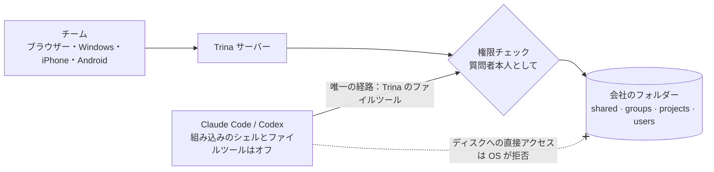

<div align="center">


# Trina AX

**それぞれ使っていた AI を、これからはチームで。**

会社のサーバーで Claude Code と Codex が、会社のファイルとチームのスキルを使って動きます。メンバーは自分のチャットか、チームのトークの横にある自分だけのサイドチャットで質問し、AI はその人が開けるファイルだけを見ます。

[Web サイト](https://ax.trina.app) · [10分で試す](#10分で試す) · [セルフホスト](docs/for-admins.md) · [ドキュメント](docs/README.md) · [Discord](https://discord.gg/zUVfSR8MVk) · [X](https://x.com/trina_ax)

[English](README.md) · [한국어](README.ko.md) · 日本語 · [Español](README.es.md) · [简体中文](README.zh-CN.md)

</div>

## できること

| | チームにとっては |
|---|---|
| **共有ファイルと、人ごとの権限** | 会社の資料を、全社共有（`shared/`）、グループ（`groups/`）、プロジェクト（`projects/`）、個人のフォルダーにまとめます。AI がファイルを開くたびにサーバーが質問者本人の権限でチェックするので、自分が開けないフォルダーは自分の AI にとっても存在しません。 |
| **チームスキル** | チームの仕事のやり方を一度 `SKILL.md` に書いておけば、誰でも `/名前` で呼び出せます。チーム全体・グループ・プロジェクト・個人のスキルを分けて置けて、Claude Code や Codex で使っていたスキルも取り込めます。AI がスキルを変更する前には人に確認を求めます。 |
| **チームのトーク** | グループのトーク、全員のトーク、1対1やグループでのやり取りで、スレッド、メンション、ファイル、写真を送り合えます。管理者も自分が入っていないトークは開けません。 |
| **トークごとに、自分だけの AI サイドチャット**（0.5） | トーク上部の ✦ を押すと、トークの横に Trina が開きます。見えるのは自分だけで、Trina は自分に見えるとおりにトークを読みます。「キャッチアップ」「要約」、各メッセージの「このメッセージをトリナに聞く」。良い回答は **スレッドに送る** か **ルームに送る** のワンクリックで共有できます。メンバーの一部が開けない資料を使った回答なら、送る前に確認が入ります。 |
| **同僚の AI チャットを引き継ぐ**（0.5） | プロジェクトのチャットを共有すると、プロジェクトのメンバーなら誰でもそのチャットを読み、続きを質問できます。メッセージはそれぞれ、送った本人の権限と AI 接続で動きます。 |
| **外部サービスとの接続** | あらゆる MCP サーバー、自社の HTTP API（キーまたは自社の OAuth アプリで）、Google Drive、[Slack](docs/SLACK.md)、そして Notion・Linear・Higgsfield などのカタログ。チャットで「Higgsfield に接続して」と頼めば、カード1枚で終わります。 |
| **定期タスク** | 「毎週月曜 9:00 に、shared/sales の先週のメモを要約して」。作成した本人の権限で、チームのタイムゾーンに合わせて実行されます。 |
| **バージョン履歴とごみ箱** | ファイルには以前のバージョンが残り、復元できます。削除したファイルは、まずチームのごみ箱に入ります。 |
| **PDF・Office・ハングル文書** | PDF、Office、HWP/HWPX ファイルを読み、Word・Excel・PowerPoint・PDF ファイルを作ります。オプションの HWP プラグインをオンにすると、ハングル文書の作成や書式への記入もできます。 |
| **アプリ** | パソコンやスマートフォンのブラウザー、Windows アプリ、[iPhone アプリ](https://apps.apple.com/app/id6829192435)、[Android アプリ](https://github.com/trina-app/trina-ax/releases/tag/android-v1.0.2)（APK。Google Play は審査中）で使えます。 |
| **AI は自分たちのログインで** | Claude Code と Codex は、接続した Claude・ChatGPT のサブスクリプションか API キーで動きます。チームでひとつ接続しても、一人ひとりが自分のものを接続しても構いません。使用量は人ごとに確認でき、上限も設定できます。AI は Trina が提供するものではありません。 |
| **セルフホストもホスティングも** | Linux サーバー（[Docker](docs/INSTALL-DOCKER.md) でも可）、オフィスの Mac、AWS ソウルリージョンの Trina ホスティングから選べます。AGPL-3.0 のフリーソフトウェアです。 |

<sub><b>（0.5）</b>：0.5 のベータリリースにあるか、次のベータに向けて <code>dev</code> に入っている機能です。安定版の 0.4.0 では、まだトークで直接 @Trina を呼びます。</sub>

## 10分で試す

```sh
git clone https://github.com/trina-app/trina-ax.git && cd trina-ax
bun install --frozen-lockfile
bun run demo        # → http://127.0.0.1:19760 · alice / teamax-demo-1 でログイン
```

架空のチームと、スタータースキル6つが入っています。AI はオフなので、AI アカウントは要りません。シークレットウィンドウで `bob` としてもログインしてみてください。alice とは見えるグループフォルダーが違います。Git、Bun 1.3.12、Go 1.27 以上が必要です。**本番環境向けのインストールではありません。** [詳しい手順](docs/QUICKSTART.md)

トークで AI まで試すには、[Docker でのインストール](docs/INSTALL-DOCKER.md)でリリースを指定し（`TRINA_AX_VERSION=0.4.0`。サイドチャットと共有プロジェクトチャットは `0.5.0-beta.1`）、自分の AI アカウントを接続してください。

## しくみ

1. **一度入れておく。** 会社の資料は `shared/` に、提案書の書き方は `skills/proposal/SKILL.md` に置きます。
2. **誰でも質問できる。自分のチャットでも、トークの横でも。** パソコンやスマートフォンのブラウザー、またはアプリから使えます。ターミナルも、ノートPCへのインストールも要りません。回答がトークに出るのは、本人がそこへ送ったときだけです。
3. **権限は人ごと。** AI がファイルを開くたびに、サーバーが質問者本人の権限でチェックします。自分に見えないフォルダーは、自分の AI にとっても存在しません。


<sub><b>同じ質問でも、聞く人によって答えが変わります。</b> 営業の Mina は、売上ファイルのある <code>shared/Finance</code> を開けません。そのため、Mina の AI も開けません。</sub>

## 同じ依頼、違う答え

<table>
<tr>
<td width="50%" valign="top"><b>空のフォルダーで開いた Claude Code</b><br><sub>会社のことを知りようがないので、まず質問を6つ返します。</sub></td>
<td width="50%" valign="top"><b>Trina AX に同じ1行</b><br><sub>チームのファイルと社長の提案書スキルをもとに書き始めます。</sub></td>
</tr>
<tr>
<td></td>
<td></td>
</tr>
</table>

<sub>2026-10-31・11-01 に架空の会社 Dawnroute で実際に出力した結果です。提案書の写真は Higgsfield で作りました。Claude Code が聞き返すのは正しい判断です。空のフォルダーには、どんな会社なのかを伝えるものが何もないからです。Trina は、そのフォルダーを Claude Code に渡します。</sub>

## 内部構造

2026-10-21 の最初のコミットに、すでに権限関数（`server/src/policy/authorize.ts`）が入っていました。今もすべてのファイル呼び出しがこの関数を通ります。



- **エージェントは本物です。** ツール実行は1回の回答につき既定で最大150ラウンド、サブエージェントは同時に最大4つまで（Claude）、Web 検索にも対応しています。サブエージェントも同じ本人として動き、同じチェックを通り、同じ操作記録を残します。
- **入り口を絞っています。** エンジン組み込みのシェルとファイルツールはオフにしてあり、エンジンごとの回帰テストで確認しています。フォルダーにアクセスする経路は Trina のファイルツールだけで、呼び出しのたびにチェックされます。
- **キーはエンジンに渡しません。** トークンはブラウザー内で暗号化してから送信します。エンジンが受け取るのはターンごとの代理トークンだけで、本物のトークンはモデルプロキシが付け加えます。
- **Trina とのチャットは自分のもの。** 自分のチャットとサイドチャットは本人だけ、プロジェクトの共有チャットはそのプロジェクトのメンバーだけが見られます。トークはそのメンバーだけが見られ、管理者も自分が入っていないトークは開けません。管理者に見えるのは AI がどのファイルを読んだかで、会話の内容は見えません。ただし、サーバーの運用者は保存データを読めます。この点は[後述の「データと制限」](#データと制限)にも明記しています。

<sub>OS レベルの分離（エンジン専用アカウント）が適用されるのは、Linux と、ロールアカウント方式で導入した Mac だけです。オフィス Mac はサインイン中のユーザーとして動作し、ローカルデモには OS 分離がありません。→ <a href="docs/security-and-permissions.md">セキュリティと権限（英語）</a> · <a href="docs/PERMISSIONS.md">権限モデル（韓国語）</a></sub>

## チームの最初の1週間

オーナーアカウントを作ったら、**権限 → AI 接続 → メンバー招待 → 最初のスキル → 最初のバックアップ**の順に進めます。以下のスタータースキルは、架空の入力データを使います。

| 役割 | 実際の業務 | コピーして使えるスキル |
|---|---|---|
| 社長・チームリーダー | 週次メモを決定事項・リスク・次のアクションに整理 | [Weekly report](examples/skills/weekly-team-report/SKILL.md) |
| 営業 | 打ち合わせ内容から、勝手な約束を書かずにフォローアップを下書き | [Sales follow-up](examples/skills/sales-follow-up/SKILL.md) |
| マーケティング | 承認済みのブランド資料からキャンペーンブリーフを作成 | [Brand brief](examples/skills/brand-brief/SKILL.md) |
| 経理 | 不足している領収書や不確かな金額を洗い出し、確認に回す | [Expense review](examples/skills/expense-review/SKILL.md) |
| 人事 | 閲覧を許可された規程をもとに、新入社員の質問に回答 | [New-hire guide](examples/skills/new-hire-guide/SKILL.md) |
| 全員 | 議事録から決定事項とタスクを抽出 | [Meeting summary](examples/skills/meeting-summary/SKILL.md) |

スキルは繰り返し使える指示のまとめです。モデルの学習でも、追加の権限でもありません。結果は人が確認してから使います。[チームリーダー向けチェックリスト](docs/for-teams.md) · [すべての例](examples/README.md)

## 導入方法

| | Trina ホスティング | Linux でセルフホスト | オフィス Mac | ローカルデモ |
|---|---|---|---|---|
| 向いているケース | IT 担当者がいないチーム | IT 担当者がいるチーム | 専用の Mac がある小規模オフィス | まずは触ってみたい |
| 運用するのは | Trina（AWS ソウル） | 社内の IT 担当者 | オフィスの運用担当者 | 自分 |
| AI | 利用が認められた Claude・OpenAI の接続 | 同上 | Claude のみ（Codex なし） | オフ |
| 費用 | 14日間の無料トライアル、その後は月額プラン + AI 利用料 | ソフトウェアは無料 + サーバー費用 | ソフトウェアは無料 | 無料 |
| 始め方 | [プランを見る](https://ax.trina.app/#pricing) | [Linux ガイド](docs/INSTALL-LINUX.en.md) · [Docker](docs/INSTALL-DOCKER.md) | [オフィスガイド](docs/OFFICE.en.md) | [クイックスタート](docs/QUICKSTART.md) |

Trina が提供するのはワークスペースで、AI そのものではありません。Claude と OpenAI は、自分たちの使い方が認められているアカウントとプランだけを使ってください。AI の利用料は、接続したアカウントに別途請求されます。セルフホストなら [Anthropic 互換ゲートウェイ](docs/CONFIGURATION.md#anthropic-compatible-gateway)で、Claude Code を DeepSeek、Kimi、GLM などほかのモデルでも動かせます。[最新の料金](https://ax.trina.app/#pricing)

Linux でセルフホストするには、Debian 12/13 または Ubuntu 24.04、systemd と cgroup v2、amd64 または arm64 が必要です。RAM は 4 GB を推奨、ディスクは 20 GB 以上が必要です。インストール、アップデート、バックアップからの復元は社内の IT 担当者が行います。

## データと制限

セルフホストでも、オフラインで動くわけではありません。依頼の処理に必要なコンテキストは、接続した AI プロバイダーに送られます。サーバーの運用者（ホスティングの場合は Trina も含む）は、保存されたファイルとチャットを読めます。アプリの管理者は、他人の個人的な会話を閲覧できません。

<details>
<summary><b>サーバーの外に出るもの、接続のルール、保証しないこと</b></summary>

<br>

- 選択されたコンテキストは選んだ AI プロバイダーに、各リクエストは設定済みの外部連携に送られます。Codex が Web 検索をするたびに、それまでの会話が OpenAI の検索サービスに送られます。チームが音声認識に OpenRouter を選んで許可している場合は、AI が読む動画・音声ファイルの音声が OpenRouter に送られます。サーバーは30分ごとに、自身の公開アドレスを `updates.trina.app` に問い合わせます（`MYCEL_EXIT_ADDRESS_CHECK=off` で無効にできます）。[詳細](docs/security-and-permissions.md)
- サーバーの運用者は、保存されたファイルとチャットを読めます。ホスティングの場合は Trina の運用者も含まれます。アプリの管理者には、全員の個人的な会話を閲覧する機能はありません。
- フォルダーへのアクセス権を外しても、それ以前の回答は消えません。共有範囲を広げるときの確認は、包括的な情報漏えい対策（DLP）ではありません。
- セキュリティ認証、完璧な回答、確実なコスト削減、法務・財務・人事判断の自動化は、いずれもうたっていません。出力内容と導入範囲は人が確認してください。
- AI は写真やスキャンした PDF のページを画像として扱います（管理者がオフにできます）。ただし Linux サーバーでは OCR を実行しないため、スキャン文書や写真はテキスト検索できません。
- Linux サーバーでは、AI は動画・音声ファイルも読みます。均等な間隔で選んだ場面は画像と同じように AI プロバイダーに送られ、音声は管理者が許可した場合（「動画の音声をテキストにする」）にだけ、チームの音声認識の提供元がテキストにします。音声認識が OpenRouter の場合、チームのファイルの音声は OpenRouter とその提供元に送られます。機密のチャットからは送られません。オフィス Mac はまだ動画を読めません。
- HWP/HWPX のテキスト抽出はどのチームでも使えます。[見た目のプレビュー](resources/hwp/README.md)と、AI によるハングル文書の作成・記入は、オプションの HWP Preview プラグインで提供され、macOS か glibc 2.39 以降の Linux が必要です。そのため Debian 12 では**使えません**。
- 管理型のインストールでは、条件を満たす本人の接続が最優先で、その次は個人、グループ、チーム全体に割り当てられた接続の順に使われます。新規の Trina チームでは、会社の接続ひとつをチーム全体で使える設定が既定でオンです。既存の保存済み設定はそのまま維持されます。接続ごとの同意は引き続き適用されます。**このソフトウェアの設定によって、Anthropic や OpenAI の規約上の許可が得られるわけではありません。** ローカルデモでは AI が無効です。開発モードとオフィスのローカルログインモードでは、接続の挙動が異なります。[接続の詳細](docs/FAQ.md)

</details>

## よくある質問

<details>
<summary><b>全員に Claude のシートを用意するのと何が違いますか？</b></summary>

<br>シートを配っても、各自に渡るのは空のワークスペースです。Trina では、1台のサーバー上で全員が同じ会社のフォルダーとチームスキルを使え、各自のフォルダー権限はサーバーが確認します。その上で、人ごとのアカウントを接続することもできます。

</details>

<details>
<summary><b>試すのに AI アカウントは必要ですか？</b></summary>

<br>いいえ。[ローカルデモ](docs/QUICKSTART.md)は AI をオフにした状態で、架空のデータを使って動きます。まずはファイル、スキル、権限を確かめられます。Trina が答えるところを見るには、自分の AI アカウントを接続したサーバーが必要です（[10分で試す](#10分で試す)）。

</details>

<details>
<summary><b>管理者はチャットやトークを読めますか？</b></summary>

<br>いいえ。Trina との自分のチャットとサイドチャットは本人だけ、プロジェクトの共有チャットはそのプロジェクトのメンバーだけが見られます。トークはそのメンバーだけが見られ、管理者も自分が入っていないトークは開けません。操作記録からわかるのは AI がどのファイルを読んだかだけで、会話の内容はわかりません。ただし、サーバーやそのストレージを運用する人は保存データを読めます。

</details>

<details>
<summary><b>韓国の HWP ファイルにも対応していますか？</b></summary>

<br>対応しています。AI はどのサーバーでも HWP/HWPX ファイルのテキストを読み取ります。オプションの HWP Preview プラグインをオンにすると、新しい .hwpx 文書（見出し、段落、リスト、簡単な表）を作ること、既存の .hwp・.hwpx 書式の空欄や表の行を埋めて同じ形式で保存すること（ほかの部分はそのまま）、見た目のプレビューもできます。このプラグインは Debian 12 では動作しません。詳しくは [FAQ](docs/FAQ.md) をご覧ください。

</details>

## 97秒のストーリー

https://github.com/user-attachments/assets/61f3469b-358d-4b3a-9233-c6b23b5db835

<sub><b>音声あり（英語）。</b>チームリーダーが Claude を一度セットアップすれば、入社初日の新人の提案書もリーダーが作ったように仕上がります。<br>アニメーションで、1:15 に実際のアプリ画面が出ます。会社は架空です。</sub>

## コミュニティと貢献

質問や交流は [Discord](https://discord.gg/zUVfSR8MVk)（「Trina AX」サーバー）で、最新情報は [X](https://x.com/trina_ax) でどうぞ。

[最新リリースとチェックサム](https://github.com/trina-app/trina-ax/releases/latest) · [変更履歴](CHANGELOG.md) · [サポート](SUPPORT.md) · [貢献ガイド](CONTRIBUTING.md) · [セキュリティ報告](SECURITY.md) · [開発](docs/DEVELOPMENT.md) · [設定](docs/CONFIGURATION.md) · [機械可読の索引](llms.txt)

アプリは英語、韓国語、インドネシア語、日本語、スペイン語に対応しています。公開済みのインストーラーには、ソースの最新の変更がまだ反映されていないことがあります。各リリースノートを確認してください。

## ライセンス

[AGPL-3.0-only](LICENSE) のもとで、商用利用も含めて自由に使えます。改変版をネットワーク経由で提供する場合は、その利用者にソースコードを提供してください。クラウドプロトコルは別途 MIT ライセンスで提供しています（[ライセンス](shared/src/cloud-protocol/LICENSE)）。[NOTICE](NOTICE) · [サードパーティ通知](docs/THIRD-PARTY-NOTICES.md)

Claude Code と Codex にはそれぞれ独自の規約があります。本プロジェクトは Anthropic および OpenAI の公認を受けたものではありません。Claude は Anthropic の商標です。
