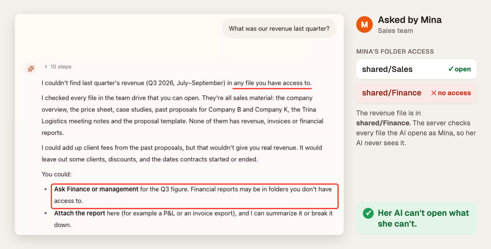
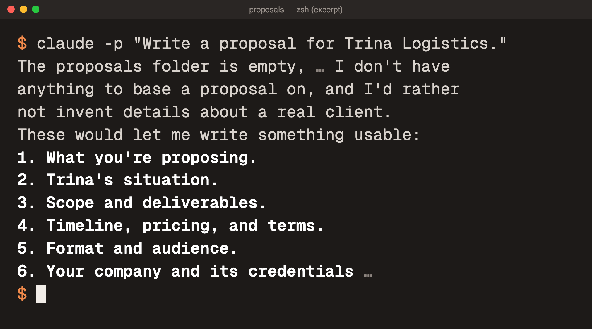
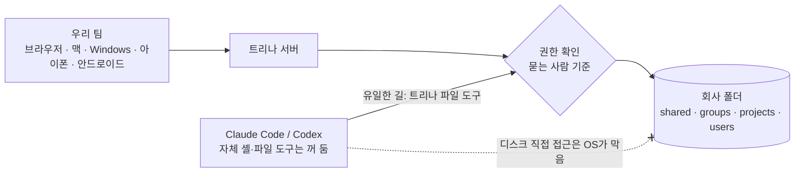

<div align="center">


# 트리나 AX

**각자 쓰던 AI, 이제 팀이 같이 써요.**

Claude Code와 Codex가 팀 전체를 위해 일해요. 회사 파일을 알고, 우리 팀이 일하는 방식을 따르고, 사람마다 볼 수 있는 것만 봐요. 견적서 쓰는 법을 한 번 적어 두면, 누구의 AI든 우리 단가표로 같은 방식의 견적서를 만들어요.

[웹사이트](https://ax.trina.app) · [10분 만에 써 보기](#10분-만에-써-보기) · [직접 설치](docs/for-admins.ko.md) · [문서](docs/README.md) · [Discord](https://discord.gg/zUVfSR8MVk) · [X](https://x.com/trina_ax)

[English](README.md) · 한국어 · [日本語](README.ja.md) · [Español](README.es.md) · [简体中文](README.zh-CN.md)

</div>

## 우리 팀에 생기는 변화

| | 이렇게 달라져요 |
|---|---|
| **모두가 같은 방식으로** | 견적서 쓰는 법을 한 번 적어 두면, 그다음부터는 누구의 AI든 회사 단가표로 그 방식대로 견적서를 만들어요. 입사 첫날인 사람도요. |
| **회사 파일은 함께, 권한은 사람마다** | 회사 자료는 한곳에 모이고, AI는 묻는 사람이 열 수 있는 것만 봐요. 영업팀의 AI가 재무팀 숫자를 볼 일은 없어요. |
| **팀 대화방** | 팀 대화방, 전체 대화방, 1:1 대화에서 파일과 사진을 주고받아요. 스레드와 그룹 대화는 0.5에서 새로 생겼어요. |
| **대화방 옆, 나만 보는 AI** <sub>0.5 신규</sub> | 대화방 옆에서 트리나에게 물어봐요. "못 읽은 거 정리해 줘", "이 논의 요약해 줘", 메시지 하나를 두고 묻는 것도 돼요. 나만 보이고, 쓸 만한 답은 한 번 눌러 대화방이나 스레드에 보내요. 방 사람 중 누군가 못 여는 자료를 쓴 답이면 보내기 전에 한 번 더 확인해요. |
| **동료가 하던 AI 대화 이어받기** <sub>0.5 신규</sub> | Mina가 시작한 견적 채팅을 Sam이 그대로 이어서 물어요. 메시지마다 보낸 사람의 권한과 AI 계정으로 돌아요. |
| **쓰던 도구와 연결** | Google Drive, Slack, Notion, Linear, Higgsfield, 그리고 어떤 MCP 서버나 회사 API든 연결해요. 채팅에서 "Higgsfield 연결해 줘"라고 하면 카드 한 장으로 끝나요. AI가 거기에 뭔가 쓰거나 보내기 전에는 따로 허용해 두지 않은 한 먼저 물어요. |
| **알아서 돌아가는 일** | "매주 월요일 9시에 지난주 영업 메모 요약해 줘." 정한 시간마다, 만든 사람의 권한으로 돌아요. |
| **잃어버릴 걱정 없이** | 파일을 예전 버전으로 되돌릴 수 있고, 지운 파일은 팀 휴지통에 남아 있어요. |
| **실제 업무 문서 그대로** | PDF, Word, Excel, PowerPoint, 한글(HWP) 파일을 읽고, Word·Excel·PowerPoint·PDF 파일을 만들어요. 선택 플러그인을 켜면 한글 문서도 만들고 양식도 채워요. |
| **어느 기기에서나** | 컴퓨터·휴대폰 브라우저, App Store의 [아이폰](https://apps.apple.com/app/id6829192435)·[맥](https://apps.apple.com/app/trina-ax/id6829192435) 앱, Windows 앱, [안드로이드 앱](https://github.com/trina-app/trina-ax/releases/tag/android-v1.0.2)(Google Play 심사 중)으로 써요. |
| **AI는 우리 계정으로** | 연결한 Claude·ChatGPT 구독이나 API 키로 돌아요. 팀에 하나만 연결해도, 사람마다 자기 계정을 연결해도 되고, 사람별 사용량과 한도도 정할 수 있어요. AI 이용은 트리나가 제공하지 않아요. |
| **우리 서버든, 트리나 호스팅이든** | 회사 서버나 사무실 맥에 직접 설치하거나, AWS 서울의 트리나 호스팅을 써요. 소프트웨어는 무료 오픈소스예요. |

<sub><b>0.5 신규</b>: 0.5 베타 릴리스에 있거나 다음 베타에 들어가요. 지금 안정판(0.4)에서는 대화방 안에서 바로 @트리나를 불러요.</sub>

## 가상 회사 Dawnroute의 하루

- **월요일 오전 9시.** Alex의 알림함에 지난주 영업 요약이 와 있어요. 한 번 만들어 둔 예약 작업이 Alex의 권한으로 알아서 돌았어요.
- **오전 10시 30분.** Sam이 영업 대화방에 Northwind Foods가 오늘 견적을 달라고 했다고 써요. Mina는 방 옆에서 트리나에게 단가표로 견적을 뽑아 달라고 하고, 숫자를 확인한 뒤 **스레드에 보내기**를 눌러요. 견적이 Sam의 메시지 아래 스레드에 올라가요. <sub>0.5 신규</sub>
- **오후 2시.** Mina는 고객 미팅에 나가 있어요. Sam이 영업 프로젝트에서 Mina의 Northwind 견적 채팅을 열고 배송비 무료 버전도 만들어 달라고 이어서 물어요. 트리나는 Mina가 하던 데서 이어 가되, Sam의 권한으로 일해요. <sub>0.5 신규</sub>
- **오후 4시.** Mina가 지난 분기 매출을 물어요. 매출 파일은 Mina가 못 여는 재무 폴더에 있어서, Mina의 AI도 열지 못해요.



<sub><b>같은 질문도 사람마다 답이 달라요.</b> 영업팀 Mina는 매출 파일이 있는 <code>shared/Finance</code>를 열 수 없어요. 그래서 Mina의 AI도 못 열어요.</sub>

## 같은 요청, 다른 답

<table>
<tr>
<td width="50%" valign="top"><b>빈 폴더에서 연 Claude Code</b><br><sub>회사를 알 수 없으니 질문 여섯 개부터 돌려줘요.</sub></td>
<td width="50%" valign="top"><b>트리나 AX, 같은 한 줄</b><br><sub>팀 파일과 대표의 제안서 스킬에서 시작해요.</sub></td>
</tr>
<tr>
<td></td>
<td></td>
</tr>
</table>

<sub>2026-10-31·11-01에 가상 회사 Dawnroute 자료로 실제로 돌린 결과예요. 덱 사진은 Higgsfield로 만들었어요. Claude Code가 되묻는 게 맞아요. 빈 폴더에는 우리가 누군지 알려 줄 게 없으니까요. 트리나는 그 폴더를 채워 줘요.</sub>

## 궁금한 점

<details>
<summary><b>AI 이용료도 포함인가요?</b></summary>

<br>아니요. 트리나는 업무 공간이에요. 팀이 자기 Claude·ChatGPT 구독이나 API 키를 연결하고, AI 이용료는 그 계정으로 나가요. 쓰임새에 맞게 허용된 계정과 요금제만 연결하세요.

</details>

<details>
<summary><b>팀원마다 Claude 좌석을 사 주는 것과 뭐가 다른가요?</b></summary>

<br>좌석은 사람마다 빈 작업 공간을 줘요. 트리나는 서버 하나에서 모두가 같은 회사 폴더와 팀 스킬로 시작하게 하고, 사람마다 폴더 권한을 서버가 확인해요. 사람별 계정을 연결해도 돼요.

</details>

<details>
<summary><b>써 보려면 AI 계정이 있어야 하나요?</b></summary>

<br>아니요. [로컬 데모](docs/QUICKSTART.ko.md)는 AI를 끄고 가상 자료로 돌아서, 파일·스킬·권한부터 먼저 볼 수 있어요. 트리나가 답하는 걸 보려면 내 AI 계정을 연결한 서버가 필요해요([써 보기](#10분-만에-써-보기)).

</details>

<details>
<summary><b>관리자가 우리 대화와 대화방을 볼 수 있나요?</b></summary>

<br>아니요. 트리나와 나눈 내 채팅과 사이드 채팅은 나만 보고, 공유 프로젝트 채팅은 그 프로젝트 사람만 봐요. 대화방은 그 방 사람만 보고, 관리자도 자기가 속하지 않은 대화방은 못 열어요. 활동 기록에는 AI가 어떤 파일을 읽었는지만 나오고 대화 내용은 나오지 않아요. 서버나 저장소를 운영하는 사람은 저장된 데이터를 볼 수 있어요.

</details>

<details>
<summary><b>한글(HWP) 파일도 되나요?</b></summary>

<br>돼요. AI가 HWP/HWPX의 글자는 어느 서버에서나 읽어요. 선택 플러그인(한글 문서 미리보기)을 켜면 새 .hwpx 문서(제목·문단·목록·간단한 표)도 만들고, 이미 있는 .hwp·.hwpx 양식의 빈칸·표 행을 채워 같은 형식으로 저장하고(나머지는 그대로 둬요), 화면 미리보기도 보여 줘요. 이 플러그인은 Debian 12에서는 돌지 않아요. [자세히](docs/FAQ.ko.md)

</details>

## 97초 이야기

https://github.com/user-attachments/assets/f19762ef-84de-414a-9f5d-69792f319ec7

<sub><b>소리를 켜고 보세요.</b> 대표님이 Claude를 한 번 세팅하면, 입사 첫날 신입의 제안서도 대표님이 쓴 것처럼 나와요.<br>애니메이션이고, 1:15에 실제 앱 화면이 나와요. 회사는 가상이에요.</sub>

## 설치하고 운영하는 분께

### 10분 만에 써 보기

```sh
git clone https://github.com/trina-app/trina-ax.git && cd trina-ax
bun install --frozen-lockfile
bun run demo --locale ko   # → http://127.0.0.1:19760 · alice / teamax-demo-1 로 로그인
```

가상 팀과 기본 스킬 여섯 개가 들어 있어요. AI는 꺼져 있어서 AI 계정이 필요 없어요. 시크릿 창에서 `bob`으로도 로그인해 보세요. 둘에게 보이는 그룹 폴더가 달라요. Git, Bun 1.3.12, Go 1.27 이상이 필요하고, **실제 운영용 설치는 아니에요**. [자세한 안내](docs/QUICKSTART.ko.md)

대화방에서 AI까지 써 보려면 [Docker 설치](docs/INSTALL-DOCKER.md)에서 릴리스를 골라(`TRINA_AX_VERSION=0.4.0`, 사이드 채팅의 첫 버전과 공유 프로젝트 채팅은 `0.5.0-beta.1`) 띄우고 내 AI 계정을 연결하세요.

### 첫 주에 할 일

owner 계정을 만든 다음 **권한 → AI 연결 → 팀원 초대 → 첫 스킬 → 첫 백업** 순서로 가세요. 아래 기본 스킬은 가상 자료로 시작해요.

| 역할 | 실제 업무 | 복사해서 쓸 스킬 |
|---|---|---|
| 대표·팀장 | 주간 기록을 결정 사항, 위험, 다음 할 일로 정리 | [주간 보고](examples/skills/weekly-team-report/SKILL.md) |
| 영업 | 회의에 없던 약속은 빼고 후속 메일 초안 작성 | [영업 후속 연락](examples/skills/sales-follow-up/SKILL.md) |
| 마케팅 | 승인된 브랜드 자료로 캠페인 기획 초안 작성 | [브랜드 브리프](examples/skills/brand-brief/SKILL.md) |
| 재무 | 빠진 영수증과 확인이 필요한 금액 표시 | [비용 검토](examples/skills/expense-review/SKILL.md) |
| 인사 | 볼 수 있는 정책 문서로 신입 질문에 답변 | [입사 안내](examples/skills/new-hire-guide/SKILL.md) |
| 모든 팀원 | 회의록에서 결정과 할 일 뽑기 | [회의 요약](examples/skills/meeting-summary/SKILL.md) |

스킬은 반복 업무에 쓰는 지침이에요. 모델을 학습시키거나 권한을 더 주지는 않아요. 결과는 쓰거나 공유하기 전에 사람이 검토하세요. [팀장 체크리스트](docs/for-teams.ko.md) · [예제 전체](examples/README.ko.md)

### 운영 방법

| | 트리나 호스팅 | 리눅스 직접 설치 | 사무실 맥 | 로컬 데모 |
|---|---|---|---|---|
| 잘 맞는 팀 | IT 담당자가 없는 팀 | IT 담당자가 있는 팀 | 전용 맥이 있는 작은 사무실 | 둘러보기 |
| 운영 | 트리나(AWS 서울) | 회사 IT | 사무실 담당자 | 직접 |
| AI | 사용이 허용된 Claude·OpenAI 연결 | 같음 | Claude만(Codex 없음) | 꺼짐 |
| 비용 | 14일 무료 체험, 그다음 월 요금제 + AI 이용료 | 무료 소프트웨어 + 서버 비용 | 무료 소프트웨어 | 무료 |
| 시작 | [요금제 보기](https://ax.trina.app/#pricing) | [리눅스 안내](docs/INSTALL-LINUX.md) · [Docker](docs/INSTALL-DOCKER.md) | [사무실 맥 안내](docs/OFFICE.md) | [빠른 체험](docs/QUICKSTART.ko.md) |

트리나는 업무 공간을 드리고, AI는 드리지 않아요. Claude·OpenAI 계정과 요금제는 쓰임새에 맞게 허용된 것만 연결하세요. AI 이용료는 연결한 계정으로 따로 나가요. 직접 설치했다면 [Anthropic 호환 게이트웨이](docs/CONFIGURATION.md#anthropic-compatible-gateway)로 Claude Code를 DeepSeek·Kimi·GLM 같은 다른 모델로도 돌릴 수 있어요. [현재 가격](https://ax.trina.app/#pricing)

리눅스 직접 설치에는 Debian 12/13 또는 Ubuntu 24.04, systemd와 cgroup v2, amd64나 arm64, RAM 4 GB(권장), 디스크 20 GB(최소)가 필요해요. 설치, 업데이트, 백업 복구는 회사 IT 담당자가 맡아요.

### 속을 들여다보면

2026-10-21 첫 커밋에 이미 권한 함수(`server/src/policy/authorize.ts`)가 있었고, 지금도 모든 파일 호출이 그 함수를 지나요.



- **에이전트는 진짜예요.** 답 하나에 도구를 기본 150회까지 쓰고, 하위 에이전트를 한 번에 4개까지(Claude) 띄우고, 웹 검색도 해요. 하위 에이전트도 같은 사람으로 일해요. 같은 확인을 거치고 같은 활동 기록을 남겨요.
- **들어가는 길은 좁아요.** 엔진 자체의 셸과 파일 도구는 꺼 두고, 엔진마다 회귀 시험으로 확인해요. 폴더에 닿는 길은 트리나 파일 도구뿐이고, 부를 때마다 권한을 봐요.
- **키는 엔진 손에 닿지 않아요.** 토큰은 브라우저에서 봉인해서 보내요. 엔진은 턴마다 바뀌는 대리 토큰만 받고, 진짜 값은 모델 프록시가 붙여요.
- **트리나와 나눈 대화는 내 거예요.** 내 채팅과 사이드 채팅은 나만 보고, 공유 프로젝트 채팅은 그 프로젝트 사람만 봐요. 대화방은 그 방 사람만 보고, 관리자도 자기가 속하지 않은 대화방은 못 열어요. 관리자에게는 AI가 어떤 파일을 읽었는지만 보여요. 다만 서버를 운영하는 사람은 저장된 데이터를 볼 수 있고, 이 내용은 [아래](#데이터와-한계)에 적어 뒀어요.

<sub>OS 격리(엔진 전용 계정)는 리눅스와 역할 계정 맥 설치에만 있어요. 사무실 맥은 로그인한 사용자로 돌고, 로컬 데모에는 OS 격리가 없어요. → <a href="docs/security-and-permissions.ko.md">보안과 권한</a> · <a href="docs/PERMISSIONS.md">권한 구조</a></sub>

### 데이터와 한계

직접 설치해도 오프라인으로 도는 건 아니에요. 요청에 필요한 내용은 연결한 AI 회사로 가요. 서버 운영자(호스팅이면 트리나 포함)는 저장된 파일과 채팅을 볼 수 있어요. 앱 관리자는 남의 대화를 열어 볼 수 없어요.

<details>
<summary><b>서버 밖으로 나가는 것, 연결 규칙, 약속하지 않는 것</b></summary>

<br>

- 고른 내용은 선택한 AI 회사로 가고, 설정한 외부 연동도 요청을 받아요. Codex 웹 검색은 그때까지의 대화를 OpenAI 검색 서비스로 보내요. 팀이 음성 제공자로 OpenRouter를 고르고 허용했다면 AI가 읽는 영상·오디오 파일의 소리도 OpenRouter로 가요. 서버는 30분마다 `updates.trina.app`에 자기 공인 주소를 물어요(`MYCEL_EXIT_ADDRESS_CHECK=off`로 끌 수 있음). [자세히](docs/security-and-permissions.ko.md)
- 서버 운영자는 저장된 파일과 채팅을 볼 수 있어요. 호스팅이면 트리나 운영자도 포함돼요. 앱 관리자에게는 남의 대화를 보는 화면이 없어요.
- 폴더 권한을 빼도 예전 답에 인용된 내용은 지워지지 않아요. 더 넓게 공유할 때 받는 확인이 모든 유출을 막아 주지는 않아요.
- 보안 인증, 완벽한 답, 비용 절감, 법무·재무·인사 결정의 자동화는 약속하지 않아요. 결과와 운영 범위는 사람이 검토하세요.
- AI는 사진과 스캔한 PDF 쪽을 이미지로 봐요(관리자가 끌 수 있음). 다만 리눅스 서버에는 OCR이 없어서 스캔 문서와 사진은 글자로 검색되지 않아요.
- 리눅스 서버에서는 AI가 영상·오디오 파일도 읽어요. 일정한 간격으로 뽑은 장면은 이미지처럼 AI 회사로 가고, 소리는 관리자가 허용했을 때만("영상 소리를 글로 바꾸기") 팀의 음성 제공자가 글로 바꿔요. 음성 제공자가 OpenRouter면 팀 파일의 소리가 OpenRouter와 그 제공사로 가요. 기밀 채팅에서는 보내지 않아요. 사무실 맥은 아직 영상을 읽지 못해요.
- HWP/HWPX 글자 추출은 어느 팀이든 돼요. [화면 미리보기](resources/hwp/README.md)와 AI의 한글 문서 만들기·채우기는 선택 플러그인(한글 문서 미리보기)이고 macOS나 glibc 2.39 이상의 리눅스가 필요해서, Debian 12에서는 **쓸 수 없어요**.
- 관리형 설치에서는 개인 연결이 먼저 쓰이고, 그다음 사람, 그룹, 팀 전체에 배정한 연결 순서로 쓰여요. 새 트리나 팀은 회사 연결 하나를 팀 전체가 쓸 수 있게 기본으로 켜져 있고, 이미 저장한 선택은 그대로 유지돼요. 연결마다 받는 동의도 그대로 적용돼요. **이 설정이 Anthropic이나 OpenAI 약관상의 허락을 뜻하지는 않아요.** 로컬 데모는 AI를 끄고, 개발 모드와 사무실 로컬 로그인 모드는 연결 방식이 달라요. [연결 자세히](docs/FAQ.ko.md)

</details>

## 함께 만들기

질문은 [Discord](https://discord.gg/zUVfSR8MVk)("Trina AX" 서버)에 남기고, 소식은 [X](https://x.com/trina_ax)에서 받아 보세요.

[최신 릴리스와 체크섬](https://github.com/trina-app/trina-ax/releases/latest) · [변경 기록](CHANGELOG.md) · [도움 받기](SUPPORT.md) · [기여하기](CONTRIBUTING.md) · [보안 신고](SECURITY.md) · [개발](docs/DEVELOPMENT.md) · [설정](docs/CONFIGURATION.md) · [기계용 색인](llms.txt)

앱은 영어, 한국어, 인도네시아어, 일본어, 스페인어로 쓸 수 있어요. 배포된 설치본은 소스보다 늦을 수 있으니 릴리스 노트를 확인하세요.

## 라이선스

[AGPL-3.0-only](LICENSE)로 상업적인 용도까지 자유롭게 쓸 수 있어요. 고친 버전을 네트워크로 제공한다면 그 사용자에게 소스도 제공해야 해요. 클라우드 프로토콜은 따로 MIT 라이선스예요([라이선스](shared/src/cloud-protocol/LICENSE)). [고지](NOTICE) · [제3자 고지](docs/THIRD-PARTY-NOTICES.md)

Claude Code와 Codex에는 각자의 약관이 있고, 이 프로젝트는 Anthropic이나 OpenAI의 보증을 받지 않았어요. Claude는 Anthropic의 상표예요.
