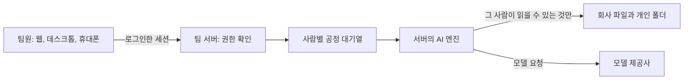

# 트리나 AX

[English](README.md) · [한국어](README.ko.md)

트리나 AX는 회사 파일과 AI를 함께 쓰는 팀 앱이에요. 팀원은 웹 앱 하나에 로그인해요. AI(Claude Code, 선택하면
Codex CLI도)는 팀 서버에서 실행돼요. 파일 도구는 요청한 사람의 권한을 매번 확인해요.



## 상태

공개 배포본은 [GitHub Releases](https://github.com/trina-app/trina-ax/releases)에 있어요.
변경과 게시 상태는 [CHANGELOG.md](CHANGELOG.md), 전체 문서 입구는 [docs/README.md](docs/README.md)를 보세요.
맥 데스크톱 DMG는 Apple 서명·공증 준비 중이라 배포하지 않아요. 사무실용 맥 ZIP은 서버 묶음이에요. v0.2.3은 GitHub Releases에서 배포하며 트리나 업데이트 피드는 아직 운영하지 않아 자동 업데이트에 의존하면 안 돼요.
준비된 맥에서 약 10분 동안 합성 데이터로 둘러보려면 [빠른 체험 안내(영문)](docs/QUICKSTART.md)를 따라 해 보세요.

## 기능

- **권한이 있는 파일.** 팀·그룹·프로젝트·개인 폴더. AI는 요청한 사람이 볼 수 있는 파일만 봐요.
- **서버에서 도는 AI와 채팅.** 팀원 컴퓨터마다 Claude를 설치할 필요가 없어요.
- **팀 스킬.** 업무 절차를 파일로 저장해요. 폴더 쓰기 권한으로 관리를 나누고, 팀원 제안을 검토해 등록할 수 있어요.
- **공정한 대기열.** 각자의 작업은 순서대로 돌고, 서버는 사람들 사이에 차례를 나눠요.
- **예약 작업과 알림함.** 정한 시간에 작업을 돌려요. 실행 결과는 새 채팅에서 확인해요.
- **사용량과 한도.** 사람·모델·스킬별 사용량을 보고 CSV로 내보내요. 비용은 추정값이며 청구서가 아니에요.
- **오피스 문서.** PDF·Word(DOCX)·Excel·PowerPoint(PPTX) 미리보기와 글자 읽기. HWP/HWPX는 글자 읽기만 지원하며 미리보기·생성은 지원하지 않아요. 이미지는 OCR로 글자만 읽으며 장면을 이해하는 기능은 아니에요. 결과는 파일과 설치된 변환 도구에 따라 달라요.
- **데스크톱 앱.** AI가 쓸 수 있는 앱 안 브라우저가 있는 맥·윈도우 앱. 사이트 접근은 개인·팀의 허용 설정을 따라요.

- **외부 서비스.** 개인·팀 MCP 서버와 HTTP API를 연결해요. 개인 외부 서비스 연결은 기본으로 켜져 있고 관리자가 끌 수 있어요. 지원 범위는 [연결 안내](docs/INTEGRATIONS.md)에 있어요.
- **모바일 웹.** 휴대폰 브라우저에서도 팀 서버에 접속해요.

## AI 연결과 호스팅

Claude Code는 Claude 구독·Anthropic API 키, Codex CLI는 ChatGPT 로그인·OpenAI API 키로 연결해요.
관리형 설치에서는 소유자가 팀 연결을 설정해요. 개인 AI 연결은 기본으로 켜져 있고 소유자가 끌 수 있어요. 구독 하나를 여러 팀원이 공유하는 기능은 기본으로 꺼져 있어요. 개발 모드는 맥 사용자의 CLI 로그인을 써요.
OpenAI 호환 API 엔진은 실험 단계이며 모델마다 호환성이 달라요. AI 제공사의 비용과 약관은 별도예요.
회사 리눅스 서버·사무실 맥에 직접 설치하거나 [트리나 호스팅](https://ax.trina.app)을 문의할 수 있어요.

## 실행하기

| 용도 | 안내 |
|---|---|
| 맥 한 대에서 써 보기(개발 모드) | [docs/INSTALL.md](docs/INSTALL.md) 1장 |
| 맥 운영 설치 | [docs/INSTALL.md](docs/INSTALL.md) 2장 |
| 사무실 맥 한 대 + 사무실 망의 데스크 PC | [docs/OFFICE.md](docs/OFFICE.md) |
| 리눅스 서버 | [docs/INSTALL-LINUX.md](docs/INSTALL-LINUX.md) |

자체 설치한 서버에 사무실 밖에서 접속하려면 사무실 망, Cloudflare Tunnel, Tailscale, 직접 운영하는 중계(`relay/`) 중
하나를 써요.

## 개발

```sh
bun install
bun run build:native   # Go 필요
bun run dev            # 서버, 웹 앱, 로컬 중계
bun run test:unit
```

필요한 도구와 전체 설정은 [docs/INSTALL.md](docs/INSTALL.md) 1장, 설계 결정은 [docs/DECISIONS.md](docs/DECISIONS.md)에 있어요.

## 폴더 구성

| 폴더 | 내용 |
|---|---|
| `server/` | 팀 서버(Bun) |
| `web/` | 웹 앱(React) |
| `desktop/` | 데스크톱 앱(Electron) |
| `relay/` | 팀 서버를 인터넷에 연결하는 중계 |
| `native/` | 도구 관문·실행기·등록 도구(Go) |
| `shared/` | 공통 코드. `shared/src/cloud-protocol/`은 MIT |
| `editions/trina/branding/` | 트리나 이름·소스 링크·배포 채널 |
| `mobile/`, `menubar/` | 휴대폰 앱과 맥 메뉴 막대 앱 |

트리나 호스팅 서비스(결제·호스팅·운영 콘솔)와 trina.app 사이트는 비공개이며 이 저장소에 없어요.

## 데이터와 개인정보

파일과 채팅은 팀 서버에 저장돼요. 서버는 답을 만들기 위해 그 사람이 읽을 수 있는 맥락을 모델 제공사(예: Anthropic)에
보내요. 서버 관리자는 저장된 데이터를 볼 수 있어요.

## 라이선스

트리나 AX는 **AGPL-3.0-only**예요. [LICENSE](LICENSE)와 [NOTICE](NOTICE)를 보세요. `shared/src/cloud-protocol/`은 별도
MIT 라이선스예요. 제3자 고지: [docs/THIRD-PARTY-NOTICES.md](docs/THIRD-PARTY-NOTICES.md).

바꾼 버전을 네트워크 서비스로 운영하면 사용자에게 그 소스 코드를 제공해야 해요(AGPL 13조). 앱은 로그인 화면과
**설정 › 정보**에 소스 코드 링크를 보여 줘요.

Claude Code와 Codex는 각자 약관이 있는 별도 제품이에요. 이 프로젝트는 Anthropic이나 OpenAI의 보증을 받지 않았어요.
