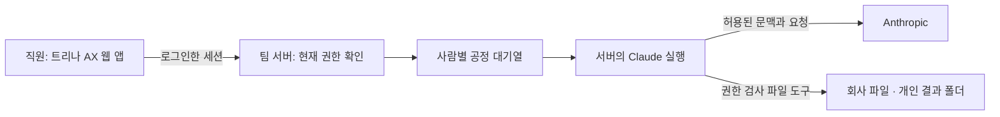

# 트리나 AX — 서버판

[English](README.md) · [한국어](README.ko.md)

회사 파일과 Claude를 팀 앱에서 사용해요. 직원은 트리나 AX에 로그인하고, Claude는 팀 서버에서 실행돼요. 파일 작업은 사용자의 현재 권한을 확인해요.

**공개 준비 중인 로컬 후보예요.** 새 서버판의 공개 저장소·배포본·설치 링크는 아직 확정하지 않았어요. 아래 설명은 구현 범위이며 실제 클라우드 운영이나 실제 모델 검증 완료를 뜻하지 않아요. 가격·체험·환불·호스팅 리전은 계약 전에 별도로 확정해야 해요.

- PC·휴대폰 브라우저와 설치형 웹 앱에서 같은 팀 작업을 이어가요. 이 방식에는 직원 PC의 Claude 설치가 필요하지 않아요.
- 회사 파일, 재사용하는 스킬, 개인·모델·스킬별 사용량과 CSV를 한곳에서 관리해요. PDF·Office·HWP/HWPX 텍스트 추출은 파일 형식과 실제 문서 상태에 따라 확인해야 해요.
- 개인 자격증명이 기본이고 회사 API 지원과 한도는 관리자가 설정해요. 팀 구독 공유는 기본 OFF예요. 설정을 켜는 행위는 모델 제공사의 이용 승인을 대신하지 않아요.
- 사용자마다 대기 작업의 접수 순서를 유지하고, 실행 중인 작업 수와 순환 순서를 고려해 배분해요. 표시 순서는 고정 시작 시각이나 대기 시간 보장이 아니에요.
- 예약 템플릿은 사용자가 만들기 전에는 실행되지 않아요. 예약도 같은 대기열과 현재 권한을 사용하고 기본 결과는 개인 폴더에 저장해요.
- 예약 결과와 재연결 안내는 앱 알림함에 남아요. 기기 알림은 서버 설정과 명시적 동의가 필요한 선택 기능이고 전달을 보장하지 않아요.

파일·대화는 팀 서버에 저장되지만 모델에 필요한 허용된 문맥은 Anthropic으로 전송돼요. 서버 관리자와 권한을 받은 운영자는 저장 데이터에 접근할 수 있어요. 비용 화면은 제공사 청구서가 아닌 추정치예요. 한 작업에서 여러 스킬을 쓰면 스킬별 비용이 중복될 수 있어 합계로 더하면 안 돼요.

## 다른 선택지와 비교할 때

2026-10-27 공식 문서 확인 기준이에요. 기존 허브 비교표의 “Claude 안에서 사용” 기준은 새 서버판과 맞지 않아 사용 화면·운영 책임으로 바꿨어요. 경쟁 제품에도 권한·조직 스킬·사용량 관리 기능이 있으므로 단순한 O/X 점수로 우열을 주장하지 않아요. 요금 숫자와 계약별 조건은 비교에서 제외했어요.

| 선택지 | 확인한 사용 방식과 조건 | 도입 시 확인할 점 |
| --- | --- | --- |
| 트리나 AX 서버판 후보 | 팀 앱과 자체 운영 서버, 현재 권한 검사, 공정 대기열, 예약·알림 | 새 공개 배포본 준비, 지원 환경·실제 모델 검증, 운영·백업 담당 필요 |
| Claude Team / Enterprise | 조직 플러그인·스킬을 배포할 수 있고, 그룹별 플러그인 설정은 Enterprise 조건이에요. [공식 관리 문서](https://support.claude.com/en/articles/13837433-manage-plugins-for-your-organization) | 필요한 데이터 연결, 그룹 관리, 제공사 이용 조건 |
| ChatGPT Business / Enterprise / Edu | Company Knowledge는 허용된 연결 소스의 권한을 존중해요. 지원 소스와 워크스페이스 설정이 필요해요. [공식 도움말](https://help.openai.com/en/articles/12628342-company-knowledge-in-chatgpt) | 앱별 인증·기능, 플랜별 관리·감사 범위 |
| Microsoft 365 Copilot | Microsoft 365 서비스 경계에서 접근 통제와 Purview 보호·감사를 사용해요. [공식 아키텍처](https://learn.microsoft.com/en-us/microsoft-365/copilot/architecture-data-protection-auditing) | 기존 Microsoft 365 권한 설정과 외부 커넥터별 색인·권한 정책 |
| Google Workspace with Gemini | Workspace의 생성형 AI 제품과 데이터 보호 정책을 사용해요. [공식 보안 안내](https://workspace.google.com/security/ai-privacy/) | 대상 Workspace 에디션·관리 설정·필요한 파일의 실제 처리 여부 |
| Glean | Glean Hosted와 고객 클라우드의 Glean 관리형 배포를 구분해요. Customer Hosted도 고객이 직접 수정·운영하는 전통적 자체 호스팅과는 달라요. [공식 배포 문서](https://docs.glean.com/get-started/prepare/about-deployment) | Glean의 운영 접근, 계약, 연결 소스와 인프라 책임 |

HWP/HWPX가 다른 제품의 지원 목록에 없다는 사실만으로 “지원하지 않는다”고 단정하지 않아요. 실제 파일과 선택한 플랜으로 확인해야 해요. 부록 C의 가격·지원표를 그대로 재사용하지 않았고, 새로 확인한 위 항목만 담았어요.

## 소스와 운영 경계

공통 엔진·권한·대기열·직원 앱은 코어에 두고, 트리나 브랜드·결제·호스팅 정책은 `editions/trina`에 둬요. 트리나 추가 코드는 **AGPL-3.0-only**이며 [LICENSE](LICENSE)와 [NOTICE](NOTICE), 의존성 고지를 함께 확인해야 해요. 고객 데이터·자격증명·회사 전용 운영 설정은 공개 소스가 아니에요.

공개 검토 뒤 배포 버전과 일치하는 소스 및 설치 안내를 연결해야 해요. 네트워크 제공 시 대응 소스를 받을 수 있는 경로도 배포 검토에 포함해요. 라이선스 조건은 [GNU AGPL 원문](https://www.gnu.org/licenses/agpl-3.0.html)을 기준으로 확인해요.

로컬 사이트 개발 방법은 [website/README.md](editions/trina/website/README.md), 판매·운영 구현 경계는 [OPERATIONS.md](editions/trina/OPERATIONS.md)를 참고해요. 최신 코어와 판매판을 로컬에서 조립한 검토 후보이며, [동기화 기록](docs/UPSTREAM.md)에 실제 반입 기준과 검증 경계를 남겼어요.
