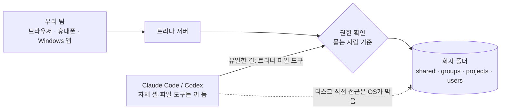

<div align="center">


# 트리나 AX

**Claude Code, 한 번 세팅하면 회사 전체가 씁니다.**

회사 서버 하나에서 Claude Code와 Codex가 돌아가요. 회사 파일, 팀 스킬, 사람마다 다른 폴더 권한까지 그 서버에 있어요. 팀원은 브라우저만 열면 돼요.

[웹사이트](https://ax.trina.app) · [10분 만에 써 보기](#10분-만에-써-보기) · [직접 설치](docs/for-admins.ko.md) · [문서](docs/README.md)

[English](README.md) · 한국어 · [日本語](README.ja.md) · [Español](README.es.md)


<sub><b>입사 첫날, 한 줄:</b> “Write a proposal for Trina Logistics.” AI가 팀 영업 자료를 읽고 대표의 <code>proposal</code> 스킬대로 7쪽 제안서를 저장했어요.<br>실제 앱(영어 화면)에 가상 회사 자료를 넣었어요. 만드는 데 81초 걸렸고, 영상은 빨리 감았어요.</sub>

</div>

## 같은 요청, 다른 답

<table>
<tr>
<td width="50%" valign="top"><b>빈 폴더에서 연 Claude Code</b><br><sub>회사를 알 수 없으니 질문 여섯 개부터 돌려줘요.</sub></td>
<td width="50%" valign="top"><b>트리나 AX, 같은 한 줄</b><br><sub>팀 파일과 대표의 제안서 스킬에서 시작해요.</sub></td>
</tr>
<tr>
<td></td>
<td></td>
</tr>
</table>

<sub>2026-10-31에 가상 회사 Dawnroute 자료로 실제로 돌린 결과예요. Claude Code가 되묻는 게 맞아요. 빈 폴더에는 우리가 누군지 알려 줄 게 없으니까요. 트리나는 그 폴더를 채워 줘요.</sub>

## 이렇게 돌아가요

1. **한 번만 넣어 두세요.** 회사 자료는 `shared/`에, 우리 회사 제안서 쓰는 법은 `skills/proposal/SKILL.md`에 둬요.
2. **누구나 물어보면 돼요.** 컴퓨터나 휴대폰 브라우저에서 채팅으로요. 터미널도, 노트북에 따로 설치할 것도 없어요.
3. **권한은 사람마다 따로예요.** AI가 파일을 열 때마다 서버가 묻는 사람의 권한으로 확인해요. 내가 못 보는 폴더는 내 AI에게도 없는 폴더예요.


<sub><b>같은 질문도 사람마다 답이 달라요.</b> 영업팀 Mina는 매출 파일이 있는 <code>shared/Finance</code>를 열 수 없어요. 그래서 Mina의 AI도 못 열어요.</sub>

## 10분 만에 써 보기

```sh
git clone https://github.com/trina-app/trina-ax.git && cd trina-ax
bun install --frozen-lockfile
bun run demo --locale ko   # → http://127.0.0.1:19760 · alice / teamax-demo-1 로 로그인
```

가상 팀과 기본 스킬 여섯 개가 들어 있어요. AI는 꺼져 있어서 AI 계정이 필요 없어요. 시크릿 창에서 `bob`으로도 로그인해 보세요. 둘에게 보이는 그룹 폴더가 달라요. Git, Bun 1.3.12, Go 1.27 이상이 필요하고, **실제 운영용 설치는 아니에요**. [자세한 안내](docs/QUICKSTART.ko.md)

## 이런 걸 할 수 있어요

| | 실제로는 |
|---|---|
| **진짜 Claude Code·Codex 에이전트** | 회사 서버에서 돌아가요. 답 하나에 도구를 기본 150회까지 쓰고, 하위 에이전트를 한 번에 4개까지 띄우며, 웹 검색과 예약 작업도 해요. |
| **회사 폴더가 곧 지식** | `shared/`, `groups/`, `projects/`, 개인 폴더에 버전 기록이 남아요. PDF, 오피스 문서, HWP/HWPX의 글자도 읽어요. |
| **파일처럼 관리하는 팀 스킬** | 스킬은 `SKILL.md` 파일 하나예요. 누가 쓸지는 폴더 규칙이 정하고, AI가 스킬을 바꾸려면 사람의 확인을 받아야 해요. |
| **파일을 열 때마다 권한 확인** | 볼 수 없는 파일은 파일 화면, AI 답, 검색, 미리보기, 버전 기록, 휴지통 어디에도 나오지 않아요. |
| **AI 연결은 회사가 고르기** | Claude나 OpenAI를 구독 또는 API 키로 연결하고, 사람·그룹·팀 전체에 나눠 줘요. 사람별 사용량을 보고 한도도 걸 수 있어요. |
| **직접 설치 또는 호스팅** | 리눅스 서버, 사무실 맥, AWS 서울의 트리나 호스팅 중에 고르세요. 컴퓨터·휴대폰 브라우저와 Windows 설치본으로 써요. |

## 속을 들여다보면



- **에이전트는 진짜예요.** 하위 에이전트도 같은 사람으로 일해요. 같은 확인을 거치고 같은 활동 기록을 남겨요.
- **들어가는 길은 좁아요.** 엔진 자체의 셸과 파일 도구는 꺼 두고, 엔진마다 회귀 시험으로 확인해요. 폴더에 닿는 길은 트리나 파일 도구뿐이고, 부를 때마다 권한을 봐요.
- **키는 엔진 손에 닿지 않아요.** 토큰은 브라우저에서 봉인해서 보내요. 엔진은 턴마다 바뀌는 대리 토큰만 받고, 진짜 값은 모델 프록시가 붙여요.
- **관리자도 남의 채팅은 못 봐요.** AI가 어떤 파일을 읽었는지만 보여요. 다만 서버를 운영하는 사람은 저장된 데이터를 볼 수 있고, 이 내용은 [아래](#데이터와-한계)에 적어 뒀어요.

<sub>OS 격리(엔진 전용 계정)는 리눅스와 역할 계정 맥 설치에만 있어요. 사무실 맥은 로그인한 사용자로 돌고, 로컬 데모에는 OS 격리가 없어요. → <a href="docs/security-and-permissions.ko.md">보안과 권한</a> · <a href="docs/PERMISSIONS.md">권한 구조</a></sub>

## 첫 주에 할 일

owner 계정을 만든 다음 **권한 → AI 연결 → 팀원 초대 → 첫 스킬 → 첫 백업** 순서로 가세요. 아래 기본 스킬은 가상 자료로 시작해요.

| 역할 | 실제 업무 | 복사해서 쓸 스킬 |
|---|---|---|
| 대표·팀장 | 주간 기록을 결정 사항, 위험, 다음 할 일로 정리 | [주간 보고](examples/skills/weekly-team-report/SKILL.md) |
| 영업 | 회의에 없던 약속은 빼고 후속 메일 초안 작성 | [영업 후속 연락](examples/skills/sales-follow-up/SKILL.md) |
| 마케팅 | 승인된 브랜드 자료로 캠페인 기획 초안 작성 | [브랜드 브리프](examples/skills/brand-brief/SKILL.md) |
| 재무 | 빠진 영수증과 확인이 필요한 금액 표시 | [비용 검토](examples/skills/expense-review/SKILL.md) |
| 인사 | 볼 수 있는 정책 문서로 신입 질문에 답변 | [입사 안내](examples/skills/new-hire-guide/SKILL.md) |
| 모든 팀원 | 회의록에서 결정과 할 일 뽑기 | [회의 요약](examples/skills/meeting-summary/SKILL.md) |

스킬은 반복 업무에 쓰는 지침이에요. 모델을 학습시키거나 권한을 더 주지는 않아요. 결과는 쓰거나 공유하기 전에 사람이 검토하세요. [팀장 체크리스트](docs/for-teams.ko.md) · [예제 전체](examples/README.ko.md)

## 운영 방법

| | 트리나 호스팅 | 리눅스 직접 설치 | 사무실 맥 | 로컬 데모 |
|---|---|---|---|---|
| 잘 맞는 팀 | IT 담당자가 없는 팀 | IT 담당자가 있는 팀 | 전용 맥이 있는 작은 사무실 | 둘러보기 |
| 운영 | 트리나(AWS 서울) | 회사 IT | 사무실 담당자 | 직접 |
| AI | 사용이 허용된 Claude·OpenAI 연결 | 같음 | Claude만(Codex 없음) | 꺼짐 |
| 비용 | 월 $39부터 + AI 사용료 | 무료 소프트웨어 + 서버 비용 | 무료 소프트웨어 | 무료 |
| 시작 | [도입 문의](https://ax.trina.app/#contact) | [리눅스 안내](docs/INSTALL-LINUX.md) | [사무실 맥 안내](docs/OFFICE.md) | [빠른 체험](docs/QUICKSTART.ko.md) |

트리나는 업무 공간을 드리고, AI는 드리지 않아요. Claude·OpenAI 계정과 요금제는 쓰임새에 맞게 허용된 것만 연결하세요. 호스팅 요금(2026-10-30 확인, 미국 달러, 세금 별도): **Starter 월 $39(5명까지), Team $69(15명), Business $129(40명)**. AI 사용료는 따로 나가요. 호스팅은 상담으로 시작하며, 바로 쓰는 무료 체험은 없어요. [최신 요금](https://ax.trina.app/#pricing)

리눅스 직접 설치에는 Debian 12/13 또는 Ubuntu 24.04, systemd와 cgroup v2, amd64나 arm64, RAM 4 GB(권장), 디스크 20 GB(최소)가 필요해요. 설치, 업데이트, 백업 복구는 회사 IT 담당자가 맡아요.

## 데이터와 한계

직접 설치해도 오프라인으로 도는 건 아니에요. 요청에 필요한 내용은 연결한 AI 회사로 가요. 서버 운영자(호스팅이면 트리나 포함)는 저장된 파일과 채팅을 볼 수 있어요. 앱 관리자는 남의 대화를 열어 볼 수 없어요.

<details>
<summary><b>서버 밖으로 나가는 것, 연결 규칙, 약속하지 않는 것</b></summary>

<br>

- 고른 내용은 선택한 AI 회사로 가고, 설정한 외부 연동도 요청을 받아요. Codex 웹 검색은 그때까지의 대화를 OpenAI 검색 서비스로 보내요. 서버는 30분마다 `updates.trina.app`에 자기 공인 주소를 물어요(`MYCEL_EXIT_ADDRESS_CHECK=off`로 끌 수 있음). [자세히](docs/security-and-permissions.ko.md)
- 서버 운영자는 저장된 파일과 채팅을 볼 수 있어요. 호스팅이면 트리나 운영자도 포함돼요. 앱 관리자에게는 남의 대화를 보는 화면이 없어요.
- 폴더 권한을 빼도 예전 답에 인용된 내용은 지워지지 않아요. 더 넓게 공유할 때 받는 확인이 모든 유출을 막아 주지는 않아요.
- 보안 인증, 완벽한 답, 비용 절감, 법무·재무·인사 결정의 자동화는 약속하지 않아요. 결과와 운영 범위는 사람이 검토하세요.
- AI는 사진과 스캔한 PDF 쪽을 이미지로 봐요(관리자가 끌 수 있음). 다만 리눅스 서버에는 OCR이 없어서 스캔 문서와 사진은 글자로 검색되지 않아요.
- HWP/HWPX 글자 추출은 돼요. [화면 미리보기](resources/hwp/README.md)는 선택 플러그인이고 macOS나 glibc 2.39 이상의 리눅스가 필요해서, Debian 12에서는 **쓸 수 없어요**.
- 관리형 설치에서는 개인 연결이 먼저 쓰이고, 그다음 사람, 그룹, 팀 전체에 배정한 연결 순서로 쓰여요. 새 트리나 팀은 구독 공유가 기본으로 켜져 있고, 이미 저장한 선택은 그대로 유지돼요. 연결마다 받는 동의도 그대로 적용돼요. **이 설정이 Anthropic이나 OpenAI 약관상의 허락을 뜻하지는 않아요.** 로컬 데모는 AI를 끄고, 개발 모드와 사무실 로컬 로그인 모드는 연결 방식이 달라요. [연결 자세히](docs/FAQ.ko.md)

</details>

## 궁금한 점

<details>
<summary><b>팀원마다 Claude 좌석을 사 주는 것과 뭐가 다른가요?</b></summary>

<br>좌석은 사람마다 빈 작업 공간을 줘요. 트리나는 서버 하나에서 모두가 같은 회사 폴더와 팀 스킬로 시작하게 하고, 사람마다 폴더 권한을 서버가 확인해요. 사람별 계정을 연결해도 돼요.

</details>

<details>
<summary><b>써 보려면 AI 계정이 있어야 하나요?</b></summary>

<br>아니요. [로컬 데모](docs/QUICKSTART.ko.md)는 AI를 끄고 가상 자료로 돌아서, 파일·스킬·권한부터 먼저 볼 수 있어요.

</details>

<details>
<summary><b>관리자가 우리 채팅을 볼 수 있나요?</b></summary>

<br>아니요. 채팅은 본인만 봐요. 활동 기록에는 AI가 어떤 파일을 읽었는지만 나오고 대화 내용은 나오지 않아요. 서버나 저장소를 운영하는 사람은 저장된 데이터를 볼 수 있어요.

</details>

<details>
<summary><b>한글(HWP) 파일도 되나요?</b></summary>

<br>글자는 돼요. AI가 HWP/HWPX의 글자를 읽어요. 화면 미리보기는 선택 플러그인이 필요하고 Debian 12에서는 돌지 않아요. [자세히](docs/FAQ.ko.md)

</details>

## 함께 만들기

[최신 릴리스와 체크섬](https://github.com/trina-app/trina-ax/releases/latest) · [변경 기록](CHANGELOG.md) · [도움 받기](SUPPORT.md) · [기여하기](CONTRIBUTING.md) · [보안 신고](SECURITY.md) · [개발](docs/DEVELOPMENT.md) · [설정](docs/CONFIGURATION.md) · [기계용 색인](llms.txt)

앱은 영어, 한국어, 인도네시아어, 일본어, 스페인어로 쓸 수 있어요. 배포된 설치본은 소스보다 늦을 수 있으니 릴리스 노트를 확인하세요.

## 라이선스

[AGPL-3.0-only](LICENSE)로 상업적인 용도까지 자유롭게 쓸 수 있어요. 고친 버전을 네트워크로 제공한다면 그 사용자에게 소스도 제공해야 해요. 클라우드 프로토콜은 따로 MIT 라이선스예요([라이선스](shared/src/cloud-protocol/LICENSE)). [고지](NOTICE) · [제3자 고지](docs/THIRD-PARTY-NOTICES.md)

Claude Code와 Codex에는 각자의 약관이 있고, 이 프로젝트는 Anthropic이나 OpenAI의 보증을 받지 않았어요. Claude는 Anthropic의 상표예요.
