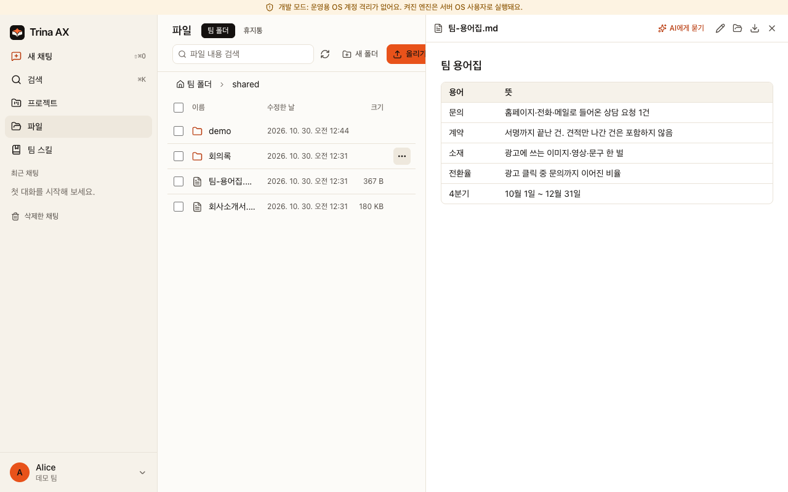
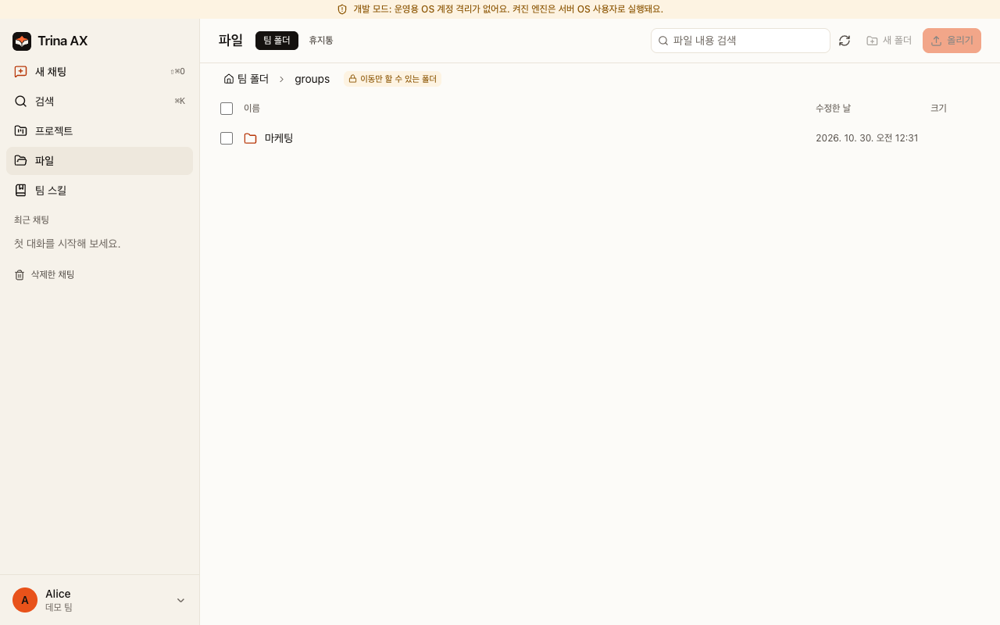
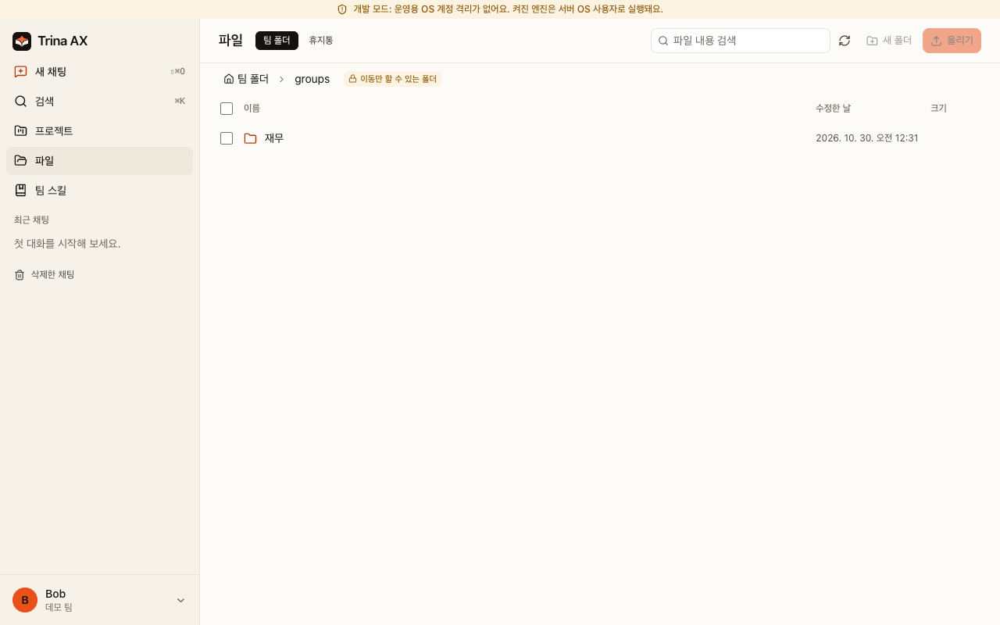

# 트리나 AX — 우리 회사만의 AI 업무 공간

[English](README.md) · [한국어](README.ko.md) · [日本語](README.ja.md) · [Español](README.es.md)

회사 자료, 팀 스킬, 폴더 권한을 한곳에 모으세요. 팀원은 브라우저에서 질문하고 초안을 만들며 회사의 일하는 방식을 함께 활용합니다. *스킬*은 반복 업무에 쓰는 지침입니다. 모델을 학습시키거나 추가 권한을 주는 기능은 아닙니다.

**[트리나 호스팅·요금 문의](https://ax.trina.app/#pricing)** · **[직접 설치: IT 담당자 안내](docs/for-admins.ko.md)**

## 우리 팀은 이렇게 씁니다

| 역할 | 시작할 업무 | 복사해서 쓸 예제 |
|---|---|---|
| 대표·팀장 | 주간 기록을 결정 사항, 위험, 다음 할 일로 정리 | [주간 보고](examples/skills/weekly-team-report/SKILL.md) |
| 영업 | 회의에 없던 약속을 만들지 않고 후속 메일 초안 작성 | [영업 후속 연락](examples/skills/sales-follow-up/SKILL.md) |
| 마케팅 | 승인된 브랜드 자료로 캠페인 기획 초안 작성 | [브랜드 브리프](examples/skills/brand-brief/SKILL.md) |
| 재무 | 누락된 영수증과 확인이 필요한 금액 표시 | [비용 검토](examples/skills/expense-review/SKILL.md) |
| 인사 | 접근 가능한 정책으로 신입 구성원 질문에 답변 | [입사 안내](examples/skills/new-hire-guide/SKILL.md) |
| 모든 팀원 | 회의록에서 결정과 할 일 추출 | [회의 요약](examples/skills/meeting-summary/SKILL.md) |

가상 자료로 시작하는 지침 예제입니다. 결과는 사용하거나 공유하기 전에 사람이 검토합니다.

## 같은 질문, 다른 답

“우리 회사 입사 안내를 요약해 줘.” 인사 폴더를 볼 수 있는 인사 담당자는 그 자료를 활용할 수 있지만, 권한이 없는 영업 담당자는 파일 도구로 읽을 수 없습니다. 서버가 파일 요청마다 질문한 사람의 권한을 확인합니다. 스킬에도 폴더 권한이 적용됩니다.

위 화면은 기본 가상 데모의 마케팅·재무 계정입니다. 서로 다른 그룹 폴더가 보이는 실제 파일 접근 화면이며, AI의 실시간 답변은 아닙니다. [보안과 권한](docs/security-and-permissions.ko.md)에서 공유 확인과 한계를 확인하세요.

## 시작 방법을 고르세요

| 방법 | 준비물 | 운영 담당·첫 결과 |
|---|---|---|
| 트리나 호스팅 | 브라우저, 인터넷, 사용이 허용된 AI 연결 | AWS 서울에서 트리나가 운영. [도입 문의](https://ax.trina.app/#contact)로 설치 상담 |
| 리눅스 직접 설치 | Debian 12/13 또는 Ubuntu 24.04, systemd·cgroup v2, amd64/arm64, RAM 4 GB 권장, 디스크 최소 20 GB | 회사 IT 담당자가 설치·업데이트·복구. [리눅스 안내](docs/INSTALL-LINUX.md) |
| 사무실 맥 | 전용 macOS 13+ 맥, 로그인된 OS 사용자, 인터넷, 허용된 Claude 연결 | 사무실 담당자가 운영. [사무실 맥 안내](docs/OFFICE.md). 업무량별 실측 용량 보장은 없음 |
| 로컬 체험 | Git, Bun 1.3.12(CI 고정 버전), Go 1.27+, 빌드 도구, 준비된 Mac 또는 Linux | AI 계정 없이 가상 파일과 권한 비교. [빠른 체험](docs/QUICKSTART.ko.md) |

2026-10-30 확인 기준 호스팅은 **Starter 월 $39(최대 5명), Team $69(15명), Business $129(40명)**입니다. USD·세금 별도이며 AI 사용료도 별도입니다. 직접 설치하는 소프트웨어는 무료지만 장비·운영·AI 비용은 회사가 부담합니다. [현재 요금](https://ax.trina.app/#pricing)을 확인하세요. 호스팅은 상담 후 시작하며 즉시 가입하는 무료 체험은 아닙니다.

저장소를 받고 의존성을 설치했다면 `bun run demo --locale ko` 한 명령으로 가상 자료를 갖춘 로컬 체험을 시작할 수 있습니다. AI는 비활성화됩니다. **운영 설치가 아닙니다.** [준비·종료·정리 방법](docs/QUICKSTART.ko.md).

## 첫 주에 준비할 다섯 가지

소유자 계정을 만든 뒤 **폴더 권한 → AI 연결 → 팀원 초대 → 첫 팀 스킬 → 첫 백업** 순서로 준비하세요. 접근을 허용한 소수의 자료와 반복 업무 하나로 시작하면 됩니다. [팀장 체크리스트](docs/for-teams.ko.md) · [예제 복사](examples/README.ko.md).

관리형 연결에서는 사용 가능한 개인 연결을 먼저 쓰고, 사람 지정 → 그룹 지정 → 팀 전체 연결 순으로 선택합니다. 새 트리나 팀은 구독 공유가 기본으로 켜져 있으며, 기존에 저장한 선택은 유지됩니다. 연결별 동의도 필요합니다. **이 설정이 Anthropic·OpenAI 약관상 사용 허가를 뜻하지는 않습니다.** 목적에 맞게 허용된 계정·요금제만 사용하세요. 로컬 데모는 AI가 꺼져 있고, 개발·사무실 local-login 방식은 연결 동작이 다릅니다. [연결 FAQ](docs/FAQ.ko.md).

## 약속하지 않는 것

- 직접 설치해도 AI 처리가 모두 오프라인에서 이루어지지는 않습니다. 답변에 쓰이는 문맥은 선택한 AI 제공사로, 외부 연동 요청은 해당 서비스로 전송됩니다.
- 서버 운영자는 저장된 파일과 채팅을 읽을 수 있습니다. 호스팅이면 트리나 운영자도 포함됩니다. 앱 관리 화면에는 모든 개인 대화를 읽는 기능이 없습니다.
- 폴더 권한을 회수해도 이전 답변은 지워지지 않습니다. 넓은 범위로 공유할 때의 확인은 모든 유출을 막는 기능이 아닙니다.
- 보안 인증, 완벽한 답변, 비용 절감 수치, 법무·재무·인사 결정의 자동화를 보장하지 않습니다. 결과와 설치 방식의 경계를 검토하세요.
- AI는 사진과 스캔한 PDF 페이지를 이미지로 봅니다(관리자가 끌 수 있음). 다만 Linux 서버는 글자 인식(OCR)을 하지 않아 스캔 문서와 사진을 글자로 검색할 수 없습니다.
- HWP/HWPX 텍스트 추출은 지원합니다. [시각 미리보기](resources/hwp/README.md)는 선택해서 설치하는 '한글 문서 미리보기' 플러그인입니다. 관리자가 관리 > 플러그인의 공식 목록에서 설치하면 서버가 고정된 빌드를 릴리스 피드에서 받습니다. 기본 릴리스에는 실행 도구가 포함되지 않습니다. macOS나 glibc 2.39 이상의 Linux가 필요해 Debian 12에서는 시각 미리보기를 **지원하지 않습니다**. 텍스트 추출과 원본 다운로드는 유지되며 복잡한 레이아웃·변환에는 한계가 있습니다.

## 클라이언트·릴리스·도움말

PC와 휴대폰 브라우저로 사용합니다. Windows 설치 파일은 배포되며 Mac 사무실 ZIP은 서버용으로 **데스크톱 DMG가 아닙니다**. 네이티브 모바일 소스가 있다고 앱스토어에 출시된 것은 아닙니다. 현재 소스는 앱 전체에 영어·한국어·인도네시아어·일본어·스페인어를 지원합니다. 배포된 설치 파일에는 소스의 최신 변경이 아직 없을 수 있으니 릴리스 설명을 확인하세요.

[최신 릴리스·체크섬](https://github.com/trina-app/trina-ax/releases/latest) · [변경 기록](CHANGELOG.md) · [문서](docs/README.md) · [FAQ](docs/FAQ.ko.md) · [지원·커뮤니티 질문](SUPPORT.md)

## 개발자·운영자 안내

팀 서버에서 AI 도구를 실행하며 로그인한 사람의 파일 권한을 검사합니다. Linux·역할 계정 Mac 설치는 전용 엔진 계정과 OS 격리를 더합니다. 사무실 모드는 로그인한 Mac 사용자로 실행되며, 개발 데모는 운영 격리를 검증하는 환경이 아닙니다. MCP(Model Context Protocol)는 외부 도구 연결 규격이며 첫 체험에는 필요하지 않습니다.

[개발·테스트](docs/DEVELOPMENT.md) · [이 저장소에 기여하기](CONTRIBUTING.md) · [설정](docs/CONFIGURATION.md) · [보안 신고](SECURITY.md) · [기계용 문서 목록](llms.txt)

## 라이선스

[AGPL-3.0-only](LICENSE), 단 [클라우드 프로토콜](shared/src/cloud-protocol/LICENSE)은 별도 MIT 라이선스입니다. 수정한 버전을 네트워크 서비스로 제공한다면 라이선스에 따라 사용자에게 해당 소스를 제공해야 합니다. [고지](NOTICE) · [제3자 고지](docs/THIRD-PARTY-NOTICES.md). Claude Code와 Codex에는 별도 약관이 적용되며 Anthropic·OpenAI가 이 프로젝트를 보증하지 않습니다.
