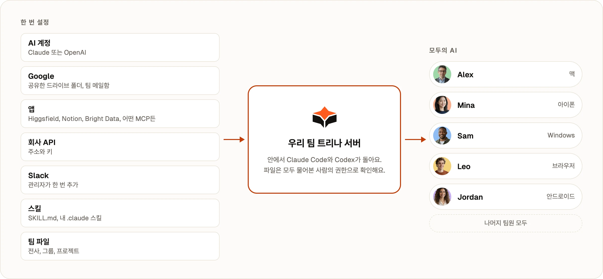

<div align="center">

<picture><source media="(prefers-color-scheme: dark)" srcset="editions/trina/branding/logo/mark-dark.svg"></picture>

<h1>Trina AX</h1>

<b>팀 모두가 같이 쓰는 AI</b><br>
트리나 AX는 팀의 파일, 스킬, 도구를 서버 하나에 모아요. 모두의 AI가 그걸 바탕으로 일해요.<br>동료가 하던 AI 세션을 그대로 이어받을 수 있어요. AI가 여는 파일은 모두 물어본 사람의 권한으로 확인해요.

<a href="https://demo.trina.app"></a>

<a href="https://ax.trina.app/download"></a>&nbsp;&nbsp;<a href="https://ax.trina.app/download"></a>&nbsp;&nbsp;<a href="https://apps.apple.com/app/trina-ax/id6829192435"></a>&nbsp;&nbsp;<a href="https://play.google.com/store/apps/details?id=app.trina.ax"></a><br>
<sub>Linux: .deb와 AppImage(x64, arm64)는 <a href="https://ax.trina.app/download">다운로드 페이지</a>에 있어요</sub>

[웹사이트](https://ax.trina.app) · [문서](docs/README.md) · [요금제](https://ax.trina.app/pricing) · [Discord](https://discord.gg/zUVfSR8MVk)

[English](README.md) · 한국어 · [日本語](README.ja.md) · [Español](README.es.md) · [简体中文](README.zh-CN.md) · [Bahasa Indonesia](README.id.md)

</div>

https://github.com/user-attachments/assets/761ef58c-eaf9-4dbc-963b-b9e2e3005c1a

<p align="center"><sub>입사 첫날 신입의 AI가 할 수 있는 일을 80초 영상에 담았어요.</sub><br>오픈소스(AGPL-3.0) · 직접 설치는 무료, 인원 제한 없음<br><br><a href="https://github.com/trina-app/trina-ax?tab=readme-ov-file"></a><br><sub>버튼을 누른 뒤 페이지 맨 위의 ☆ Star를 눌러 주세요. Star가 많을수록 더 많은 팀이 트리나 AX를 알게 돼요.</sub></p>

<br>

<picture><source media="(prefers-color-scheme: dark)" srcset="docs/images/readme/v4/divider-dark.png"></picture>

## 설정은 한 번, 쓰는 건 팀 전체

**AI 계정 하나로 팀 모두가 써요.** Claude나 OpenAI API 키 하나(또는 약관이 허용하는 요금제)를 연결하면 누가 묻든 AI가 그 계정으로 답해요. 토큰 한도는 사람별, 그룹별, 팀 전체로 걸 수 있어요.

한 사람이 팀 서버에 한 번 설정하면, 모두의 AI가 첫 질문부터 그걸 써요. 브라우저에서도 앱에서도요. 나머지 팀원은 Claude Code를 깔거나 스킬을 복사할 필요가 없어요. 필요할 때 자기 계정에 로그인만 하면 돼요.

<picture><source media="(prefers-color-scheme: dark)" srcset="docs/images/readme/v4/set-up-once-ko-dark.webp"></picture>

| 한 번 설정 | 팀 모두에게 |
| --- | --- |
| **AI 계정:** 소유자나 관리자가 Claude나 OpenAI API 키, 또는 약관이 허용하는 요금제를 연결해요. | 팀원 모두가 AI에게 물어볼 수 있어요. 토큰 한도는 사람별, 그룹별, 팀 전체로 걸 수 있어요. |
| **Google:** 드라이브 폴더를 팀과 공유하거나, 공용 메일함이나 캘린더 같은 팀 계정 하나를 Gmail, Calendar, Docs, Sheets용으로 연결해요. | 고른 사람은 자기 채팅에서 써요. 각자 자기 Google 계정을 따로 연결할 수도 있어요. |
| **앱:** 앱 목록에서 Higgsfield, Notion, Linear, Figma 등을 고르거나, 주소만 있으면 어떤 MCP 서버든(예: Bright Data) 추가해요. | 누구나 채팅에서 그 앱의 도구를 써요. 팀 계정 하나로 로그인하거나, 각자 자기 계정으로 로그인해요. |
| **회사 API:** 주소, 키, 쓰는 법 몇 줄. | AI가 회사 시스템을 호출해요. 그 주소 아래로만요. |
| **Slack:** 소유자나 관리자가 한 번 추가해요. | DM이나 트리나를 초대한 채널에서 트리나에게 물어요. 내 권한으로요. |
| **스킬:** `SKILL.md`를 쓰거나, `.claude`·`.codex` 폴더의 스킬을 그대로 가져와요. | 모두의 AI가 같은 순서로 일해요. `/`를 눌러 써요. |
| **팀 파일:** 전사, 그룹, 프로젝트, 팀 스킬, 개인 폴더를 드라이브 하나에 둬요. | 모두의 AI가 팀 파일을 바로 쓰고, 그 사람이 열 수 있는 것만 열어요. |

<table>
<tr>
<td colspan="2"><br><sub>관리자 › 연결한 서비스: 한 번 설정하면 팀 모두가 써요</sub></td>
</tr>
<tr>
<td width="50%"><br><sub>팀 드라이브 하나</sub></td>
<td width="50%"><br><sub>팀 스킬, 내 스킬도 가져오기</sub></td>
</tr>
</table>

<br>

<picture><source media="(prefers-color-scheme: dark)" srcset="docs/images/readme/v4/divider-dark.png"></picture>

## 모두가 트리나로 하는 일

**동료가 하던 일, 그대로 이어서.** 팀 프로젝트에서 동료의 AI 세션을 열면 지금까지의 대화와 답이 모두 보이고, 바로 이어서 물을 수 있어요. 새 답은 물어본 사람의 권한으로 처리돼요. 그 밖의 세션도 Google Drive 파일처럼 사람이나 그룹에 공유할 수 있어요.


**대화 중에 옆에서 묻고, 답은 클릭 한 번으로 보내요.** 나만 보는 옆 채팅에서 묻고, 클릭 한 번이면 트리나의 답이 대화방에 올라가요.


**내 AI도 내가 열 수 있는 것만 봐요.** Mina가 Finance를 못 열면 Mina의 AI도 못 열어요. [권한은 이렇게 돌아가요](docs/PERMISSIONS.md)


**파일을 내용으로 찾아요.** 밤마다 팀 AI가 공유·그룹·프로젝트 폴더의 새 파일과 바뀐 파일을 읽고, 파일마다 무엇인지 한 줄씩 적어 둬요. 그래서 `temp.pdf`라는 스캔본이나 `IMG_2031.jpg`라는 사진도 내용으로 찾을 수 있어요. 이 작업은 팀 AI 계정으로 하고, 개인 폴더는 읽지 않아요. 가상 파일 2,238개로 시험했을 때 Claude Code는 질문 184개 중 이 한 줄 설명이 있으면 181개, 없으면 172개에서 맞는 파일을 찾았어요.

<table>
<tr>
<td width="50%"><b>예약 작업:</b> 한 번 시키면 정한 일정대로 트리나가 반복해요. 시간은 팀 시간대를 따라요.<br><br></td>
<td width="50%"><b>게스트:</b> 외부 사람을 그룹 대화나 프로젝트에 초대하고, AI를 쓸 수 있게 할지 정해요.<br><br></td>
</tr>
<tr>
<td width="50%"><b>사용량과 한도:</b> 사람별 답변 수, 토큰, 예상 비용을 봐요. 토큰 한도는 사람별, 그룹별, 팀 전체로 걸 수 있어요.<br><br></td>
<td width="50%"><b>통합 검색:</b> ⌘K로 채팅, 기록, 프로젝트, 파일, 스킬, 예약 작업을 한 번에 찾아요.<br><br></td>
</tr>
<tr>
<td colspan="2"><b>Slack 같은 팀 채팅에 트리나 AI까지.</b> 전체·그룹 채널, 비공개 채널, DM, 그룹 대화, 스레드, @멘션이 다 있어요. 웹, 데스크톱, 휴대폰에서 쓰고, 어느 대화에서든 옆에 나만 보는 채팅을 열어 트리나에게 물어봐요.<br><br></td>
</tr>
</table>

- **바뀐 내용은 모두 남아요.** 사람이 바꿨든 그 사람의 AI가 바꿨든, 어느 버전으로든 되돌릴 수 있어요.
- **앱 안 브라우저:** 데스크톱 앱에서는 트리나가 채팅 옆 창에 웹사이트를 열어 읽고, 클릭하고, 양식을 채워요. 지켜보다가 ‘멈추기’를 누르면 거기서 끝나요. 새 사이트는 열기 전에 물어봐요. 모든 웹사이트를 허용해 두면 묻지 않아요.
- **앱 소식이 대화방에.** Sentry, GitHub, Stripe, Jira, HubSpot 소식이 카드로 올라와요.
- **업무 파일 찾기:** 데스크톱 앱이 내 컴퓨터의 최근 업무 파일을 찾아 주고, 고른 것만 올려요.
- **문서:** 한글(HWP/HWPX) 문서 내용을 읽고, PDF와 PPT는 미리 볼 수 있어요.
- **모든 기기:** 맥, Windows, Linux, 아이폰, 안드로이드와 모든 브라우저에서 6개 언어로 써요.

<br>

<picture><source media="(prefers-color-scheme: dark)" srcset="docs/images/readme/v4/divider-dark.png"></picture>

## 시작하기

- **브라우저에서 써 보기:** 설치 없이 가상 팀으로 써 봐요. AI는 꺼져 있어요. [데모 열기](https://ax.trina.app/demo/ko/)
- **트리나 호스팅:** 서버를 따로 운영할 필요가 없어요. 14일 무료 체험 뒤 월 요금제예요. [요금제](https://ax.trina.app/pricing)
- **앱:** [맥, Windows, Linux, 아이폰, 안드로이드](https://ax.trina.app/download) 앱이 있고, 브라우저에서도 쓸 수 있어요.
- **직접 설치:** 회사 리눅스 서버, 윈도우 PC, Docker, 사무실 맥에 설치해요. 무료예요. [리눅스](docs/INSTALL-LINUX.md) · [윈도우 PC](docs/INSTALL-WINDOWS.ko.md) · [Docker](docs/INSTALL-DOCKER.md) · [사무실 맥](docs/OFFICE.md) · [AI 에이전트로 설치](docs/INSTALL-LINUX.md#ai-에이전트로-설치하기)

<b>Docker로 직접 설치</b> (리눅스, 또는 OrbStack을 쓰는 맥)

```sh
git clone https://github.com/trina-app/trina-ax.git && cd trina-ax/docker
cp env.example .env && docker compose up -d --build
docker compose exec trina-ax trina-ax-setup-link   # 링크를 열어 소유자 계정을 만들어요
```

리눅스 설치보다 새로 나온 방식이라 아직 덜 검증됐어요. Ubuntu 24.04 서버는 먼저 호스트 설정 하나가 필요해요. [Docker 안내](docs/INSTALL-DOCKER.md)

<b>10분 만에 내 컴퓨터에서 써 보기</b> (가상 팀, AI 꺼짐)

```sh
git clone https://github.com/trina-app/trina-ax.git && cd trina-ax
bun install --frozen-lockfile && bun run demo   # → http://127.0.0.1:19760 · alice / teamax-demo-1
```

Bun 1.3.12와 Go 1.27 이상이 필요해요. 실제 운영용 설치는 아니에요. [자세한 안내](docs/QUICKSTART.ko.md)

<br>

<picture><source media="(prefers-color-scheme: dark)" srcset="docs/images/readme/v4/divider-dark.png"></picture>

## 작동 방식

서버 하나에서 Claude Code와 Codex가 엔진으로 돌아요. 사람이든 그 사람의 AI든, 파일을 열 때마다 서버의 권한 확인 한 곳을 거쳐요. 리눅스 서버에서는 엔진이 전용 계정으로 bubblewrap, Landlock, seccomp 샌드박스 안에서 돌아요. 엔진의 셸과 내장 파일 도구는 꺼져 있어서, 파일은 트리나 도구로만 열어요. [보안과 권한](docs/security-and-permissions.ko.md)

트리나가 드리는 건 업무 공간이에요. AI는 용도에 맞게 허용된 Claude·OpenAI 계정이나 요금제를 연결해 쓰세요. AI 이용료는 연결한 계정으로 나가요.

<details>
<summary><b>데이터, 한계, 약속하지 않는 것</b></summary>

### 약속하지 않는 것

- 직접 설치해도 오프라인으로 도는 건 아니에요. 요청에 필요한 내용은 연결한 AI 회사로 가고, 설정한 외부 연동도 요청을 받아요. Codex 웹 검색은 할 때마다 그때까지의 대화를 OpenAI 검색 서비스로 보내요. 관리자가 음성 인식에 OpenRouter를 허용하면, 영상·오디오 파일의 소리가 OpenRouter로 가요. 서버는 30분마다 `updates.trina.app`에 자기 공인 주소를 물어요(`MYCEL_EXIT_ADDRESS_CHECK=off`로 끌 수 있어요). [자세히](docs/security-and-permissions.ko.md)
- 서버 운영자는 저장된 파일과 채팅을 볼 수 있어요. 트리나 호스팅이라면 트리나 운영자도 볼 수 있어요. 앱 관리자에게는 모두의 개인 대화를 보는 화면이 없어요.
- 폴더 권한을 빼도 예전 답은 지워지지 않아요. 더 많은 사람이 보게 될 때 뜨는 확인이 모든 유출을 막아 주지는 않아요.
- 보안 인증, 완벽한 답, 비용 절감, 법무·재무·인사 결정의 자동화는 약속하지 않아요. 결과와 운영 범위는 직접 검토해 주세요.
- 리눅스 서버에는 OCR이 없어요. AI는 사진과 스캔한 페이지를 이미지로 보지만, 글자로 검색되지는 않아요. 사무실 맥은 아직 영상을 읽지 못해요.
- HWP/HWPX 문서 내용은 어느 팀이든 읽을 수 있어요. [미리보기와 한글 문서 만들기](resources/hwp/README.md)에는 한글 문서 미리보기 플러그인(선택)이 필요해요(macOS, 또는 glibc 2.39 이상의 리눅스. Debian 12는 안 돼요).
- 연결은 본인이 쓸 수 있는 개인 연결부터 쓰고, 그다음 그 사람, 그룹, 팀 전체에 배정한 연결 순이에요. 새 트리나 팀은 회사 연결 하나를 팀 전체가 기본으로 쓸 수 있고, 이미 저장한 설정은 바뀌지 않아요. **이 설정을 했다고 Anthropic이나 OpenAI 약관에서 허용된다는 뜻은 아니에요.** [연결 방식 자세히](docs/FAQ.ko.md)
- 리눅스 직접 설치에는 Debian 12/13 또는 Ubuntu 24.04, systemd와 cgroup v2, amd64나 arm64, RAM 4 GB, 디스크 20 GB가 필요해요. 설치, 업데이트, 백업 복구는 회사 IT 담당자가 맡아요.

</details>

<br>

<picture><source media="(prefers-color-scheme: dark)" srcset="docs/images/readme/v4/divider-dark.png"></picture>

## 커뮤니티

트리나 AX가 팀에 도움이 됐다면 GitHub에서 ⭐ Star를 눌러 주세요. 더 많은 팀이 트리나 AX를 알게 돼요.

[Discord](https://discord.gg/zUVfSR8MVk) · [X](https://x.com/trina_ax) · [릴리스](https://github.com/trina-app/trina-ax/releases/latest) · [변경 기록](CHANGELOG.md) · [도움 받기](SUPPORT.md) · [기여하기](CONTRIBUTING.md) · [보안 신고](SECURITY.md) · [개발](docs/DEVELOPMENT.md) · [설정](docs/CONFIGURATION.md) · [llms.txt](llms.txt)

앱은 영어, 한국어, 인도네시아어, 일본어, 스페인어, 중국어(간체)로 쓸 수 있어요. 그림에 나오는 회사와 사람은 모두 가상이에요.

<br>

<picture><source media="(prefers-color-scheme: dark)" srcset="docs/images/readme/v4/divider-dark.png"></picture>

## 라이선스

[AGPL-3.0-only](LICENSE) 라이선스라 상업적 용도로도 자유롭게 쓸 수 있어요. 수정한 버전을 네트워크로 서비스한다면 그 사용자에게 소스 코드도 제공해야 해요. 클라우드 프로토콜은 따로 MIT 라이선스예요([라이선스](shared/src/cloud-protocol/LICENSE)). [고지](NOTICE) · [제3자 고지](docs/THIRD-PARTY-NOTICES.md)

Claude Code와 Codex는 각각 약관이 따로 있어요. 이 프로젝트는 Anthropic이나 OpenAI의 보증을 받지 않았어요. Claude는 Anthropic의 상표예요.
