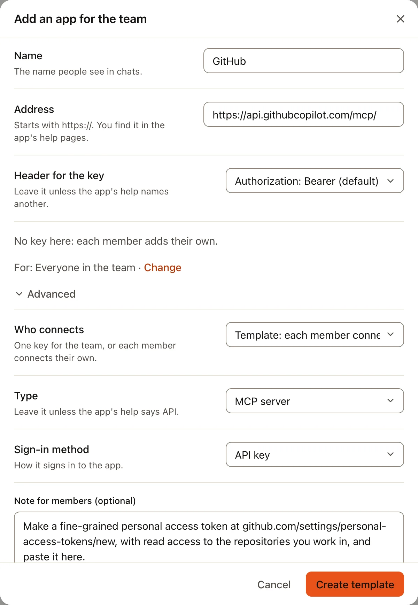
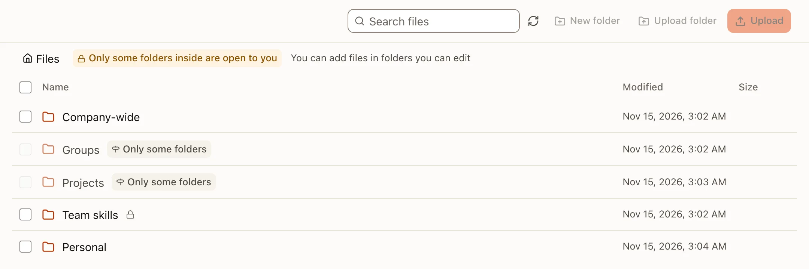
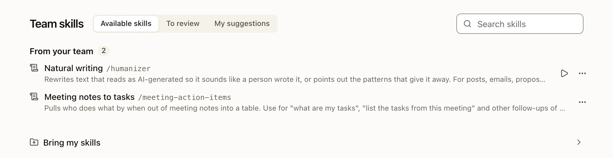

<div align="center">

<picture><source media="(prefers-color-scheme: dark)" srcset="editions/trina/branding/logo/mark-dark.svg"></picture>

<h1>Trina AX</h1>

<b>팀 모두가 같이 쓰는 AI.</b><br>
트리나 AX는 팀의 파일, 스킬, 도구를 서버 하나에 모아요. 모두의 AI가 거기서 시작하고,<br>AI가 여는 파일은 모두 물어본 사람의 권한으로 확인해요.

<a href="https://ax.trina.app/download"></a>&nbsp;&nbsp;<a href="https://ax.trina.app/download"></a>&nbsp;&nbsp;<a href="https://apps.apple.com/app/trina-ax/id6829192435"></a>&nbsp;&nbsp;<a href="https://play.google.com/store/apps/details?id=app.trina.ax"></a>

[웹사이트](https://ax.trina.app) · [문서](docs/README.md) · [요금제](https://ax.trina.app/pricing) · [Discord](https://discord.gg/zUVfSR8MVk)

[English](README.md) · 한국어 · [日本語](README.ja.md) · [Español](README.es.md) · [简体中文](README.zh-CN.md)

</div>

https://github.com/user-attachments/assets/1bd7de3e-5818-452d-a644-eb1591297050

<p align="center"><sub>같은 Claude, 같은 부탁, 다른 결과. 97초 이야기예요.</sub><br>오픈소스(AGPL-3.0) · 직접 설치는 무료, 인원 제한 없음</p>

## 한 번 설정하면, 팀 전체가 써요

한 사람이 팀 서버에 한 번 설정하면, 모두의 AI가 첫 질문부터 그걸 써요. 브라우저에서도 앱에서도요. 다른 사람은 Claude Code를 깔거나, 키를 붙여 넣거나, 스킬을 복사할 필요가 없어요.

<picture><source media="(prefers-color-scheme: dark)" srcset="docs/images/readme/v4/set-up-once-ko-dark.webp"></picture>

| 한 번 설정 | 모두가 받는 것 |
| --- | --- |
| **AI 계정.** 소유자가 Claude나 OpenAI API 키, 또는 약관이 허용하는 요금제를 연결해요. | 팀 전체가 답을 받아요. 토큰 한도는 사람, 그룹, 팀 단위로 걸어요. |
| **Google.** 드라이브 폴더를 팀과 공유하거나, 팀 계정 하나(공용 메일함이나 캘린더)를 Gmail, Calendar, Docs, Sheets에 연결해요. | 고른 사람들이 자기 채팅에서 써요. 각자 자기 Google 계정을 따로 연결할 수도 있어요. |
| **앱.** 앱 목록의 Higgsfield, Notion, Linear, Figma 등, 또는 주소로 붙이는 MCP 서버(예: Bright Data). | 모두의 채팅에서 그 앱의 도구를 써요. 팀 계정 하나로 로그인하거나, 각자 자기 계정으로 로그인해요. |
| **회사 API.** 주소, 키, 쓰는 법 몇 줄. | AI가 회사 시스템을 불러요. 그 주소 아래만요. |
| **Slack.** 관리자가 한 번 추가해요. | 어느 채널이나 DM에서든 트리나에게 물어요. 내 권한으로요. |
| **스킬.** `SKILL.md`를 쓰거나, `.claude`·`.codex` 폴더의 스킬을 그대로 가져와요. | 모두의 AI가 같은 순서로 일해요. `/`를 눌러 써요. |
| **팀 파일.** 드라이브 하나: 전사, 그룹, 프로젝트, 팀 스킬, 개인 폴더. | 모두의 AI가 팀 파일에서 시작하고, 그 사람이 열 수 있는 것만 열어요. |

<table>
<tr>
<td width="33%"><br><sub>팀 전체용 앱 추가</sub></td>
<td width="33%"><br><sub>팀 드라이브 하나</sub></td>
<td width="33%"><br><sub>팀 스킬, 내 스킬도 가져오기</sub></td>
</tr>
</table>

## 모두가 이걸로 하는 일

**어느 대화방 옆에서든 묻고, 클릭 한 번으로 보내요.** 나만 보는 옆 채팅에서 묻고, 클릭 한 번이면 트리나의 답이 대화방에 올라가요.


**각자 열 수 있는 것만 봐요.** Mina가 Finance를 못 열면 Mina의 AI도 못 열어요. [권한은 이렇게 돌아가요](docs/PERMISSIONS.md)


**동료의 세션을 이어받아요.** 동료의 프로젝트 세션을 열어 이어서 하고, 내가 묻는 건 내 권한으로 처리돼요.


<table>
<tr>
<td width="50%"><b>예약 작업.</b> 한 번 시키면 정한 일정대로 트리나가 반복해요. 시간은 팀 시간대를 따라요.<br><br></td>
<td width="50%"><b>손님.</b> 바깥 사람을 그룹 대화나 프로젝트에 부르고, AI를 쓰게 할지 정해요.<br><br></td>
</tr>
<tr>
<td width="50%"><b>사용량과 한도.</b> 사람별 답변 수, 토큰, 예상 비용을 봐요. 토큰 한도는 사람, 그룹, 팀 단위로 걸어요.<br><br></td>
<td width="50%"><b>모두 검색.</b> ⌘K로 채팅, 기록, 프로젝트, 파일, 스킬, 예약 작업을 찾아요.<br><br></td>
</tr>
</table>

- **바뀐 내용은 모두 남아요.** 사람이 바꿨든 그 사람의 AI가 바꿨든, 어느 버전이든 되돌릴 수 있어요.
- **앱 소식이 대화방에.** Sentry, GitHub, Stripe, Jira, HubSpot 소식이 카드로 올라와요.
- **회의록.** 맥 앱이 Zoom, Meet, Teams 통화를 받아 적어요.
- **업무 파일 찾기.** 데스크톱 앱이 내 컴퓨터의 최근 업무 파일을 찾아 주고, 고른 것만 올려요.
- **문서.** 한글(HWP/HWPX) 글을 읽고, PDF와 PPT를 미리 봐요.
- **어느 기기에서든.** 맥, Windows, 아이폰, 안드로이드, 어떤 브라우저에서든. 6개 언어로요.

## 시작하기

- **트리나 호스팅:** 서버를 따로 운영할 필요가 없어요. 14일 무료 체험 뒤 월 요금제예요. [요금제](https://ax.trina.app/pricing)
- **앱:** [맥, 아이폰, 안드로이드, Windows](https://ax.trina.app/download), 또는 어떤 브라우저에서든 써요.
- **직접 설치:** 회사 리눅스 서버, Docker, 사무실 맥에 설치해요. 무료예요. [리눅스](docs/INSTALL-LINUX.md) · [Docker](docs/INSTALL-DOCKER.md) · [사무실 맥](docs/OFFICE.md) · [AI 에이전트로 설치](docs/INSTALL-LINUX.md#ai-에이전트로-설치하기)

<b>10분 만에 내 컴퓨터에서 써 보기</b> (가상 팀, AI 꺼짐)

```sh
git clone https://github.com/trina-app/trina-ax.git && cd trina-ax
bun install --frozen-lockfile && bun run demo   # → http://127.0.0.1:19760 · alice / teamax-demo-1
```

Bun 1.3.12와 Go 1.27 이상이 필요해요. 실제 운영용 설치는 아니에요. [자세한 안내](docs/QUICKSTART.ko.md)

## 작동 방식

서버 하나에서 Claude Code와 Codex가 엔진으로 돌아요. 앱에서 오는 요청은 모두 권한 확인 하나를 지나요. 리눅스 서버에서는 엔진이 전용 계정으로 bubblewrap, Landlock, seccomp 샌드박스 안에서 돌아요. 엔진의 셸과 내장 파일 도구는 꺼져 있어서, 파일은 트리나 도구로만 열어요. [보안과 권한](docs/security-and-permissions.md)

트리나는 업무 공간을 드리고, AI는 드리지 않아요. 쓰임새에 맞게 허용된 Claude·OpenAI 계정과 요금제를 연결하세요. AI 이용료는 연결한 계정으로 나가요.

<details>
<summary><b>데이터, 한계, 약속하지 않는 것</b></summary>

### 약속하지 않는 것

- 직접 설치해도 오프라인으로 도는 건 아니에요. 요청에 필요한 내용은 연결한 AI 회사로 가고, 설정한 외부 연동도 요청을 받아요. Codex 웹 검색은 할 때마다 그때까지의 대화를 OpenAI 검색 서비스로 보내요. 관리자가 허용해서 음성에 OpenRouter를 쓰면, 영상·오디오 파일의 소리가 OpenRouter로 가요. 서버는 30분마다 `updates.trina.app`에 자기 공인 주소를 물어요(`MYCEL_EXIT_ADDRESS_CHECK=off`로 끌 수 있어요). [자세히](docs/security-and-permissions.ko.md)
- 서버 운영자는 저장된 파일과 채팅을 볼 수 있어요. 호스팅이면 트리나 운영자도 포함돼요. 앱 관리자에게는 모두의 개인 대화를 보는 화면이 없어요.
- 폴더 권한을 빼도 예전 답은 지워지지 않아요. 더 넓게 공유할 때 받는 확인이 모든 유출을 막아 주지는 않아요.
- 보안 인증, 완벽한 답, 비용 절감, 법무·재무·인사 결정의 자동화는 약속하지 않아요. 결과와 운영 범위는 사람이 검토하세요.
- 리눅스 서버에는 OCR이 없어요. AI는 사진과 스캔한 쪽을 이미지로 보지만, 글자로 검색되지는 않아요. 사무실 맥은 아직 영상을 읽지 못해요.
- HWP/HWPX 글자는 어느 팀이든 읽어요. [미리보기와 한글 문서 만들기](resources/hwp/README.md)에는 선택 플러그인(한글 문서 미리보기)이 필요해요(macOS, 또는 glibc 2.39 이상의 리눅스. Debian 12는 안 돼요).
- 연결: 그 사람이 쓸 수 있는 개인 연결이 먼저 쓰이고, 그다음 그 사람, 그룹, 팀 전체에 배정한 연결 순서예요. 새 트리나 팀은 회사 연결 하나를 팀 전체가 기본으로 쓸 수 있고, 이미 저장한 선택은 그대로 유지돼요. **이 설정이 Anthropic이나 OpenAI 약관상의 허락을 뜻하지는 않아요.** [연결 자세히](docs/FAQ.ko.md)
- 리눅스 직접 설치에는 Debian 12/13 또는 Ubuntu 24.04, systemd와 cgroup v2, amd64나 arm64, RAM 4 GB, 디스크 20 GB가 필요해요. 설치, 업데이트, 백업 복구는 회사 IT 담당자가 맡아요.

</details>

## 커뮤니티

[Discord](https://discord.gg/zUVfSR8MVk) · [X](https://x.com/trina_ax) · [릴리스](https://github.com/trina-app/trina-ax/releases/latest) · [변경 기록](CHANGELOG.md) · [도움 받기](SUPPORT.md) · [기여하기](CONTRIBUTING.md) · [보안 신고](SECURITY.md) · [개발](docs/DEVELOPMENT.md) · [설정](docs/CONFIGURATION.md) · [llms.txt](llms.txt)

앱은 영어, 한국어, 인도네시아어, 일본어, 스페인어, 중국어(간체)로 쓸 수 있어요. 모든 그림 속 회사와 사람은 가상이에요.

## 라이선스

[AGPL-3.0-only](LICENSE)로 상업적인 용도까지 자유롭게 쓸 수 있어요. 고친 버전을 네트워크로 제공한다면 그 사용자에게 소스도 제공해야 해요. 클라우드 프로토콜은 따로 MIT 라이선스예요([라이선스](shared/src/cloud-protocol/LICENSE)). [고지](NOTICE) · [제3자 고지](docs/THIRD-PARTY-NOTICES.md)

Claude Code와 Codex에는 각자의 약관이 있고, 이 프로젝트는 Anthropic이나 OpenAI의 보증을 받지 않았어요. Claude는 Anthropic의 상표예요.
