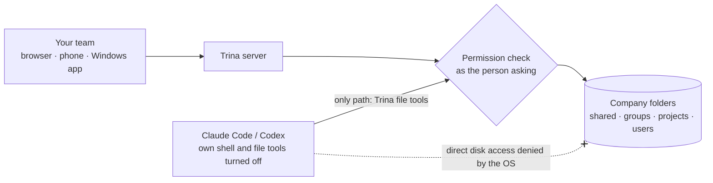

<div align="center">


# Trina AX

**Set up Claude Code once. Your whole company gets it.**

Claude Code and Codex on one company server, with your files, your team's skills and each person's folder permissions. Everyone else just opens a browser.

[Website](https://ax.trina.app) · [Try it in 10 minutes](#try-it-in-10-minutes) · [Self-host](docs/for-admins.md) · [Docs](docs/README.md)

English · [한국어](README.ko.md) · [日本語](README.ja.md) · [Español](README.es.md)


<sub><b>Day one, one line:</b> “Write a proposal for Trina Logistics.” The AI read the team's sales files, followed the CEO's <code>proposal</code> skill and saved a 7-page deck.<br>Real app, fictional company. Generation took 81 seconds; the clip is sped up.</sub>

</div>

## Same request, two answers

<table>
<tr>
<td width="50%" valign="top"><b>Claude Code in an empty folder</b><br><sub>It can't know your company, so it asks six questions first.</sub></td>
<td width="50%" valign="top"><b>Trina AX, same line</b><br><sub>It starts from the team's files and the CEO's proposal skill.</sub></td>
</tr>
<tr>
<td></td>
<td></td>
</tr>
</table>

<sub>Real outputs from 2026-10-31 with a fictional company, Dawnroute. Claude Code is right to ask: nothing in an empty folder tells it who you are. Trina gives it the folder.</sub>

## How it works

1. **Put it in once.** Company files go in `shared/`. The way you write a proposal goes in `skills/proposal/SKILL.md`.
2. **Everyone asks.** In a chat app in the browser, on desktop or phone. No terminal, nothing to install on their laptop.
3. **Each person keeps their own access.** The server checks every file the AI opens, as the person asking. A folder you can't see doesn't exist for your AI either.


<sub><b>Same question, different people.</b> Mina is in Sales. The revenue file sits in <code>shared/Finance</code>, which she can't open, so her AI can't open it either.</sub>

## Try it in 10 minutes

```sh
git clone https://github.com/trina-app/trina-ax.git && cd trina-ax
bun install --frozen-lockfile
bun run demo        # → http://127.0.0.1:19760 · sign in as alice / teamax-demo-1
```

A fictional team with six starter skills. AI is off, so no AI account is needed. Sign in as `bob` in a private window: each sees a different group folder. Needs Git, Bun 1.3.12 and Go 1.27+. This is **not a production install**. [Walkthrough](docs/QUICKSTART.md)

## What you get

| | In practice |
|---|---|
| **Real Claude Code and Codex agents** | They run on your server: up to 150 tool rounds per answer by default, up to 4 sub-agents at a time, web search and schedules. |
| **Company folders are the knowledge** | `shared/`, `groups/`, `projects/` and personal folders, with version history. Text from PDF, Office and HWP/HWPX files. |
| **Team skills, governed like files** | A skill is a `SKILL.md` file. Folder rules decide who can use it, and the AI asks a person before it changes one. |
| **Permissions on every file call** | Files you can't access stay invisible in Files, AI answers, search, previews, version history and trash. |
| **Your AI connection** | Claude or OpenAI, by subscription or API key, for a person, a group or the whole team. Usage per person, with limits. |
| **Self-host or hosted** | A Linux server, an office Mac, or Trina hosting in AWS Seoul. Browser on desktop and phone, plus a Windows installer. |

## Under the hood



- **The agent is real.** Sub-agents work as the same person, through the same checks, and leave the same activity records.
- **The way in is narrow.** The engine's own shell and file tools are turned off and covered by regression tests for each engine. Its path to your folders is Trina's file tools, checked on every call.
- **Keys stay out of reach.** Tokens are sealed in the browser before they're sent. The engine gets a per-turn stand-in token, and a model proxy adds the real one.
- **Admins can't read your chats.** They see which files the AI read, not the conversation. Server operators can still read stored data, and we say so [below](#data-and-limits).

<sub>OS isolation (a dedicated engine account) applies to Linux and role-account Mac installs. Office Mac runs as the signed-in user, and the local demo has no OS isolation. → <a href="docs/security-and-permissions.md">Security and permissions</a> · <a href="docs/PERMISSIONS.md">Permission model (Korean)</a></sub>

## Your team's first week

Create the owner account, then **permissions → AI connection → invite the team → first skill → first backup**. These starter skills use fictional inputs:

| Role | A real task | Copyable skill |
|---|---|---|
| CEO / team lead | Turn weekly notes into decisions, risks and next steps | [Weekly report](examples/skills/weekly-team-report/SKILL.md) |
| Sales | Draft a follow-up from a meeting, without inventing promises | [Sales follow-up](examples/skills/sales-follow-up/SKILL.md) |
| Marketing | Prepare a campaign brief from approved brand notes | [Brand brief](examples/skills/brand-brief/SKILL.md) |
| Finance | Flag missing receipts and uncertain amounts for review | [Expense review](examples/skills/expense-review/SKILL.md) |
| HR | Answer onboarding questions from permitted policies | [New-hire guide](examples/skills/new-hire-guide/SKILL.md) |
| Everyone | Extract decisions and actions from a meeting note | [Meeting summary](examples/skills/meeting-summary/SKILL.md) |

A skill is a reusable set of instructions, not model training or extra access. People review results before using them. [Team lead checklist](docs/for-teams.md) · [All examples](examples/README.md)

## How to run

| | Trina hosting | Self-host on Linux | Office Mac | Local demo |
|---|---|---|---|---|
| Best for | Teams without IT | Teams with an IT owner | A small office with a dedicated Mac | Looking around |
| Who runs it | Trina, in AWS Seoul | Your IT | Your office operator | You |
| AI | Your authorized Claude or OpenAI connection | Same | Claude (no Codex) | Off |
| Cost | From $39/month + AI usage | Free software + your server | Free software | Free |
| Start | [Contact Trina](https://ax.trina.app/#contact) | [Linux guide](docs/INSTALL-LINUX.en.md) | [Office guide](docs/OFFICE.en.md) | [Quickstart](docs/QUICKSTART.md) |

Trina provides the workspace, not the AI: use only Claude and OpenAI accounts and plans authorized for your use. Hosted plans, checked 2026-10-30, USD before tax: **Starter $39/month (up to 5 people), Team $69 (15), Business $129 (40)**. AI usage is separate. Hosting is contact-led, not an instant free trial. [Current pricing](https://ax.trina.app/#pricing)

Linux self-hosting needs Debian 12/13 or Ubuntu 24.04, systemd with cgroup v2, amd64 or arm64, 4 GB RAM recommended and 20 GB disk minimum. Your IT team installs, updates and restores backups.

## Data and limits

Self-hosting is not offline: the context a request needs goes to the AI provider you connect. Server operators, including Trina for hosting, can read stored files and chats; app admins cannot browse private conversations.

<details>
<summary><b>What leaves the server, connection rules and what we don't promise</b></summary>

<br>

- Selected context goes to the chosen AI provider, and configured integrations receive their requests. Each Codex web search sends the conversation so far to OpenAI's search service. The server asks `updates.trina.app` for its own public address every 30 minutes (`MYCEL_EXIT_ADDRESS_CHECK=off` turns that off). [Details](docs/security-and-permissions.md)
- Server operators can read stored files and chats, including Trina operators for hosting. App administrators do not get a browser for everyone's private conversations.
- Removing folder access does not erase earlier answers. Wider-sharing confirmation is not universal data-loss prevention.
- No security certification, perfect answers, guaranteed savings or automatic legal, financial or HR decisions. Review outputs and deployment boundaries.
- The AI sees photos and scanned PDF pages as images (an admin can turn this off), but Linux servers run no OCR: scanned documents and photos are not text-searchable there.
- HWP/HWPX text extraction is available. [Visual previews](resources/hwp/README.md) come as the optional HWP Preview plugin, which needs macOS or Linux with glibc 2.39 or newer, so Debian 12 does **not** support them.
- In managed installations, eligible personal connections take priority, followed by connections assigned to a person, a group, then the whole team. Fresh Trina teams allow shared subscriptions by default; existing saved choices persist. Connection-level consent still applies. **This software setting does not grant permission under Anthropic's or OpenAI's terms.** The local demo disables AI; development and office local-login modes have different connection behavior. [Connection details](docs/FAQ.md)

</details>

## FAQ

<details>
<summary><b>How is this different from giving everyone a Claude seat?</b></summary>

<br>A seat gives each person their own empty workspace. Trina gives everyone the same company folders and team skills on one server, with each person's folder permissions checked by the server. You can still connect per-person accounts.

</details>

<details>
<summary><b>Do we need an AI account to try it?</b></summary>

<br>No. The [local demo](docs/QUICKSTART.md) runs with AI turned off and fictional data, so you can look at files, skills and permissions first.

</details>

<details>
<summary><b>Can admins read our chats?</b></summary>

<br>No. Chats are visible only to their owner. Activity records show which files the AI read, not the conversation. People who operate the server or its storage can read stored data.

</details>

<details>
<summary><b>Does it work with Korean HWP files?</b></summary>

<br>Yes for text: the AI can read text from HWP/HWPX files. Visual previews need the optional plugin, which does not run on Debian 12. More in the [FAQ](docs/FAQ.md).

</details>

## Community and contributing

[Latest release and checksums](https://github.com/trina-app/trina-ax/releases/latest) · [Changes](CHANGELOG.md) · [Support](SUPPORT.md) · [Contributing](CONTRIBUTING.md) · [Security reports](SECURITY.md) · [Development](docs/DEVELOPMENT.md) · [Configuration](docs/CONFIGURATION.md) · [Machine-readable index](llms.txt)

The app speaks English, Korean, Indonesian, Japanese and Spanish. Published installers can lag behind source changes; check their release notes.

## License

Free to use, including commercially, under [AGPL-3.0-only](LICENSE). If you offer a modified version over a network, offer its source to those users. The cloud protocol is separately licensed under MIT ([license](shared/src/cloud-protocol/LICENSE)). [Notices](NOTICE) · [Third-party notices](docs/THIRD-PARTY-NOTICES.md)

Claude Code and Codex have their own terms; this project is not endorsed by Anthropic or OpenAI. Claude is a trademark of Anthropic.
