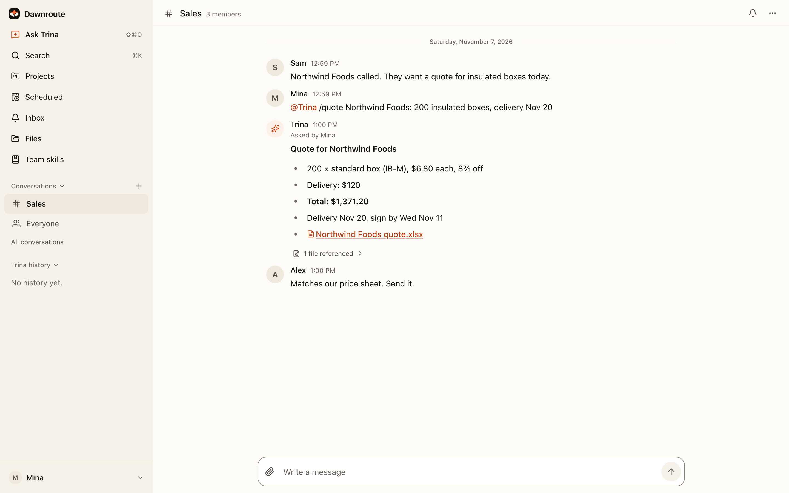
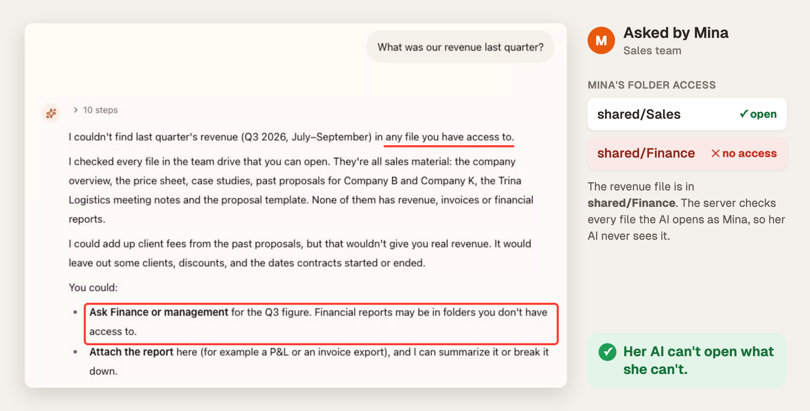
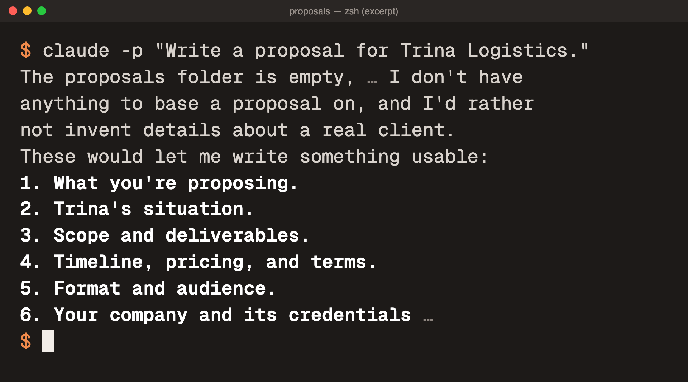
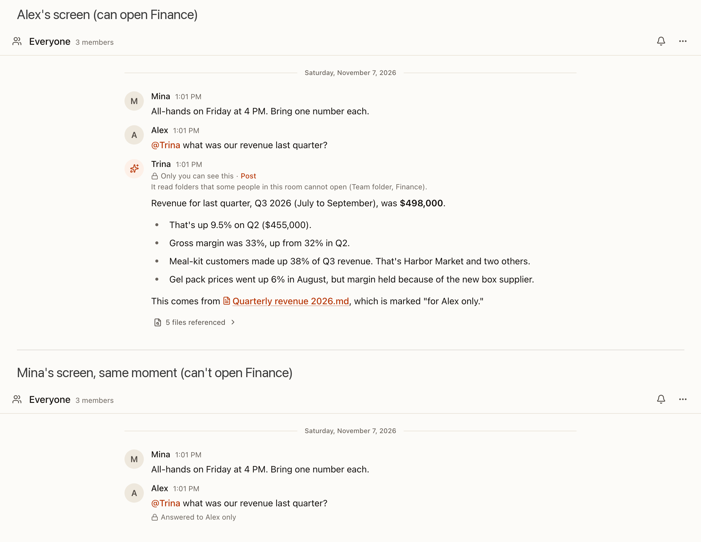
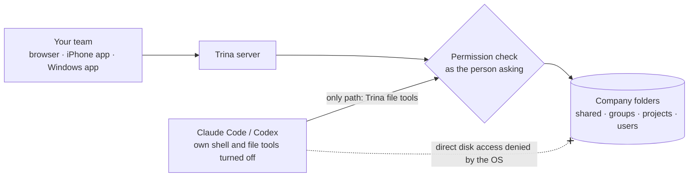

<div align="center">


# Trina AX

**The AI your whole team shares.**

Claude Code and Codex on your company's server, with your company files and your team's skills. Your team uses it in the browser, in their own chat or, from version 0.4, by calling @Trina in a team conversation.

[Website](https://ax.trina.app) · [Try it in 10 minutes](#try-it-in-10-minutes) · [Self-host](docs/for-admins.md) · [Docs](docs/README.md)

English · [한국어](README.ko.md) · [日本語](README.ja.md) · [Español](README.es.md) · [简体中文](README.zh-CN.md)



<sub>A team conversation in version 0.4. Fictional company.</sub>

</div>

- **Set it up once, everyone works that way.** Company files go in `shared/`. The way your lead writes a quote goes in `skills/quote/SKILL.md`. Everyone on the team works from them, from their first day.
- **Call @Trina in the room, the result lands there.** Ask in a team conversation: the team's skill runs on the files you can open, and the answer, with its file, is posted in the room.
- **Pick up where a teammate left off** (coming next). Anyone on a project will be able to continue a teammate's AI chat, and each message runs as the person who sent it.

Put real company files in. Everyone sees only what they're allowed to. [How](#under-the-hood)

```sh
git clone https://github.com/trina-app/trina-ax.git && cd trina-ax
bun install --frozen-lockfile && bun run demo   # http://127.0.0.1:19760 · alice / teamax-demo-1
```

<sub>Local demo: fictional team, AI off, not for production. Needs Bun 1.3.12 and Go 1.27+. To try team conversations and @Trina, run the [Docker install](docs/INSTALL-DOCKER.md) with `TRINA_AX_VERSION=0.4.0-beta.10` and connect an AI account.</sub>

## How it works

1. **Put it in once.** Company files go in `shared/`. The way you write a proposal goes in `skills/proposal/SKILL.md`.
2. **Anyone asks, in their own chat or in a team conversation.** In the browser on desktop or phone, or in the iPhone app. No terminal, nothing to install on their laptop. In a conversation, @Trina works as the person who called it.
3. **Each person keeps their own access.** The server checks every file the AI opens, as the person asking. A folder you can't see doesn't exist for your AI either.



<sub><b>Same question, different people.</b> Mina is in Sales. The revenue file sits in <code>shared/Finance</code>, which she can't open, so her AI can't open it either.</sub>

## Try it in 10 minutes

```sh
git clone https://github.com/trina-app/trina-ax.git && cd trina-ax
bun install --frozen-lockfile
bun run demo        # → http://127.0.0.1:19760 · sign in as alice / teamax-demo-1
```

A fictional team with six starter skills. AI is off, so no AI account is needed. Sign in as `bob` in a private window: each sees a different group folder. Needs Git, Bun 1.3.12 and Go 1.27+. This is **not a production install**. [Walkthrough](docs/QUICKSTART.md)

To try team conversations and @Trina, use the [Docker install](docs/INSTALL-DOCKER.md) with `TRINA_AX_VERSION=0.4.0-beta.10` (or a later 0.4 release) and connect an AI account. The local demo has AI off, so @Trina does not answer there.

## Same request, two answers

<table>
<tr>
<td width="50%" valign="top"><b>Claude Code in an empty folder</b><br><sub>It can't know your company, so it asks six questions first.</sub></td>
<td width="50%" valign="top"><b>Trina AX, same line</b><br><sub>It starts from the team's files and the CEO's proposal skill.</sub></td>
</tr>
<tr>
<td></td>
<td></td>
</tr>
</table>

<sub>Real outputs from 2026-10-31 and 11-01 with a fictional company, Dawnroute; the deck photos were made with Higgsfield. Claude Code is right to ask: nothing in an empty folder tells it who you are. Trina gives it the folder.</sub>

**Same room, two screens.** Only answers built from what everyone in the room can see go straight to the room. Otherwise, the person who asked sees it first.



<sub>Alex's answer used <code>shared/Finance</code>, which Mina can't open. Alex can still choose to post it; until then, Mina sees only that he got an answer. Fictional company.</sub>

## What you get

| | In practice |
|---|---|
| **Real Claude Code and Codex agents** | They run on your server: up to 150 tool rounds per answer by default, up to 4 sub-agents at a time, web search and schedules. |
| **Company folders are the knowledge** | `shared/`, `groups/`, `projects/` and personal folders, with version history. Text from PDF, Office and HWP/HWPX files. |
| **Team skills, governed like files** | A skill is a `SKILL.md` file. Folder rules decide who can use it, and the AI asks a person before it changes one. |
| **Team conversations (0.4)** | Group rooms, an Everyone room and direct messages, with quoted replies, mentions, files and photos. Call @Trina and it answers as you, with the files and skills you can use. A room is visible to its members; admins can't open rooms they aren't in. |
| **Permissions on every file call** | Files you can't access stay invisible in Files, AI answers, search, previews, version history and trash. |
| **Your AI connection** | Connect the company's Claude or OpenAI account once, or let people connect their own. Usage per person, with limits. Self-hosted, Claude Code can also run on other models such as DeepSeek, Kimi or GLM through an [Anthropic-compatible gateway](docs/CONFIGURATION.md#anthropic-compatible-gateway). |
| **Slack connector (0.4, off by default)** | Once the owner sets up the team's own Slack app, people link their own Slack account and ask the app in a channel or a direct message. Each question runs as the person who asked; in a channel the answer shows to them first, with *Post to channel*. [Slack guide](docs/SLACK.md) |
| **iPhone app** | [Trina AX on the App Store](https://apps.apple.com/app/id6829192435). It opens your team's server, so it has what your server's version has: team conversations need 0.4. |
| **Self-host or hosted** | A Linux server (also with [Docker](docs/INSTALL-DOCKER.md)), an office Mac, or Trina hosting in AWS Seoul. Browser on desktop and phone, the iPhone app and a Windows installer. |

## Under the hood

Our first commit, on 2026-10-21, already had the permission function (`server/src/policy/authorize.ts`). Every file call still goes through it.



- **The agent is real.** Sub-agents work as the same person, through the same checks, and leave the same activity records.
- **The way in is narrow.** The engine's own shell and file tools are turned off and covered by regression tests for each engine. Its path to your folders is Trina's file tools, checked on every call.
- **Keys stay out of reach.** Tokens are sealed in the browser before they're sent. The engine gets a per-turn stand-in token, and a model proxy adds the real one.
- **Your chats with Trina are visible only to you.** A room is visible to its members; admins can't open rooms they aren't in. Admins see which files the AI read, not the conversation. Server operators can still read stored data, and we say so [below](#data-and-limits).

<sub>OS isolation (a dedicated engine account) applies to Linux and role-account Mac installs. Office Mac runs as the signed-in user, and the local demo has no OS isolation. → <a href="docs/security-and-permissions.md">Security and permissions</a> · <a href="docs/PERMISSIONS.md">Permission model (Korean)</a></sub>

## Your team's first week

Create the owner account, then **permissions → AI connection → invite the team → first skill → first backup**. These starter skills use fictional inputs:

| Role | A real task | Copyable skill |
|---|---|---|
| CEO / team lead | Turn weekly notes into decisions, risks and next steps | [Weekly report](examples/skills/weekly-team-report/SKILL.md) |
| Sales | Draft a follow-up from a meeting, without inventing promises | [Sales follow-up](examples/skills/sales-follow-up/SKILL.md) |
| Marketing | Prepare a campaign brief from approved brand notes | [Brand brief](examples/skills/brand-brief/SKILL.md) |
| Finance | Flag missing receipts and uncertain amounts for review | [Expense review](examples/skills/expense-review/SKILL.md) |
| HR | Answer onboarding questions from permitted policies | [New-hire guide](examples/skills/new-hire-guide/SKILL.md) |
| Everyone | Extract decisions and actions from a meeting note | [Meeting summary](examples/skills/meeting-summary/SKILL.md) |

A skill is a reusable set of instructions, not model training or extra access. People review results before using them. [Team lead checklist](docs/for-teams.md) · [All examples](examples/README.md)

## How to run

| | Trina hosting | Self-host on Linux | Office Mac | Local demo |
|---|---|---|---|---|
| Best for | Teams without IT | Teams with an IT owner | A small office with a dedicated Mac | Looking around |
| Who runs it | Trina, in AWS Seoul | Your IT | Your office operator | You |
| AI | Your authorized Claude or OpenAI connection | Same | Claude (no Codex) | Off |
| Cost | Free 14-day trial, then a monthly plan + AI usage | Free software + your server | Free software | Free |
| Start | [See the plans](https://ax.trina.app/#pricing) | [Linux guide](docs/INSTALL-LINUX.en.md) · [Docker](docs/INSTALL-DOCKER.md) | [Office guide](docs/OFFICE.en.md) | [Quickstart](docs/QUICKSTART.md) |

Trina provides the workspace, not the AI: use only Claude and OpenAI accounts and plans authorized for your use. Free 14-day trial on Trina hosting, then a monthly plan; AI usage is billed separately by the account you connect. [Current prices](https://ax.trina.app/#pricing)

Linux self-hosting needs Debian 12/13 or Ubuntu 24.04, systemd with cgroup v2, amd64 or arm64, 4 GB RAM recommended and 20 GB disk minimum. Your IT team installs, updates and restores backups.

## Data and limits

Self-hosting is not offline: the context a request needs goes to the AI provider you connect. Server operators, including Trina for hosting, can read stored files and chats; app admins cannot browse private conversations.

<details>
<summary><b>What leaves the server, connection rules and what we don't promise</b></summary>

<br>

- Selected context goes to the chosen AI provider, and configured integrations receive their requests. Each Codex web search sends the conversation so far to OpenAI's search service. The sound of video and audio files the AI reads goes to OpenRouter when the team chose OpenRouter for speech and allowed it. The server asks `updates.trina.app` for its own public address every 30 minutes (`MYCEL_EXIT_ADDRESS_CHECK=off` turns that off). [Details](docs/security-and-permissions.md)
- Server operators can read stored files and chats, including Trina operators for hosting. App administrators do not get a browser for everyone's private conversations.
- Removing folder access does not erase earlier answers. Wider-sharing confirmation is not universal data-loss prevention.
- No security certification, perfect answers, guaranteed savings or automatic legal, financial or HR decisions. Review outputs and deployment boundaries.
- The AI sees photos and scanned PDF pages as images (an admin can turn this off), but Linux servers run no OCR: scanned documents and photos are not text-searchable there.
- On Linux servers the AI also reads video and audio files: evenly spaced frames go to the AI provider like images, and the sound is turned into text by the team's speech provider only when an admin allows it ("Turn video sound into text"). With OpenRouter as the provider, the sound of team files goes to OpenRouter and its provider; confidential chats never send it. Office Macs cannot read video yet.
- HWP/HWPX text extraction is available to every team. [Visual previews](resources/hwp/README.md), and the AI making and filling in Hangul documents, come with the optional HWP Preview plugin, which needs macOS or Linux with glibc 2.39 or newer, so Debian 12 does **not** support them.
- In managed installations, eligible personal connections take priority, followed by connections assigned to a person, a group, then the whole team. On fresh Trina teams, one company connection can serve the whole team by default; existing saved choices persist. Connection-level consent still applies. **This software setting does not grant permission under Anthropic's or OpenAI's terms.** The local demo disables AI; development and office local-login modes have different connection behavior. [Connection details](docs/FAQ.md)

</details>

## FAQ

<details>
<summary><b>How is this different from giving everyone a Claude seat?</b></summary>

<br>A seat gives each person their own empty workspace. Trina gives everyone the same company folders and team skills on one server, with each person's folder permissions checked by the server. You can still connect per-person accounts.

</details>

<details>
<summary><b>Do we need an AI account to try it?</b></summary>

<br>No. The [local demo](docs/QUICKSTART.md) runs with AI turned off and fictional data, so you can look at files, skills and permissions first. To see @Trina answer in a team conversation, you need a server with an AI connection ([Try it](#try-it-in-10-minutes)).

</details>

<details>
<summary><b>Can admins read our chats and rooms?</b></summary>

<br>No. Your chats with Trina are visible only to you. A room is visible to its members; admins can't open rooms they aren't in. Activity records show which files the AI read, not the conversation. People who operate the server or its storage can read stored data.

</details>

<details>
<summary><b>Does it work with Korean HWP files?</b></summary>

<br>Yes. The AI reads the text of HWP/HWPX files on every server. With the optional HWP Preview plugin turned on, it also makes new .hwpx documents (headings, paragraphs, lists, simple tables), fills in an existing .hwp or .hwpx form (placeholders, empty cells, table rows) and saves it in the same format, keeping the rest of the file as it was, and shows visual previews. The plugin does not run on Debian 12. More in the [FAQ](docs/FAQ.md).

</details>

## The 97-second story

https://github.com/user-attachments/assets/61f3469b-358d-4b3a-9233-c6b23b5db835

<sub><b>Sound on.</b> A team lead sets up Claude once, and on her first day a new hire’s proposal comes out like his.<br>Animated story with the real app at 1:15. Fictional company.</sub>

## What's next

- **Pick up a teammate's AI chat.** Shared project chats: anyone on the project continues an AI chat, and each message runs as the person who sent it. Designed, not built yet.
- **Android app.** In review on Google Play.
- **0.4 on Trina hosting.** Hosting follows the stable channel and gets team conversations when 0.4 becomes stable. Self-hosted servers can run a 0.4 release today.

## Community and contributing

[Latest release and checksums](https://github.com/trina-app/trina-ax/releases/latest) · [Changes](CHANGELOG.md) · [Support](SUPPORT.md) · [Contributing](CONTRIBUTING.md) · [Security reports](SECURITY.md) · [Development](docs/DEVELOPMENT.md) · [Configuration](docs/CONFIGURATION.md) · [Machine-readable index](llms.txt)

The app speaks English, Korean, Indonesian, Japanese and Spanish. Published installers can lag behind source changes; check their release notes.

## License

Free to use, including commercially, under [AGPL-3.0-only](LICENSE). If you offer a modified version over a network, offer its source to those users. The cloud protocol is separately licensed under MIT ([license](shared/src/cloud-protocol/LICENSE)). [Notices](NOTICE) · [Third-party notices](docs/THIRD-PARTY-NOTICES.md)

Claude Code and Codex have their own terms; this project is not endorsed by Anthropic or OpenAI. Claude is a trademark of Anthropic.
