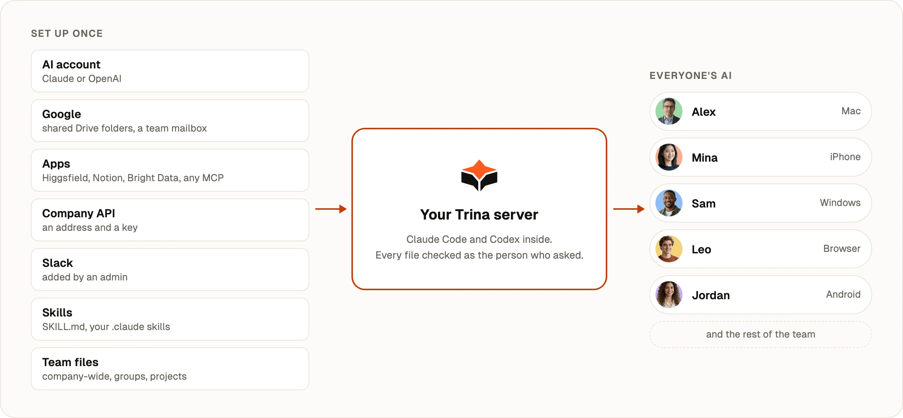
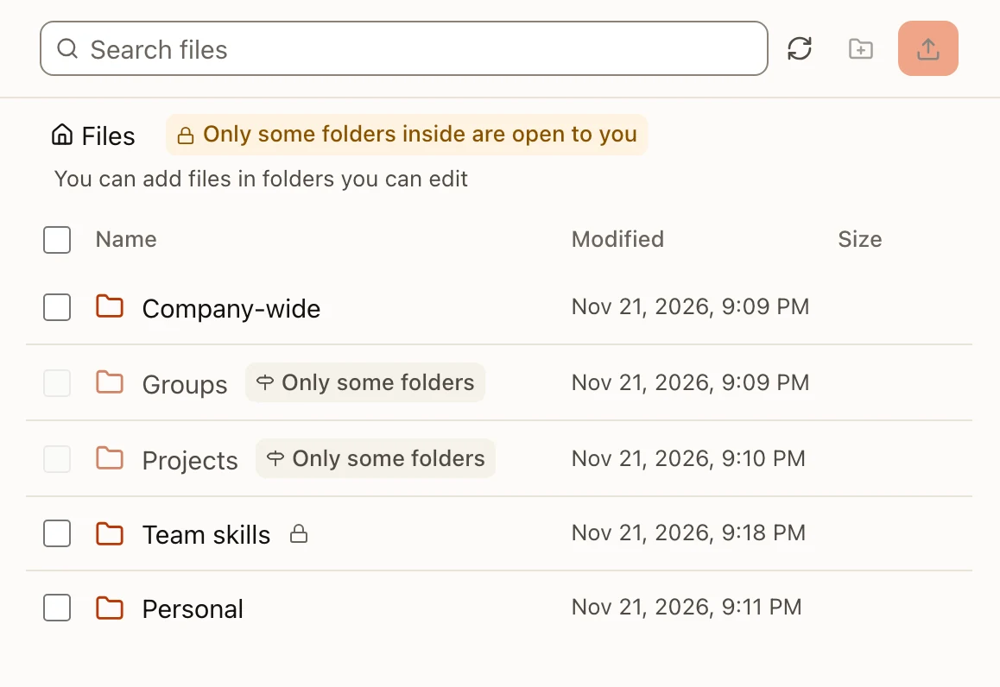
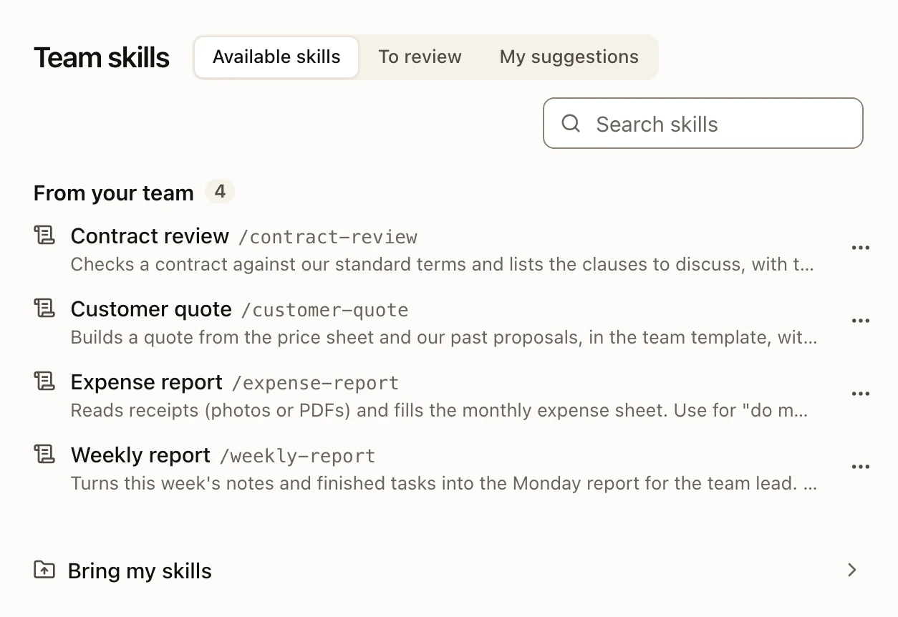
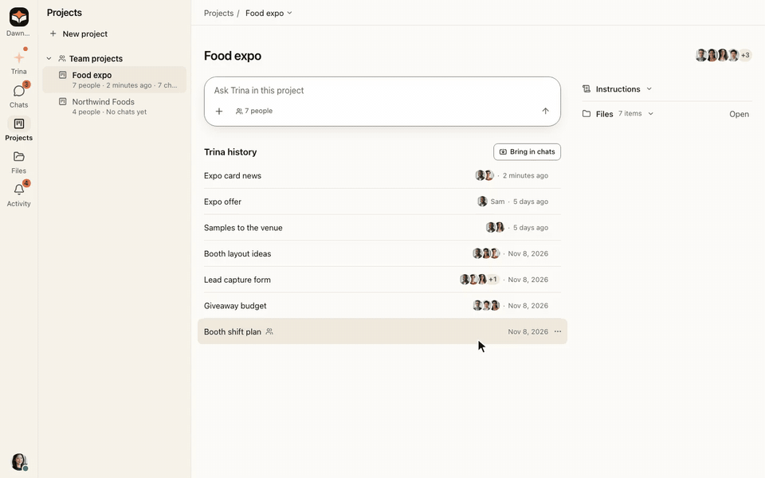
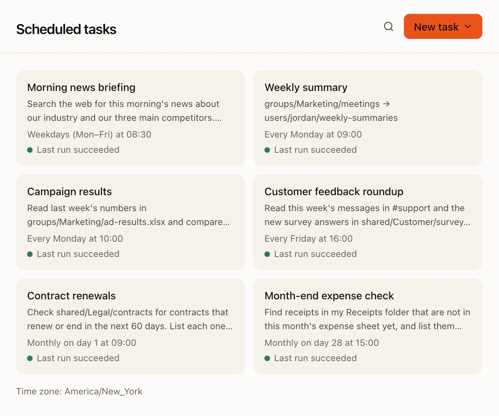
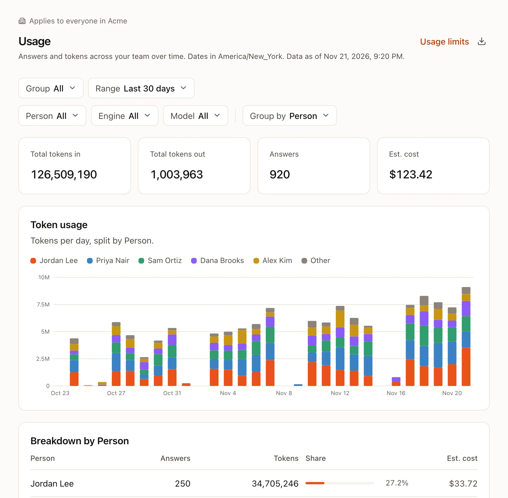

<div align="center">

<picture><source media="(prefers-color-scheme: dark)" srcset="editions/trina/branding/logo/mark-dark.svg"></picture>

<h1>Trina AX</h1>

<b>The AI your whole team shares.</b><br>
Trina AX puts your team's files, skills and tools on one server. Everyone's AI starts from them.<br>Pick up a teammate's AI session where they left off. Every file it opens is checked as the person who asked.

<a href="https://demo.trina.app"></a>

<a href="https://ax.trina.app/download"></a>&nbsp;&nbsp;<a href="https://ax.trina.app/download"></a>&nbsp;&nbsp;<a href="https://apps.apple.com/app/trina-ax/id6829192435"></a>&nbsp;&nbsp;<a href="https://play.google.com/store/apps/details?id=app.trina.ax"></a><br>
<sub>Linux: .deb and AppImage (x64, arm64) on the <a href="https://ax.trina.app/download">download page</a></sub>

[Website](https://ax.trina.app) · [Docs](docs/README.md) · [Pricing](https://ax.trina.app/pricing) · [Discord](https://discord.gg/zUVfSR8MVk)

English · [한국어](README.ko.md) · [日本語](README.ja.md) · [Español](README.es.md) · [简体中文](README.zh-CN.md) · [Bahasa Indonesia](README.id.md)

</div>

https://github.com/user-attachments/assets/d33907fe-6539-4fc6-b8d6-d0e90ebe04df

<p align="center"><sub>What a new hire's AI can do on day one. The 80-second story.</sub><br>Open source (AGPL-3.0) · Self-host free, no seat limit<br><br><a href="https://github.com/trina-app/trina-ax?tab=readme-ov-file"></a><br><sub>Then press ☆ Star at the top of the page. A star helps more teams find Trina AX.</sub></p>

<br>

<picture><source media="(prefers-color-scheme: dark)" srcset="docs/images/readme/v4/divider-dark.png"></picture>

## Set up once. Your whole team gets it.

**One AI account for the whole team.** Connect one Claude or OpenAI API key, or a plan whose terms allow it, and everyone asks with it, with token limits per person, group or team.

One person sets things up on the team server. Everyone's AI has it from their first question, in the browser or the apps. Nobody else installs Claude Code or copies skills; at most they sign in to their own accounts.

<picture><source media="(prefers-color-scheme: dark)" srcset="docs/images/readme/v4/set-up-once-en-dark.webp"></picture>

| Set up once | Everyone gets |
| --- | --- |
| **AI account.** The owner or an admin connects a Claude or OpenAI API key, or a plan whose terms allow it. | Answers for the whole team, with token limits per person, group or team. |
| **Google.** Share Drive folders with the team, or connect one team account (a shared mailbox or calendar) for Gmail, Calendar, Docs and Sheets. | The people you choose use them in their chats. Anyone can still connect their own Google account. |
| **Apps.** Higgsfield, Notion, Linear, Figma and more from the app list, or any MCP server by its address, such as Bright Data. | The app's tools in everyone's chats: one team sign-in, or each person signs in as themselves. |
| **Your company API.** An address, a key and a few notes. | The AI calls your own system, only under that address. |
| **Slack.** The owner or an admin adds it once. | Ask Trina in a DM or any channel it's invited to, with your own access. |
| **Skills.** Write a `SKILL.md`, or bring the skills in your `.claude` or `.codex` folder. | Everyone's AI follows the same steps. Type `/` to use one. |
| **Team files.** One drive: company-wide, groups, projects, team skills and personal folders. | Everyone's AI starts from the team's files, and opens only what that person may open. |

<table>
<tr>
<td colspan="2"><br><sub>Admin › Connected apps: set up once for everyone in the team</sub></td>
</tr>
<tr>
<td width="50%"><br><sub>One team drive</sub></td>
<td width="50%"><br><sub>Team skills, or bring your own</sub></td>
</tr>
</table>

<br>

<picture><source media="(prefers-color-scheme: dark)" srcset="docs/images/readme/v4/divider-dark.png"></picture>

## What everyone does with it

**Pick up where a teammate left off.** Open a teammate's AI session in a team project and keep going: the whole conversation and every answer so far are there, and each new answer runs with the access of the person who asked. Share any other session with people or groups, like a file in Google Drive.



**Ask beside any room, send in one click.** A side chat only you see; one click sends Trina's answer into the room.


**Each person's AI sees only what they may open.** Mina can't open Finance, so neither can her AI. [How permissions work](docs/PERMISSIONS.md)


**Files found by what they are.** Every night the team's AI reads new and changed files in shared, group and project folders and keeps one line per file saying what it is, so a scan named `temp.pdf` or a photo named `IMG_2031.jpg` is found by its content. It uses the team's AI account and never reads personal folders. In a test with 2,238 made-up files, Claude Code found the right file for 181 of 184 questions with these lines, and for 172 without them.

<table>
<tr>
<td width="50%"><b>Scheduled tasks.</b> Ask once; Trina repeats it on your schedule, in your team's time zone.<br><br></td>
<td width="50%"><b>Guests.</b> Invite people outside the company into a group chat or project, and choose whether they can use the AI.<br><br></td>
</tr>
<tr>
<td width="50%"><b>Usage and limits.</b> Answers, tokens and estimated cost per person; token limits per person, group or team.<br><br></td>
<td width="50%"><b>Search everything.</b> ⌘K across chats, history, projects, files, skills and scheduled tasks.<br><br></td>
</tr>
<tr>
<td colspan="2"><b>Team chat like Slack, but with Trina AI.</b> Channels for everyone and each group, private channels, direct messages, group chats, threads and @mentions, on the web, desktop and phone. Ask Trina beside any of them, in a side chat only you see.<br><br></td>
</tr>
</table>

- **Every change is kept.** By a person or their AI; bring back any version.
- **In-app browser.** In the desktop app, Trina opens websites in a pane beside your chat, reads them, clicks and fills in forms while you watch; Stop ends it. It asks before a new site unless you allow all websites.
- **Your AI apps, in your own browser.** Link your Chrome, Edge or Brave profiles to Trina once; then Trina's AI, Claude Code, Codex and Claude can all work in them, signed in as you. Pick the account for each step, run several sessions side by side (each in its own window), and approve a new site once for every app. [How](docs/site/agents/mcp-connector.md#your-browser-profiles)
- **Apps post into rooms.** Sentry, GitHub, Stripe, Jira and HubSpot updates arrive as cards.
- **Find work files.** The desktop app finds recent work files on your computer and adds the ones you pick.
- **Documents.** Reads Hangul (HWP/HWPX) text; previews PDF and PowerPoint.
- **Every device.** Mac, Windows, Linux, iPhone, Android and any browser, in six languages.

<br>

<picture><source media="(prefers-color-scheme: dark)" srcset="docs/images/readme/v4/divider-dark.png"></picture>

## Get started

- **Try it in your browser:** nothing to install; a fictional team with the AI off. [Open the demo](https://ax.trina.app/demo/)
- **Trina hosting:** no server to run. 14-day free trial, then a monthly plan. [Pricing](https://ax.trina.app/pricing)
- **Apps:** [Mac, Windows, Linux, iPhone, Android](https://ax.trina.app/download), or any browser.
- **Self-host:** your own Linux server, a Windows PC, Docker or an office Mac. Free. [Linux](docs/INSTALL-LINUX.en.md) · [Windows PC](docs/INSTALL-WINDOWS.md) · [Docker](docs/INSTALL-DOCKER.md) · [Office Mac](docs/OFFICE.en.md) · [Install with your AI agent](docs/INSTALL-LINUX.en.md#install-with-your-ai-agent)

<b>Self-host with Docker</b> (Linux, or a Mac with OrbStack)

```sh
git clone https://github.com/trina-app/trina-ax.git && cd trina-ax/docker
cp env.example .env && docker compose up -d --build
docker compose exec trina-ax trina-ax-setup-link   # open the link and create the owner
```

Newer and less tested than the Linux install; an Ubuntu 24.04 server needs one host setting first. [Docker guide](docs/INSTALL-DOCKER.md)

<b>Try it on your computer in 10 minutes</b> (fictional team, AI off)

```sh
git clone https://github.com/trina-app/trina-ax.git && cd trina-ax
bun install --frozen-lockfile && bun run demo   # → http://127.0.0.1:19760 · alice / teamax-demo-1
```

Needs Bun 1.3.12 and Go 1.27+. Not a production install. [Walkthrough](docs/QUICKSTART.md)

<br>

<picture><source media="(prefers-color-scheme: dark)" srcset="docs/images/readme/v4/divider-dark.png"></picture>

## How it works

One server runs Claude Code and Codex as the engine. Every file request, from a person or their AI, goes through one permission check on the server. On a Linux server the engine runs as its own account inside a bubblewrap, Landlock and seccomp sandbox, with its shell and built-in file tools turned off: it reaches files only through Trina's tools. [Security and permissions](docs/security-and-permissions.md)

Trina provides the workspace, not the AI: connect Claude or OpenAI accounts and plans authorized for your use. AI usage is billed by the account you connect.

<details>
<summary><b>Data, limits and what we don't promise</b></summary>

### What we don't promise

- Self-hosting is not offline: the context a request needs goes to the AI provider you connect, and configured integrations receive their requests. Each Codex web search sends the conversation so far to OpenAI's search service. With OpenRouter for speech, allowed by an admin, the sound of video and audio files goes to OpenRouter. The server asks `updates.trina.app` for its own public address every 30 minutes (`MYCEL_EXIT_ADDRESS_CHECK=off` turns that off). [Details](docs/security-and-permissions.md)
- Server operators can read stored files and chats, including Trina operators for hosting. App admins don't get a browser for everyone's private conversations.
- Removing folder access does not erase earlier answers. The wider-sharing check is not universal data-loss prevention.
- No security certification, perfect answers, guaranteed savings or automatic legal, financial or HR decisions. Review outputs and deployment boundaries.
- Linux servers run no OCR: the AI sees photos and scanned pages as images, but they are not text-searchable. Office Macs cannot read video yet.
- HWP/HWPX text works for every team; [previews and making Hangul documents](resources/hwp/README.md) need the optional HWP Preview plugin (macOS, or Linux with glibc 2.39+; not Debian 12).
- Connections: a person's own eligible connection comes first, then one assigned to the person, a group, then the whole team. On fresh Trina teams, one company connection can serve the whole team by default; existing saved choices persist. **This software setting does not grant permission under Anthropic's or OpenAI's terms.** [Connection details](docs/FAQ.md)
- Linux self-hosting needs Debian 12/13 or Ubuntu 24.04, systemd with cgroup v2, amd64 or arm64, 4 GB RAM and 20 GB disk. Your IT team installs, updates and restores backups.

</details>

<br>

<picture><source media="(prefers-color-scheme: dark)" srcset="docs/images/readme/v4/divider-dark.png"></picture>

## Community

If Trina AX helps your team, a ⭐ on GitHub helps other teams find it.

[Discord](https://discord.gg/zUVfSR8MVk) · [X](https://x.com/trina_ax) · [Releases](https://github.com/trina-app/trina-ax/releases/latest) · [Changes](CHANGELOG.md) · [Support](SUPPORT.md) · [Contributing](CONTRIBUTING.md) · [Security](SECURITY.md) · [Development](docs/DEVELOPMENT.md) · [Configuration](docs/CONFIGURATION.md) · [llms.txt](llms.txt)

The app speaks English, Korean, Indonesian, Japanese, Spanish and Simplified Chinese. Fictional company and people in every picture.

<br>

<picture><source media="(prefers-color-scheme: dark)" srcset="docs/images/readme/v4/divider-dark.png"></picture>

## License

Free to use, including commercially, under [AGPL-3.0-only](LICENSE). If you offer a modified version over a network, offer its source to those users. The cloud protocol is MIT ([license](shared/src/cloud-protocol/LICENSE)). [Notices](NOTICE) · [Third-party notices](docs/THIRD-PARTY-NOTICES.md)

Claude Code and Codex have their own terms; this project is not endorsed by Anthropic or OpenAI. Claude is a trademark of Anthropic.
