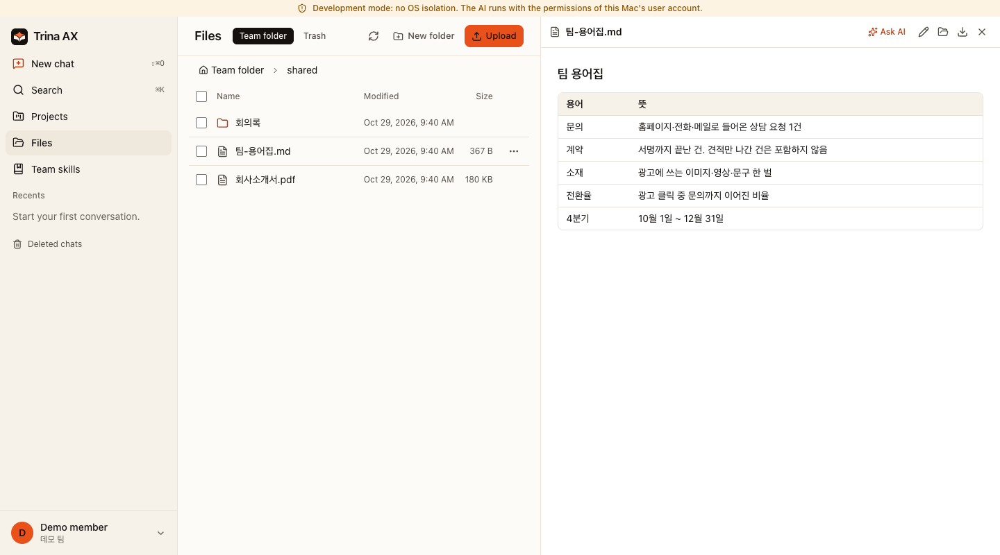
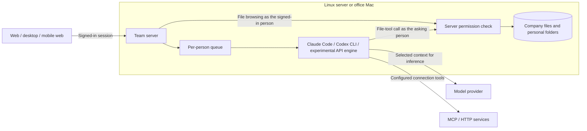

# Trina AX

[English](README.md) · [한국어](README.ko.md) · [Website](https://ax.trina.app) · [Documentation](docs/README.md)

[](https://github.com/trina-app/trina-ax/actions/workflows/ci.yml)
[](LICENSE)

**Trina AX is a self-hosted team workspace that connects company files and folder permissions to Claude Code and the Codex CLI.**

For company IT teams and developers who want to run a shared AI workspace on a Linux server or an office Mac.
Team members use a web browser, desktop app or mobile web app; the AI engines run on the team server.
Trina also offers hosting through [ax.trina.app](https://ax.trina.app).

[Try the local demo](#try-it-in-about-10-minutes) · [Install for a team](#self-hosting-and-trina-hosting) · [Report a bug](https://github.com/trina-app/trina-ax/issues/new/choose)



*Actual local development build with synthetic demo data; no model-generated answer is shown.*

## Try it in about 10 minutes

On a **Mac with Git, Bun 1.3.12 and Go 1.27+ already installed**, allow about 10 minutes to build, seed and browse
the local demo. Downloads and first-time tool installation take longer; see the [prerequisites](docs/INSTALL.md#11-tools).
An AI conversation additionally needs a supported Claude Code or Codex CLI installation and login on the server.
You can explore files and folder permissions without calling a model.

```sh
git clone https://github.com/trina-app/trina-ax.git
cd trina-ax
bun install --frozen-lockfile
ARCHS="arm64 amd64" bun run build
TEAM_AX_DEV_DIR="$HOME/.trina-ax-demo" TEAM_AX_DEV_PORT=19720 bun run dev --no-relay
```

Keep that terminal open. In a second terminal, from the same checkout:

```sh
TEAM_AX_DEV_DIR="$HOME/.trina-ax-demo" bun run demo:seed --base http://127.0.0.1:19720
```

Open **http://127.0.0.1:19720** and sign in as `alice` with the public demo password `teamax-demo-1`.
Open **Files → shared → 팀-용어집.md** to read the sample glossary. The seed starts in Korean; change the language in
**Settings → Profile → Language** if needed. See the [demo walkthrough](docs/QUICKSTART.md) for a two-user
permission check, an optional first AI prompt and cleanup.

Use a fresh demo data directory. **Development mode runs engines as your OS user, without production OS isolation.**
Use only synthetic files, keep it local, and press Ctrl-C in the first terminal to stop it.

## What your team can do

- **Work with files under each person's permissions:** shared, group, project and personal folders; the server checks access on every file-tool call.
- **Read business documents:** PDF, Word (DOCX), Excel and PowerPoint (PPTX). HWP/HWPX support is text extraction only, with no preview or creation. Images are read through OCR, not visual scene understanding. Results depend on the file and installed conversion/OCR tools.
- **Reuse procedures as skills:** Markdown and `SKILL.md` folders, permission-controlled editing and a review path for member suggestions. [Example](docs/EXAMPLES.md).
- **Connect external services:** personal or team MCP servers and HTTP APIs, with access rules and write policies. Personal integrations are enabled by default and can be disabled by an administrator. [Supported connections and limits](docs/INTEGRATIONS.md).
- **Schedule work:** run tasks at a set time and review their results; queued work shares server capacity between people.
- **Review usage:** per-person, model and skill usage with CSV export. Cost estimates are not provider invoices.
- **Use web and desktop clients:** Windows and Mac desktop source, an in-app browser with site access controls, and a mobile web app.

## AI engines

| Engine | Connection | Scope |
|---|---|---|
| Claude Code | Claude subscription or Anthropic API key | Runs on the team server |
| Codex CLI | ChatGPT login or OpenAI API key | Runs on the team server |
| OpenAI-compatible API (experimental) | Team-configured endpoint, model and optional key | In-server agent loop using Chat Completions with tool calls; compatibility varies by provider/model |

In managed installations, the owner configures team connections. Personal AI connections are enabled by default
and take priority when enabled; the owner can disable them. Team connections can be assigned to people or groups.
Sharing a subscription across members is disabled by default; provider terms still apply. Provider accounts,
usage charges and terms are separate from Trina AX. Development mode uses the server OS user's local CLI logins.
See [AI connection setup](docs/INSTALL.md#23a-ai-connections-owner-from-the-web).

## Architecture



## Security model: defense in depth

Folder access is enforced by server code, not by instructions to the model. Linux and role-account Mac installations
combine it with engine tool restrictions, dedicated engine accounts, a sandbox and network rules. The
[Mac](docs/INSTALL.md) and [Linux](docs/INSTALL-LINUX.md) guides describe setup and diagnostics.
[Office Mac mode](docs/OFFICE.md) runs under the logged-in Mac user with its own sandbox/proxy setup; it does not
provide the same dedicated-account boundary. Use a dedicated machine and review that guide's limitations.

Files and chats are stored on the team server. Context used to answer a question is sent to the selected model
provider; configured external services receive the requests made to them. **Self-hosting does not mean all AI
processing stays on your network.** Server administrators can read stored data. Removing folder access does not
erase content already quoted in an earlier answer.

Read the [permission model (한국어)](docs/PERMISSIONS.md) and [security policy](SECURITY.md).
Report suspected vulnerabilities privately to **contact@trina.app**, not in a public issue.

## Self-hosting and Trina hosting

| Deployment | Who operates it | Start here |
|---|---|---|
| Linux server | Your company | [Linux installation (한국어)](docs/INSTALL-LINUX.md) |
| Office Mac | Your company | [Office setup (한국어)](docs/OFFICE.md) or [Mac installation](docs/INSTALL.md) |
| Trina hosting | Trina | [Hosting enquiries](https://ax.trina.app) |

This repository contains the team server, clients and Trina branding. The hosted service's billing, provisioning,
operations console and website are private and are not included. [Deployment FAQ](docs/FAQ.md).

## Releases

Find published builds and their checksums in [GitHub Releases](https://github.com/trina-app/trina-ax/releases).
The release pipeline builds Linux server kits (amd64/arm64), a Mac office bundle and a Windows desktop installer.
The Mac office bundle is a server bundle; **a Mac desktop DMG is not distributed yet**, pending Apple signing and
notarization. v0.2.3 is available through GitHub Releases; the Trina update feed is not live, so do not rely on automatic updates. See the [changelog](CHANGELOG.md) for changes and publication status.

## Documentation and contributing

- [Documentation index](docs/README.md), [examples](docs/EXAMPLES.md), [FAQ](docs/FAQ.md) and [한국어 안내](README.ko.md).
- [Contributing](CONTRIBUTING.md), [community conduct](CODE_OF_CONDUCT.md) and [issue templates](https://github.com/trina-app/trina-ax/issues/new/choose). English and Korean reports are welcome.
- [Machine-readable documentation index](llms.txt).

For local development and checks, follow [CONTRIBUTING.md](CONTRIBUTING.md).

| Folder | Contents |
|---|---|
| `server/`, `web/`, `desktop/` | Bun server, React web app, Electron desktop client |
| `native/`, `relay/` | Go helpers and relay |
| `shared/` | Shared contracts; `shared/src/cloud-protocol/` has its own MIT license |
| `editions/trina/branding/` | Product name, source link and release channel |
| `mobile/`, `menubar/` | Mobile source and Mac menu bar app |

## License

Trina AX is licensed under **AGPL-3.0-only**. See [LICENSE](LICENSE) and [NOTICE](NOTICE).
`shared/src/cloud-protocol/` has its own MIT license. Third-party notices: [docs/THIRD-PARTY-NOTICES.md](docs/THIRD-PARTY-NOTICES.md).

If you run a changed version as a network service, you must offer its source code to its users (AGPL section 13).
The app shows a source code link on the sign-in screen and in **Settings › About**.

Claude Code and Codex are separate products with their own terms. This project is not endorsed by Anthropic or
OpenAI.
