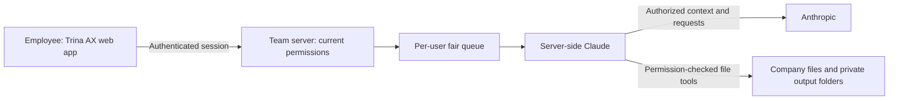

# Trina AX — server edition

[English](README.md) · [한국어](README.ko.md)

Use company files and Claude in one team app. Employees sign in to Trina AX; Claude executes on the team server. File tools check the current user’s permissions.

**This is a local release candidate, not a published server release.** The new repository, release artifact and installation link are pending review. Implemented features do not imply completed production-cloud or real-model validation. Hosting availability, pricing, trials and refund terms must be agreed before purchase.

- Use a desktop or mobile browser, or install the web app. This workflow does not require Claude on each employee’s PC.
- Share files and reusable skills, and review per-person, model and skill usage with CSV export. PDF, Office and HWP/HWPX extraction depends on format and document condition.
- Personal credentials are the default. Administrators control company API support and limits. Shared subscription credentials are off by default; enabling a setting is not provider authorization.
- Waiting work remains FIFO within each person. Scheduling considers active turns and round-robin order. Queue position is not a fixed start time or a waiting-time guarantee.
- Schedule templates stay inactive until a user creates a schedule. They use the same queue and current permissions, with private output by default.
- The app inbox records scheduled outcomes and reconnect notices. Device push requires server configuration and explicit consent; delivery is not guaranteed.

Files and conversations are stored on the team server. Authorized context is sent to Anthropic for model processing. Server administrators and authorized hosting operators can access stored data. Reported costs are estimates, not provider invoices. Several skill rows can contain the same turn’s cost and must not be summed as independent charges.

## Comparing options

Official documentation checked on 2026-10-27. The historical hub’s “inside Claude” criterion does not describe this server edition, so the comparison focuses on the user interface and operating responsibilities. Other products also offer permissions, organization skills and usage controls. This is not an O/X ranking; prices and contract-specific promises are omitted.

| Option | Documented model and conditions | Check before adoption |
| --- | --- | --- |
| Trina AX server candidate | Team app, operator-managed server, current file permissions, fair queue, schedules and inbox | Release preparation, supported-host and real-model validation, operator and backups |
| Claude Team / Enterprise | Organization plugins and skills; group-level plugin settings require Enterprise. [Official admin guide](https://support.claude.com/en/articles/13837433-manage-plugins-for-your-organization) | Required data connectors, group controls and provider terms |
| ChatGPT Business / Enterprise / Edu | Company Knowledge respects connected-source permissions; supported sources and workspace configuration are required. [Official help](https://help.openai.com/en/articles/12628342-company-knowledge-in-chatgpt) | App authorization, capabilities and plan-specific administration/auditing |
| Microsoft 365 Copilot | Microsoft 365 access controls and Purview protection/auditing within its service boundary. [Official architecture](https://learn.microsoft.com/en-us/microsoft-365/copilot/architecture-data-protection-auditing) | Existing tenant permissions and each external connector’s indexing/access policy |
| Google Workspace with Gemini | Workspace’s generative AI products and data protection policies. [Official security guidance](https://workspace.google.com/security/ai-privacy/) | Workspace edition, administrator settings and actual document handling |
| Glean | Glean Hosted or Glean-managed deployment in the customer’s cloud. Customer Hosted is not traditional customer-operated, manually modified self-hosting. [Official deployment guide](https://docs.glean.com/get-started/prepare/about-deployment) | Glean’s operating access, contract, data connectors and infrastructure responsibility |

An absent HWP/HWPX entry in another product’s file list does not prove unsupported behavior. Test the actual document and chosen plan. The old appendix C price and support matrix has not been copied into this candidate; only the narrower, freshly checked statements above are used.

## Source and operations

The shared engine, permissions, queue and employee app belong in the core. Trina branding is in `editions/trina/branding`. Trina's hosted service (billing, hosting, operations console) and the ax.trina.app website are private and are not in this repository. Trina additions are **AGPL-3.0-only**; retain [LICENSE](LICENSE), [NOTICE](NOTICE) and dependency notices. Customer data, credentials and company-specific operational settings are outside the public source artifact.

After publication review, connect the exact deployed release to its matching source and installation guide. Deployment review must include a way to obtain Corresponding Source for network use. Check the [GNU AGPL text](https://www.gnu.org/licenses/agpl-3.0.html) for the governing conditions.

This local candidate assembles the filtered core and the Trina branding; [the upstream record](docs/UPSTREAM.md) identifies the source revisions and validation boundaries.
