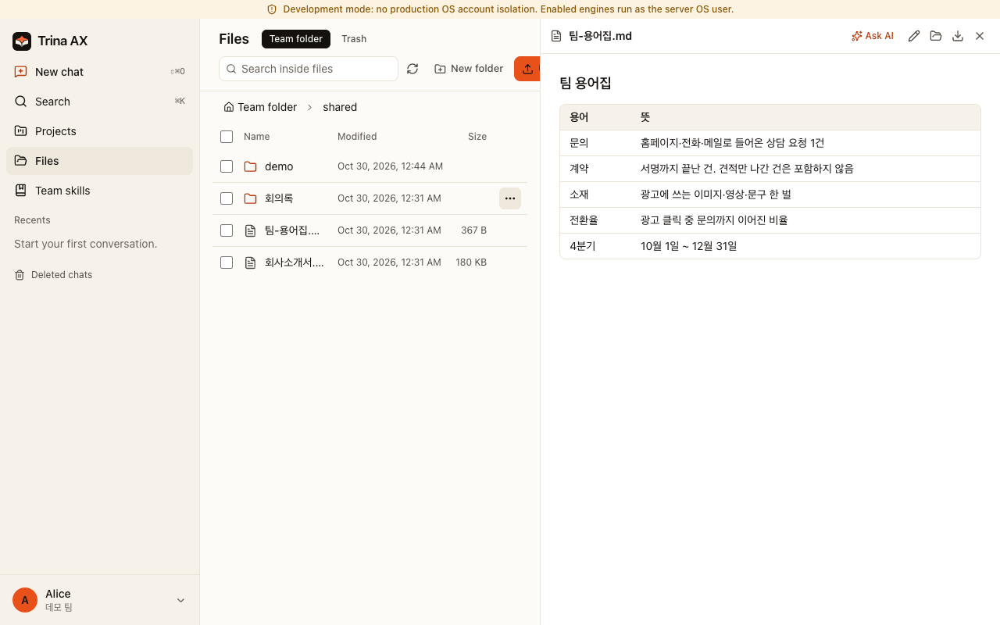
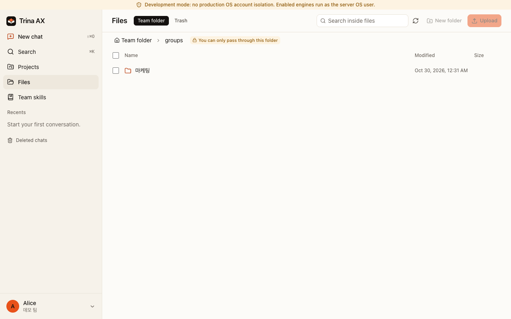

# Trina AX — your company's own AI workspace

[English](README.md) · [한국어](README.ko.md) · [日本語](README.ja.md) · [Español](README.es.md)

Bring company files, team skills and folder permissions into one place. Your team asks questions, prepares drafts and reuses the way your company works, from a browser. A *skill* is a reusable set of instructions for a task; it does not train a model or grant extra access.

**[Ask about Trina hosting and pricing](https://ax.trina.app/#pricing)** · **[Self-host: hand this guide to IT](docs/for-admins.md)**

## What your team can do

| Role | Start with a real task | Copyable example |
|---|---|---|
| CEO / team lead | Turn weekly notes into decisions, risks and next steps | [Weekly report](examples/skills/weekly-team-report/SKILL.md) |
| Sales | Draft a follow-up from a meeting, without inventing promises | [Sales follow-up](examples/skills/sales-follow-up/SKILL.md) |
| Marketing | Prepare a campaign brief from approved brand notes | [Brand brief](examples/skills/brand-brief/SKILL.md) |
| Finance | Flag missing receipts and uncertain amounts for review | [Expense review](examples/skills/expense-review/SKILL.md) |
| HR | Answer onboarding questions from permitted policies | [New-hire guide](examples/skills/new-hire-guide/SKILL.md) |
| Everyone | Extract decisions and actions from a meeting note | [Meeting summary](examples/skills/meeting-summary/SKILL.md) |

These are starting instructions with fictional inputs. People review the results before using or sharing them.

## Same question, different answers

“Summarize our onboarding policy.” An HR colleague with access to the HR folder can use that source; a sales colleague without access cannot read it through the file tools. The server checks the asking person's permissions on file requests. Skills follow folder permissions too.

The screenshots show the existing fictional marketing/finance demo: each sees a different group folder. They demonstrate file access, not a live AI answer. [Security and permissions](docs/security-and-permissions.md) explains wider-sharing confirmation and the limits.

## Choose how to start

| Path | Requirements | Who runs it / first result |
|---|---|---|
| Trina hosting | Browser, internet, approved AI connection | Trina hosts in AWS Seoul; [contact Trina](https://ax.trina.app/#contact) to arrange setup |
| Self-host Linux | Debian 12/13 or Ubuntu 24.04; systemd + cgroup v2; amd64/arm64; 4 GB RAM recommended, 20 GB disk minimum | Your IT team installs, updates and restores backups; [Linux guide](docs/INSTALL-LINUX.en.md) |
| Office Mac | Dedicated macOS 13+ Mac, signed-in OS user, internet and permitted Claude connection | Your office operator; [Mac office guide](docs/OFFICE.en.md). Capacity depends on workload; no measured Mac sizing guarantee |
| Local evaluation | Git, Bun 1.3.12 (CI pin), Go 1.27+, build tools; prepared Mac or Linux | Fictional files and permission comparison, no AI account needed; [quick try](docs/QUICKSTART.md) |

Hosted plans, checked 2026-10-30: **Starter $39/month (up to 5 people), Team $69 (15), Business $129 (40)**, USD before tax. AI usage is separate. Self-hosted software is free; hardware, operations and provider charges remain yours. See [current pricing](https://ax.trina.app/#pricing); contact-led hosting is not an instant free trial.

Already cloned and installed dependencies? Run `bun run demo`. It builds and starts a local, model-free walkthrough with fictional data. This is **not a production install**. [Complete prerequisites and cleanup](docs/QUICKSTART.md).

## First week with your team

Create the owner account, then **permissions → AI connection → invite the team → first skill → first backup**. Start with a few permitted files and one repeatable task. [Team lead checklist](docs/for-teams.md) · [Copy the examples](examples/README.md).

In managed installations, eligible personal connections take priority, followed by connections assigned to a person, a group, then the whole team. Fresh Trina teams allow shared subscriptions by default; existing saved choices persist. Connection-level consent still applies. **This software setting does not grant permission under Anthropic's or OpenAI's terms.** Use only accounts and plans authorized for your intended use. The local demo disables AI; development and office local-login modes have different connection behavior. [Connection details](docs/FAQ.md).

## What we don't promise

- Self-hosting does not make model processing offline: selected context goes to the chosen AI provider, and configured integrations receive their requests.
- Server operators can read stored files and chats, including Trina operators for hosting. App administrators do not get a browser for everyone's private conversations.
- Removing folder access does not erase earlier answers. Wider-sharing confirmation is not universal data-loss prevention.
- No security certification, perfect answers, guaranteed savings or automatic legal/financial/HR decisions. Review outputs and deployment boundaries.
- The AI sees photos and scanned PDF pages as images (an admin can turn this off), but Linux servers run no OCR: scanned documents and photos are not text-searchable there.
- HWP/HWPX text extraction is available. [Visual previews](resources/hwp/README.md) come as the optional HWP Preview plugin: an admin installs it from the official list in Admin > Plugins, and the server downloads the pinned build from the release feed. Default release bundles do not include its runtime. It needs macOS or Linux with glibc 2.39 or newer, so Debian 12 does **not** support visual previews; text extraction and original downloads remain available. Complex layouts and conversions have limits.

## Clients, releases and help

Use the browser on desktop or phone. A Windows installer is published; a Mac office ZIP runs the server and is **not a desktop DMG**. Native mobile source does not mean an app-store release. This source includes English, Korean, Indonesian, Japanese and Spanish throughout the app. Published installers can lag behind source changes; check their release notes.

[Latest release and checksums](https://github.com/trina-app/trina-ax/releases/latest) · [Changes](CHANGELOG.md) · [Documentation](docs/README.md) · [FAQ](docs/FAQ.md) · [Support and community questions](SUPPORT.md)

## For developers and operators

Trina runs AI tools on the team server and checks file access as the signed-in person. Linux and role-account Mac installations add dedicated engine accounts and OS isolation. Office mode runs as the logged-in Mac user; the development demo is not a production isolation test. MCP (Model Context Protocol) connects supported external tools; it is optional for the first walkthrough.

[Development and tests](docs/DEVELOPMENT.md) · [Contribute here](CONTRIBUTING.md) · [Configuration](docs/CONFIGURATION.md) · [Security reporting](SECURITY.md) · [Machine-readable index](llms.txt)

## License

[AGPL-3.0-only](LICENSE), with the separately licensed MIT [cloud protocol](shared/src/cloud-protocol/LICENSE). If you offer a modified version over a network, offer its corresponding source to users as required by the license. [Notices](NOTICE) · [Third-party notices](docs/THIRD-PARTY-NOTICES.md). Claude Code and Codex have separate terms; this project is not endorsed by Anthropic or OpenAI.
