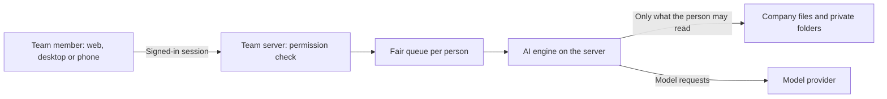

# Trina AX

[English](README.md) · [한국어](README.ko.md)

Trina AX is a team app for company files and AI. Your team signs in to one web app. The AI (Claude Code, and
optionally the Codex CLI) runs on your team server. Each file tool checks the permissions of the person who asks.



## Status

This is a **pre-release**. There is no signed release and no public download yet. Some paths are tested only in
code and tests, not on a real production install. [docs/INSTALL.md](docs/INSTALL.md) shows the status of each
part.

## Features

- **Files with permissions.** Team, group, project and personal folders. The AI sees only the files that the
  person who asks can see.
- **Chat with the AI on the server.** Team members do not need Claude on their own computers.
- **Team skills.** Save a work procedure as a file. Managers review and approve changes.
- **Fair queue.** Each person's work runs in order. The server shares turns between people.
- **Schedules and inbox.** Run a task at a set time. The result goes to a private folder by default.
- **Usage and limits.** See usage per person, model and skill, and export it as CSV. Costs are estimates, not
  provider invoices.
- **Office documents.** Preview and read PDF, Word, Excel, PowerPoint and HWP/HWPX files. Results depend on the
  file.
- **Desktop app.** Mac and Windows app with an in-app browser that the AI can use. You approve each new site.

## Run it

| Use | Guide |
|---|---|
| Try it on one Mac (dev mode) | [docs/INSTALL.md](docs/INSTALL.md), part 1 |
| Production install on a Mac | [docs/INSTALL.md](docs/INSTALL.md), part 2 |
| One Mac for an office, with desk PCs on the office network | [docs/OFFICE.md](docs/OFFICE.md) (Korean) |
| Linux server | [docs/INSTALL-LINUX.md](docs/INSTALL-LINUX.md) (Korean) |

To let people reach a self-hosted server from outside the office, use the office network, a Cloudflare Tunnel,
Tailscale or your own relay (`relay/`).

## Development

```sh
bun install
bun run build:native   # needs Go
bun run dev            # server, web app and a local relay
bun run test:unit
```

Requirements and the full setup: [docs/INSTALL.md](docs/INSTALL.md), part 1. Design decisions:
[docs/DECISIONS.md](docs/DECISIONS.md) (Korean).

## Repository layout

| Folder | Contents |
|---|---|
| `server/` | Team server (Bun) |
| `web/` | Web app (React) |
| `desktop/` | Desktop app (Electron) |
| `relay/` | Relay that connects a team server to the internet |
| `native/` | Tool gate, launcher and enrolment tools (Go) |
| `shared/` | Code that the parts share. `shared/src/cloud-protocol/` is MIT |
| `editions/trina/branding/` | Trina name, source link and release channel |
| `mobile/`, `menubar/` | Phone app and Mac menu bar app |

The Trina hosted service (billing, hosting, operations console) and the trina.app website are private. They are not
in this repository.

## Data and privacy

Files and chats stay on your team server. The server sends the context that the person may read to the model
provider (for example Anthropic) to get an answer. Server administrators can read the stored data.

## License

Trina AX is licensed under **AGPL-3.0-only**. See [LICENSE](LICENSE) and [NOTICE](NOTICE).
`shared/src/cloud-protocol/` has its own MIT license. Third-party notices: [docs/THIRD-PARTY-NOTICES.md](docs/THIRD-PARTY-NOTICES.md).

If you run a changed version as a network service, you must offer its source code to its users (AGPL section 13).
The app shows a source code link on the sign-in screen and in **Settings › About**.

Claude Code and Codex are separate products with their own terms. This project is not endorsed by Anthropic or
OpenAI.
