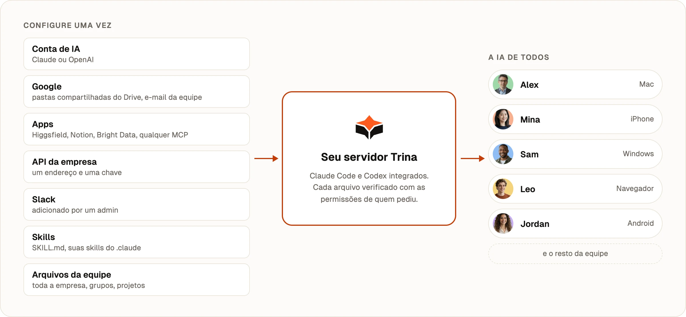
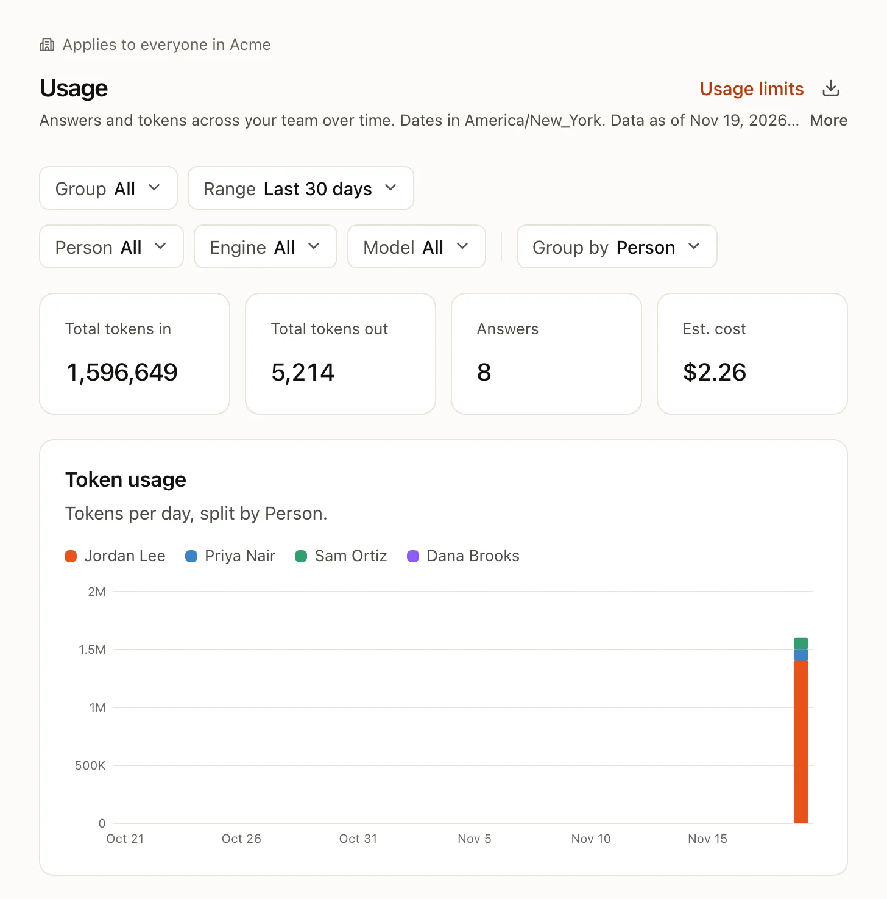

<div align="center">

<picture><source media="(prefers-color-scheme: dark)" srcset="editions/trina/branding/logo/mark-dark.svg"></picture>

<h1>Trina AX</h1>

<b>A IA que toda a sua equipe compartilha.</b><br>
O Trina AX reúne os arquivos, as skills e as ferramentas da sua equipe em um só servidor. A IA de todos já começa com eles,<br>e cada arquivo que ela abre é verificado com as permissões de quem pediu.

<a href="https://ax.trina.app/download"></a>&nbsp;&nbsp;<a href="https://ax.trina.app/download"></a>&nbsp;&nbsp;<a href="https://apps.apple.com/app/trina-ax/id6829192435"></a>&nbsp;&nbsp;<a href="https://play.google.com/store/apps/details?id=app.trina.ax"></a><br>
<sub>Linux: .deb e AppImage (x64, arm64) na <a href="https://ax.trina.app/download">página de downloads</a></sub>

[Site](https://ax.trina.app) · [Documentação](docs/README.md) · [Preços](https://ax.trina.app/pricing) · [Discord](https://discord.gg/zUVfSR8MVk)

[English](README.md) · [한국어](README.ko.md) · [日本語](README.ja.md) · [Español](README.es.md) · [简体中文](README.zh-CN.md) · [繁體中文](README.zh-TW.md) · Português · [Français](README.fr.md) · [Deutsch](README.de.md) · [Italiano](README.it.md) · [Русский](README.ru.md) · [Türkçe](README.tr.md) · [Tiếng Việt](README.vi.md) · [Bahasa Indonesia](README.id.md)

</div>

https://github.com/user-attachments/assets/fb2e1a9d-c188-4484-a869-4cc3eeaed5c7

<p align="center"><sub>O que a IA de um recém-contratado consegue fazer no primeiro dia. A história em 80 segundos.</sub><br>Open source (AGPL-3.0) · Hospedagem própria grátis, sem limite de usuários<br><br><a href="https://github.com/trina-app/trina-ax?tab=readme-ov-file"></a><br><sub>Depois, clique em ☆ Star no topo da página. Uma estrela ajuda mais equipes a encontrar o Trina AX.</sub></p>

<br>

<picture><source media="(prefers-color-scheme: dark)" srcset="docs/images/readme/v4/divider-dark.png"></picture>

## Configure uma vez. Vale para toda a equipe.

**Uma conta de IA para toda a equipe.** Conecte uma chave de API do Claude ou da OpenAI, ou um plano cujos termos permitam isso, e todos usam essa conta para perguntar, com limites de tokens por pessoa, grupo ou equipe.

Uma pessoa configura tudo no servidor da equipe. A IA de todos já tem tudo isso desde a primeira pergunta, no navegador ou nos apps. Ninguém mais instala o Claude Code nem copia skills; no máximo, cada um faz login nas próprias contas.

<picture><source media="(prefers-color-scheme: dark)" srcset="docs/images/readme/v4/set-up-once-pt-BR-dark.webp"></picture>

| Configure uma vez | Todos recebem |
| --- | --- |
| **Conta de IA.** O proprietário ou um admin conecta uma chave de API do Claude ou da OpenAI, ou um plano cujos termos permitam isso. | Respostas para toda a equipe, com limites de tokens por pessoa, grupo ou equipe. |
| **Google.** Compartilhe pastas do Drive com a equipe ou conecte uma conta da equipe (uma caixa de e-mail ou agenda compartilhada) para Gmail, Calendar, Docs e Sheets. | As pessoas que você escolher usam esses serviços nos chats. Cada pessoa também pode conectar a própria conta Google. |
| **Apps.** Higgsfield, Notion, Linear, Figma e outros da lista de apps, ou qualquer servidor MCP pelo endereço, como o Bright Data. | As ferramentas do app nos chats de todos: um login da equipe, ou cada pessoa entra com a própria conta. |
| **A API da sua empresa.** Um endereço, uma chave e algumas observações. | A IA chama o seu próprio sistema, só dentro desse endereço. |
| **Slack.** O proprietário ou um admin adiciona uma vez. | Pergunte à Trina por mensagem direta ou em qualquer canal para o qual ela foi convidada, com o seu próprio acesso. |
| **Skills.** Escreva um `SKILL.md` ou traga as skills da sua pasta `.claude` ou `.codex`. | A IA de todos segue os mesmos passos. Digite `/` para usar uma. |
| **Arquivos da equipe.** Um só drive: toda a empresa, grupos, projetos, skills da equipe e pastas pessoais. | A IA de todos começa com os arquivos da equipe e abre só o que cada pessoa pode abrir. |

<table>
<tr>
<td colspan="2"><br><sub>Admin › Apps conectados: configure uma vez para todos da equipe</sub></td>
</tr>
<tr>
<td width="50%"><br><sub>Um só drive da equipe</sub></td>
<td width="50%"><br><sub>Skills da equipe, ou traga as suas</sub></td>
</tr>
</table>

<br>

<picture><source media="(prefers-color-scheme: dark)" srcset="docs/images/readme/v4/divider-dark.png"></picture>

## O que todo mundo faz com ele

**Pergunte ao lado de qualquer conversa e envie com um clique.** Um chat lateral que só você vê; com um clique, a resposta da Trina vai para a conversa.


**A IA de cada pessoa vê só o que essa pessoa pode abrir.** A Mina não pode abrir Finance, então a IA dela também não. [Como funcionam as permissões](docs/PERMISSIONS.md)


**Retome a sessão de um colega em um projeto da equipe.** As sessões de um projeto da equipe são compartilhadas com os membros dele: abra a de um colega e continue, com o seu próprio acesso. Qualquer outra sessão você pode compartilhar com pessoas ou grupos, como um arquivo no Google Drive.


**Arquivos encontrados pelo que são.** Toda noite, a IA da equipe lê os arquivos novos e alterados nas pastas compartilhadas, de grupo e de projeto, e guarda uma linha por arquivo dizendo o que ele é. Assim, um documento escaneado chamado `temp.pdf` ou uma foto chamada `IMG_2031.jpg` são encontrados pelo conteúdo. Ela usa a conta de IA da equipe e nunca lê pastas pessoais. Em um teste com 2.238 arquivos fictícios, o Claude Code encontrou o arquivo certo em 181 de 184 perguntas com essas linhas, e em 172 sem elas.

<table>
<tr>
<td width="50%"><b>Tarefas agendadas.</b> Peça uma vez; a Trina repete no horário que você definir, no fuso horário da sua equipe.<br><br></td>
<td width="50%"><b>Convidados.</b> Convide pessoas de fora da empresa para um chat em grupo ou um projeto e escolha se elas podem usar a IA.<br><br></td>
</tr>
<tr>
<td width="50%"><b>Uso e limites.</b> Respostas, tokens e custo estimado por pessoa; limites de tokens por pessoa, grupo ou equipe.<br><br></td>
<td width="50%"><b>Busque em tudo.</b> ⌘K em chats, histórico, projetos, arquivos, skills e tarefas agendadas.<br><br></td>
</tr>
<tr>
<td colspan="2"><b>Chat de equipe como o Slack, mas com a Trina AI.</b> Canais para todos e para cada grupo, canais privados, mensagens diretas, chats em grupo, threads e @menções, na web, no desktop e no celular. Pergunte à Trina ao lado de qualquer um deles, em um chat lateral que só você vê.<br><br></td>
</tr>
</table>

- **Toda mudança fica guardada.** Feita por uma pessoa ou pela IA dela; recupere qualquer versão.
- **Navegador integrado.** No app para desktop, a Trina abre sites em um painel ao lado do chat, lê as páginas, clica e preenche formulários enquanto você acompanha; o botão Stop encerra. Ela pergunta antes de abrir um site novo, a menos que você permita todos os sites.
- **Apps postam nas conversas.** Atualizações do Sentry, GitHub, Stripe, Jira e HubSpot chegam como cards.
- **Encontre arquivos de trabalho.** O app para desktop encontra arquivos de trabalho recentes no seu computador e adiciona os que você escolher.
- **Documentos.** Lê o texto de documentos Hangul (HWP/HWPX); mostra prévias de PDF e PowerPoint.
- **Todos os dispositivos.** Mac, Windows, Linux, iPhone, Android e qualquer navegador, em seis idiomas.

<br>

<picture><source media="(prefers-color-scheme: dark)" srcset="docs/images/readme/v4/divider-dark.png"></picture>

## Comece agora

- **Experimente no navegador:** nada para instalar; uma equipe fictícia com a IA desligada. [Abrir a demo](https://ax.trina.app/demo/)
- **Hospedagem pela Trina:** nenhum servidor para manter. Teste grátis de 14 dias, depois um plano mensal. [Preços](https://ax.trina.app/pricing)
- **Apps:** [Mac, Windows, Linux, iPhone, Android](https://ax.trina.app/download) ou qualquer navegador.
- **Hospedagem própria:** no seu próprio servidor Linux, com Docker ou em um Mac do escritório. Grátis. [Linux](docs/INSTALL-LINUX.en.md) · [Docker](docs/INSTALL-DOCKER.md) · [Mac do escritório](docs/OFFICE.en.md) · [Instalar com o seu agente de IA](docs/INSTALL-LINUX.en.md#install-with-your-ai-agent)

<b>Hospedagem própria com Docker</b> (Linux ou um Mac com OrbStack)

```sh
git clone https://github.com/trina-app/trina-ax.git && cd trina-ax/docker
cp env.example .env && docker compose up -d --build
docker compose exec trina-ax trina-ax-setup-link   # abra o link e crie a conta do proprietário
```

É mais novo e menos testado que a instalação em Linux; um servidor Ubuntu 24.04 precisa primeiro de um ajuste no host. [Guia do Docker](docs/INSTALL-DOCKER.md)

<b>Experimente no seu computador em 10 minutos</b> (equipe fictícia, IA desligada)

```sh
git clone https://github.com/trina-app/trina-ax.git && cd trina-ax
bun install --frozen-lockfile && bun run demo   # → http://127.0.0.1:19760 · alice / teamax-demo-1
```

Requer Bun 1.3.12 e Go 1.27+. Não é uma instalação para produção. [Passo a passo](docs/QUICKSTART.md)

<br>

<picture><source media="(prefers-color-scheme: dark)" srcset="docs/images/readme/v4/divider-dark.png"></picture>

## Como funciona

Um servidor roda o Claude Code e o Codex como motor. Todo pedido de arquivo, de uma pessoa ou da IA dela, passa por uma única verificação de permissões no servidor. Em um servidor Linux, o motor roda com uma conta própria dentro de um sandbox com bubblewrap, Landlock e seccomp, com o shell e as ferramentas de arquivo integradas desligados: ele só acessa os arquivos pelas ferramentas da Trina. [Segurança e permissões](docs/security-and-permissions.md)

A Trina fornece o espaço de trabalho, não a IA: conecte contas e planos do Claude ou da OpenAI autorizados para o seu uso. O uso de IA é cobrado pela conta que você conectar.

<details>
<summary><b>Dados, limites e o que não prometemos</b></summary>

### O que não prometemos

- Hospedagem própria não significa offline: o contexto necessário para cada pedido vai para o provedor de IA que você conectar, e as integrações configuradas recebem as requisições feitas a elas. Cada busca na web do Codex envia a conversa até então para o serviço de busca da OpenAI. Se um admin permitir o OpenRouter para voz, o som de arquivos de vídeo e áudio vai para o OpenRouter. A cada 30 minutos, o servidor consulta `updates.trina.app` para saber o próprio endereço público (`MYCEL_EXIT_ADDRESS_CHECK=off` desliga isso). [Detalhes](docs/security-and-permissions.md)
- Quem opera o servidor pode ler os arquivos e chats armazenados; na hospedagem pela Trina, isso inclui os operadores da Trina. Os admins do app não têm uma tela para navegar pelas conversas privadas de todos.
- Remover o acesso a uma pasta não apaga respostas anteriores. A verificação ao ampliar o compartilhamento não é uma solução universal de prevenção contra perda de dados.
- Não oferecemos certificação de segurança, respostas perfeitas, economia garantida nem decisões automáticas jurídicas, financeiras ou de RH. Revise os resultados e os limites da implantação.
- Servidores Linux não fazem OCR: a IA vê fotos e páginas escaneadas como imagens, mas elas não podem ser buscadas como texto. O Mac do escritório ainda não lê vídeo.
- O texto de HWP/HWPX funciona para qualquer equipe; [prévias e criação de documentos Hangul](resources/hwp/README.md) precisam do plugin opcional HWP Preview (macOS, ou Linux com glibc 2.39+; exceto Debian 12).
- Conexões: primeiro vem a conexão elegível da própria pessoa, depois uma atribuída à pessoa, a um grupo e, por fim, à equipe inteira. Em equipes recém-criadas na Trina, uma conexão da empresa pode atender a equipe inteira por padrão; escolhas já salvas continuam valendo. **Esta configuração do software não concede permissão nos termos da Anthropic ou da OpenAI.** [Detalhes das conexões](docs/FAQ.md)
- A hospedagem própria em Linux exige Debian 12/13 ou Ubuntu 24.04, systemd com cgroup v2, amd64 ou arm64, 4 GB de RAM e 20 GB de disco. Sua equipe de TI instala, atualiza e restaura os backups.

</details>

<br>

<picture><source media="(prefers-color-scheme: dark)" srcset="docs/images/readme/v4/divider-dark.png"></picture>

## Comunidade

Se o Trina AX for útil para a sua equipe, uma ⭐ no GitHub ajuda outras equipes a encontrá-lo.

[Discord](https://discord.gg/zUVfSR8MVk) · [X](https://x.com/trina_ax) · [Versões](https://github.com/trina-app/trina-ax/releases/latest) · [Alterações](CHANGELOG.md) · [Suporte](SUPPORT.md) · [Como contribuir](CONTRIBUTING.md) · [Segurança](SECURITY.md) · [Desenvolvimento](docs/DEVELOPMENT.md) · [Configuração](docs/CONFIGURATION.md) · [llms.txt](llms.txt)

O app está disponível em inglês, coreano, indonésio, japonês, espanhol e chinês simplificado. A empresa e as pessoas de todas as imagens são fictícias.

<br>

<picture><source media="(prefers-color-scheme: dark)" srcset="docs/images/readme/v4/divider-dark.png"></picture>

## Licença

Uso gratuito, inclusive comercial, sob a licença [AGPL-3.0-only](LICENSE). Se você oferecer uma versão modificada pela rede, disponibilize o código-fonte para esses usuários. O protocolo de nuvem é MIT ([licença](shared/src/cloud-protocol/LICENSE)). [Avisos](NOTICE) · [Avisos de terceiros](docs/THIRD-PARTY-NOTICES.md)

O Claude Code e o Codex têm os próprios termos; este projeto não é endossado pela Anthropic nem pela OpenAI. Claude é uma marca registrada da Anthropic.
