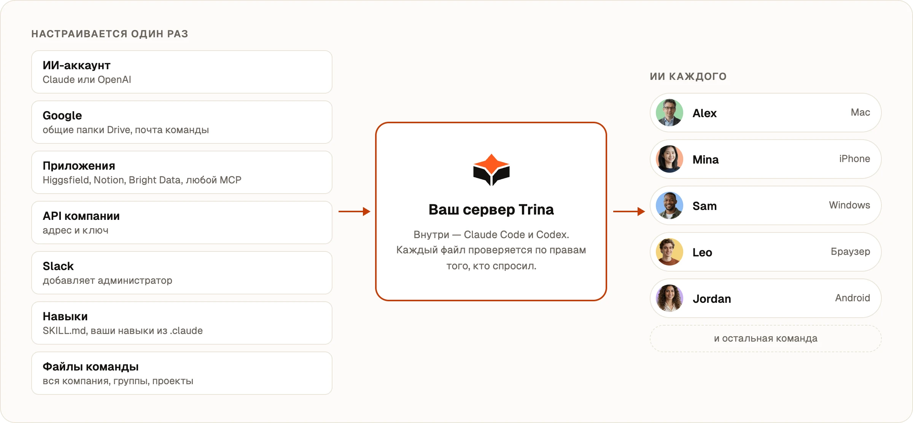
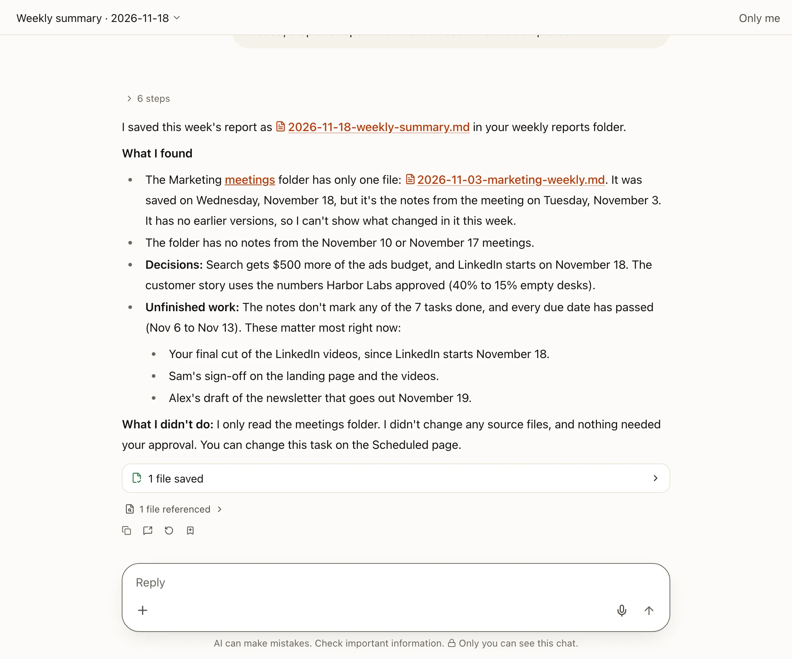

<div align="center">

<picture><source media="(prefers-color-scheme: dark)" srcset="editions/trina/branding/logo/mark-dark.svg"></picture>

<h1>Trina AX</h1>

<b>ИИ, общий для всей команды.</b><br>
Trina AX собирает файлы, навыки и инструменты команды на одном сервере. ИИ каждого сотрудника сразу опирается на них,<br>а каждый файл, который он открывает, проверяется по правам того, кто спросил.

<a href="https://ax.trina.app/download"></a>&nbsp;&nbsp;<a href="https://ax.trina.app/download"></a>&nbsp;&nbsp;<a href="https://apps.apple.com/app/trina-ax/id6829192435"></a>&nbsp;&nbsp;<a href="https://play.google.com/store/apps/details?id=app.trina.ax"></a><br>
<sub>Linux: .deb и AppImage (x64, arm64) на <a href="https://ax.trina.app/download">странице загрузки</a></sub>

[Сайт](https://ax.trina.app) · [Документация](docs/README.md) · [Цены](https://ax.trina.app/pricing) · [Discord](https://discord.gg/zUVfSR8MVk)

[English](README.md) · [한국어](README.ko.md) · [日本語](README.ja.md) · [Español](README.es.md) · [简体中文](README.zh-CN.md) · [繁體中文](README.zh-TW.md) · [Português](README.pt-BR.md) · [Français](README.fr.md) · [Deutsch](README.de.md) · [Italiano](README.it.md) · Русский · [Türkçe](README.tr.md) · [Tiếng Việt](README.vi.md) · [Bahasa Indonesia](README.id.md)

</div>

https://github.com/user-attachments/assets/3c266b6b-1714-4a7f-8fab-e49de12e01a0

<p align="center"><sub>Что умеет ИИ нового сотрудника в первый же день. История за 80 секунд.</sub><br>Открытый исходный код (AGPL-3.0) · Бесплатно на своём сервере, без лимита пользователей<br><br><a href="https://github.com/trina-app/trina-ax?tab=readme-ov-file"></a><br><sub>Затем нажмите ☆ Star вверху страницы. Звезда помогает другим командам найти Trina AX.</sub></p>

<br>

<picture><source media="(prefers-color-scheme: dark)" srcset="docs/images/readme/v4/divider-dark.png"></picture>

## Настраивается один раз. Работает у всей команды.

**Один ИИ-аккаунт на всю команду.** Подключите один API-ключ Claude или OpenAI либо тариф, условия которого это разрешают, и все будут спрашивать через него, с лимитами токенов на человека, группу или команду.

Один человек всё настраивает на сервере команды, и ИИ каждого получает это с первого же вопроса — в браузере или в приложениях. Остальным не нужно ни ставить Claude Code, ни копировать навыки: самое большее — войти в свои аккаунты.

<picture><source media="(prefers-color-scheme: dark)" srcset="docs/images/readme/v4/set-up-once-ru-dark.webp"></picture>

| Настраивается один раз | Что получает каждый |
| --- | --- |
| **ИИ-аккаунт.** Владелец или администратор подключает API-ключ Claude или OpenAI либо тариф, условия которого это разрешают. | Ответы для всей команды с лимитами токенов на человека, группу или команду. |
| **Google.** Откройте команде доступ к папкам в Drive или подключите один командный аккаунт (общий почтовый ящик или календарь) для Gmail, Calendar, Docs и Sheets. | Выбранные вами люди пользуются ими в своих чатах. При этом каждый может подключить и свой аккаунт Google. |
| **Приложения.** Higgsfield, Notion, Linear, Figma и другие из списка приложений или любой MCP-сервер по адресу, например Bright Data. | Инструменты приложения в чатах у всех: один вход на всю команду или каждый входит под своим аккаунтом. |
| **API вашей компании.** Адрес, ключ и несколько пояснений. | ИИ обращается к вашей собственной системе, но только в пределах этого адреса. |
| **Slack.** Владелец или администратор добавляет его один раз. | Спрашивайте Trina в личных сообщениях или в любом канале, куда её пригласили, — со своими правами доступа. |
| **Навыки.** Напишите `SKILL.md` или перенесите навыки из своей папки `.claude` или `.codex`. | ИИ у всех выполняет одни и те же шаги. Наберите `/`, чтобы вызвать навык. |
| **Файлы команды.** Один диск: вся компания, группы, проекты, навыки команды и личные папки. | ИИ каждого опирается на файлы команды и открывает только то, что можно открыть этому человеку. |

<table>
<tr>
<td colspan="2"><br><sub>Администрирование › Подключённые приложения: одна настройка для всех в команде</sub></td>
</tr>
<tr>
<td width="50%"><br><sub>Один диск на команду</sub></td>
<td width="50%"><br><sub>Навыки команды или ваши собственные</sub></td>
</tr>
</table>

<br>

<picture><source media="(prefers-color-scheme: dark)" srcset="docs/images/readme/v4/divider-dark.png"></picture>

## Как этим пользуется каждый

**Спрашивайте прямо из любой беседы, отправляйте в один клик.** Боковой чат, который видите только вы; один клик — и ответ Trina уходит в беседу.


**ИИ каждого видит только то, что может открыть сам человек.** Mina не может открыть Finance — значит, и её ИИ не может. [Как работают права доступа](docs/PERMISSIONS.md)


**Подхватите сессию коллеги в командном проекте.** Сессии командного проекта доступны его участникам: откройте сессию коллеги и продолжайте со своими правами доступа. Любой другой сессией можно поделиться с людьми или группами, как файлом в Google Drive.


**Файлы находятся по смыслу.** Каждую ночь ИИ команды читает новые и изменённые файлы в общих, групповых и проектных папках и к каждому файлу записывает одну строку о том, что это за файл, поэтому скан с именем `temp.pdf` или фото `IMG_2031.jpg` находится по содержимому. Для этого используется ИИ-аккаунт команды, а личные папки никогда не читаются. В тесте на 2 238 вымышленных файлах Claude Code с этими строками нашёл нужный файл для 181 вопроса из 184, а без них — для 172.

<table>
<tr>
<td width="50%"><b>Задачи по расписанию.</b> Попросите один раз — Trina будет повторять это по вашему расписанию, в часовом поясе команды.<br><br></td>
<td width="50%"><b>Гости.</b> Приглашайте в групповой чат или проект людей не из вашей компании и решайте, могут ли они пользоваться ИИ.<br><br></td>
</tr>
<tr>
<td width="50%"><b>Расход и лимиты.</b> Ответы, токены и примерная стоимость по каждому человеку; лимиты токенов на человека, группу или команду.<br><br></td>
<td width="50%"><b>Поиск по всему.</b> ⌘K по чатам, истории, проектам, файлам, навыкам и задачам по расписанию.<br><br></td>
</tr>
<tr>
<td colspan="2"><b>Командный чат как Slack, но с Trina AI.</b> Каналы для всех и для каждой группы, закрытые каналы, личные сообщения, групповые чаты, треды и @упоминания — в вебе, на десктопе и на телефоне. В любом из них можно спросить Trina в боковом чате, который видите только вы.<br><br></td>
</tr>
</table>

- **Сохраняется каждое изменение.** Неважно, вносил его человек или его ИИ, — любую версию можно вернуть.
- **Встроенный браузер.** В десктопном приложении Trina открывает сайты в панели рядом с чатом, читает их, нажимает на кнопки и заполняет формы у вас на глазах; кнопка Stop всё останавливает. Прежде чем зайти на новый сайт, она спросит вас, если только вы не разрешили ей все сайты.
- **Приложения пишут в беседы.** Обновления из Sentry, GitHub, Stripe, Jira и HubSpot приходят карточками.
- **Поиск рабочих файлов.** Десктопное приложение находит недавние рабочие файлы на вашем компьютере и добавляет те, что вы выберете.
- **Документы.** Читает текст документов Hangul (HWP/HWPX); показывает превью PDF и PowerPoint.
- **Все устройства.** Mac, Windows, Linux, iPhone, Android и любой браузер, на шести языках.

<br>

<picture><source media="(prefers-color-scheme: dark)" srcset="docs/images/readme/v4/divider-dark.png"></picture>

## Как начать

- **Попробуйте в браузере:** ничего не нужно устанавливать; вымышленная команда, ИИ выключен. [Открыть демо](https://ax.trina.app/demo/)
- **Хостинг Trina:** не нужно держать свой сервер. 14 дней бесплатно, затем помесячный тариф. [Цены](https://ax.trina.app/pricing)
- **Приложения:** [Mac, Windows, Linux, iPhone, Android](https://ax.trina.app/download) или любой браузер.
- **Свой сервер:** ваш Linux-сервер, Docker или офисный Mac. Бесплатно. [Linux](docs/INSTALL-LINUX.en.md) · [Docker](docs/INSTALL-DOCKER.md) · [Офисный Mac](docs/OFFICE.en.md) · [Установка с помощью ИИ-агента](docs/INSTALL-LINUX.en.md#install-with-your-ai-agent)

<b>Свой сервер на Docker</b> (Linux или Mac с OrbStack)

```sh
git clone https://github.com/trina-app/trina-ax.git && cd trina-ax/docker
cp env.example .env && docker compose up -d --build
docker compose exec trina-ax trina-ax-setup-link   # откройте ссылку и создайте владельца
```

Этот способ новее и проверен меньше, чем установка на Linux; на сервере с Ubuntu 24.04 сначала нужно изменить одну настройку хоста. [Руководство по Docker](docs/INSTALL-DOCKER.md)

<b>Попробуйте на своём компьютере за 10 минут</b> (вымышленная команда, ИИ выключен)

```sh
git clone https://github.com/trina-app/trina-ax.git && cd trina-ax
bun install --frozen-lockfile && bun run demo   # → http://127.0.0.1:19760 · alice / teamax-demo-1
```

Нужны Bun 1.3.12 и Go 1.27+. Для продакшена не подходит. [Пошаговое руководство](docs/QUICKSTART.md)

<br>

<picture><source media="(prefers-color-scheme: dark)" srcset="docs/images/readme/v4/divider-dark.png"></picture>

## Как это работает

Движком служат Claude Code и Codex, они работают на одном сервере. Каждый запрос к файлам — от человека или от его ИИ — проходит единую проверку прав на сервере. На Linux-сервере движок работает под своей учётной записью внутри песочницы bubblewrap, Landlock и seccomp, с отключёнными оболочкой и встроенными файловыми инструментами: до файлов он добирается только через инструменты Trina. [Безопасность и права доступа](docs/security-and-permissions.md)

Trina предоставляет рабочее пространство, а не сам ИИ: подключайте аккаунты и тарифы Claude или OpenAI, которые вам разрешено использовать. Расходы на ИИ идут на счёт подключённого аккаунта.

<details>
<summary><b>Данные, ограничения и чего мы не обещаем</b></summary>

### Чего мы не обещаем

- Свой сервер — не значит офлайн: контекст, нужный для запроса, уходит к подключённому ИИ-провайдеру, а настроенные интеграции получают свои запросы. Каждый веб-поиск Codex отправляет весь диалог до этого момента в поисковый сервис OpenAI. Если администратор разрешил OpenRouter для работы с речью, звук из видео- и аудиофайлов уходит в OpenRouter. Каждые 30 минут сервер запрашивает у `updates.trina.app` свой публичный адрес (отключается через `MYCEL_EXIT_ADDRESS_CHECK=off`). [Подробнее](docs/security-and-permissions.md)
- Операторы сервера могут читать сохранённые файлы и чаты, при хостинге — в том числе операторы Trina. У администраторов приложения нет инструмента для просмотра личной переписки всех пользователей.
- Если закрыть доступ к папке, прежние ответы не удаляются. Проверка перед расширением доступа — не универсальная защита от утечек данных.
- Никаких сертификатов безопасности, идеальных ответов, гарантированной экономии или автоматических юридических, финансовых и кадровых решений. Проверяйте результаты и границы развёртывания.
- На Linux-серверах нет OCR: ИИ видит фото и сканы как изображения, но искать по ним как по тексту нельзя. Офисные Mac пока не умеют читать видео.
- Текст HWP/HWPX читается в любой команде; для [превью и создания документов Hangul](resources/hwp/README.md) нужен необязательный плагин HWP Preview (macOS или Linux с glibc 2.39+; не Debian 12).
- Подключения: сначала идёт собственное подходящее подключение человека, затем назначенное этому человеку, группе и, наконец, всей команде. В новых командах Trina одно подключение компании по умолчанию может обслуживать всю команду; уже сохранённые настройки остаются. **Эта настройка в программе не даёт разрешения по условиям Anthropic или OpenAI.** [Подробнее о подключениях](docs/FAQ.md)
- Для своего сервера на Linux нужны Debian 12/13 или Ubuntu 24.04, systemd с cgroup v2, amd64 или arm64, 4 ГБ RAM и 20 ГБ диска. Установку, обновления и восстановление из резервных копий берёт на себя ваш ИТ-отдел.

</details>

<br>

<picture><source media="(prefers-color-scheme: dark)" srcset="docs/images/readme/v4/divider-dark.png"></picture>

## Сообщество

Если Trina AX помогает вашей команде, ⭐ на GitHub поможет другим командам её найти.

[Discord](https://discord.gg/zUVfSR8MVk) · [X](https://x.com/trina_ax) · [Релизы](https://github.com/trina-app/trina-ax/releases/latest) · [Список изменений](CHANGELOG.md) · [Поддержка](SUPPORT.md) · [Участие в разработке](CONTRIBUTING.md) · [Безопасность](SECURITY.md) · [Разработка](docs/DEVELOPMENT.md) · [Конфигурация](docs/CONFIGURATION.md) · [llms.txt](llms.txt)

Интерфейс приложения доступен на английском, корейском, индонезийском, японском, испанском и упрощённом китайском. Компания и люди на всех картинках вымышлены.

<br>

<picture><source media="(prefers-color-scheme: dark)" srcset="docs/images/readme/v4/divider-dark.png"></picture>

## Лицензия

Можно использовать бесплатно, в том числе в коммерческих целях, по лицензии [AGPL-3.0-only](LICENSE). Если вы даёте доступ к изменённой версии по сети, откройте этим пользователям её исходный код. Облачный протокол распространяется по лицензии MIT ([лицензия](shared/src/cloud-protocol/LICENSE)). [Уведомления](NOTICE) · [Уведомления о сторонних компонентах](docs/THIRD-PARTY-NOTICES.md)

У Claude Code и Codex свои условия использования; этот проект не одобрен ни Anthropic, ни OpenAI. Claude — товарный знак Anthropic.
