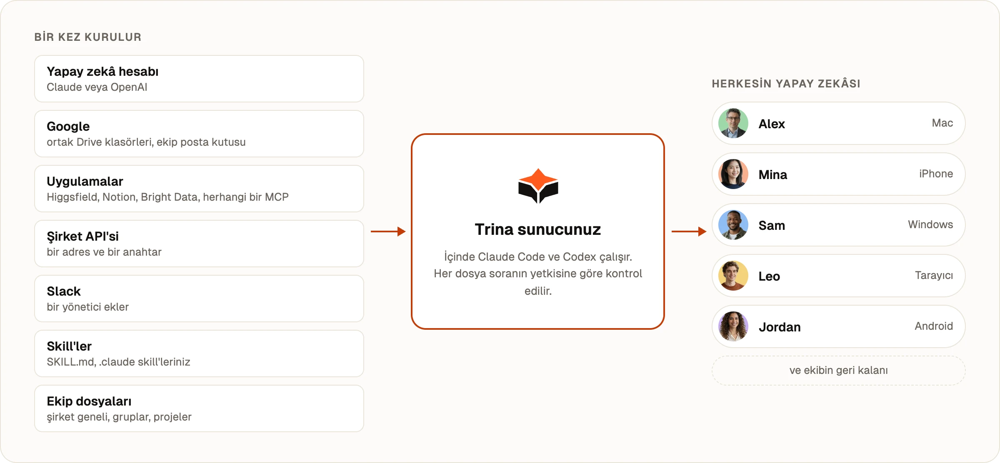

<div align="center">

<picture><source media="(prefers-color-scheme: dark)" srcset="editions/trina/branding/logo/mark-dark.svg"></picture>

<h1>Trina AX</h1>

<b>Tüm ekibinizin paylaştığı yapay zekâ.</b><br>
Trina AX, ekibinizin dosyalarını, skill'lerini ve araçlarını tek bir sunucuda toplar. Herkesin yapay zekâsı işe bunlarla başlar,<br>açtığı her dosya da soruyu soran kişinin yetkileriyle kontrol edilir.

<a href="https://ax.trina.app/download"></a>&nbsp;&nbsp;<a href="https://ax.trina.app/download"></a>&nbsp;&nbsp;<a href="https://apps.apple.com/app/trina-ax/id6829192435"></a>&nbsp;&nbsp;<a href="https://play.google.com/store/apps/details?id=app.trina.ax"></a><br>
<sub>Linux: .deb ve AppImage (x64, arm64) <a href="https://ax.trina.app/download">indirme sayfasında</a></sub>

[Web sitesi](https://ax.trina.app) · [Dokümantasyon](docs/README.md) · [Fiyatlandırma](https://ax.trina.app/pricing) · [Discord](https://discord.gg/zUVfSR8MVk)

[English](README.md) · [한국어](README.ko.md) · [日本語](README.ja.md) · [Español](README.es.md) · [简体中文](README.zh-CN.md) · [繁體中文](README.zh-TW.md) · [Português](README.pt-BR.md) · [Français](README.fr.md) · [Deutsch](README.de.md) · [Italiano](README.it.md) · [Русский](README.ru.md) · Türkçe · [Tiếng Việt](README.vi.md) · [Bahasa Indonesia](README.id.md)

</div>

https://github.com/user-attachments/assets/d90632a2-5ae1-4bd3-aa40-92be19c47403

<p align="center"><sub>Yeni bir çalışanın yapay zekâsı ilk gün neler yapabilir? 80 saniyelik hikâye.</sub><br>Açık kaynak (AGPL-3.0) · Kendi sunucunuzda ücretsiz, kullanıcı sınırı yok<br><br><a href="https://github.com/trina-app/trina-ax?tab=readme-ov-file"></a><br><sub>Ardından sayfanın üstündeki ☆ Star'a basın. Bir yıldız, daha çok ekibin Trina AX'i bulmasına yardımcı olur.</sub></p>

<br>

<picture><source media="(prefers-color-scheme: dark)" srcset="docs/images/readme/v4/divider-dark.png"></picture>

## Bir kez kurun. Tüm ekibiniz kullansın.

**Tüm ekip için tek bir yapay zekâ hesabı.** Bir Claude veya OpenAI API anahtarını ya da koşulları buna izin veren bir planı bağlayın; herkes bu hesapla soru sorar. Token sınırları kişi, grup veya ekip başına belirlenir.

Kurulumu ekip sunucusunda bir kişi yapar. Herkesin yapay zekâsı, tarayıcıda da uygulamalarda da, ilk sorudan itibaren hepsini hazır bulur. Başka kimsenin Claude Code kurmasına ya da skill kopyalamasına gerek yok; en fazla kendi hesaplarına giriş yaparlar.

<picture><source media="(prefers-color-scheme: dark)" srcset="docs/images/readme/v4/set-up-once-tr-dark.webp"></picture>

| Bir kez kurulan | Herkesin aldığı |
| --- | --- |
| **Yapay zekâ hesabı.** Ekip sahibi ya da bir yönetici, bir Claude veya OpenAI API anahtarını ya da koşulları buna izin veren bir planı bağlar. | Tüm ekip için yanıtlar; token sınırları kişi, grup veya ekip başına. |
| **Google.** Drive klasörlerini ekiple paylaşın ya da Gmail, Calendar, Docs ve Sheets için bir ekip hesabı (ortak bir posta kutusu veya takvim) bağlayın. | Seçtiğiniz kişiler bunları sohbetlerinde kullanır. Herkes yine de kendi Google hesabını bağlayabilir. |
| **Uygulamalar.** Uygulama listesinden Higgsfield, Notion, Linear, Figma ve daha fazlası ya da adresiyle eklenen herhangi bir MCP sunucusu, örneğin Bright Data. | Uygulamanın araçları herkesin sohbetlerinde: ya ekip adına tek bir girişle ya da herkesin kendi girişiyle. |
| **Şirketinizin API'si.** Bir adres, bir anahtar ve birkaç not. | Yapay zekâ kendi sisteminizi çağırır, yalnızca o adresin altında. |
| **Slack.** Ekip sahibi ya da bir yönetici bir kez ekler. | Trina'ya doğrudan mesajla ya da davet edildiği herhangi bir kanalda, kendi erişiminizle sorun. |
| **Skill'ler.** Bir `SKILL.md` yazın ya da `.claude` veya `.codex` klasörünüzdeki skill'leri içe aktarın. | Herkesin yapay zekâsı aynı adımları izler. Birini kullanmak için `/` yazın. |
| **Ekip dosyaları.** Tek bir sürücü: şirket geneli, gruplar, projeler, ekip skill'leri ve kişisel klasörler. | Herkesin yapay zekâsı işe ekibin dosyalarıyla başlar ve yalnızca o kişinin açabildiklerini açar. |

<table>
<tr>
<td colspan="2"><br><sub>Yönetici › Bağlı uygulamalar: ekipteki herkes için bir kez kurulur</sub></td>
</tr>
<tr>
<td width="50%"><br><sub>Tek bir ekip sürücüsü</sub></td>
<td width="50%"><br><sub>Ekip skill'leri ya da kendi skill'leriniz</sub></td>
</tr>
</table>

<br>

<picture><source media="(prefers-color-scheme: dark)" srcset="docs/images/readme/v4/divider-dark.png"></picture>

## Herkes bununla neler yapar

**Her konuşmanın yanında Trina'ya sorun, tek tıkla gönderin.** Yalnızca sizin gördüğünüz bir yan sohbet; Trina'nın yanıtı tek tıkla konuşmaya gider.


**Herkesin yapay zekâsı yalnızca o kişinin açabildiklerini görür.** Mina Finance klasörünü açamaz, yapay zekâsı da açamaz. [İzinler nasıl çalışır](docs/PERMISSIONS.md)


**Bir ekip projesinde, ekip arkadaşınızın oturumunu kaldığı yerden sürdürün.** Bir ekip projesindeki oturumlar projenin üyeleriyle paylaşılır: bir arkadaşınızın oturumunu açın ve kendi erişiminizle devam edin. Diğer oturumları da Google Drive'daki bir dosya gibi kişilerle ya da gruplarla paylaşabilirsiniz.


**Dosyalar içeriklerine göre bulunur.** Ekibin yapay zekâsı her gece ortak, grup ve proje klasörlerindeki yeni ve değişen dosyaları okur ve her dosya için ne olduğunu anlatan tek bir satır tutar; böylece `temp.pdf` adlı taranmış bir belge ya da `IMG_2031.jpg` adlı bir fotoğraf içeriğiyle bulunur. Ekibin yapay zekâ hesabını kullanır ve kişisel klasörleri asla okumaz. 2.238 kurgusal dosyayla yapılan bir testte Claude Code, bu satırlarla 184 sorunun 181'inde doğru dosyayı buldu, bu satırlar olmadan ise 172'sinde.

<table>
<tr>
<td width="50%"><b>Zamanlanmış görevler.</b> Bir kez isteyin; Trina bunu belirlediğiniz zamanlarda, ekibinizin saat diliminde tekrarlar.<br><br></td>
<td width="50%"><b>Misafirler.</b> Şirket dışından kişileri bir grup sohbetine ya da projeye davet edin ve yapay zekâyı kullanıp kullanamayacaklarını seçin.<br><br></td>
</tr>
<tr>
<td width="50%"><b>Kullanım ve sınırlar.</b> Kişi başına yanıt, token ve tahmini maliyet; kişi, grup veya ekip başına token sınırları.<br><br></td>
<td width="50%"><b>Her şeyi arayın.</b> ⌘K ile sohbetler, geçmiş, projeler, dosyalar, skill'ler ve zamanlanmış görevler arasında.<br><br></td>
</tr>
<tr>
<td colspan="2"><b>Slack gibi ekip sohbeti, ama Trina AI ile.</b> Herkes ve her grup için kanallar, özel kanallar, doğrudan mesajlar, grup sohbetleri, mesaj dizileri ve @bahsetmeler; web'de, masaüstünde ve telefonda. Bunların her birinin yanında, yalnızca sizin gördüğünüz bir yan sohbette Trina'ya sorun.<br><br></td>
</tr>
</table>

- **Her değişiklik saklanır.** Değişikliği kişi de yapsa yapay zekâsı da; istediğiniz sürüme geri dönün.
- **Uygulama içi tarayıcı.** Masaüstü uygulamasında Trina web sitelerini sohbetinizin yanındaki bir panelde açar; siz izlerken sayfaları okur, tıklar ve formları doldurur. Stop'a basınca durur. Tüm web sitelerine izin vermediyseniz, yeni bir siteyi açmadan önce sorar.
- **Uygulamalar konuşmalara yazar.** Sentry, GitHub, Stripe, Jira ve HubSpot güncellemeleri kart olarak gelir.
- **İş dosyalarını bulun.** Masaüstü uygulaması bilgisayarınızdaki son iş dosyalarını bulur ve seçtiklerinizi ekler.
- **Belgeler.** Hangul (HWP/HWPX) metinlerini okur; PDF ve PowerPoint dosyalarını önizler.
- **Her cihazda.** Mac, Windows, Linux, iPhone, Android ve tüm tarayıcılarda, altı dilde.

<br>

<picture><source media="(prefers-color-scheme: dark)" srcset="docs/images/readme/v4/divider-dark.png"></picture>

## Başlayın

- **Tarayıcınızda deneyin:** kurulacak bir şey yok; yapay zekâsı kapalı, kurgusal bir ekip. [Demoyu açın](https://ax.trina.app/demo/)
- **Trina'da barındırma:** yönetmeniz gereken bir sunucu yok. 14 gün ücretsiz deneme, ardından aylık plan. [Fiyatlandırma](https://ax.trina.app/pricing)
- **Uygulamalar:** [Mac, Windows, Linux, iPhone, Android](https://ax.trina.app/download) ya da herhangi bir tarayıcı.
- **Kendi sunucunuzda barındırın:** kendi Linux sunucunuz, Docker ya da bir ofis Mac'i. Ücretsiz. [Linux](docs/INSTALL-LINUX.en.md) · [Docker](docs/INSTALL-DOCKER.md) · [Ofis Mac'i](docs/OFFICE.en.md) · [Yapay zekâ ajanınızla kurun](docs/INSTALL-LINUX.en.md#install-with-your-ai-agent)

<b>Docker ile kendi sunucunuzda</b> (Linux ya da OrbStack yüklü bir Mac)

```sh
git clone https://github.com/trina-app/trina-ax.git && cd trina-ax/docker
cp env.example .env && docker compose up -d --build
docker compose exec trina-ax trina-ax-setup-link   # bağlantıyı açın ve sahip hesabını oluşturun
```

Linux kurulumuna göre daha yeni ve daha az test edilmiş; Ubuntu 24.04 sunucusunda önce ana makinede bir ayar yapmak gerekir. [Docker kılavuzu](docs/INSTALL-DOCKER.md)

<b>10 dakikada bilgisayarınızda deneyin</b> (kurgusal ekip, yapay zekâ kapalı)

```sh
git clone https://github.com/trina-app/trina-ax.git && cd trina-ax
bun install --frozen-lockfile && bun run demo   # → http://127.0.0.1:19760 · alice / teamax-demo-1
```

Bun 1.3.12 ve Go 1.27+ gerekir. Üretim ortamı için değildir. [Adım adım kılavuz](docs/QUICKSTART.md)

<br>

<picture><source media="(prefers-color-scheme: dark)" srcset="docs/images/readme/v4/divider-dark.png"></picture>

## Nasıl çalışır

Tek bir sunucu, motor olarak Claude Code ve Codex'i çalıştırır. Bir kişiden ya da onun yapay zekâsından gelen her dosya isteği, sunucudaki tek bir izin kontrolünden geçer. Linux sunucusunda motor, bubblewrap, Landlock ve seccomp sandbox'u içinde kendi hesabıyla çalışır; kabuğu ve yerleşik dosya araçları kapalıdır: dosyalara yalnızca Trina'nın araçlarıyla ulaşır. [Güvenlik ve izinler](docs/security-and-permissions.md)

Trina yapay zekâyı değil, çalışma alanını sağlar: kullanım yetkiniz olan Claude veya OpenAI hesaplarını ve planlarını bağlayın. Yapay zekâ kullanımı, bağladığınız hesaba faturalanır.

<details>
<summary><b>Veriler, sınırlar ve söz vermediklerimiz</b></summary>

### Söz vermediklerimiz

- Kendi sunucunuzda barındırmak çevrimdışı çalışmak demek değildir: bir isteğin ihtiyaç duyduğu bağlam, bağladığınız yapay zekâ sağlayıcısına gider; yapılandırılmış entegrasyonlar da kendi isteklerini alır. Her Codex web araması, o ana kadarki konuşmayı OpenAI'ın arama hizmetine gönderir. Bir yöneticinin izniyle konuşma tanıma için OpenRouter kullanılırsa, video ve ses dosyalarının sesi OpenRouter'a gider. Sunucu her 30 dakikada bir `updates.trina.app` sunucusuna kendi genel adresini sorar (`MYCEL_EXIT_ADDRESS_CHECK=off` bunu kapatır). [Ayrıntılar](docs/security-and-permissions.md)
- Sunucuyu işletenler saklanan dosyaları ve sohbetleri okuyabilir; barındırmada buna Trina'nın operatörleri de dahildir. Uygulama yöneticilerine, herkesin özel konuşmalarına göz atabilecekleri bir ekran verilmez.
- Klasör erişimini kaldırmak önceki yanıtları silmez. Daha fazla kişiyle paylaşırken yapılan kontrol, her durumu kapsayan bir veri kaybı önleme çözümü değildir.
- Güvenlik sertifikası yok; kusursuz yanıt, garantili tasarruf ya da otomatik hukuki, finansal veya İK kararı da vaat etmiyoruz. Çıktıları ve dağıtım sınırlarını gözden geçirin.
- Linux sunucularda OCR yok: yapay zekâ fotoğrafları ve taranmış sayfaları görüntü olarak görür, ancak bunlarda metin olarak arama yapılamaz. Ofis Mac'leri henüz video okuyamaz.
- HWP/HWPX metni her ekip için çalışır; [önizlemeler ve Hangul belgesi oluşturma](resources/hwp/README.md) için isteğe bağlı HWP Preview eklentisi gerekir (macOS ya da glibc 2.39+ olan Linux; Debian 12 hariç).
- Bağlantılar: önce kişinin kendi uygun bağlantısı gelir, sonra kişiye, ardından bir gruba, en son da tüm ekibe atanmış bağlantı. Yeni Trina ekiplerinde tek bir şirket bağlantısı varsayılan olarak tüm ekibe hizmet verebilir; daha önce kaydedilmiş seçimler korunur. **Bu yazılım ayarı, Anthropic'in veya OpenAI'ın koşulları kapsamında bir izin anlamına gelmez.** [Bağlantı ayrıntıları](docs/FAQ.md)
- Linux'ta kendi sunucunuzda barındırmak için Debian 12/13 veya Ubuntu 24.04, cgroup v2 ile systemd, amd64 veya arm64, 4 GB RAM ve 20 GB disk gerekir. Kurulumu, güncellemeleri ve yedeklerden geri yüklemeyi BT ekibiniz yapar.

</details>

<br>

<picture><source media="(prefers-color-scheme: dark)" srcset="docs/images/readme/v4/divider-dark.png"></picture>

## Topluluk

Trina AX ekibinizin işine yarıyorsa, GitHub'da vereceğiniz bir ⭐ başka ekiplerin de onu bulmasına yardımcı olur.

[Discord](https://discord.gg/zUVfSR8MVk) · [X](https://x.com/trina_ax) · [Sürümler](https://github.com/trina-app/trina-ax/releases/latest) · [Değişiklikler](CHANGELOG.md) · [Destek](SUPPORT.md) · [Katkıda bulunma](CONTRIBUTING.md) · [Güvenlik](SECURITY.md) · [Geliştirme](docs/DEVELOPMENT.md) · [Yapılandırma](docs/CONFIGURATION.md) · [llms.txt](llms.txt)

Uygulama İngilizce, Korece, Endonezce, Japonca, İspanyolca ve Basitleştirilmiş Çince dillerinde kullanılabilir. Tüm görsellerdeki şirket ve kişiler kurgusaldır.

<br>

<picture><source media="(prefers-color-scheme: dark)" srcset="docs/images/readme/v4/divider-dark.png"></picture>

## Lisans

[AGPL-3.0-only](LICENSE) lisansıyla, ticari amaçlar dahil ücretsiz kullanabilirsiniz. Değiştirilmiş bir sürümü ağ üzerinden sunuyorsanız, kaynak kodunu da bu kullanıcılara verin. Bulut protokolü MIT lisanslıdır ([lisans](shared/src/cloud-protocol/LICENSE)). [Yasal bildirimler](NOTICE) · [Üçüncü taraf bildirimleri](docs/THIRD-PARTY-NOTICES.md)

Claude Code ve Codex'in kendi koşulları vardır; bu proje Anthropic veya OpenAI tarafından onaylanmamıştır. Claude, Anthropic'in ticari markasıdır.
