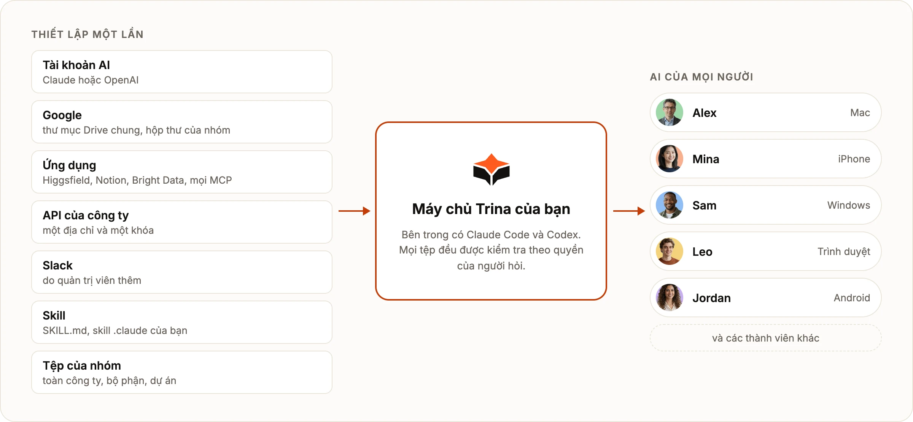

<div align="center">

<picture><source media="(prefers-color-scheme: dark)" srcset="editions/trina/branding/logo/mark-dark.svg"></picture>

<h1>Trina AX</h1>

<b>AI dùng chung cho cả nhóm.</b><br>
Trina AX đưa tệp, skill và công cụ của nhóm bạn lên cùng một máy chủ. AI của mọi người đều bắt đầu từ đó,<br>và mọi tệp mà AI mở đều được kiểm tra theo quyền của chính người hỏi.

<a href="https://ax.trina.app/download"></a>&nbsp;&nbsp;<a href="https://ax.trina.app/download"></a>&nbsp;&nbsp;<a href="https://apps.apple.com/app/trina-ax/id6829192435"></a>&nbsp;&nbsp;<a href="https://play.google.com/store/apps/details?id=app.trina.ax"></a><br>
<sub>Linux: .deb và AppImage (x64, arm64) trên <a href="https://ax.trina.app/download">trang tải về</a></sub>

[Trang web](https://ax.trina.app) · [Tài liệu](docs/README.md) · [Bảng giá](https://ax.trina.app/pricing) · [Discord](https://discord.gg/zUVfSR8MVk)

[English](README.md) · [한국어](README.ko.md) · [日本語](README.ja.md) · [Español](README.es.md) · [简体中文](README.zh-CN.md) · [繁體中文](README.zh-TW.md) · [Português](README.pt-BR.md) · [Français](README.fr.md) · [Deutsch](README.de.md) · [Italiano](README.it.md) · [Русский](README.ru.md) · [Türkçe](README.tr.md) · Tiếng Việt · [Bahasa Indonesia](README.id.md)

</div>

https://github.com/user-attachments/assets/7ff9f13c-ce52-4819-bd3d-031e234be395

<p align="center"><sub>Những gì AI của một nhân viên mới làm được ngay ngày đầu đi làm. Câu chuyện 80 giây.</sub><br>Mã nguồn mở (AGPL-3.0) · Tự host miễn phí, không giới hạn số người dùng<br><br><a href="https://github.com/trina-app/trina-ax?tab=readme-ov-file"></a><br><sub>Sau đó bấm ☆ Star ở đầu trang. Mỗi star giúp thêm nhiều nhóm tìm thấy Trina AX.</sub></p>

<br>

<picture><source media="(prefers-color-scheme: dark)" srcset="docs/images/readme/v4/divider-dark.png"></picture>

## Thiết lập một lần. Cả nhóm cùng dùng.

**Một tài khoản AI cho cả nhóm.** Kết nối một khóa API của Claude hoặc OpenAI, hoặc một gói có điều khoản cho phép việc này, và mọi người đều hỏi bằng tài khoản đó, với giới hạn token cho từng người, bộ phận hoặc cả nhóm.

Một người thiết lập mọi thứ trên máy chủ của nhóm. AI của mọi người có sẵn những thứ đó ngay từ câu hỏi đầu tiên, trên trình duyệt hoặc trong ứng dụng. Không ai khác phải cài Claude Code hay sao chép skill; cùng lắm chỉ cần đăng nhập vào tài khoản của chính mình.

<picture><source media="(prefers-color-scheme: dark)" srcset="docs/images/readme/v4/set-up-once-vi-dark.webp"></picture>

| Thiết lập một lần | Mọi người nhận được |
| --- | --- |
| **Tài khoản AI.** Chủ sở hữu hoặc quản trị viên kết nối một khóa API của Claude hoặc OpenAI, hoặc một gói có điều khoản cho phép việc này. | Câu trả lời cho cả nhóm, với giới hạn token cho từng người, bộ phận hoặc cả nhóm. |
| **Google.** Chia sẻ thư mục Drive với nhóm, hoặc kết nối một tài khoản chung của nhóm (hộp thư hay lịch dùng chung) cho Gmail, Calendar, Docs và Sheets. | Những người bạn chọn dùng được chúng trong cuộc trò chuyện của mình. Mỗi người vẫn có thể kết nối tài khoản Google riêng của mình. |
| **Ứng dụng.** Higgsfield, Notion, Linear, Figma và nhiều ứng dụng khác trong danh sách, hoặc bất kỳ máy chủ MCP nào qua địa chỉ của nó, như Bright Data. | Công cụ của ứng dụng có trong cuộc trò chuyện của mọi người: cả nhóm dùng chung một lần đăng nhập, hoặc mỗi người tự đăng nhập bằng tài khoản của mình. |
| **API của công ty bạn.** Một địa chỉ, một khóa và vài ghi chú. | AI gọi đến hệ thống của chính bạn, chỉ trong phạm vi địa chỉ đó. |
| **Slack.** Chủ sở hữu hoặc quản trị viên thêm một lần. | Hỏi Trina trong tin nhắn trực tiếp hoặc ở bất kỳ kênh nào Trina được mời vào, với quyền truy cập của chính bạn. |
| **Skill.** Viết một tệp `SKILL.md`, hoặc mang các skill sẵn có trong thư mục `.claude` hay `.codex` của bạn vào. | AI của mọi người đều làm theo các bước giống nhau. Gõ `/` để dùng một skill. |
| **Tệp của nhóm.** Một ổ đĩa duy nhất: toàn công ty, bộ phận, dự án, skill của nhóm và thư mục cá nhân. | AI của mọi người bắt đầu từ tệp của nhóm, và chỉ mở những gì người đó được phép mở. |

<table>
<tr>
<td colspan="2"><br><sub>Admin › Connected apps: thiết lập một lần cho mọi người trong nhóm</sub></td>
</tr>
<tr>
<td width="50%"><br><sub>Một ổ đĩa chung cho cả nhóm</sub></td>
<td width="50%"><br><sub>Skill của nhóm, hoặc mang skill của riêng bạn vào</sub></td>
</tr>
</table>

<br>

<picture><source media="(prefers-color-scheme: dark)" srcset="docs/images/readme/v4/divider-dark.png"></picture>

## Mọi người dùng nó để làm gì

**Hỏi ngay bên cạnh mọi phòng chat, gửi đi chỉ với một cú nhấp.** Một khung chat bên cạnh chỉ mình bạn thấy; chỉ một cú nhấp là gửi câu trả lời của Trina vào phòng.


**AI của mỗi người chỉ thấy những gì người đó được mở.** Mina không có quyền mở Finance, nên AI của cô ấy cũng không mở được. [Cách phân quyền hoạt động](docs/PERMISSIONS.md)


**Tiếp tục phiên làm việc của đồng nghiệp trong dự án của nhóm.** Các phiên trong một dự án của nhóm được chia sẻ với thành viên dự án: mở phiên của đồng nghiệp và làm tiếp, với quyền truy cập của chính bạn. Các phiên khác thì bạn có thể chia sẻ với từng người hoặc bộ phận, giống như một tệp trên Google Drive.


**Tìm tệp theo đúng nội dung.** Mỗi đêm, AI của nhóm đọc các tệp mới và tệp vừa sửa trong thư mục chung, thư mục bộ phận và thư mục dự án, rồi ghi cho mỗi tệp một dòng mô tả tệp đó là gì, nên một bản scan tên `temp.pdf` hay một ảnh tên `IMG_2031.jpg` vẫn được tìm thấy theo nội dung. Việc này dùng tài khoản AI của nhóm và không bao giờ đọc thư mục cá nhân. Trong một thử nghiệm với 2.238 tệp giả lập, Claude Code tìm đúng tệp cho 181 trên 184 câu hỏi khi có các dòng mô tả này, và 172 câu khi không có.

<table>
<tr>
<td width="50%"><b>Tác vụ theo lịch.</b> Chỉ cần nhờ một lần; Trina tự làm lại theo lịch bạn đặt, tính theo múi giờ của nhóm.<br><br></td>
<td width="50%"><b>Khách.</b> Mời người ngoài công ty vào chat nhóm hoặc dự án, và chọn xem họ có được dùng AI hay không.<br><br></td>
</tr>
<tr>
<td width="50%"><b>Mức sử dụng và giới hạn.</b> Số câu trả lời, token và chi phí ước tính theo từng người; giới hạn token cho từng người, bộ phận hoặc cả nhóm.<br><br></td>
<td width="50%"><b>Tìm mọi thứ.</b> Một phím tắt ⌘K để tìm trong cuộc trò chuyện, lịch sử, dự án, tệp, skill và tác vụ theo lịch.<br><br></td>
</tr>
<tr>
<td colspan="2"><b>Chat nội bộ như Slack, nhưng có Trina AI.</b> Kênh cho mọi người và cho từng bộ phận, kênh riêng tư, tin nhắn trực tiếp, chat nhóm, thread và @mention, trên web, máy tính và điện thoại. Ở kênh hay cuộc chat nào cũng hỏi được Trina, trong khung chat bên cạnh mà chỉ bạn thấy.<br><br></td>
</tr>
</table>

- **Mọi thay đổi đều được lưu.** Dù do người hay AI của họ sửa, bạn đều khôi phục được mọi phiên bản.
- **Trình duyệt trong ứng dụng.** Trong ứng dụng máy tính, Trina mở trang web trong một khung bên cạnh cuộc trò chuyện, đọc, bấm và điền biểu mẫu trong lúc bạn theo dõi; bấm Stop là dừng. Trina hỏi trước khi mở một trang mới, trừ khi bạn cho phép mọi trang web.
- **Ứng dụng gửi tin vào phòng chat.** Cập nhật từ Sentry, GitHub, Stripe, Jira và HubSpot hiển thị dưới dạng thẻ.
- **Tìm tệp công việc.** Ứng dụng máy tính tìm các tệp công việc gần đây trên máy của bạn và thêm những tệp bạn chọn.
- **Tài liệu.** Đọc văn bản Hangul (HWP/HWPX); xem trước PDF và PowerPoint.
- **Mọi thiết bị.** Mac, Windows, Linux, iPhone, Android và mọi trình duyệt, hỗ trợ sáu ngôn ngữ.

<br>

<picture><source media="(prefers-color-scheme: dark)" srcset="docs/images/readme/v4/divider-dark.png"></picture>

## Bắt đầu

- **Dùng thử trên trình duyệt:** không cần cài gì; một nhóm hư cấu, AI đã tắt. [Mở bản demo](https://ax.trina.app/demo/)
- **Hosting của Trina:** không cần tự chạy máy chủ. Dùng thử miễn phí 14 ngày, sau đó là gói theo tháng. [Bảng giá](https://ax.trina.app/pricing)
- **Ứng dụng:** [Mac, Windows, Linux, iPhone, Android](https://ax.trina.app/download), hoặc bất kỳ trình duyệt nào.
- **Tự host:** máy chủ Linux của bạn, Docker hoặc một máy Mac ở văn phòng. Miễn phí. [Linux](docs/INSTALL-LINUX.en.md) · [Docker](docs/INSTALL-DOCKER.md) · [Mac văn phòng](docs/OFFICE.en.md) · [Cài bằng AI agent của bạn](docs/INSTALL-LINUX.en.md#install-with-your-ai-agent)

<b>Tự host bằng Docker</b> (Linux, hoặc Mac có OrbStack)

```sh
git clone https://github.com/trina-app/trina-ax.git && cd trina-ax/docker
cp env.example .env && docker compose up -d --build
docker compose exec trina-ax trina-ax-setup-link   # mở liên kết và tạo chủ sở hữu
```

Cách này mới hơn và ít được kiểm thử hơn bản cài trên Linux; máy chủ Ubuntu 24.04 cần chỉnh một thiết lập trên host trước. [Hướng dẫn Docker](docs/INSTALL-DOCKER.md)

<b>Chạy thử trên máy tính của bạn trong 10 phút</b> (nhóm hư cấu, AI đã tắt)

```sh
git clone https://github.com/trina-app/trina-ax.git && cd trina-ax
bun install --frozen-lockfile && bun run demo   # → http://127.0.0.1:19760 · alice / teamax-demo-1
```

Cần Bun 1.3.12 và Go 1.27+. Không dùng cho môi trường production. [Hướng dẫn từng bước](docs/QUICKSTART.md)

<br>

<picture><source media="(prefers-color-scheme: dark)" srcset="docs/images/readme/v4/divider-dark.png"></picture>

## Cách hoạt động

Một máy chủ chạy Claude Code và Codex làm engine. Mọi yêu cầu truy cập tệp, từ một người hay từ AI của họ, đều đi qua cùng một bước kiểm tra quyền trên máy chủ. Trên máy chủ Linux, engine chạy bằng một tài khoản riêng trong sandbox bubblewrap, Landlock và seccomp; shell và các công cụ tệp tích hợp sẵn của engine đều bị tắt, nên nó chỉ truy cập tệp qua công cụ của Trina. [Bảo mật và phân quyền](docs/security-and-permissions.md)

Trina cung cấp không gian làm việc, không cung cấp AI: hãy kết nối tài khoản và gói Claude hoặc OpenAI mà bạn được phép sử dụng. Chi phí AI được tính vào tài khoản bạn kết nối.

<details>
<summary><b>Dữ liệu, giới hạn và những gì chúng tôi không cam kết</b></summary>

### Những gì chúng tôi không cam kết

- Tự host không có nghĩa là chạy offline: ngữ cảnh mà mỗi yêu cầu cần sẽ được gửi đến nhà cung cấp AI bạn kết nối, và các tích hợp bạn đã cấu hình sẽ nhận các yêu cầu gửi tới chúng. Mỗi lần Codex tìm kiếm web, cuộc trò chuyện tính đến lúc đó được gửi đến dịch vụ tìm kiếm của OpenAI. Nếu quản trị viên cho phép dùng OpenRouter để xử lý giọng nói, âm thanh của tệp video và audio sẽ được gửi đến OpenRouter. Cứ 30 phút một lần, máy chủ hỏi `updates.trina.app` để biết địa chỉ công khai của chính nó (đặt `MYCEL_EXIT_ADDRESS_CHECK=off` để tắt). [Chi tiết](docs/security-and-permissions.md)
- Người vận hành máy chủ có thể đọc tệp và cuộc trò chuyện đã lưu, kể cả đội vận hành của Trina nếu bạn dùng bản hosting. Quản trị viên ứng dụng không có công cụ nào để xem các cuộc trò chuyện riêng tư của mọi người.
- Gỡ quyền truy cập thư mục không xóa các câu trả lời trước đó. Bước kiểm tra khi chia sẻ rộng hơn không phải là giải pháp chống thất thoát dữ liệu toàn diện.
- Không có chứng nhận bảo mật, không đảm bảo câu trả lời hoàn hảo hay khoản tiết kiệm nào, và không tự động đưa ra quyết định pháp lý, tài chính hay nhân sự. Hãy tự rà soát kết quả và phạm vi triển khai.
- Máy chủ Linux không chạy OCR: AI thấy ảnh và trang scan dưới dạng hình ảnh, nhưng không tìm kiếm được chữ trong đó. Mac văn phòng chưa đọc được video.
- Văn bản HWP/HWPX dùng được cho mọi nhóm; [xem trước và tạo tài liệu Hangul](resources/hwp/README.md) cần plugin tùy chọn HWP Preview (macOS, hoặc Linux có glibc 2.39+; không hỗ trợ Debian 12).
- Kết nối: kết nối hợp lệ của chính người đó được ưu tiên trước, sau đó là kết nối được gán cho người đó, cho một bộ phận, rồi cho cả nhóm. Với các nhóm Trina mới tạo, mặc định một kết nối của công ty có thể phục vụ cả nhóm; các lựa chọn đã lưu trước đó được giữ nguyên. **Thiết lập này trong phần mềm không cấp cho bạn quyền theo điều khoản của Anthropic hay OpenAI.** [Chi tiết về kết nối](docs/FAQ.md)
- Tự host trên Linux cần Debian 12/13 hoặc Ubuntu 24.04, systemd với cgroup v2, amd64 hoặc arm64, RAM 4 GB và ổ đĩa 20 GB. Đội IT của bạn tự lo việc cài đặt, cập nhật và khôi phục bản sao lưu.

</details>

<br>

<picture><source media="(prefers-color-scheme: dark)" srcset="docs/images/readme/v4/divider-dark.png"></picture>

## Cộng đồng

Nếu Trina AX giúp ích cho nhóm bạn, một ⭐ trên GitHub sẽ giúp các nhóm khác tìm thấy nó.

[Discord](https://discord.gg/zUVfSR8MVk) · [X](https://x.com/trina_ax) · [Bản phát hành](https://github.com/trina-app/trina-ax/releases/latest) · [Nhật ký thay đổi](CHANGELOG.md) · [Hỗ trợ](SUPPORT.md) · [Đóng góp](CONTRIBUTING.md) · [Bảo mật](SECURITY.md) · [Phát triển](docs/DEVELOPMENT.md) · [Cấu hình](docs/CONFIGURATION.md) · [llms.txt](llms.txt)

Ứng dụng hỗ trợ tiếng Anh, tiếng Hàn, tiếng Indonesia, tiếng Nhật, tiếng Tây Ban Nha và tiếng Trung giản thể. Công ty và nhân vật trong mọi hình ảnh đều là hư cấu.

<br>

<picture><source media="(prefers-color-scheme: dark)" srcset="docs/images/readme/v4/divider-dark.png"></picture>

## Giấy phép

Miễn phí sử dụng, kể cả cho mục đích thương mại, theo [AGPL-3.0-only](LICENSE). Nếu bạn cho người dùng sử dụng một phiên bản đã sửa đổi qua mạng, hãy cung cấp mã nguồn của phiên bản đó cho họ. Giao thức cloud dùng giấy phép MIT ([giấy phép](shared/src/cloud-protocol/LICENSE)). [Thông báo](NOTICE) · [Thông báo bên thứ ba](docs/THIRD-PARTY-NOTICES.md)

Claude Code và Codex có điều khoản riêng; dự án này không được Anthropic hay OpenAI chứng thực. Claude là nhãn hiệu của Anthropic.
