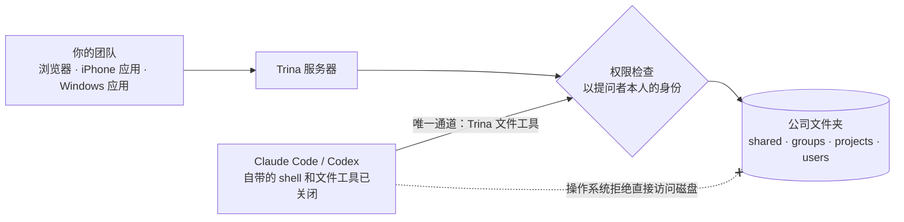

<div align="center">


# Trina AX

**各用各的 AI，现在全队一起用。**

Claude Code 和 Codex 跑在公司的服务器上，用的是公司文件和团队技能。团队成员在浏览器里使用：可以在自己的聊天里提问，从 0.4 版起也可以在团队对话里 @Trina。

[官网](https://ax.trina.app) · [10 分钟上手](#10-分钟上手) · [自托管](docs/for-admins.md) · [文档](docs/README.md)

[English](README.md) · [한국어](README.ko.md) · [日本語](README.ja.md) · [Español](README.es.md) · 简体中文


<sub>真实应用 0.4 版的 Sales 对话（英文界面）。公司是虚构的。</sub>

</div>

- **一次设好，大家都照这个做法干活。** 公司文件放进 `shared/`；负责人写报价单的方法写进 `skills/quote/SKILL.md`。新同事入职第一天就能照着用。
- **在对话里 @Trina，结果直接发到对话里。** 在团队对话中提问：团队技能用你能打开的文件来处理，回答连同文件会发到这个对话里。
- **同事做到一半的事，谁都能接着做**（即将推出）。同一个项目的成员将能接着同事的 AI 聊天继续做，每条消息都以发送者本人的身份运行。

放进真实的公司文件也没关系，每个人只能看到自己有权看的内容。[原理](#底层原理)

```sh
git clone https://github.com/trina-app/trina-ax.git && cd trina-ax
bun install --frozen-lockfile && bun run demo   # http://127.0.0.1:19760 · alice / teamax-demo-1
```

<sub>本地演示：虚构团队，AI 关闭，不用于生产。需要 Bun 1.3.12 和 Go 1.27+。想试团队对话和 @Trina，请用 [Docker 安装](docs/INSTALL-DOCKER.md)，设置 `TRINA_AX_VERSION=0.4.0-beta.10`，再接入一个 AI 账号。</sub>

## 工作原理

1. **一次放好。** 公司文件放进 `shared/`；提案该怎么写，就写进 `skills/proposal/SKILL.md`。
2. **人人都能问，在自己的聊天里，或在团队对话里。** 电脑或手机浏览器，或者 iPhone 应用都行。不用开终端，笔记本上也不用装任何东西。在对话里，@Trina 以叫它的那个人的身份工作。
3. **权限跟着人走。** AI 每打开一个文件，服务器都会以提问者本人的身份检查权限。你看不到的文件夹，对你的 AI 来说也不存在。


<sub><b>同一个问题，不同的人来问。</b>Mina 在销售部。营收文件放在 <code>shared/Finance</code>，她打不开，所以她的 AI 也打不开。</sub>

## 10 分钟上手

```sh
git clone https://github.com/trina-app/trina-ax.git && cd trina-ax
bun install --frozen-lockfile
bun run demo        # → http://127.0.0.1:19760 · 用 alice / teamax-demo-1 登录
```

演示里是一个虚构团队，自带六个入门技能。AI 是关闭的，所以不需要任何 AI 账号。再开一个无痕窗口用 `bob` 登录，你会发现两人看到的组文件夹不一样。环境要求：Git、Bun 1.3.12 和 Go 1.27+。这**不是生产环境的安装方式**。[详细步骤](docs/QUICKSTART.md)

想试团队对话和 @Trina，请用 [Docker 安装](docs/INSTALL-DOCKER.md)，设置 `TRINA_AX_VERSION=0.4.0-beta.10`（或之后的 0.4 版本），再接入一个 AI 账号。本地演示关闭了 AI，所以 @Trina 在那里不会回答。

## 同一个请求，两种回答

<table>
<tr>
<td width="50%" valign="top"><b>空文件夹里的 Claude Code</b><br><sub>它没法了解你们公司，只能先问六个问题。</sub></td>
<td width="50%" valign="top"><b>Trina AX，同样一句话</b><br><sub>直接基于团队文件和 CEO 的提案技能开始写。</sub></td>
</tr>
<tr>
<td></td>
<td></td>
</tr>
</table>

<sub>2026-10-31 和 11-01 用虚构公司 Dawnroute 实际跑出的结果，幻灯片里的照片由 Higgsfield 生成。Claude Code 先提问并没有错：空文件夹里没有任何东西能告诉它你是谁。Trina 做的，就是把这个文件夹交给它。</sub>

**同一个对话，两块屏幕。** 只有用对话里每个人都能看到的资料做出的回答，才会直接发到对话里。否则，先只给提问的人看。


<sub>Alex 的回答用到了 Mina 打不开的 <code>shared/Finance</code>。Alex 仍然可以自己决定发出去；在那之前，Mina 只能看到他收到了回答。真实应用，0.4 版。公司是虚构的。</sub>

## 功能一览

| | 具体来说 |
|---|---|
| **真正的 Claude Code 和 Codex 智能体** | 跑在你们自己的服务器上：每次回答默认最多 150 轮工具调用，同时最多运行 4 个子代理，还支持联网搜索和定时任务。 |
| **公司文件夹就是知识库** | `shared/`、`groups/`、`projects/` 和个人文件夹，都带版本历史。能提取 PDF、Office 和 HWP/HWPX 文件里的文字。 |
| **团队技能，像文件一样管理** | 一个技能就是一个 `SKILL.md` 文件。谁能用由文件夹规则决定，AI 要改动技能前会先找人确认。 |
| **团队对话（0.4）** | 群组对话、全员对话和私信，支持引用回复、@提及、文件和照片。@Trina 时，它以你的身份、用你能用的文件和技能来回答。对话只有成员能看到；管理员打不开自己不在的对话。 |
| **每次文件调用都查权限** | 你无权访问的文件，在文件页面、AI 回答、搜索、预览、版本历史和回收站里都不会出现。 |
| **用你们自己的 AI 连接** | 把公司的 Claude 或 OpenAI 账号接入一次，也可以让每个人接入自己的账号。按人统计用量，还能设置上限。自托管时，还可以通过 [Anthropic 兼容网关](docs/CONFIGURATION.md#anthropic-compatible-gateway)让 Claude Code 使用 DeepSeek、Kimi、GLM 等其他模型。 |
| **Slack 连接器（0.4，默认关闭）** | 所有者配置好团队自己的 Slack 应用后，每个人关联自己的 Slack 账号，在频道或私信里向应用提问。每个问题都以提问者本人的身份运行；在频道里，回答先只给本人看，点 *Post to channel* 才会发到频道。[Slack 指南（英文）](docs/SLACK.md) |
| **iPhone 应用** | [App Store 上的 Trina AX](https://apps.apple.com/app/id6829192435)。它打开的是你们团队的服务器，所以功能取决于服务器的版本：团队对话需要 0.4。 |
| **自托管或托管** | 可以部署在 Linux 服务器（也可以用 [Docker](docs/INSTALL-DOCKER.md)）或办公室的 Mac 上，也可以用 Trina 在 AWS 首尔区域的托管服务。电脑和手机用浏览器访问，另有 iPhone 应用和 Windows 安装包。 |

> [!NOTE]
> **如果你所在的地区无法直接使用 Claude 或 OpenAI**：自托管时，可以在服务器的 `server.json` 里配置 [Anthropic 兼容网关](docs/CONFIGURATION.md#anthropic-compatible-gateway)（`engine.anthropicGateway`），让真正的 Claude Code 通过 OpenRouter，或 DeepSeek、Kimi、GLM 等提供的 Anthropic 兼容接口，使用这些模型。开启后，Claude 订阅和 Anthropic 的密钥都不会发往网关，也只转发你在配置里写明的模型；每个人的文件夹权限照样逐一检查。目前已用 OpenRouter 上的 `deepseek/deepseek-v4-pro` 实测过。另外还有一个实验性的、兼容 OpenAI 接口的 API 引擎（管理 › AI 引擎 › API 引擎）。

## 底层原理

我们的第一个提交（2026-10-21）里就已经有权限函数（`server/src/policy/authorize.ts`）了。如今每一次文件调用仍然都要经过它。



- **用的是真正的智能体。** 子代理也以同一个人的身份工作，经过同样的检查，留下同样的活动记录。
- **入口收得很窄。** 引擎自带的 shell 和文件工具都已关闭，并由针对每个引擎的回归测试把关。它访问你们文件夹的通道是 Trina 的文件工具，每次调用都会检查。
- **真实密钥不经引擎之手。** Token 先在浏览器里加密封装，然后才发出去。引擎每一轮拿到的只是临时的替代 Token，真正的 Token 由模型代理（proxy）补上。
- **你和 Trina 的聊天只有你自己能看到。** 对话只有成员能看到；管理员打不开自己不在的对话。管理员能看到 AI 读了哪些文件，但看不到对话本身。不过服务器运维人员仍然可以读取存储的数据，这一点我们在[下文](#数据与限制)写明了。

<sub>操作系统级隔离（专用的引擎账户）适用于 Linux 安装和以角色账户方式安装的 Mac。办公室 Mac 以当前登录的用户身份运行，本地演示则没有操作系统级隔离。→ <a href="docs/security-and-permissions.md">安全与权限（英文）</a> · <a href="docs/PERMISSIONS.md">权限模型（韩文）</a></sub>

## 团队的第一周

先创建所有者账户，然后依次完成**权限 → AI 连接 → 邀请团队成员 → 第一个技能 → 第一次备份**。下面这些入门技能的输入都是虚构的：

| 角色 | 实际任务 | 可直接复制的技能 |
|---|---|---|
| CEO / 团队负责人 | 把每周笔记整理成决策、风险和下一步计划 | [Weekly report](examples/skills/weekly-team-report/SKILL.md) |
| 销售 | 根据会议内容起草跟进消息，不凭空许诺 | [Sales follow-up](examples/skills/sales-follow-up/SKILL.md) |
| 市场 | 根据已审核通过的品牌资料准备营销活动简报 | [Brand brief](examples/skills/brand-brief/SKILL.md) |
| 财务 | 标出缺失的票据和存疑的金额，交给人复核 | [Expense review](examples/skills/expense-review/SKILL.md) |
| 人事 | 根据有权查看的制度文件回答入职问题 | [New-hire guide](examples/skills/new-hire-guide/SKILL.md) |
| 所有人 | 从会议记录里提取决议和待办事项 | [Meeting summary](examples/skills/meeting-summary/SKILL.md) |

技能是一组可复用的指令，不是模型训练，也不附带额外权限。结果要先由人审核再使用。[团队负责人检查清单](docs/for-teams.md) · [全部示例](examples/README.md)

## 部署方式

| | Trina 托管 | Linux 自托管 | 办公室 Mac | 本地演示 |
|---|---|---|---|---|
| 适合 | 没有 IT 人员的团队 | 有 IT 负责人的团队 | 有一台专用 Mac 的小办公室 | 先体验一下 |
| 谁来运维 | Trina（AWS 首尔） | 你们的 IT 团队 | 办公室里负责维护的同事 | 你自己 |
| AI | 你们获得授权的 Claude 或 OpenAI 连接 | 同上 | Claude（不含 Codex） | 关闭 |
| 费用 | 14 天免费试用，之后按月订阅 + AI 用量费 | 软件免费 + 自备服务器 | 软件免费 | 免费 |
| 开始 | [查看套餐](https://ax.trina.app/#pricing) | [Linux 指南](docs/INSTALL-LINUX.en.md) · [Docker](docs/INSTALL-DOCKER.md) | [办公室 Mac 指南](docs/OFFICE.en.md) | [快速开始](docs/QUICKSTART.md) |

Trina 提供的是工作空间，不是 AI 本身：请只使用你们获得授权的 Claude 和 OpenAI 账号与套餐。Trina 托管提供 14 天免费试用，之后按月订阅；AI 用量费由你接入的账号另行计费。[最新价格](https://ax.trina.app/#pricing)

Linux 自托管需要 Debian 12/13 或 Ubuntu 24.04、启用 cgroup v2 的 systemd、amd64 或 arm64 架构，建议 4 GB 内存，磁盘至少 20 GB。安装、升级和从备份恢复都由你们的 IT 团队负责。

## 数据与限制

自托管不等于离线运行：每次请求所需的上下文都会发给你接入的 AI 服务商。服务器运维人员（使用托管时也包括 Trina）可以读取存储的文件和聊天记录；应用管理员无法浏览别人的私人对话。

<details>
<summary><b>哪些数据会离开服务器、连接规则，以及我们不做的承诺</b></summary>

<br>

- 选定的上下文会发给所选的 AI 服务商，已配置的集成也会收到各自的请求。Codex 每次联网搜索，都会把截至当时的对话发给 OpenAI 的搜索服务。服务器每 30 分钟会向 `updates.trina.app` 查询一次自己的公网地址（设置 `MYCEL_EXIT_ADDRESS_CHECK=off` 即可关闭）。[详情](docs/security-and-permissions.md)
- 服务器运维人员可以读取存储的文件和聊天记录；使用托管时，这也包括 Trina 的运维人员。应用管理员没有可以浏览所有人私人对话的界面。
- 撤销文件夹权限并不会删除之前的回答。扩大共享范围时的确认提示，也不等于全面的数据防泄漏（DLP）。
- 不具备任何安全认证，不保证回答完美、一定省钱，也不会自动做出法务、财务或人事决策。请自行审核输出结果和部署边界。
- AI 会把照片和扫描版 PDF 页面当作图片来看（管理员可以关闭），但 Linux 服务器不做 OCR：在 Linux 上，扫描件和照片无法按文字搜索。
- 任何团队都能提取 HWP/HWPX 的文字。[可视化预览](resources/hwp/README.md)以及 AI 新建和填写韩文（Hangul）文档，由可选的 HWP Preview 插件提供，需要 macOS 或 glibc 2.39 及以上的 Linux，因此 Debian 12 **不**支持。
- 在受管安装中，符合条件的本人连接优先，然后依次是分配给个人、组和整个团队的连接。新建的 Trina 团队默认可以让一个公司连接供整个团队使用；已经保存过的选择保持不变。每个连接自身的同意要求仍然适用。**这个软件设置并不代表你获得了 Anthropic 或 OpenAI 条款下的许可。** 本地演示禁用 AI；开发模式和办公室本地登录模式的连接行为有所不同。[连接详情](docs/FAQ.md)

</details>

## 常见问题

<details>
<summary><b>这和给每人开一个 Claude 席位有什么区别？</b></summary>

<br>开席位，每个人拿到的都是一个空的工作区。Trina 则让所有人在同一台服务器上使用同一套公司文件夹和团队技能，每个人的文件夹权限由服务器检查。你仍然可以给每个人接入各自的账号。

</details>

<details>
<summary><b>试用需要 AI 账号吗？</b></summary>

<br>不需要。[本地演示](docs/QUICKSTART.md)关闭了 AI，用的是虚构数据，你可以先看看文件、技能和权限是怎么运作的。想看 @Trina 在团队对话里回答，需要一台接入了 AI 的服务器（[10 分钟上手](#10-分钟上手)）。

</details>

<details>
<summary><b>管理员能看我们的聊天和对话吗？</b></summary>

<br>不能。你和 Trina 的聊天只有你自己能看到。对话只有成员能看到；管理员打不开自己不在的对话。活动记录只显示 AI 读了哪些文件，不包含对话内容。不过，负责运维服务器或其存储的人可以读取已保存的数据。

</details>

<details>
<summary><b>支持韩国的 HWP 文件吗？</b></summary>

<br>支持。AI 在任何服务器上都能读取 HWP/HWPX 文件里的文字。打开可选的 HWP Preview 插件后，还能新建 .hwpx 文档（标题、段落、列表和简单表格），填写已有的 .hwp 或 .hwpx 表单（占位符、空白单元格、表格行）并以原格式保存（文件其余部分保持原样），并显示可视化预览。这个插件不能在 Debian 12 上运行。更多内容见 [FAQ](docs/FAQ.md)。

</details>

## 97 秒的故事

https://github.com/user-attachments/assets/61f3469b-358d-4b3a-9233-c6b23b5db835

<sub><b>请打开声音（英文）。</b>团队负责人只需把 Claude 设置一次，新同事入职第一天写的提案也像负责人做的一样。<br>动画演示，1:15 处是真实应用界面。公司是虚构的。</sub>

## 接下来

- **接着同事的 AI 聊天做。** 共享项目聊天：项目里的任何人都能接着一个 AI 聊天继续，每条消息都以发送者本人的身份运行。已完成设计，尚未开发。
- **Android 应用。** 正在 Google Play 审核中。
- **Trina 托管上的 0.4。** 托管跟随稳定版通道，0.4 成为稳定版后就会有团队对话。自托管服务器现在就可以运行 0.4 版本。

## 社区与贡献

[最新版本与校验和](https://github.com/trina-app/trina-ax/releases/latest) · [更新日志](CHANGELOG.md) · [获取支持](SUPPORT.md) · [参与贡献](CONTRIBUTING.md) · [报告安全问题](SECURITY.md) · [开发](docs/DEVELOPMENT.md) · [配置](docs/CONFIGURATION.md) · [机器可读索引](llms.txt)

应用界面支持英语、韩语、印尼语、日语和西班牙语。已发布的安装包可能落后于源码的最新改动，请查看对应的发布说明。

## 许可证

基于 [AGPL-3.0-only](LICENSE) 许可证发布，可免费使用，包括商业用途。如果你通过网络提供修改后的版本，需要向这些用户提供对应的源代码。云协议部分单独采用 MIT 许可证（[许可证文本](shared/src/cloud-protocol/LICENSE)）。[声明](NOTICE) · [第三方声明](docs/THIRD-PARTY-NOTICES.md)

Claude Code 和 Codex 各有其使用条款；本项目并未获得 Anthropic 或 OpenAI 的认可或背书。Claude 是 Anthropic 的商标。
