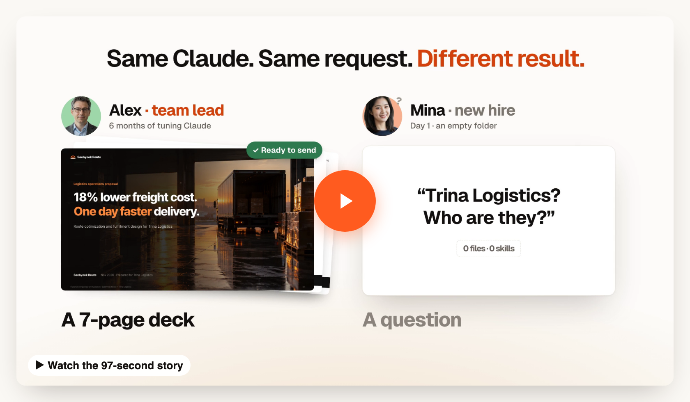
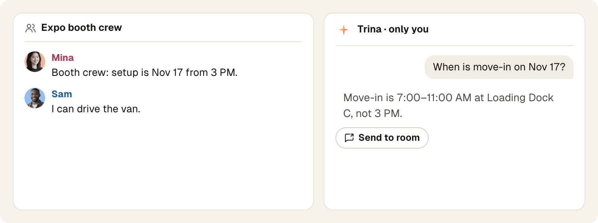
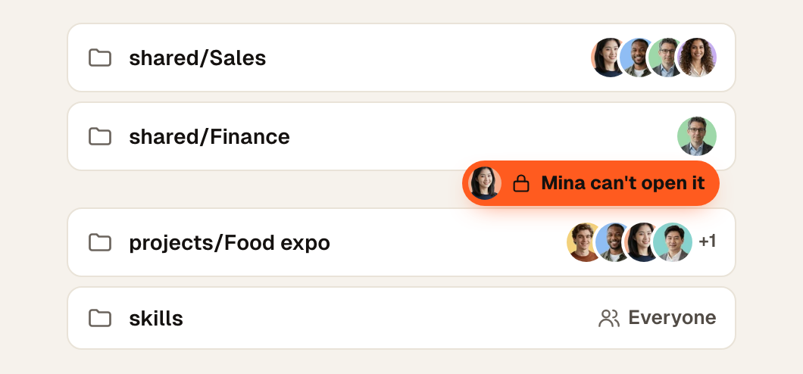

<div align="center">


<h1>全队共用的 AI。</h1>

Trina AX 把团队的文件、技能和工具放在一台服务器上。每个人的 AI 都从这里开始，<br>AI 打开的每个文件，都会按提问者本人的权限检查。

<a href="https://apps.apple.com/app/trina-ax/id6829192435"></a>&nbsp;&nbsp;<a href="https://play.google.com/store/apps/details?id=app.trina.ax"></a>

[官网](https://ax.trina.app) · [下载 Mac 和 Windows 版](https://ax.trina.app/download) · [文档](docs/README.md) · [Discord](https://discord.gg/zUVfSR8MVk)

[English](README.md) · [한국어](README.ko.md) · [日本語](README.ja.md) · [Español](README.es.md) · 简体中文

<br>

<a href="https://ax.trina.app/#watch"></a>

</div>

## 团队能得到什么

**在任何对话旁边提问，一键发出。** 侧边聊天只有你能看到；点一下，Trina 的回答就发到对话里。



**每个人只看到自己能打开的内容。** Mina 打不开 Finance，她的 AI 也打不开。[权限如何运作](docs/PERMISSIONS.md)



- 🤝 **接着同事的 AI 聊天做。** 继续同事的项目聊天，你的提问按你自己的权限处理。
- 📋 **团队技能。** 把团队的做法写下来一次，每个人的 AI 都照着做。
- 🔌 **你们在用的工具。** 任何 MCP 服务器、Google Drive、Slack 和公司 API，按人检查权限。
- 🕘 **每次改动都会保留。** 不管是人改的还是 AI 改的，任何版本都能恢复。
- 📱 **任何设备。** Mac、iPhone、Android、Windows，以及任何浏览器。

## 开始使用

- **Trina 托管：** 不用自己运维服务器。14 天免费试用，之后按月订阅。[套餐](https://ax.trina.app/pricing)
- **应用：** [Mac、iPhone、Android 和 Windows](https://ax.trina.app/download)，或任何浏览器。
- **自托管：** 你们自己的 Linux 服务器、Docker 或办公室 Mac。免费。[Linux](docs/INSTALL-LINUX.en.md) · [Docker](docs/INSTALL-DOCKER.md) · [办公室 Mac](docs/OFFICE.en.md)

<details>
<summary><b>10 分钟在你的电脑上试用</b>（虚构团队，AI 关闭）</summary>

<br>

```sh
git clone https://github.com/trina-app/trina-ax.git && cd trina-ax
bun install --frozen-lockfile && bun run demo   # → http://127.0.0.1:19760 · alice / teamax-demo-1
```

需要 Bun 1.3.12 和 Go 1.27+。这不是生产环境的安装方式。[详细步骤](docs/QUICKSTART.md)

</details>

Trina 提供的是工作空间，不是 AI 本身：请接入你们获得授权的 Claude 或 OpenAI 账号与套餐。AI 用量费由你接入的账号计费。

<details>
<summary><b>数据、限制，以及我们不做的承诺</b></summary>

### 我们不做的承诺

- 自托管不等于离线运行：每次请求所需的上下文都会发给你接入的 AI 服务商，已配置的集成也会收到各自的请求。Codex 每次联网搜索，都会把截至当时的对话发给 OpenAI 的搜索服务。如果管理员允许用 OpenRouter 处理语音，视频和音频文件的声音会发给 OpenRouter。服务器每 30 分钟会向 `updates.trina.app` 查询一次自己的公网地址（设置 `MYCEL_EXIT_ADDRESS_CHECK=off` 即可关闭）。[详情](docs/security-and-permissions.md)
- 服务器运维人员可以读取存储的文件和聊天记录；使用托管时，这也包括 Trina 的运维人员。应用管理员没有可以浏览所有人私人对话的界面。
- 撤销文件夹权限并不会删除之前的回答。扩大共享范围时的确认提示，也不等于全面的数据防泄漏（DLP）。
- 不具备任何安全认证，不保证回答完美、一定省钱，也不会自动做出法务、财务或人事决策。请自行审核输出结果和部署边界。
- Linux 服务器不做 OCR：AI 会把照片和扫描页面当作图片来看，但无法按文字搜索。办公室 Mac 还不能读取视频。
- 任何团队都能读取 HWP/HWPX 的文字；[预览和新建韩文（Hangul）文档](resources/hwp/README.md)需要可选的 HWP Preview 插件（macOS，或 glibc 2.39 及以上的 Linux；不支持 Debian 12）。
- 连接：优先使用本人符合条件的连接，然后依次是分配给本人、组和整个团队的连接。新建的 Trina 团队默认可以让一个公司连接供整个团队使用；已经保存过的选择保持不变。**这个软件设置并不代表你获得了 Anthropic 或 OpenAI 条款下的许可。** [连接详情](docs/FAQ.md)
- Linux 自托管需要 Debian 12/13 或 Ubuntu 24.04、启用 cgroup v2 的 systemd、amd64 或 arm64 架构、4 GB 内存和 20 GB 磁盘。安装、升级和从备份恢复都由你们的 IT 团队负责。

</details>

## 社区

[Discord](https://discord.gg/zUVfSR8MVk) · [X](https://x.com/trina_ax) · [版本发布](https://github.com/trina-app/trina-ax/releases/latest) · [更新日志](CHANGELOG.md) · [获取支持](SUPPORT.md) · [参与贡献](CONTRIBUTING.md) · [安全](SECURITY.md) · [开发](docs/DEVELOPMENT.md) · [配置](docs/CONFIGURATION.md) · [llms.txt](llms.txt)

应用界面支持英语、韩语、印尼语、日语和西班牙语。所有图片中的公司和人物都是虚构的。

## 许可证

基于 [AGPL-3.0-only](LICENSE) 许可证发布，可免费使用，包括商业用途。如果你通过网络提供修改后的版本，需要向这些用户提供对应的源代码。云协议部分单独采用 MIT 许可证（[许可证文本](shared/src/cloud-protocol/LICENSE)）。[声明](NOTICE) · [第三方声明](docs/THIRD-PARTY-NOTICES.md)

Claude Code 和 Codex 各有其使用条款；本项目并未获得 Anthropic 或 OpenAI 的认可或背书。Claude 是 Anthropic 的商标。
