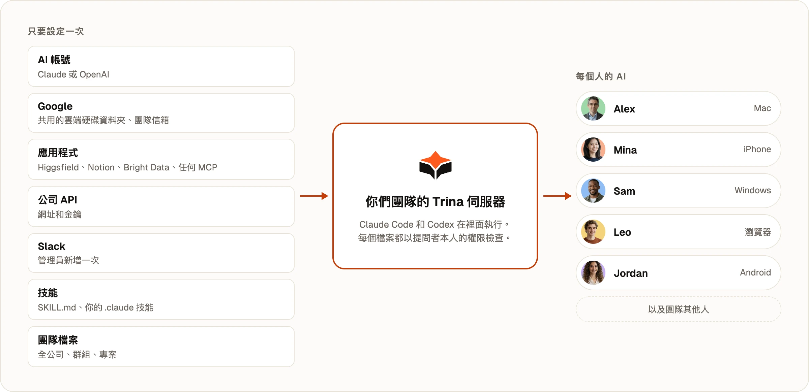
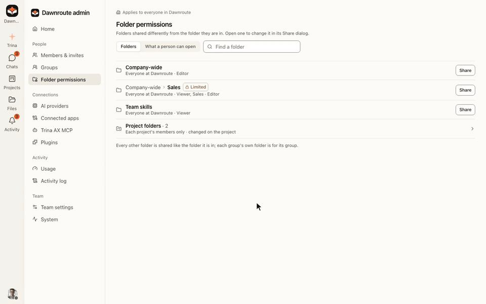

<div align="center">

<picture><source media="(prefers-color-scheme: dark)" srcset="editions/trina/branding/logo/mark-dark.svg"></picture>

<h1>Trina AX</h1>

<b>全團隊共用的 AI。</b><br>
Trina AX 把團隊的檔案、技能和工具集中在一台伺服器上。每個人的 AI 一開始就用得上這些，<br>AI 開啟的每個檔案，都會以提問者本人的權限檢查。

<a href="https://ax.trina.app/download"></a>&nbsp;&nbsp;<a href="https://ax.trina.app/download"></a>&nbsp;&nbsp;<a href="https://apps.apple.com/app/trina-ax/id6829192435"></a>&nbsp;&nbsp;<a href="https://play.google.com/store/apps/details?id=app.trina.ax"></a><br>
<sub>Linux：.deb 和 AppImage（x64、arm64）請見<a href="https://ax.trina.app/download">下載頁面</a></sub>

[官網](https://ax.trina.app) · [說明文件](docs/README.md) · [價格](https://ax.trina.app/pricing) · [Discord](https://discord.gg/zUVfSR8MVk)

[English](README.md) · [한국어](README.ko.md) · [日本語](README.ja.md) · [Español](README.es.md) · [简体中文](README.zh-CN.md) · 繁體中文 · [Português](README.pt-BR.md) · [Français](README.fr.md) · [Deutsch](README.de.md) · [Italiano](README.it.md) · [Русский](README.ru.md) · [Türkçe](README.tr.md) · [Tiếng Việt](README.vi.md) · [Bahasa Indonesia](README.id.md)

</div>

https://github.com/user-attachments/assets/7d423557-0f0f-4b05-a1fa-e8b5ad14f9b8

<p align="center"><sub>新人到職第一天，AI 能幫他做到什麼？80 秒的故事。</sub><br>開源（AGPL-3.0）· 自架免費，不限人數<br><br><a href="https://github.com/trina-app/trina-ax?tab=readme-ov-file"></a><br><sub>接著按頁面頂端的 ☆ Star。按個 Star，就能讓更多團隊發現 Trina AX。</sub></p>

<br>

<picture><source media="(prefers-color-scheme: dark)" srcset="docs/images/readme/v4/divider-dark.png"></picture>

## 只要設定一次，整個團隊就能用

**整個團隊共用一個 AI 帳號。** 連結一組 Claude 或 OpenAI 的 API 金鑰（或條款允許的方案），大家都用它來提問，並可依個人、群組或團隊設定 token 上限。

只要一個人在團隊伺服器上設定好，每個人的 AI 從第一個問題起就用得上，瀏覽器和 App 都一樣。其他人不用安裝 Claude Code，也不用複製技能，頂多登入自己的帳號。

<picture><source media="(prefers-color-scheme: dark)" srcset="docs/images/readme/v4/set-up-once-zh-TW-dark.webp"></picture>

| 設定一次 | 每個人都能用到 |
| --- | --- |
| **AI 帳號。** 擁有者或管理員連結 Claude 或 OpenAI 的 API 金鑰，或條款允許的方案。 | 整個團隊都能向 AI 提問，並可依個人、群組或團隊設定 token 上限。 |
| **Google。** 與團隊共用雲端硬碟資料夾，或為 Gmail、Calendar、Docs 和 Sheets 連結一個團隊帳號（共用信箱或行事曆）。 | 你選定的人可以在自己的聊天中使用。每個人也還是能連結自己的 Google 帳號。 |
| **應用程式。** 應用程式清單裡的 Higgsfield、Notion、Linear、Figma 等，或用網址連結任何 MCP 伺服器，例如 Bright Data。 | 每個人的聊天裡都能用這個應用程式的工具：用一個團隊帳號登入，或每個人以自己的身分登入。 |
| **公司 API。** 一個網址、一組金鑰和幾行說明。 | AI 會呼叫你們自己的系統，但只限這個網址底下。 |
| **Slack。** 擁有者或管理員新增一次即可。 | 在私訊或任何已邀請 Trina 的頻道裡問 Trina，用的是你自己的權限。 |
| **技能。** 寫一份 `SKILL.md`，或直接帶入你 `.claude`、`.codex` 資料夾裡的技能。 | 每個人的 AI 都照同樣的步驟做。輸入 `/` 就能使用。 |
| **團隊檔案。** 一個雲端硬碟：全公司、群組、專案、團隊技能和個人資料夾。 | 每個人的 AI 一開始就用得上團隊的檔案，而且只會開啟他自己有權開啟的內容。 |

<table>
<tr>
<td colspan="2"><br><sub>管理 › 已連結的應用程式：為團隊每個人設定一次</sub></td>
</tr>
<tr>
<td width="50%"><br><sub>一個團隊雲端硬碟</sub></td>
<td width="50%"><br><sub>團隊技能，也能帶入你自己的</sub></td>
</tr>
</table>

<br>

<picture><source media="(prefers-color-scheme: dark)" srcset="docs/images/readme/v4/divider-dark.png"></picture>

## 大家都用它做這些事

**在任何聊天室旁邊提問，一鍵送出。** 側邊聊天只有你看得到；按一下，Trina 的回答就送進聊天室。


**每個人的 AI，都只看得到他自己能開啟的內容。** Mina 打不開 Finance，她的 AI 也打不開。[權限的運作方式](docs/PERMISSIONS.md)



**在團隊專案裡接手同事的對話。** 團隊專案裡的對話會分享給專案成員：打開同事的對話就能接著做，用的是你自己的權限。其他對話也能像 Google 雲端硬碟裡的檔案一樣，分享給個人或群組。


**看內容就找得到檔案。** 每天晚上，團隊的 AI 會讀取共用、群組和專案資料夾中新增和變更的檔案，為每個檔案記下一行說明它是什麼，所以就算掃描檔叫 `temp.pdf`、照片叫 `IMG_2031.jpg`，也能依內容找到。這項功能用的是團隊的 AI 帳號，而且從不讀取個人資料夾。在 2,238 個虛構檔案的測試中，Claude Code 回答 184 個問題，有這些說明時找對 181 個，沒有時找對 172 個。

<table>
<tr>
<td width="50%"><b>排程任務。</b> 交代一次，Trina 就依你的排程重複執行，時間以團隊的時區為準。<br><br></td>
<td width="50%"><b>訪客。</b> 邀請公司以外的人加入群組聊天或專案，並決定他們能不能使用 AI。<br><br></td>
</tr>
<tr>
<td width="50%"><b>用量與上限。</b> 每個人的回答數、token 和預估費用；可依個人、群組或團隊設定 token 上限。<br><br></td>
<td width="50%"><b>全域搜尋。</b> 用 ⌘K 搜尋聊天、歷史紀錄、專案、檔案、技能和排程任務。<br><br></td>
</tr>
<tr>
<td colspan="2"><b>像 Slack 一樣的團隊聊天，還多了 Trina AI。</b> 全員頻道和各群組頻道、私人頻道、私訊、群組聊天、討論串和 @提及，網頁、桌面和手機都能用。不管在哪個聊天，都能在旁邊開一個只有你看得到的側邊聊天問 Trina。<br><br></td>
</tr>
</table>

- **每次變更都會保留。** 不論是人改的還是他的 AI 改的，任何版本都能還原。
- **App 內建瀏覽器。** 在桌面版 App 中，Trina 會在聊天旁的窗格開啟網站，讀取內容、點擊並填寫表單，你可以在一旁看著；按 Stop 就會停止。開啟新的網站前會先問你，除非你已允許所有網站。
- **應用程式把更新貼進聊天室。** Sentry、GitHub、Stripe、Jira 和 HubSpot 的更新會變成一張張卡片送進來。
- **找出工作檔案。** 桌面版 App 會在你的電腦上找出最近的工作檔案，再把你選取的加進來。
- **文件。** 讀取韓國 Hangul 文件（HWP/HWPX）的文字；預覽 PDF 和 PowerPoint。
- **所有裝置。** Mac、Windows、Linux、iPhone、Android 和任何瀏覽器，支援六種語言。

<br>

<picture><source media="(prefers-color-scheme: dark)" srcset="docs/images/readme/v4/divider-dark.png"></picture>

## 開始使用

- **在瀏覽器裡試用：** 不用安裝，直接用虛構團隊體驗，AI 已關閉。[立即體驗](https://ax.trina.app/demo/)
- **Trina 代管：** 不用自己維運伺服器。14 天免費試用，之後按月付費。[價格](https://ax.trina.app/pricing)
- **App：** [Mac、Windows、Linux、iPhone、Android](https://ax.trina.app/download)，或任何瀏覽器。
- **自架：** 你們自己的 Linux 伺服器、Docker 或辦公室的 Mac。免費。[Linux](docs/INSTALL-LINUX.en.md) · [Docker](docs/INSTALL-DOCKER.md) · [辦公室 Mac](docs/OFFICE.en.md) · [交給你的 AI 代理安裝](docs/INSTALL-LINUX.en.md#install-with-your-ai-agent)

<b>用 Docker 自架</b>（Linux，或裝了 OrbStack 的 Mac）

```sh
git clone https://github.com/trina-app/trina-ax.git && cd trina-ax/docker
cp env.example .env && docker compose up -d --build
docker compose exec trina-ax trina-ax-setup-link   # 開啟連結，建立擁有者帳號
```

這種方式比 Linux 安裝來得新，測試也比較少；Ubuntu 24.04 伺服器需要先調整一項主機設定。[Docker 指南](docs/INSTALL-DOCKER.md)

<b>10 分鐘在你的電腦上試用</b>（虛構團隊，AI 關閉）

```sh
git clone https://github.com/trina-app/trina-ax.git && cd trina-ax
bun install --frozen-lockfile && bun run demo   # → http://127.0.0.1:19760 · alice / teamax-demo-1
```

需要 Bun 1.3.12 和 Go 1.27+。不適合用在正式環境。[完整步驟](docs/QUICKSTART.md)

<br>

<picture><source media="(prefers-color-scheme: dark)" srcset="docs/images/readme/v4/divider-dark.png"></picture>

## 運作方式

一台伺服器，用 Claude Code 和 Codex 當引擎。不論是人還是他的 AI，每個檔案請求都要經過伺服器上的同一道權限檢查。在 Linux 伺服器上，引擎以專屬帳號在 bubblewrap、Landlock 和 seccomp 沙箱裡執行，shell 和內建的檔案工具都已關閉，只能透過 Trina 的工具存取檔案。[安全與權限](docs/security-and-permissions.md)

Trina 提供的是工作空間，不是 AI 本身：請連結你們已獲授權使用的 Claude 或 OpenAI 帳號與方案。AI 用量由你連結的帳號計費。

<details>
<summary><b>資料、限制，以及我們不承諾的事</b></summary>

### 我們不承諾的事

- 自架不等於離線：每次請求需要的上下文會送到你連結的 AI 供應商，已設定的整合服務也會收到各自的請求。Codex 每次網路搜尋，都會把到當下為止的對話送到 OpenAI 的搜尋服務。若管理員允許用 OpenRouter 處理語音，影片和音訊檔的聲音會送到 OpenRouter。伺服器每 30 分鐘會向 `updates.trina.app` 查詢一次自己的公開位址（設定 `MYCEL_EXIT_ADDRESS_CHECK=off` 即可關閉）。[詳細說明](docs/security-and-permissions.md)
- 伺服器維運人員可以讀取儲存的檔案和聊天內容；使用代管時，也包括 Trina 的維運人員。App 管理員沒有可以瀏覽所有人私人對話的介面。
- 移除資料夾權限，不會刪除先前的回答。擴大分享範圍時的檢查，也不等於全面的資料外洩防護（DLP）。
- 沒有任何資安認證，也不保證回答完美、一定省錢，或自動做出法務、財務或人資決策。請自行審查產出結果與部署邊界。
- Linux 伺服器不做 OCR：AI 會把照片和掃描頁面當成圖片來看，但無法用文字搜尋。辦公室 Mac 目前還不能讀取影片。
- 每個團隊都能讀取 HWP/HWPX 的文字；[預覽和建立 Hangul 文件](resources/hwp/README.md)需要選用的 HWP Preview 外掛（macOS，或 glibc 2.39 以上的 Linux；不支援 Debian 12）。
- 連線：優先使用本人自己符合資格的連線，其次依序是指派給本人、所屬群組和整個團隊的連線。新建立的 Trina 團隊，預設一個公司連線就能給整個團隊使用；已儲存的選擇不會改變。**這項軟體設定並不授予 Anthropic 或 OpenAI 條款下的許可。** [連線詳細說明](docs/FAQ.md)
- Linux 自架需要 Debian 12/13 或 Ubuntu 24.04、啟用 cgroup v2 的 systemd、amd64 或 arm64 架構、4 GB 記憶體和 20 GB 磁碟空間。安裝、更新和從備份還原，都由你們的 IT 團隊負責。

</details>

<br>

<picture><source media="(prefers-color-scheme: dark)" srcset="docs/images/readme/v4/divider-dark.png"></picture>

## 社群

如果 Trina AX 幫到了你的團隊，在 GitHub 上按個 ⭐，就能讓更多團隊找到它。

[Discord](https://discord.gg/zUVfSR8MVk) · [X](https://x.com/trina_ax) · [版本發布](https://github.com/trina-app/trina-ax/releases/latest) · [更新紀錄](CHANGELOG.md) · [取得支援](SUPPORT.md) · [參與貢獻](CONTRIBUTING.md) · [安全性](SECURITY.md) · [開發](docs/DEVELOPMENT.md) · [設定](docs/CONFIGURATION.md) · [llms.txt](llms.txt)

App 介面支援英文、韓文、印尼文、日文、西班牙文和簡體中文。所有圖片中的公司和人物皆為虛構。

<br>

<picture><source media="(prefers-color-scheme: dark)" srcset="docs/images/readme/v4/divider-dark.png"></picture>

## 授權條款

本專案採用 [AGPL-3.0-only](LICENSE) 授權，可免費使用，包括商業用途。若你透過網路提供修改後的版本，須向這些使用者提供其原始碼。雲端協定部分採用 MIT 授權（[授權條款](shared/src/cloud-protocol/LICENSE)）。[聲明](NOTICE) · [第三方聲明](docs/THIRD-PARTY-NOTICES.md)

Claude Code 和 Codex 各有其使用條款；本專案並未獲得 Anthropic 或 OpenAI 的認可或背書。Claude 是 Anthropic 的商標。
