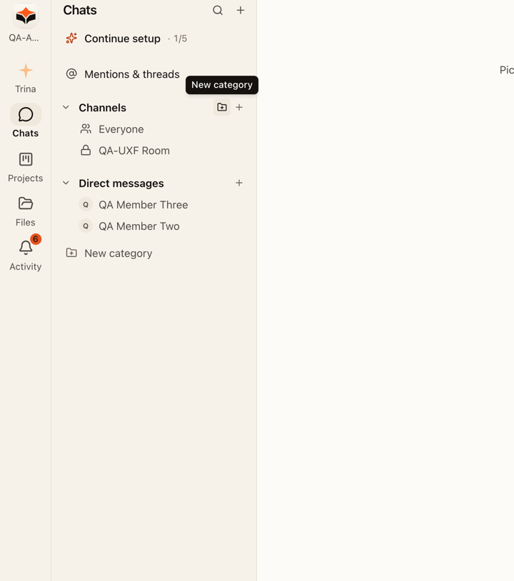
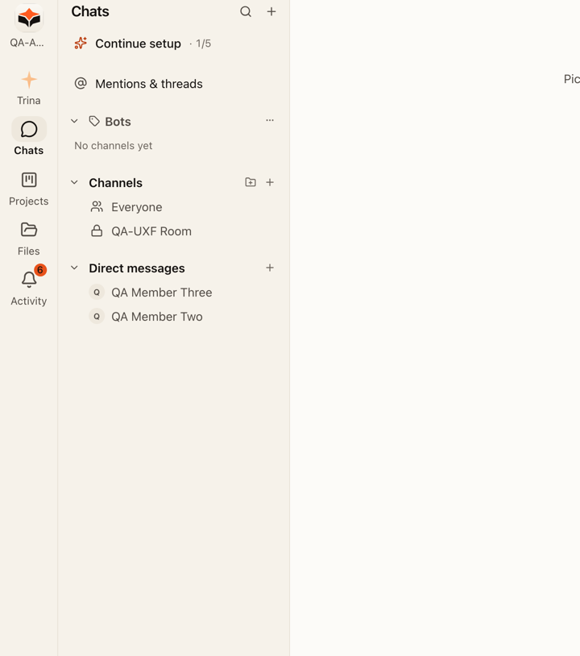
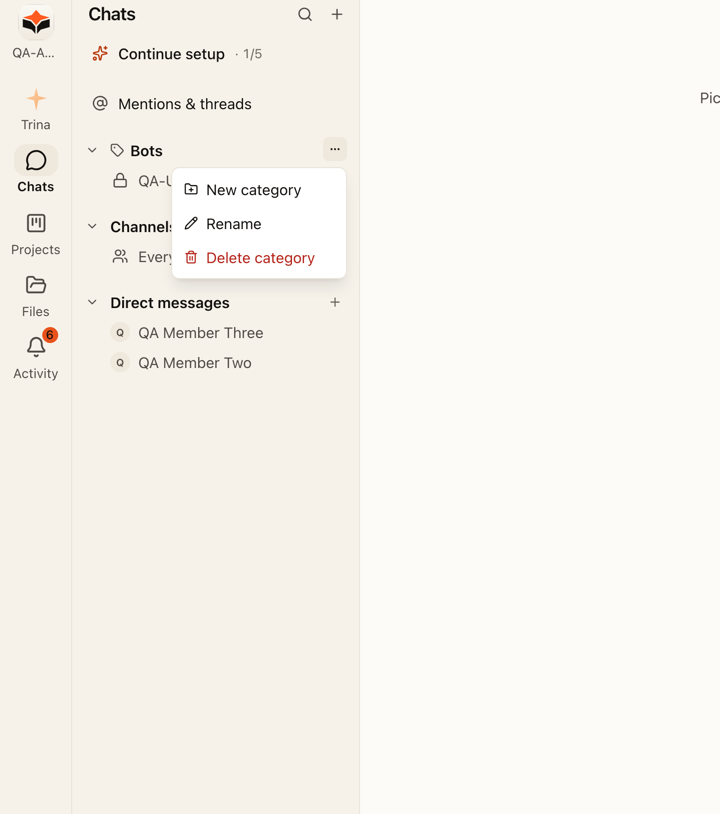
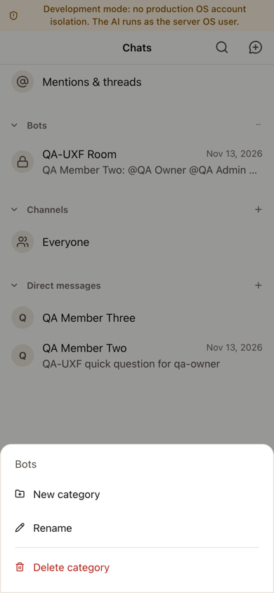

# Sidebar sections: each person sorts their own Chats list, as in Slack

- Date (UTC): 2026-11-21 01:14 (revised 01:29 after the owner's call: per person, named Sections)
- Branch: `plan/sidebar-categories-redo` (this plan only); the work goes on `feat/sidebar-sections-server` (PR 1),
  `feat/sidebar-sections` (PR 2) and `feat/sidebar-sections-drag` (PR 3)
- Status: draft
- Where: server/ (one migration, the nav-folders API, a one-time conversion), web/ (Chats list, room menus, phone
  Chats tab). Why: the owner made a category and could not tell how to put a conversation in it, then decided the
  feature must work like Slack's sidebar sections (see docs/REPOSITORY-RULES.md)
- Version impact: minor. Personal sections are a new feature on top of the existing nav-folders API, which gains an
  optional `sort` field. The team-category endpoints stay in place, read-only and empty, so nothing that calls them
  breaks.
- Decision: [docs/decisions/20261121-personal-sidebar-sections.md](../../decisions/20261121-personal-sidebar-sections.md)
  (supersedes [20261120-shared-chat-categories](../../decisions/20261120-shared-chat-categories.md))

## Goal

What the owner reported on 2026-11-21, with a screenshot:
- They made a category called "Bots". It showed "아직 채널이 없어요" with no hint on how to add channels.
- They could not tell how to put conversations into it.
- The small folder+ button next to 채널 was hard to see.

The owner then decided (2026-11-21): "사람마다 자기 사이드바를 따로 정리하는 기능이어야해. 슬랙이랑 똑같이 가야해 우리는"
("It should be a feature where each person organizes their own sidebar. We have to go the same way as Slack.")

The goal: everyone sorts their own Chats list into **sections**, and nobody else sees them, as in Slack.
- Any member can create a section where they expect to.
- They can fill it right away, by dragging or from any conversation's menu.
- An empty section says how to fill it.
- A phone can do all of this without dragging.

Channels, DMs and group DMs can all go in a section.

## Today (origin/dev df8816549, tried hands-on)

I tried this on a local copy of the QA-Acme test team (port 19949, a copy of its data). The shared 19787 server was not
touched. I used qa-owner and qa-member at 1440 and 390.

Code: `web/src/components/nav/RoomCategories.tsx`, `web/src/components/panels/RoomsByKind.tsx`,
`web/src/pages/Rooms.tsx`, `web/src/store/roomCategories.ts`, `server/src/rooms/categories.ts`,
`shared/src/api/room-categories.ts`.

| Area | Today |
|---|---|
| Who | Team-wide categories (migration 429). Admins and the owner create, rename, reorder, delete and fill them. Everyone sees the same list. |
| What goes in | Channels only. A 1:1 or an unnamed group chat gets 409 `room_category_personal`. |
| Create (computer) | A 14 px folder+ icon next to the Channels "+". A quiet "New category" row at the end of the list. "New category" in each category's "⋯". "New category" in the Move-to-category picker. |
| Fill | Only through a channel row's hover "⋯" › Move to category › a second menu. There is no drag, and the channel's header menu has no Move. |
| Empty | "No channels yet" / "아직 채널이 없어요", with nothing to click. |
| Rename, reorder, delete | Category "⋯" › Rename · Move up · Move down · Delete category. On delete, the channels go back to Channels. |
| Collapse | Every section folds, and the fold is kept per person (2026-11-16 decision). |
| Sort inside | A to Z. You cannot change it. |
| Phone | The category "⋯" sheet works. The long-press sheet of a channel has **no** Move to category, and the Channels header has only "+". So a phone **cannot create or fill** a category. |
| Old personal folders | Hidden on 11-20, not deleted. Migration 289 tables `nav_folders` / `nav_folder_items` (kind `rooms`), `PUT /api/rooms/:id/folder`, `Room.folderId` (per member), `navFolders.changed`, and the web parts in `NavFolders.tsx` / `store/navFolders.ts` (including drag: `dragRow`, `useDropTarget`) are all still on dev. Kind `chats` is still in use in the Trina list. |

### The problems, each with a screenshot

1. **The create button is hard to find.** It is a 14 px faint folder+ icon beside the Channels "+", and it looks like
   the "+".
   
2. **A new category is a dead end.** It shows "No channels yet" with no hint and no button. Nothing offers to fill it.
   
3. **Drag does nothing.** Dragging "QA-UXF Room" onto "Bots" leaves the list as it was. This is the first thing a
   Slack user tries.
   
4. **The only way in is two menus deep, behind a hover.** Move to category is the 6th of 7 items, and then a second
   menu opens.
   
   
5. **"New category" is in four places**, and none of them is where people look.
   
6. **The phone cannot create or fill one.**
   
   
   
7. **It is the wrong model.** The owner wants each person's own sidebar, holding DMs too. Today's categories are the
   team's and hold channels only.

## How Slack does it (help centre, read 2026-11-21)

Source: [Organize your sidebar with custom sections](https://slack.com/help/articles/360043207674-Organize-your-sidebar-with-custom-sections).
The folding behaviour comes from the 2026-11-16 reading of Slack's web app, in
[collapsible-chat-sections](../../decisions/20261116-collapsible-chat-sections.md).

- **Personal.** Sections are visible only to you. They can hold channels, DMs and apps.
- **Create (computer).** Hover over the Channels header, open its "⋯", and choose to create a section. Give it a name
  or pick a suggestion; an emoji is optional.
- **Create (phone).** In a conversation, tap the header, then Star or Move, then New section.
- **Fill.** Drag a conversation from the sidebar into a section. Or use the conversation header's star or Move to pick
  a section or make a new one. Or use bulk manage: tick several conversations, then Move to….
- **Take out.** The conversation goes back to Channels or Direct messages.
- **Rename and delete.** Use the section's "⋯".
- **Sort and filter, per section.** The section's "⋯" › Sort offers **A to Z, Recency or Priority**. There is also a
  Filter, whose default is "Active only" (it hides conversations with no activity in 30 days).
- **Phone.** You move a conversation from its header (Move › a section or New section). There is no drag. You can
  rename and delete a section from its "⋯".
- **Empty section.** The help centre does not say what an empty section shows.

We copy the behaviour, not the words. English comes first (memory: english-first-not-a-slack-copy). We use Slack's
term "Sections" ("섹션"), as the owner asked. We leave out Priority (Slack ranks it with its own signals), the Active-only
filter and emoji (see the open questions).

## The data: revive the personal folders, convert the team categories

**Revive `nav_folders` kind `rooms` as sections. Build no new tables.** Everything a section needs already exists and
is tested:
- per-person rows, hidden from everyone else (404 for anyone else's);
- channels, DMs and group DMs alike;
- `Room.folderId` on each member's copy of a room;
- unique names per person in any letter case;
- order, rename and delete, with delete sending the items back;
- leaving a room drops its row (`rooms/service.ts`);
- hidden and archived rooms filtered on read;
- realtime `navFolders.changed` to my other windows;
- limits of 30 sections per person and 500 conversations per section.

Missing pieces: a per-section sort, and the conversion of the team categories.

**Team categories become personal sections, then team categories go.** A one-time step at server start
(`server/src/rooms/categories-to-sections.ts`) runs in one transaction, and only while `room_categories` has rows. For
each category, in the team's order:
1. **Who gets a section:** every member (guests too) of at least one non-archived room with that `category_id`, plus
   the category's `created_by`. The maker gets it even when it is empty, so the owner keeps "Bots". Other admins, who
   saw empty ones only to fill them, do not get the empty ones.
2. **The section:** a `nav_folders` row (kind `rooms`, the same name, a new UUIDv7 from `newId()`). It goes before that
   person's older sections, in the team's order. If the person already has a section with the same name (any letter
   case), the step uses that one.
3. **Its conversations:** a `nav_folder_items` row for each room of the category that the person is in. If the room is
   already in one of their older folders, the category's placement wins, because it is what they see today.
4. **Clean up:** set `rooms.category_id` to NULL, and delete the `room_categories` rows. That deletion is the "done"
   mark, so the step never runs twice.
5. **Limits:** the step ignores the 30-section limit. Someone who ends up over it can still use, rename and delete
   their sections, but cannot add more until they are under it.

**No table or column is dropped.** The repo rule is that migrations are additive, so a downgrade still opens the
database. `room_categories` and `rooms.category_id` stay empty and unused until a later cleanup, as `nav_folders` kind
`rooms` did after 11-20. If someone downgrades to 0.5.23, they see no categories; the sections are kept for when they
come back.

**The old hidden personal folders come back** as sections, with what was in them. They are the person's own work and
were hidden for one day. See open question 2.

### Server work (PR 1)

- **Migration `431_b_sidebar_section_sort.sql`.** Check the highest B number on `dev` when you start; 430 is the
  highest today. It adds `ALTER TABLE nav_folders ADD COLUMN sort TEXT CHECK (sort IN ('name','recent'))`, where NULL
  means A to Z. It is additive, with no `min_compatible_reader` bump.
- **API (`shared/src/api/nav-folders.ts`).**
  - `NavFolder.sort` (`'name' | 'recent'`, rooms kind only).
  - `UpdateNavFolderBody` takes `name` and/or `sort`; a body must have at least one.
  - `NAV_FOLDERS_MAX` stays 30.
  - Docs: `bun run docs:api`.
- **The conversion step** above, called once at start after migrations, inside a try/catch so a failure is logged and
  does not stop the server.
- **Team-category endpoints are deprecated, not removed.**
  - `GET /api/room-categories` returns `{ items: [] }`.
  - Create, rename, order, delete and `PUT /api/rooms/:id/category` answer 410 `room_categories_removed`.
  - `Room.categoryId` is no longer sent.
  - Removing them for good happens in a later cleanup, with the tables.
- **`setRoomFolder` on a hidden room** answers 409 `room_hidden` today. That stays: a hidden room is not in the list
  to file.
- **Tests:**
  - `tests/unit/b-sidebar-sections.test.ts`: conversion cases (members, maker-empty, name merge, older-folder clash,
    archived, left, guest, idempotent) and sort round trip.
  - Keep `b-nav-folders` green.
  - Rewrite `b-room-categories.test.ts` for the deprecated answers.

## Target flows

### 1. Create a section (everyone, guests too)

- **Main entry, computer and phone.** The Channels header "+" becomes a small menu with **Create a channel** and
  **New section**. A guest, who cannot create channels, gets "+" that opens New section directly.
- **The Channels and Direct messages headers always show**, even when every conversation is in a section, so the entry
  never goes away.
- **Also from any conversation:** Move to section › **New section…** (flow 2).
- **The dialog:** a name box (the nav-folder name rules) with one line under it: "Only you see your sections." The
  button is **Create**.
- **Right after Create:** the dialog turns into **Add conversations to "Bots"**.
  - It lists every channel, DM and group DM I have, with tick boxes and their current section in grey ("in Clients").
  - A search box appears past 8 conversations.
  - The buttons are **Add n** and **Skip**.
  - Adding moves the ticked conversations, opens the section and shows a toast with Undo.

### 2. Put conversations in a section

These three ways work for every conversation: channel, DM or group DM.
- **Drag (computer, mouse).** Drag a row onto a section's header or rows. The section shows a highlight ring and a
  "Move here" row; drop it, and a toast says "Moved to 'Bots'" with Undo. Dropping on the Channels or Direct messages
  header takes it out of its section; it goes back to its own default list whichever header gets the drop. You can
  also drag between sections.
- **Move to section (menus).** This is the second item, under Pin, in:
  - the row "⋯" on a computer;
  - the phone's long-press sheet (`pages/Rooms.tsx` gets `folders`);
  - the conversation header "⋯" (`pages/Room.tsx`).

  It opens a list of my sections, with a check on the current one, then **New section…**, which makes a section and
  moves the conversation into it. **Remove from section** appears when the conversation is in one.
- **Add conversations (from the section).** The section's "⋯" › **Add conversations** opens the tick-box list from
  flow 1. This is the bulk way and the phone's easiest way.

### 3. Empty section

- **Computer:** "Drag a conversation here, or use Add conversations." with a button: [Add conversations].
- **Phone:** "Nothing here yet." with [Add conversations].
- **During a drag:** the empty section shows the "Move here" row.

### 4. Manage (the section's "⋯")

- **Add conversations**
- **Sort** › A to Z (default) · Recent activity. This is per section and kept on the account. A to Z sorts by the name
  the row shows; Recent activity uses the latest message first, as Direct messages does today.
- **Rename**
- **Move up / Move down**, shown only when the section can move.
- **Delete section.** A confirmation appears only when the section has something in it: "Its 3 conversations go back
  to Channels and Direct messages. Only your sidebar changes."
- **Collapse:** the chevron, as today. The fold is kept on the account, and a folded section shows the unread pill.
- **Order of the list:** Mentions & threads › Pinned › my sections › Channels › Direct messages. A conversation shows
  in one place only: pinned › its section › its kind. Pinned stays where it is (see open question 4).

### 5. Phone (no drag)

- **Create:** Channels "+" › New section, then Add conversations.
- **Fill:** long-press a row › Move to section (with New section…). Or use the conversation header "⋯" › Move to
  section, or the section "⋯" › Add conversations.
- **Manage:** the section "⋯" sheet: Add conversations, Sort, Rename, Move up / Move down, Delete.

### 6. Per person (decided)

Sections are personal, as in Slack: nobody else, owners and admins included, sees, lists or counts them. A section
never changes who is in a conversation.

## What gets removed

- **The team categories:**
  - `RoomCategories.tsx` and `store/roomCategories.ts`;
  - the admin-only category menus;
  - `roomCategories.changed`;
  - the API writes (410), `Room.categoryId` in responses;
  - the rule "only admins sort the sidebar".

  The tables stay, empty, until a later cleanup.
- **The folder+ icon** next to the Channels "+" (`NewCategoryButton`).
- **The quiet "New category" row** at the end of the list (`NewCategoryRow`).
- **"New category" in each category's "⋯"**, replaced by Add conversations.
- **The "Everyone on the team sees the same categories." footer.** The create dialog says "Only you see your sections"
  once instead.
- **The tag icon and the folder icon** before section names. A section header looks like Channels.
- **The old "Conversation folders" words** in the rooms list: "폴더로 옮기기", the "대화 폴더" heading, the
  `navFolders.separateRooms` line. Sections use their own words. Folders stay only in the Trina AI-chat list, which is
  unchanged.
- **"No channels yet" with nothing to do**, replaced by the hint with a button.

The result is one name (Section), one main entry (the "+" menu), and one menu item, Move to section, that is the same
everywhere.

## Wording (en is the source; ko follows; es, id, ja and zh are translated in the same PR)

Keys move to `sidebarSections.*`.

| Key (proposed) | en | ko |
|---|---|---|
| `rooms.section.newChannel` (as today) | Create a channel | 채널 만들기 |
| `sidebarSections.addMenu` (the "+" label) | Add | 추가 |
| `sidebarSections.new` | New section | 새 섹션 |
| `sidebarSections.newFromMove` | New section… | 새 섹션… |
| `sidebarSections.nameLabel` | Section name | 섹션 이름 |
| `sidebarSections.onlyYou` | Only you see your sections. | 섹션은 나에게만 보여요. |
| `sidebarSections.create` | Create | 만들기 |
| `sidebarSections.addTitle` | Add conversations to '{name}' | '{name}'에 대화 넣기 |
| `sidebarSections.addButton` | Add {n, plural, one {# conversation} other {# conversations}} | 대화 {n}개 넣기 |
| `sidebarSections.skip` | Skip | 건너뛰기 |
| `sidebarSections.inOther` | in {name} | {name}에 있음 |
| `sidebarSections.add` (section "⋯") | Add conversations | 대화 넣기 |
| `sidebarSections.emptyComputer` | Drag a conversation here, or use Add conversations. | 대화를 여기로 끌어 놓거나 '대화 넣기'를 눌러요. |
| `sidebarSections.emptyPhone` | Nothing here yet. | 아직 비어 있어요. |
| `sidebarSections.dropHere` | Move here | 여기로 옮기기 |
| `sidebarSections.moveTo` | Move to section | 섹션으로 옮기기 |
| `sidebarSections.remove` | Remove from section | 섹션에서 빼기 |
| `sidebarSections.moved` + Undo | Moved to '{name}' · Undo | '{name}'(으)로 옮겼어요 · 되돌리기 |
| `sidebarSections.movedMany` | Moved {n, plural, one {# conversation} other {# conversations}} to '{name}' | 대화 {n}개를 '{name}'(으)로 옮겼어요 |
| `sidebarSections.removed` | Removed from '{name}' | '{name}'에서 뺐어요 |
| `sidebarSections.sort` | Sort | 정렬 |
| `sidebarSections.sortName` | A to Z | 가나다순 |
| `sidebarSections.sortRecent` | Recent activity | 최근 활동순 |
| `sidebarSections.rename` | Rename | 이름 바꾸기 |
| `sidebarSections.delete` | Delete section | 섹션 지우기 |
| `sidebarSections.deleteTitle` | Delete the section '{name}'? | '{name}' 섹션을 지울까요? |
| `sidebarSections.deleteBody` | {n, plural, one {Its conversation goes} other {Its # conversations go}} back to Channels and Direct messages. Only your sidebar changes. | 안에 있던 대화 {n}개는 채널과 다이렉트 메시지로 돌아가요. 내 사이드바만 바뀌어요. |
| `sidebarSections.nameTaken` | You already have a section with this name. | 같은 이름의 섹션이 이미 있어요. |
| `sidebarSections.full` (server, 409) | You can have up to {n} sections. | 섹션은 {n}개까지 만들 수 있어요. |

Removed keys: every `roomCategories.*` key, and `navFolders.separateRooms`.

## Steps and size

PR 1 and PR 2 ship in one batch (the team's batch rule). On its own, PR 1 would make the categories disappear before
the sections show.

**PR 1, `feat/sidebar-sections-server` (server, component B; about 300 lines plus tests).**
1. Migration 431 (`nav_folders.sort`); `NavFolder.sort`; `UpdateNavFolderBody` with name and/or sort; API docs.
2. `categories-to-sections.ts`, the one-time conversion, called at start; unit tests.
3. Deprecate the team-category endpoints (empty GET, 410 writes); stop sending `Room.categoryId`.

**PR 2, `feat/sidebar-sections` (web; about 600 lines plus tests).**
4. Chats list: draw my `rooms` folders as sections between Pinned and Channels. This brings back the pre-11-20 code in
   `RoomsByKind.tsx` and `pages/Rooms.tsx`, which `d4b05530b` replaced. Order inside each section follows its `sort`.
   Remove the categories UI.
5. Channels "+" menu (New section for everyone; a guest's "+" opens it directly); headers always drawn.
6. Create dialog with "Only you see your sections", then the new `AddConversationsDialog` (tick boxes, current
   section, search past 8, a loop of `PUT /api/rooms/:id/folder`).
7. Move to section second in the row "⋯", the phone long-press sheet and the conversation header "⋯", with New
   section… and Remove from section.
8. Section "⋯": Add conversations · Sort · Rename · Move up / Move down · Delete section (confirm only when not
   empty).
9. Empty hint with its button; Undo on the moved and removed toasts.
10. The removals; i18n in all six languages; the decision file (written with this plan).

**PR 3, `feat/sidebar-sections-drag` (web; about 250 lines plus e2e).**
11. Draggable rows (pointer-fine only), using `dragRow` / `useDropTarget` from `NavFolders.tsx`, with one drag type for
    any conversation.
12. Drop targets: each section (header and rows), and the Channels and Direct messages headers (take out). Highlight
    ring, "Move here" row in an empty or folded section, Undo toast, and the panel scrolls itself near its edges during
    a drag.

## Decisions

[docs/decisions/20261121-personal-sidebar-sections.md](../../decisions/20261121-personal-sidebar-sections.md). It
supersedes [20261120-shared-chat-categories](../../decisions/20261120-shared-chat-categories.md), whose Status line now
points to it. It keeps the 2026-11-16 rule that every section folds and the fold is kept on the account.

## Risks

- **Migration number:** 431 must still be free on `dev` when PR 1 starts (430 is the highest B today; two files with
  one number stop the server).
- **The conversion runs on live teams' data at start.**
  - It runs in one transaction and only while `room_categories` has rows.
  - The unit tests cover a team with categories, old folders and guests.
  - Rehearse it on a copy of QA-Acme with "Bots" and a filled category before the batch.
- **The old folders coming back** surprises nobody who did not make one. For someone who did, they return as they left
  them on 11-20.
- **Privacy:** sections stay mine only. Every nav-folder route already answers 404 for anyone else's. Keep a test that
  an admin cannot list another person's sections.
- **Drag and the row link:** a drag must not open the room, and a click must not start a drag (a 4 px threshold, as
  NavFolders did). Touch screens never drag; long press opens the sheet.
- **`content-visibility` on sections** during a long drag: scroll the panel itself near its edges.
- **Languages:** all six app languages get the new keys (`bun run check:i18n`).

## Tests

- `bun run typecheck`, `bun run check:i18n`, `bun run check:docs`, `bun run check:prepush`, `bun run docs:api`.
- Unit (server): `tests/unit/b-sidebar-sections.test.ts`, `b-nav-folders`, and `b-room-categories` (deprecated answers).
- Unit (web): `web/test/unit/nav-folders.test.tsx` (sections in the rooms list), and a new
  `add-conversations-dialog.test.tsx`.
- Web e2e:
  - a member creates from "+", adds 2 channels and 1 DM;
  - drags in, between sections and out;
  - Move to section › New section… from the phone sheet at 390 and from the conversation header;
  - sort A to Z / Recent activity;
  - the empty hint;
  - delete with its count;
  - another member does not see the section.
- QA on a QA-Acme copy, 1440 and 390, light and dark, as qa-owner, qa-member and a guest. Include the conversion of a
  pre-made "Bots" (empty, owner-made) and of a filled category.

## Open questions (each with one recommendation)

1. **Are the team categories converted or dropped?** **Recommend: convert** each one into a personal section for every
   member who sees it (plus the maker, so the owner keeps "Bots"), then empty the team tables. Nobody loses the order
   they see today.
2. **Do the old personal room folders (hidden since 11-20) come back as sections?** **Recommend: yes, with their
   contents.** They are the person's own work. Anyone who does not want one deletes it in two clicks.
3. **Where does New section live besides the Channels "+"?** **Recommend: also "New section…" in every Move to section
   menu, and nowhere else.** That is the same two places as Slack (the Channels header and the conversation's Move).
   The Direct messages "+" keeps opening New message directly.
4. **Does Pinned stay a separate section above my sections?** (Slack's Starred is just another section.) **Recommend:
   keep Pinned as it is.** It already works on every list and the phone, and the owner did not ask to change it.
5. **Slack's Priority sort and Active-only filter?** **Recommend: not now.** A to Z and Recent activity cover what
   people sort by. Priority needs Slack's own ranking, and the filter hides conversations, which surprises people. Add
   them later if someone asks.
6. **Emoji on a section, as Slack allows?** **Recommend: not now.** A name can already start with an emoji typed by
   hand, since names accept emoji.
7. **Drag a section header to reorder sections?** **Recommend: in PR 3 if it stays small; otherwise later.** Move up /
   Move down works on every screen and stays either way.
8. **Can admins share a starter set of sections with new members** (Slack has this)? **Recommend: not now.** That was
   the reason for team categories, and the owner chose personal sections.

## Result

Filled in at the end.
