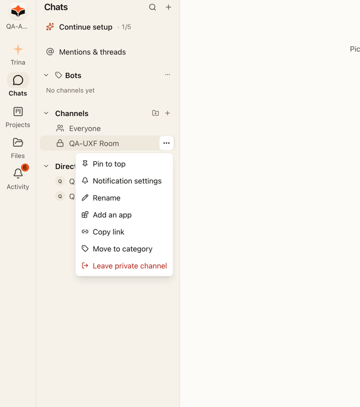
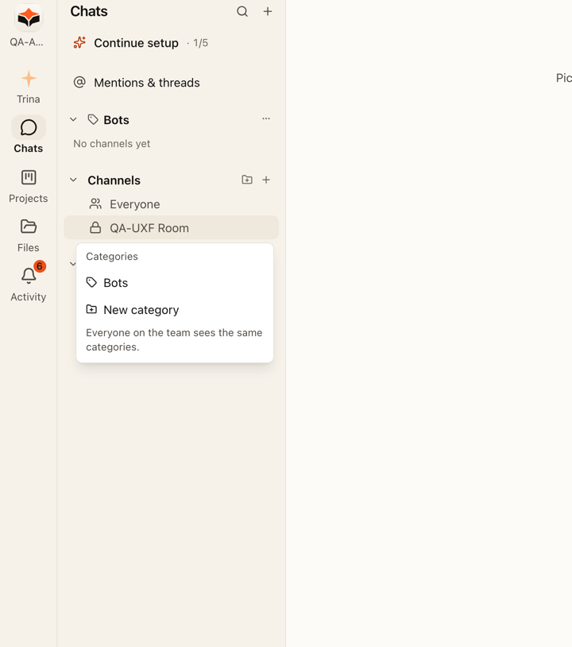

# Chat categories that are as easy as Slack's sidebar sections

- Date (UTC): 2026-11-21 01:14
- Branch: `plan/sidebar-categories-redo` (this plan only); the work goes on `feat/sidebar-categories-easy` (PR 1) and
  `feat/sidebar-categories-drag` (PR 2)
- Status: draft
- Where: web/ (Chats list, room menus, phone Chats tab). No server change is needed. Why: the owner made a category and
  could not find out how to put a conversation in it (see docs/REPOSITORY-RULES.md)
- Version impact: minor. Categories shipped in 0.5.23, and this adds new ways to use them (drag and drop, Add channels,
  Move to category on the phone). No API or data change.

## Goal

What the owner reported (2026-11-21, screenshot): they made a category "Bots". It showed "아직 채널이 없어요" (no
channels yet) with no hint on how to add one. They could not work out how to put conversations in it. In Slack you
make a section and drag channels in. The small folder+ button next to 채널 was hard to see. Their words: "한번
기획다시 해봐야할 것 같은데?"

The goal is a category flow that someone who knows Slack's sidebar sections uses without being told. You make a
category where you expect to. You fill it right away, and you can drag channels in. An empty category says how to fill
it. The phone can do the same things without drag.

The rule of the 2026-11-20 decision stays as it is: one team-wide list, made by admins and the owner, holding channels
only ([docs/decisions/20261120-shared-chat-categories.md](../decisions/20261120-shared-chat-categories.md)). This plan
changes how people reach and use it, not who sees what.

## Today (origin/dev df8816549, tried hands-on)

Tried on a local copy of the QA-Acme test team (port 19949, a copy of its data; the shared 19787 server was not
touched), as qa-owner and qa-member, at 1440 and 390. Code: `web/src/components/nav/RoomCategories.tsx`,
`web/src/components/panels/RoomsByKind.tsx`, `web/src/pages/Rooms.tsx`, `web/src/store/roomCategories.ts`,
`server/src/rooms/categories.ts`, `shared/src/api/room-categories.ts`.

| Area | Today |
|---|---|
| Who | Admins and the owner create, rename, reorder, delete and fill categories. Everyone sees the same list. A member sees a category only when it holds a channel they are in. |
| What goes in | Channels only (Everyone, team rooms, named private channels). A 1:1 or an unnamed group chat is refused (409 `room_category_personal`). |
| Create (computer) | A 14 px folder+ icon on the left of the Channels "+" (`NewCategoryButton`). A quiet "New category" row at the end of the list while there is no category yet (`NewCategoryRow`). "New category" in a category's "⋯". "New category" at the end of the Move-to-category picker. |
| Fill | Only from a channel row's hover "⋯" › **Move to category**, which opens a second menu with the categories. There is no drag. There is no Move to category in the channel's own header menu (`pages/Room.tsx`). |
| Empty category | "No channels yet" / "아직 채널이 없어요", with no action. Only admins see an empty one. |
| Take out | Row "⋯" › Take out of category. |
| Rename, reorder, delete | Category "⋯" › Rename · Move up · Move down · Delete category. Deleting sends the channels back to Channels for everyone. |
| Collapse | Every section folds. Folds are kept per person, on the account (2026-11-16 decision). |
| Sort inside | By name (A to Z). It cannot be changed. |
| Phone | The category "⋯" sheet works. The long-press sheet of a channel row has **no** Move to category (`pages/Rooms.tsx` does not pass `folders` to `RoomMenu`). The Channels header has only "+", so a phone **cannot create a category or fill one** unless one already exists and is filled from a computer. |

### The problems, each with a screenshot

1. **The create button is hard to find.** A 14 px faint folder+ icon sits next to the Channels "+". It looks like the
   "+" and you only learn what it does from its tooltip.
   
2. **A new category is a dead end.** After you make it, "Bots" says "No channels yet" with no hint and no button. The
   dialog closes and nothing offers to fill it.
   
3. **Drag does nothing.** You drag "QA-UXF Room" onto "Bots" and the list stays as it was. This is the first thing a
   Slack user tries. The old personal folders had drag (`NavFolders.tsx` `dragRow` / `useDropTarget`); the categories
   did not keep it.
   
4. **The only way in is two menus deep, behind a hover.** It is row hover › "⋯" › Move to category (6th of 7 items) ›
   a second menu.
   
   
5. **"New category" is in four places**: the folder+ icon, the quiet row, each category's "⋯", and the picker. The same
   action appears four times, and none of them is where people look.
   
6. **The phone cannot create or fill.** The Channels header has only "+". The long-press sheet of a channel has no Move
   to category.
   
   
   

## How Slack does it (help centre, read 2026-11-21)

Sources: [Organize your sidebar with custom sections](https://slack.com/help/articles/360043207674-Organize-your-sidebar-with-custom-sections),
and the 2026-11-16 reading of Slack's web app in
[collapsible-chat-sections](../decisions/20261116-collapsible-chat-sections.md).

- **Create.** On a computer you hover the Channels header › "⋯" › create a section, then give a name (an emoji is
  optional). From a conversation, the star in its header › pick a section or create a new one. On a phone you go to
  the conversation header › Star / Move › New section.
- **Fill.** You drag any conversation from the sidebar into a section. You can also use a conversation's header star /
  Move, or bulk manage (tick several conversations › Move to…). The help centre does not document a right-click Move,
  but third-party guides describe one.
- **Empty section.** The help centre does not say what an empty section shows.
- **Sort.** Each section has its own "⋯" › Sort: A to Z, Recency or Priority, plus a filter.
- **Rename and delete.** You use the section's "⋯". Taking a conversation out sends it back to Channels or Direct
  messages.
- **Phone.** You move a conversation from its header (Move › section or New section), and rename or delete from the
  section's "⋯". There is no drag.
- **Who.** Sections are personal and can hold DMs. Admins can share a set of sections with new members.

We keep Slack's ideas (create from the Channels header, drag in, Move from the conversation itself, pick several at
once) but use our own words, in English first (memory: english-first-not-a-slack-copy). We do not copy its
per-section sort or filter: the owner prefers a lean UI.

## Scope

In:
- One clear place to create a category, on a computer and on a phone.
- Filling it right after you make it ("Add channels" with a list of tick boxes).
- Drag and drop on a computer, in and out.
- Move to category in every channel menu: the row "⋯", the phone long-press sheet, and the channel's header menu.
- An empty-category hint that says how to fill it, with a button.
- A delete confirmation that says what happens to the channels.
- The removals below.

Out:
- Personal sections and DMs in categories (see the open questions).
- Per-category sort and filter.
- Dragging categories to reorder them (Move up / Move down stays).
- Emoji on categories.
- Server or API changes.

## Target flows

### 1. Create a category (admins and the owner)

- **Entry point (computer and phone):** the Channels header "+" becomes a small menu for admins with two items:
  **Create a channel** and **New category**. Members and guests keep today's "+", which opens Create a channel
  directly. The folder+ icon goes. This is Slack's place (the Channels header), behind the button people already
  click.
- The Channels header is always drawn for anyone who can create a channel, even when every channel is in a category,
  so the entry point never goes away. This replaces "New category" in each category's "⋯".
- **The dialog:** a name box (as today, with the same checks) and one line under it: "Everyone on the team sees it.
  Only admins can change it." Button: **Create**.
- **Right after Create:** the same dialog turns into **Add channels to "Bots"**. It lists the channels I am in that can
  go in a category, as rows with tick boxes and their current category in grey ("in Clients"). A search box appears
  when there are more than 8. The buttons are **Add** (n) and **Skip**. Adding moves the ticked channels, then the
  category opens with them inside and a toast with Undo.

### 2. Put channels in a category (three ways, the same on every screen where they apply)

- **Drag (computer, mouse):** you drag a channel row onto a category's header or its rows. The category gets a
  highlight ring and an outline row, "Move here". Dropping moves it for everyone and shows a toast "Moved to 'Bots'"
  with Undo. Dragging onto the Channels header takes it out. A DM row cannot be dragged onto a category: the target
  does not light up, and a tooltip on hover says "Direct messages stay in your own list". Only admins can drag
  channels. For a member the row does not start a drag, as today.
- **Move to category (menus):** the item moves up to the second place in the channel row's "⋯", under Pin. It is also
  added to the phone's long-press sheet and to the channel's own header "⋯" (`pages/Room.tsx`), like Slack's
  "from the conversation". The second step lists the categories, a check on the current one, then "New category…",
  and "Take out of category" when it is in one.
- **Add channels (from the category):** a category's "⋯" gets **Add channels** first. It opens the same tick-box list
  as after Create. This is the bulk way and the phone's main way.

### 3. Empty category (only admins see one)

- One line plus a button inside the section:
  - computer: "Drag a channel here, or use **Add channels**." + [Add channels]
  - phone: "Nothing here yet." + [Add channels]
- During a drag, the empty category shows the drop row "Move here".

### 4. Manage

- **Take out:** drag it to the Channels header, or use the row "⋯" › Take out of category. Both show a toast with Undo.
- **Rename:** category "⋯" › Rename (as today).
- **Reorder:** category "⋯" › Move up / Move down (as today; shown only when it can move).
- **Delete:** category "⋯" › Delete category. The confirmation names what happens: "'Bots' goes away for everyone.
  Its 3 channels go back to Channels. No one leaves a channel." Button: Delete.
- **Collapse:** as today (the chevron, kept per person on the account, the unread pill while folded).
- **Order inside:** A to Z by name, as today. There is no sort menu.

### 5. Phone (no drag)

- Create: Channels "+" › New category (admins), then Add channels with tick boxes.
- Fill: a channel's long-press sheet › Move to category; the channel header "⋯" › Move to category; or the category
  "⋯" › Add channels.
- There is no drag and no long-press reorder. Move up / Move down stays in the category "⋯".

### 6. Per person or team: keep team-wide (recommended)

The owner asked for team categories made by admins on 2026-11-20 ("admin can create the category and it's showed for
all users"). This plan keeps that rule and fixes the flow. Personal sections, the Slack model, would bring back what
that decision removed: every person sorting the same channels alone, and a different sidebar for each teammate. See
open question 1.

## What gets removed

- The folder+ icon next to the Channels "+" (`NewCategoryButton`). Its job moves into the "+" menu.
- The quiet "New category" row at the end of the list (`NewCategoryRow`).
- "New category" in each category's "⋯". Add channels takes its place there.
- The grey footer "Everyone on the team sees the same categories." under the Move-to-category picker. The line is said
  once, in the create dialog.
- The tag icon before each category name. A category header looks like Channels and Direct messages, as in Slack.
- "No channels yet" with nothing to do. The hint with a button replaces it.

Net change: two buttons and one row go; one menu item (Add channels) and one hint come in.

## Wording (en is the source; ko follows; es, id, ja and zh are translated in the same PR)

| Key (proposed) | en | ko |
|---|---|---|
| `rooms.section.addMenu` (the "+" label for admins) | Add to Channels | 채널에 추가 |
| `rooms.section.newChannel` (as today) | Create a channel | 채널 만들기 |
| `roomCategories.new` (as today) | New category | 새 카테고리 |
| `roomCategories.newHint` | Everyone on the team sees it. Only admins can change it. | 팀 모두에게 보여요. 관리자만 바꿀 수 있어요. |
| `roomCategories.make` | Create | 만들기 |
| `roomCategories.addTitle` | Add channels to '{name}' | '{name}'에 채널 넣기 |
| `roomCategories.addButton` | Add {n, plural, one {# channel} other {# channels}} | 채널 {n}개 넣기 |
| `roomCategories.skip` | Skip | 건너뛰기 |
| `roomCategories.inOther` | in {name} | {name}에 있음 |
| `roomCategories.add` (category "⋯") | Add channels | 채널 넣기 |
| `roomCategories.emptyComputer` | Drag a channel here, or use Add channels. | 채널을 여기로 끌어 놓거나 '채널 넣기'를 눌러요. |
| `roomCategories.emptyPhone` | Nothing here yet. | 아직 비어 있어요. |
| `roomCategories.dropHere` | Move here | 여기로 옮기기 |
| `roomCategories.dmStays` | Direct messages stay in your own list | 다이렉트 메시지는 내 목록에만 있어요 |
| `roomCategories.moveTo` (as today) | Move to category | 카테고리로 옮기기 |
| `roomCategories.moved` (as today) + Undo | Moved to '{name}' · Undo | '{name}'(으)로 옮겼어요 · 되돌리기 |
| `roomCategories.movedMany` | Moved {n, plural, one {# channel} other {# channels}} to '{name}' | 채널 {n}개를 '{name}'(으)로 옮겼어요 |
| `roomCategories.deleteTitle` (as today) | Delete the category '{name}'? | '{name}' 카테고리를 지울까요? |
| `roomCategories.deleteBody` | '{name}' goes away for everyone. {n, plural, =0 {} one {Its channel goes back to Channels. } other {Its # channels go back to Channels. }}No one leaves a channel. | 모두의 목록에서 '{name}'이(가) 사라져요. 안에 있던 채널 {n}개는 채널 목록으로 돌아가요. 채널에서 나가는 사람은 없어요. |

Removed keys: `roomCategories.everyoneSees`, `roomCategories.empty` (after its last use).

## Steps

PR 1, `feat/sidebar-categories-easy` (web only; about 400 lines plus tests):
1. Channels "+" menu for admins (`RoomSectionAction`, `RoomsByKind.tsx`, `pages/Rooms.tsx`). Keep the Channels header
   while a category holds every channel.
2. Create dialog with its hint, then the **Add channels** step: a new `AddChannelsDialog` with tick boxes, current
   category, search past 8, and a loop of `PUT /api/rooms/:id/category`. Use the room list the client already has.
   It lists only channels I am in, because the server returns 404 for a room I am not in.
3. Category "⋯": Add channels first; remove New category.
4. Move to category second in the row "⋯"; add it to `pages/Rooms.tsx` (phone sheet) and `pages/Room.tsx` (channel
   header).
5. Empty hint with its button (computer and phone wording).
6. Delete confirmation with the channel count. Undo on the moved / taken-out toasts (the toast sets the old category
   back).
7. Removals: `NewCategoryButton`, `NewCategoryRow`, the picker footer, the tag icon. i18n in all five languages.

PR 2, `feat/sidebar-categories-drag` (web only; about 250 lines plus e2e):
8. Draggable channel rows for admins (pointer-fine only), with a drag type for channels so a target knows what it
   takes. Bring back `dragRow` / `useDropTarget` from `NavFolders.tsx` as a shared helper.
9. Drop targets: each category section (header and rows) and the Channels header (take out). Highlight ring, a
   "Move here" outline row in an empty or folded category, Undo toast. Use the keyboard and screen-reader path
   through the menus (Move to category) as now, since drag has no keyboard path.
10. DM rows: no drag type, so no target lights up.

## Decisions

A new file, `docs/decisions/<date>-category-flow-like-sections.md`, written with PR 1. It covers the entry point in the
Channels "+" menu, three ways in (drag, Move to category in every channel menu, Add channels), the empty hint with an
action, and the removals. It extends [20261120-shared-chat-categories](../decisions/20261120-shared-chat-categories.md)
and does not supersede its rule.

## Risks

- No migration or API change. The bulk add sends one request per channel. That is fine for a team's channel count
  (tens); each sends `room.updated` to the members.
- Drag and the row's link: a drag must not open the room, and a click must not start a drag (use a 4 px threshold, as
  NavFolders did).
- `content-visibility` on sections: a drop target off screen during a long drag. Auto-scroll the panel near its edges.
- Touch screens: drag stays off (`pointer-coarse`), so the long press keeps opening the sheet.
- The five app languages: new keys in en, ko, es, id, ja and zh (`bun run check:i18n`).
- Admin-only actions stay admin-only on the server (`auth: 'admin'`). The UI only hides them.

## Tests

- `bun run typecheck`, `bun run check:i18n`, `bun run check:docs`, `bun run check:prepush`.
- Unit tests: `web/test/unit/nav-folders.test.tsx` (the categories part), a new `add-channels-dialog.test.tsx`, and
  `tests/unit/b-room-categories.test.ts` (unchanged, still green).
- Web e2e (the categories spec): create from "+", then Add channels with 2 ticked; drag in and out; Move to category
  from the phone sheet at 390 and from the channel header; the empty hint; delete with its count; a member sees no
  "+" menu and cannot drag.
- QA screenshots at 1440 and 390, light and dark, as qa-owner and qa-member, on a copy of QA-Acme.

## Open questions (each with one recommendation)

1. **Per person or team?** Slack's sections are personal and hold DMs. **Recommend: stay team-wide and admin-made** (the
   owner's 2026-11-20 call), and fix the flow only. Revisit personal sections only if members ask to sort DMs.
2. **What did the owner want in "Bots"?** If it is the app bots or AI DMs, those are DMs and cannot go in a category
   today. **Recommend: ask the owner in one line with the screenshot. Until then, keep channels only**, so the empty
   hint and the picker never offer something that will be refused.
3. **Should members be able to make categories?** **Recommend: no.** Members see the result. Admins already get the
   requests through Ask an admin.
4. **Drag to reorder the categories themselves?** **Recommend: not now.** Move up / Move down is enough for a handful of
   categories. Add it in a later PR if the owner drags a header and expects it to move.
5. **Sort inside a category (A to Z or by recent activity)?** **Recommend: A to Z only**, the same as Channels. No
   per-category sort menu (lean UI).
6. **Can an admin file a private channel they are not in?** Today they cannot (404). **Recommend: keep it.** An admin
   who is not in a channel should not be placing it; the picker lists only channels they are in.

## Result

Filled in at the end.
