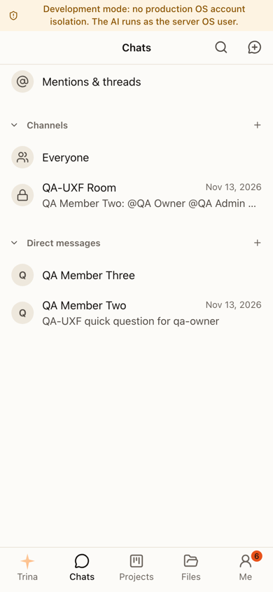
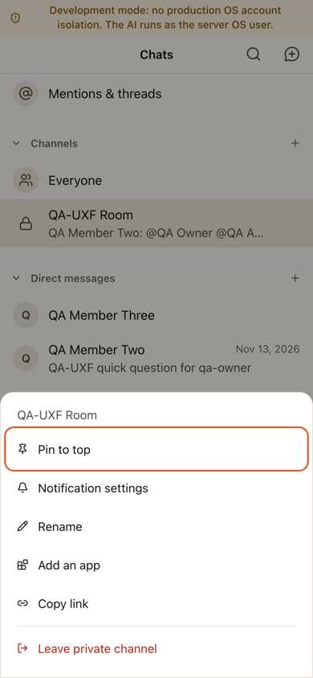
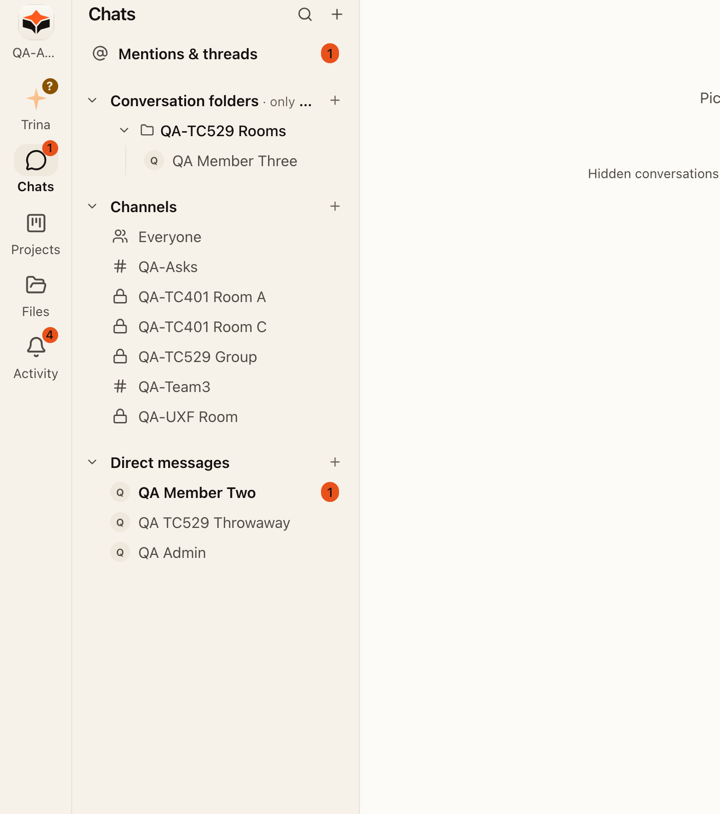
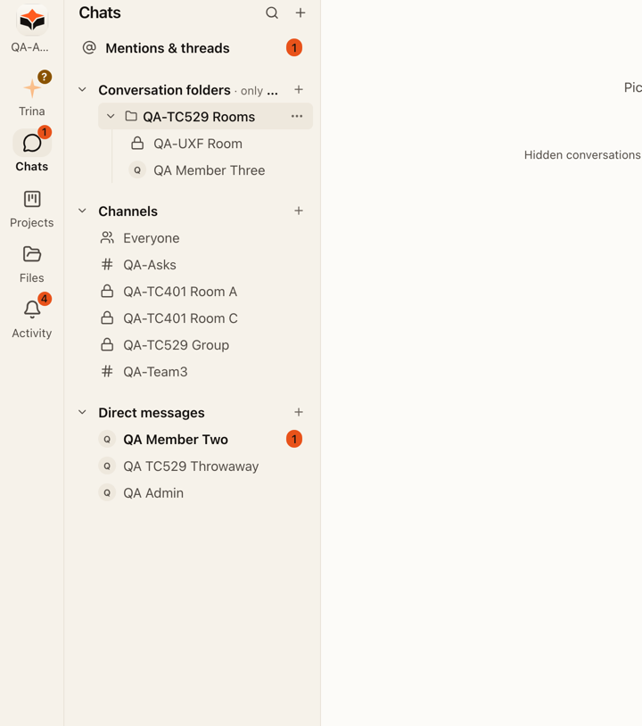
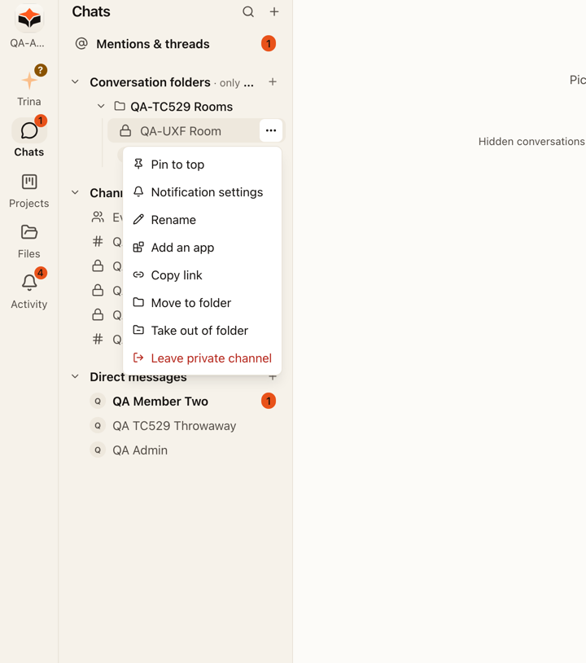
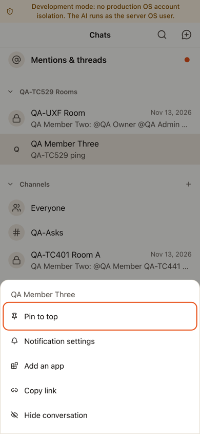

# Sidebar sections: bring back the personal conversation folders and make them work like Slack's sections

- Date (UTC): 2026-11-21 01:14 (revised twice on 2026-11-21 after the owner's calls)
- Branch: `plan/sidebar-categories-redo` (this plan only); the work goes on one web PR, `feat/sidebar-sections`
- Status: draft
- Where: web/ only. No server change and no migration. Why: the owner could not tell how to fill a team category. Then
  they decided the sidebar must be each person's own, as in Slack, by bringing back the personal folders and changing
  only the UI (see docs/REPOSITORY-RULES.md)
- Version impact: minor. Personal sections come back with new ways to use them, and the team categories leave the UI.
  The API does not change.
- Decision: [docs/decisions/20261121-personal-sidebar-sections.md](../../decisions/20261121-personal-sidebar-sections.md)
  (supersedes [20261120-shared-chat-categories](../../decisions/20261120-shared-chat-categories.md))

## Goal

The owner's report and calls, all on 2026-11-21:
- **Report:** they made a team category, "Bots". It said "아직 채널이 없어요" with no way to fill it, and the
  create button was hard to see.
- **First call:** "사람마다 자기 사이드바를 따로 정리하는 기능이어야해. 슬랙이랑 똑같이 가야해 우리는" (it should be a feature
  where each person organizes their own sidebar; we go the same way as Slack).
- **Second call:** "그냥 라카꺼를 빼고 UI만 바꾸면 될 것 같은데?" (just take out the team categories and change only the UI).

So:
- Take out the 11-20 team categories from the web.
- Show the personal conversation folders again, which have worked per person since 11-11.
- Call them **Sections / 섹션**.
- Change only the UI, so that they work like Slack's sidebar sections:
  - a section is easy to create;
  - you can fill it right away;
  - you can drag conversations in and out;
  - there is Move to section in every conversation menu;
  - an empty section says how to fill it.

## What is there today (origin/dev df8816549, tried hands-on)

I tried both the current build and a throwaway build with the 11-20 web change reverted. Both ran on local copies of
the QA-Acme test team (port 19949). The shared 19787 server was not touched. I tested at 1440 and 390.

**The team categories, which the owner tried:**

| # | Problem | Screenshot |
|---|---|---|
| 1 | The create button is a faint 14 px folder+ icon next to the Channels "+". |  |
| 2 | A new category says "No channels yet", with no hint and no button. |  |
| 3 | Dragging a channel onto it does nothing. |  |
| 4 | The only way in is a hover "⋯", then Move to category (item 6 of 7), then a second menu. |   |
| 5 | "New category" is in four places, none of them obvious. |  |
| 6 | On a phone you cannot create a category or fill one. |   |
| 7 | The categories are the team's, admin-made, and hold channels only. The owner wants each person's own, holding DMs too. | |

**The personal folders, hidden since 11-20.** I brought them back by reverting the web part of `d4b05530b`. Two small
conflicts came up, in `RoomMenu.tsx` and `pages/Rooms.tsx`. The source typechecks; only
`web/test/unit/nav-folders.test.tsx` needs its old cases back.

- **The server never stopped serving them.** That covers:
  - `nav_folders` and `nav_folder_items` (kind `rooms`) and their routes;
  - `PUT /api/rooms/:id/folder`;
  - `Room.folderId`, which is each member's own;
  - realtime `navFolders.changed`;
  - 404 for anyone else's folder;
  - channels, DMs and group DMs;
  - hidden and archived rooms filtered on read;
  - limits of 30 per person and 500 per folder;
  - guests are allowed.
- **Old data comes back as it was.** On the QA copy, qa-member's folder "QA-TC529 Rooms" came back with its DM inside.
- **Drag in works.** I dragged "QA-UXF Room" onto the folder with Playwright, the room moved in, and the toast said
  "Moved to 'QA-TC529 Rooms'".
- **Drag out does not work.** Dragging a row from a folder onto the Channels header does nothing: there is no drop
  target there.
- **On a computer the folders are nested** under one "Conversation folders · only you" group with its own "+". Slack
  shows each section at the top level.
- **The row "⋯"** has Move to folder and Take out of folder near the end.
- **The phone draws each folder as its own top-level section** (already Slack-like), but the long-press sheet has
  **no** Move to folder. `pages/Rooms.tsx` never passed `folders` to it, before or after 11-20.

| | |
|---|---|
| Folders back, nested under one group, computer |  |
| Drag in works |  |
| Row "⋯": Move to folder near the end |  |
| Phone long-press sheet: no Move to folder |  |

## How Slack does it (help centre, read 2026-11-21)

Source: [Organize your sidebar with custom sections](https://slack.com/help/articles/360043207674-Organize-your-sidebar-with-custom-sections).

- Sections are personal and hold channels, DMs and apps.
- **Create:** on a computer, the Channels header "⋯" › create a section. In a conversation, the header's star or Move ›
  New section. On a phone, the conversation header › Move › New section.
- **Fill:** drag a conversation into a section, use the conversation header's Move, or bulk manage (tick several, then
  Move to…).
- **Manage:** the section "⋯" has Rename, Delete and Sort (A to Z, Recency, Priority), plus a filter.
- **Remove:** taking a conversation out of a section sends it back to Channels or Direct messages.

We copy the behaviour, not the words (memory: english-first-not-a-slack-copy). Sort is left out for now (open
question 2).

## Scope

In (web only):
- Remove the team categories from the web.
- Show the personal room folders again as **Sections**.
- Make the UI changes below.

Out:
- Any server change. The team-category routes and tables stay where they are, unused by the web; they go away in a
  later cleanup.
- Converting the existing categories. **The owner's "Bots" category disappears and has to be made again as a section,
  which takes a few seconds** (Channels "+" › New section › tick the conversations › Add).
- Sort per section, which would need a migration.
- Emoji on sections.
- The Trina AI-chat folders, which are unchanged.

## Target flows

1. **Create:** the Channels header "+" becomes a small menu, **Create a channel** and **New section**, for everyone. A
   guest's "+" opens New section directly.
   - The Channels and Direct messages headers always show, so the entry never goes away.
   - The dialog has a name box and one line: "Only you see your sections."
2. **Add conversations right after Create:**
   - The dialog turns into "Add conversations to 'Bots'": every channel, DM and group DM I have, with tick boxes and
     the current section in grey.
   - Search appears past 8.
   - The buttons are Add n and Skip. Adding loops `PUT /api/rooms/:id/folder`.
3. **Move to section** is the second item, under Pin, in three places:
   - the row "⋯";
   - the phone long-press sheet (`pages/Rooms.tsx` gets `folders`);
   - the conversation header "⋯" (`pages/Room.tsx`).

   Its list has my sections with a check on the current one, then **New section…** (makes one and moves the
   conversation in), and **Remove from section** when it is in one.
4. **Drag (computer):**
   - Drag in, as now.
   - Drag between sections.
   - Drag out by dropping on the Channels or Direct messages header. This is new: one more `useDropTarget` on those
     headers, sending `folderId: null`.
   - A highlight ring while a section is held over.
   - A toast with Undo.
5. **Empty section:** "Drag a conversation here, or use Add conversations." with a button: [Add conversations]. On a
   phone: "Nothing here yet." with [Add conversations].
6. **Section "⋯":** Add conversations · Rename · Move up / Move down · Delete section.
   - Delete asks only when the section is not empty: "Its 3 conversations go back to Channels and Direct messages."
7. **Layout:**
   - Each section is a top-level header, like Channels. There is no "Conversation folders" group and no folder icon.
   - The order is Mentions & threads › Pinned › my sections › Channels › Direct messages.
   - Sections fold as today, and the fold is kept on the account.
8. **Phone:** the same entry (Channels "+" › New section), long-press › Move to section, and the section "⋯" › Add
   conversations. There is no drag.

## What gets removed

- **The team categories, from the web:**
  - `RoomCategories.tsx` and `store/roomCategories.ts`;
  - the admin category menus;
  - the folder+ icon and the "New category" row;
  - the `roomCategories.changed` handler;
  - `room-categories.spec.ts`;
  - every `roomCategories.*` key;
  - the `rooms.categories` row in `docs/features.ts`.
- **The "Conversation folders · only you" group header** and its "+", and the folder icon before each folder.
- **The old folder words in the conversation list:** "Move to folder", "Take out of folder", "대화 폴더",
  `navFolders.separateRooms`. They become section words. "Folders" stays only in the Trina AI-chat list.
- **The empty line with nothing to do** ("Empty for now" / "No channels yet").

## Wording (en first, then ko; es, id, ja and zh are translated in the same PR)

| Key (proposed) | en | ko |
|---|---|---|
| `rooms.section.newChannel` (as today) | Create a channel | 채널 만들기 |
| `sidebarSections.new` | New section | 새 섹션 |
| `sidebarSections.newFromMove` | New section… | 새 섹션… |
| `sidebarSections.nameLabel` | Section name | 섹션 이름 |
| `sidebarSections.onlyYou` | Only you see your sections. | 섹션은 나에게만 보여요. |
| `sidebarSections.addTitle` | Add conversations to '{name}' | '{name}'에 대화 넣기 |
| `sidebarSections.addButton` | Add {n, plural, one {# conversation} other {# conversations}} | 대화 {n}개 넣기 |
| `sidebarSections.skip` | Skip | 건너뛰기 |
| `sidebarSections.add` | Add conversations | 대화 넣기 |
| `sidebarSections.emptyComputer` | Drag a conversation here, or use Add conversations. | 대화를 여기로 끌어 놓거나 '대화 넣기'를 눌러요. |
| `sidebarSections.emptyPhone` | Nothing here yet. | 아직 비어 있어요. |
| `sidebarSections.moveTo` | Move to section | 섹션으로 옮기기 |
| `sidebarSections.remove` | Remove from section | 섹션에서 빼기 |
| `sidebarSections.moved` + Undo | Moved to '{name}' · Undo | '{name}'(으)로 옮겼어요 · 되돌리기 |
| `sidebarSections.delete` | Delete section | 섹션 지우기 |
| `sidebarSections.deleteBody` | {n, plural, one {Its conversation goes} other {Its # conversations go}} back to Channels and Direct messages. | 안에 있던 대화 {n}개는 채널과 다이렉트 메시지로 돌아가요. |

## Steps and size

**One web PR, `feat/sidebar-sections`.** About 500 changed lines plus tests, about half of it the revert. No server
PR is needed.
1. Revert the web part of `d4b05530b`, `6cd5e8726` and `563044df5`. That covers `RoomsByKind.tsx`, `RoomsList.tsx`,
   `RoomMenu.tsx`, `pages/Rooms.tsx`, `nav-folders.test.tsx`, `nav-folders.spec.ts` and the mock server's folder
   routes. Delete the category files, keys and spec.
2. Flatten the room folders into top-level sections and drop the group header.
3. Add the Channels "+" menu with New section, and always draw the headers.
4. Add the create dialog line, then the new `AddConversationsDialog`.
5. Add Move to section, second in the row "⋯", the phone sheet (`folders` on `pages/Rooms.tsx`) and the header "⋯",
   with New section… and Remove from section.
6. Add the drop targets on the Channels and Direct messages headers (drag out), and Undo on the toasts.
7. Add the empty hint with its button, and the section "⋯" with Add conversations first.
8. Change the wording in all six languages, update `docs/features.ts`, and write the decision file (written with this
   plan).

## Risks

- **Old folders reappear** for people who made them before 11-20 (for example qa-member's "QA-TC529 Rooms"). That is
  their own work, as they left it.
- **Team categories stay in the database** and the API, unused. An admin's old category is not shown to anyone. A later
  cleanup removes the routes and leaves the tables, since migrations only add.
- **Drag and the row link:** a drag must not open the room. Touch screens never drag; long press opens the sheet.
- **Languages:** all six app languages need the new keys (`bun run check:i18n`).

## Tests

- `bun run typecheck`, `bun run check:i18n`, `bun run check:docs`, `bun run check:prepush`.
- Unit tests: `web/test/unit/nav-folders.test.tsx` (sections, flattening, drag out) and a new
  `add-conversations-dialog.test.tsx`.
- Web e2e (`nav-folders.spec.ts`, restored and extended):
  - create from "+", then add 2 channels and 1 DM;
  - drag in, between and out;
  - Move to section › New section… from the phone sheet at 390 and from the header;
  - the empty hint;
  - delete;
  - another member does not see the section.
- QA on a QA-Acme copy, 1440 and 390, light and dark, as qa-owner, qa-member and a guest.

## Open questions (each with one recommendation)

1. **The team-category API on the server: stub or leave unused?** **Recommend: leave it unused**, which is the smaller
   change (no server PR). Remove it in a later cleanup.
2. **Sort per section (Slack's A to Z / Recency)?** **Recommend: later, only if the owner asks.** It needs one additive
   migration (`nav_folders.sort`) and a small server PR.
3. **Does Pinned stay above the sections?** **Recommend: yes, as today.**

## Result

Filled in at the end.
