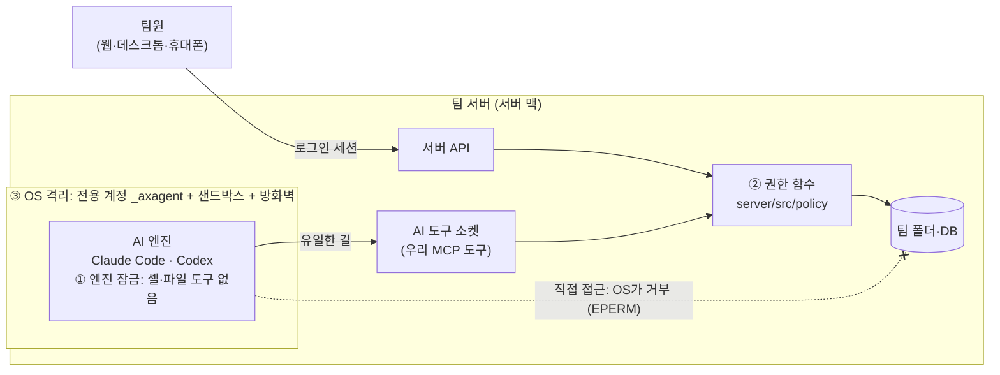

# 권한 구조 요약

Team AX에서 각자 볼 수 있는 범위와, 그 범위를 AI가 넘지 못하게 막는 방법을 정리한 문서입니다.
자세한 근거는 [README의 Security model](../README.md#security-model-defense-in-depth), [DECISIONS.md](DECISIONS.md), 설계서 2·7번 탭에 있습니다.

**한 줄 요약**: 누가 무엇을 볼 수 있는지는 우리 서버의 **권한 함수 하나**가 정합니다. **OS**는 AI가 그 함수를 건너뛰지 못하게 막습니다. **엔진 잠금**은 그 위에 한 겹 더 두는 장치입니다.

## 누가 무엇을 보나

| 위치 | 볼 수 있는 사람 |
|---|---|
| `shared/` | 폴더 규칙대로 (보통 팀 전체) |
| `groups/<그룹>/` | 그 그룹 사람 (관리자가 규칙으로 다른 그룹에 읽기·쓰기를 줄 수 있음) |
| `projects/<프로젝트>/` | 그 프로젝트에 속한 사람 |
| `skills/` (팀 규칙) | 모두 읽기만. 등록은 관리자 |
| `users/<id>/` (개인 폴더) | **본인만**. owner·admin도 못 봄 |
| `.system/` | 아무도 못 봄 (서버 내부용) |
| 채팅 | **본인만**. 관리자 화면의 기록에는 AI가 어떤 파일을 읽었는지만 나오고, 대화 내용은 나오지 않음 |

- 권한이 없는 폴더와 파일은 **이름조차 보이지 않습니다**. "없음"과 "권한 없음"을 같은 답으로 돌려줘서 존재 여부도 알 수 없습니다.
- 파일 화면, AI, 검색, 미리보기, 버전 기록, 휴지통, 실시간 알림이 모두 같은 규칙을 따릅니다.
- 그룹에서 빠지거나 규칙이 바뀌면 **바로** 적용됩니다. AI 도구는 호출할 때마다 권한을 다시 읽고, 권한을 잃은 채팅은 AI 세션을 새로 시작합니다.
- AI는 **묻는 사람의 권한만큼만** 일합니다. alice의 AI는 alice가 볼 수 있는 것만 봅니다.

## 세 겹 구조

| 겹 | 하는 일 | Claude·Codex에 기대나 |
|---|---|---|
| ① 엔진 잠금 | 엔진의 셸·내장 파일 도구를 끄고 우리 도구만 쓰게 함. 엔진 버전마다 회귀 시험(`tests/engine/lockdown-*.ts`)을 통과해야 켤 수 있음 | 예 (엔진마다 설정이 다름) |
| ② 권한 함수 | 사람이든 AI든 모든 파일 읽기·쓰기를 판단함. 사람별, 그룹별, 폴더별로 정함 | 아니요 (우리 코드) |
| ③ OS 격리 | AI 엔진은 권한 없는 숨은 계정 `_axagent`로 돎. 팀 폴더, DB, 다른 채팅 폴더, 홈 폴더를 OS가 직접 거부함. 샌드박스(`scripts/macos/engine.sb`)는 그 턴의 채팅 폴더만 열고, 방화벽은 로컬 모델 프록시만 열어 둠 | 아니요 (macOS) |

## 왜 여러 겹인가

- **③만으로는 사람별로 나눌 수 없습니다.** 모든 팀원의 AI가 같은 계정 `_axagent`로 돌기 때문에, OS는 alice의 AI와 bob의 AI를 구분하지 못합니다. OS는 팀 파일을 다 막거나 다 열 수밖에 없습니다.
- **②만으로는 우회 위험이 남습니다.** AI가 셸이나 자체 파일 도구로 다른 길을 찾으면 권한 함수를 건너뛸 수 있습니다.
- **그래서 ②와 ③은 짝입니다.** ②가 사람별로 허용하고, ③은 AI가 팀 파일에 닿는 길을 우리 도구 하나로 좁힙니다. 그 길 위에 ②가 서 있습니다.
- **①은 덤입니다.** ②와 ③이 있으면 ①이 뚫려도 파일은 새지 않습니다. 그래도 AI가 막힌 길을 헤매는 일을 줄이고, ③이 약한 개발 모드에서 보호를 더합니다.
- 사람마다 OS 계정을 만들고 폴더마다 OS 권한을 거는 방식은 쓰지 않았습니다. 규칙이 바뀔 때마다 수많은 파일의 권한을 다시 걸어야 하고, 공유·휴지통·버전 기록·링크를 맞추기 어렵고, OS마다 방식이 다르기 때문입니다.

## 새 AI 엔진이 나오면

- 새 엔진에 끌 수 없는 자체 파일 도구가 있다면 ①은 뚫릴 수 있습니다.
- 그래도 정식 모드에서는 ③이 막습니다. 그 엔진이 무엇을 쓰든 `_axagent` 계정이 팀 파일을 읽을 권한이 없습니다. 팀 파일에 닿는 길은 도구 소켓 하나뿐이고, 그 뒤에 ②가 있습니다.
- 새 엔진은 잠금 회귀 시험을 통과해야만 켤 수 있습니다. 이 시험은 그 엔진이 실제로 쓸 수 있는 도구 목록이 우리 도구뿐인지 확인합니다.

## 모드별 차이

| | 개발 모드 (`bun run dev`, 지금 데모) | 정식 설치 (`scripts/install-macos.sh`) |
|---|---|---|
| ① 엔진 잠금 | 있음 | 있음 |
| ② 권한 함수 | 있음 | 있음 |
| ③ OS 격리 | 일부만. 샌드박스는 있지만 엔진이 owner의 맥 계정으로 돌고 방화벽이 없음 | 전부 (`_axagent`, 샌드박스, pf 방화벽) |
| Claude 로그인 | owner의 키체인 로그인 | `claude setup-token` 토큰. 서버 계정만 읽고, AI는 턴마다 가짜 토큰만 받음 |

실제 팀원이 실제 데이터로 쓸 때는 정식 설치를 써야 합니다. 정식 설치의 구독 프록시 연결은 지금 마무리 중입니다([OWNER-TODO.md](OWNER-TODO.md) 1번).

## 어떻게 확인하나

- `bun test tests/security`: 모든 API를 역할별(owner, admin, 그룹 안 팀원, 그룹 밖 팀원, 다른 팀원, 로그인 안 함)로 두드리는 권한 시험과 공격 회귀 시험.
- 경로 퍼저(`bun run test:fuzz:fast`): 경로를 비틀어 넣는 무작위 공격(유니코드, 대소문자, `..`, 링크 등)에서 새는 곳이 0이어야 함.
- 엔진 잠금 회귀(`tests/engine/lockdown-*.ts`): 실제 Claude Code·Codex CLI에서 쓸 수 있는 도구가 우리 도구뿐인지 확인.
- 공격 감사: 영역별로 실제 서버를 띄워 공격하고, 다른 에이전트가 재현하고, 고친 뒤 다시 공격함. 결과는 `docs/SECURITY-AUDIT.md`에 정리.

## 알려진 한계

- **서버 맥 관리자는 디스크 전체를 볼 수 있습니다.** 앱 안의 권한은 앱을 거치는 접근에만 적용됩니다. 서버 맥의 관리자 계정과 백업 디스크는 owner만 가져야 합니다.
- **이미 나온 답변은 남습니다.** 폴더 권한을 잃어도, 그 전에 AI가 답변에 인용한 내용은 그 사람의 채팅에 남아 있습니다.
- **AI가 내용을 더 넓은 곳으로 옮길 수 있습니다.** 예를 들어 그룹 폴더 내용을 공용 폴더에 쓰는 경우입니다. 채팅이 읽은 범위보다 더 많은 사람이 보는 곳에 쓰려 하면, 서버가 확인 카드로 먼저 묻습니다. 이 확인은 AI가 끌 수 없습니다.
- **AI 회사로 보내지는 내용이 있습니다.** AI가 읽은 내용은 답을 만들기 위해 Anthropic(또는 OpenAI)으로 전송됩니다.
