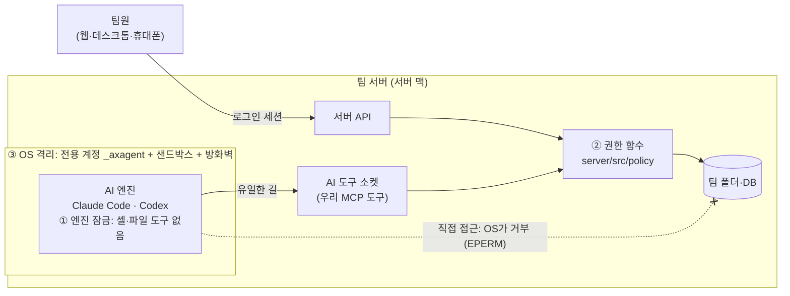

# 권한 구조 요약

Trina AX에서 각자 볼 수 있는 범위와, 그 범위를 AI가 넘지 못하게 막는 방법을 정리한 문서입니다.
자세한 근거는 [README의 Security model](../README.md#what-we-dont-promise), [DECISIONS.md](DECISIONS.md), 설계서 2·7번 탭에 있습니다.

**한 줄 요약**: 누가 무엇을 볼 수 있는지는 우리 서버의 **권한 함수 하나**가 정합니다. **OS**는 AI가 그 함수를 건너뛰지 못하게 막습니다. **엔진 잠금**은 그 위에 한 겹 더 두는 장치입니다.

## 누가 무엇을 보나

| 위치 | 볼 수 있는 사람 |
|---|---|
| `shared/` | 폴더 규칙대로 (보통 팀 전체) |
| `groups/<그룹>/` | 그 그룹 사람 (관리자가 규칙으로 다른 그룹에 읽기·쓰기를 줄 수 있음) |
| `projects/<프로젝트>/` | 폴더 규칙대로. 팀 프로젝트는 여기에만 만든다: 팀원도 만들 수 있고(관리자 › 팀 설정에서 관리자만으로 바꿀 수 있음), 서버가 새 폴더를 시스템으로 만들어 고른 사람·부서와 만든 사람에게 읽기·쓰기, 나머지 모두에게 `권한 없음`(바닥 규칙) 규칙을 쓴다. 그래서 팀 맨 위를 "모두 읽기"로 열어도 열리지 않는다. **안의 파일·채팅·지침·스킬은 멤버만 본다**: 팀장·관리자도 멤버일 때만이다(이 폴더 아래에서는 팀원처럼, 이 폴더와 그 아래 규칙으로만 판단; 역할 규칙과 위 폴더 규칙은 들어오지 않는다). 팀장·관리자는 모든 팀 프로젝트의 이름·만든 사람·멤버 수를 보고(`GET /api/projects?manage=1`), 멤버를 바꾸고(자기를 더하는 **나를 멤버로 추가** 포함: 활동 기록에 남고 멤버에게 알림이 간다), 이름을 바꾸고, 지우고 되살린다. 누가 어떤 길로든(부서에 더해져서, 그 부서로 새 계정이 생겨서) 프로젝트를 보게 되면 `project.member_gained` 기록과 멤버에게 조용한 알림이 남는다. 관리자 › 폴더 권한은 `projects/<이름>`과 그 안에 규칙을 쓰지 않고 "멤버만"으로 보여 준다. `projects/` 자체는 옮기거나 이름을 바꾸거나 휴지통에 넣을 수 없고, 프로젝트 폴더는 `projects/` 밖으로 옮길 수 없다. 프로젝트를 지우면 폴더와 함께 휴지통으로 가고(팀장·관리자가 되살리거나 완전히 지운다), 휴지통에 있는 동안은 아무도 안을 보지 않는다. 볼 수 있는 사람(멤버)은 만든 사람과 관리자가 프로젝트 페이지의 **멤버** 줄 › 관리(또는 목록 카드의 ⋯ › 멤버)에서 바꾸며, 관리자 › 폴더 권한과 같은 길(규칙 해시 확인, 권한 회수 처리, 감사 기록)로 저장된다. 팀원이 만든 사람이면 서버가 만든 폴더일 때만 바꾼다. 사람이 늘어날 때, 또는 저장이 고르지 않은 규칙(예전 폴더에 없던 바닥 규칙, 폴더 권한에서 빠진 만든 사람의 규칙)도 쓸 때는 서버가 미리 계산한 내용(다른 사람이 올린 파일 수, 공유 채팅, 프로젝트 스킬, 못 보게 되는 사람 수)으로 한 번 묻는다. 다른 멤버는 몇 명이 보는지와 누가 바꾸는지만 본다. 만든 사람과 관리자는 자기 AI 채팅에서 AI에게 바꿔 달라고 할 수도 있다(`change_project_members`): 서버 카드 한 장에 넣고 빼는 사람·부서가 모두 나오고, 누를 때만 같은 길로 저장된다. 만든 사람이 지워지면 그 규칙만 사라지고 바닥 규칙이 남아, 멤버가 없으면 아무도 열지 못한다(팀장·관리자가 멤버를 더한다). 프로젝트에는 따로 구성원 명단이 없다: 프로젝트(이름·지침)는 그 폴더를 읽을 수 있는 사람에게 보이고, 폴더 하나에 프로젝트 하나다. 개인 프로젝트는 `users/<나>/projects/<이름>`에만 둔다. 예전에 다른 폴더에 만든 프로젝트는 그 폴더 규칙대로 그대로 쓰이고, 그 폴더는 보통 팀 폴더라 팀장·관리자도 본다. 서버 자체의 백업은 모든 파일을 담는다(복원에 필요): 앱의 규칙이고, 서버 디스크·셸·백업을 다루는 사람은 모두 읽을 수 있다. 관리자가 팀원의 비밀번호를 다시 정하거나 계정을 만들면 그 사람으로 로그인할 수 있다: 그 사람은 로그아웃되고 기록에 남는다 |
| `skills/` (팀 스킬·팀 규칙) | 모두 읽기. 바꾸는 사람은 **스킬 관리자**: owner·관리자, 그리고 관리자가 팀 스킬 화면의 "고칠 수 있는 사람" **[바꾸기]**로 맡긴 사람·그룹(`skills/` 전체) 또는 폴더 권한에서 `skills/재무/` 같은 하위 폴더에 쓰기를 준 사람·그룹 |
| `skills//` (restricted team skills) | The folder rules, the same as for files. Only people who can **read** the folder see and use its skills. See "Skills" below. |
| `users/<id>/skills/` (personal skills) | **The owner only**, the same as all of `users/<id>/`. Owner and admins cannot see them. |
| `projects/<name>/skills/` (project skills) | The folder rules of the project's folder (its members: the owner and admins only as members): who **reads** it gets them, **only in that project's chats**; who **writes** it changes them (the AI after a card). A rule on `projects/<name>/skills/` narrows them. See "Skills" below. |
| 스킬 제안 ("스킬로 제안") | 제안한 사람과 **제안을 넣을 폴더의 스킬 관리자**만. 다른 사람에게는 있다는 것도 안 보임 |
| 내 스킬 가져오기 (공유 제안) | **만든 사람만** (owner·관리자만 만들 수 있음). 다른 관리자도 못 봄(404). 멤버는 만들 수 없고(403) 지금처럼 "스킬로 제안"을 씀 |
| `users/<id>/` (개인 폴더) | **본인만**. owner·admin도 못 봄. 단, 그 사람을 지우면 기본(`personalFolder=transfer`)으로 폴더가 owner의 개인 폴더 안 `보관된 계정/<id>/`(팀 기본 언어 이름)로 옮겨지고 그때부터 **owner만** 봄(채팅 첨부 `.attachments/`는 지움). 그 안의 개인 프로젝트(이름·지침)도 폴더를 따라가 owner에게 보임. 그 사람이 개인 폴더에 있을 때 저장된 이전 버전은 보통 owner에게도 안 보임. 지운 사람이 admin이어도 owner에게 감. `personalFolder=delete`(API)면 함께 지움 |
| `.system/` | 아무도 못 봄 (서버 내부용) |
| 채팅 | **본인만**. 관리자 화면의 활동 로그에는 AI가 어떤 파일을 읽었는지만 나오고, 대화 내용은 나오지 않음. **공유 프로젝트 채팅**은 그 프로젝트 폴더를 지금 읽을 수 있는 사람(`projects/` 안의 프로젝트는 멤버만, owner·관리자도 멤버일 때만; 폴더가 휴지통에 있으면 아무도). 아래 "공유 프로젝트 채팅" |

- 권한이 없는 폴더와 파일은 **이름조차 보이지 않습니다**. "없음"과 "권한 없음"을 같은 답으로 돌려줘서 존재 여부도 알 수 없습니다.
- 파일 화면, AI, 검색, 미리보기, 버전 기록, 휴지통, 실시간 알림이 모두 같은 규칙을 따릅니다.
- 관리자 > 폴더 권한에서 `shared/`와 `skills/`는 규칙을 모두 지울 수 없습니다(규칙이 없으면 팀원은 팀 폴더 맨 위의 규칙을 따르는데, 기본으로는 맨 위에 규칙이 없어 팀장과 관리자만 보게 됩니다. 팀장과 관리자만 보게 하려면 "모두: 권한 없음" 규칙을 둡니다). 맥(대소문자를 가리지 않는 볼륨)에서는 대소문자만 바꾼 이름(`Shared`)도 같고, 리눅스에서 `Shared`는 다른 폴더라 보통 폴더로 다룹니다. 그룹 폴더 항목은 그룹이 있는 동안 지울 수 없고, 휴지통에 있는 폴더의 항목은 목록에 나오지 않습니다. 규칙을 모두 지우기 전에는 누가 어떤 권한을 얻고 잃는지 서버가 계산해 보여 줍니다(권한은 사람마다 위로 올라가며 그 사람에게 맞는 가장 가까운 규칙으로 정해집니다).
- 관리자 > 폴더 권한 > 폴더별은 팀 폴더를 맨 위부터 트리로 보여 줍니다. 줄마다 볼 수 있는 사람과 그 권한이 어느 폴더의 규칙에서 오는지, 계산된 위험(팀 전체가 쓸 수 있는 폴더, `skills/` 아래를 모두가 쓰는 경우, 맨 위의 "모두" 규칙)이 나오고, 폴더를 고르면 사람마다 권한과 이유가 나옵니다. `users/`는 한 줄(사람 수)로만 보이고 안을 나열하지 않습니다. 디스크에 없는 폴더의 규칙은 트리 아래에 따로 모여 지울 수 있습니다. 모두 서버의 같은 권한 함수로 계산한 것이고, 이 화면은 권한을 정하지 않습니다.
- **파일 화면의 "열 수 있는 사람"**(빵부스러기 끝의 칩, 폴더 ⋯ 메뉴; DECISIONS "열 수 있는 사람, 드라이브 공유 창처럼"): 관리자에게는 구글 드라이브 공유 창처럼 그 폴더를 열 수 있는 사람과 부서(볼 수 있음 / 고칠 수 있음), 공개 범위 하나, 위 폴더에서 오는 사람(흐리게, "'영업' 폴더에서 · 거기서 바꾸기")이 나오고, 그 자리에서 추가·변경·빼기와 공개 범위를 바꿔 저장합니다. 저장은 관리자 > 폴더 권한의 편집 창과 같은 코드·같은 서버 확인(관리자만, `users/` 불가, `shared/`·`skills/`는 규칙 하나 이상, 규칙 해시, 감사 기록)을 거치고, 저장 직전에 서버에 다시 묻고, 더 많은 사람이 열게 되는 변경은 한 번 묻습니다. 바꾸는 동안 얻거나 잃는 사람을 이름으로 말합니다(가장 깊은 폴더의 규칙이 이겨서, 부서를 더하면 위 폴더에서 고칠 수 있던 사람이 보기만 하게 될 수 있음). 팀 프로젝트 폴더와 그 안은 이 창에서 바꾸지 않고(프로젝트 멤버에서), 관리자 API도 묻지 않습니다. 팀원은 **자기가 쓸 수 있는 폴더**에서만 몇 명이 열 수 있는지(팀장·관리자 포함)나 팀 전체인지를 보고, 내 폴더는 "나만 열 수 있어요", 팀 프로젝트 폴더는 프로젝트의 인원 수(`Project.audience`)를 봅니다. 이름·그룹·역할·볼 수 있음/고칠 수 있음·쓸 수 있는 사람 수·규칙이 있는 폴더는 보이지 않습니다. 읽기만 하는 폴더에는 수를 주지 않습니다(이동만 하는 폴더 아래에서 다른 그룹의 인원이 드러나기 때문). 쓸 수 있는 폴더의 수는 복사 미리보기(`viewersAdded`)로 이미 알 수 있는 값이고, 수를 폴더끼리나 시간에 따라 비교하면 규칙이 좁히는 곳이나 꺼진 사람이 보던 곳을 짐작할 수 있다는 점도 그 미리보기와 같습니다(`GET /api/files/audience`, DECISIONS "폴더를 볼 수 있는 사람, 그 자리에서").
- 폴더를 고르고 "규칙 바꾸기"를 누르면 그 자리에서 편집 패널이 열립니다(휴대폰에서는 화면 전체). 먼저 **기본 접근**(아래에 정하지 않은 모든 팀원)을 고릅니다: 위 폴더 따르기(그 폴더에 "모두" 규칙 없음) / 정한 사람만("모두: 권한 없음") / 모두 읽기 / 모두 읽기·쓰기. "위 폴더 따르기"는 지금 그것이 무엇을 뜻하는지 서버가 계산해 보여 주고, 팀 폴더 맨 위에는 따를 폴더가 없으며, 연결 폴더(원본에서 한쪽으로만 복사)에는 "모두 읽기·쓰기"가 없습니다. 그다음 **사람과 그룹**을 검색해 더하고 각각 읽기·읽기·쓰기·권한 없음을 정합니다(사람 규칙이 그룹보다 먼저, 여러 그룹이면 가장 넓은 권한). 바꾸는 동안 서버가 같은 권한 함수로 누가 권한을 잃고 얻는지(쓰기→읽기도 줄어듦), 그 아래 규칙이 있는 폴더 중 같이 바뀌는 곳, 경고(shared·skills를 팀원의 AI가 못 읽게 됨, skills에서 모두가 쓰기 = 모두 스킬 관리자, 맨 위를 모두에게 엶)를 계산해 보여 주고(`POST /api/admin/access/edit-preview`, 저장하지 않음), 저장 버튼이 그 수를 말합니다. 예전 역할 규칙("팀원 전체"는 같은 뜻의 "모두"로, 효과가 없는 "관리자 전체"는 빠짐)은 저장할 때 정리되며 누구의 권한도 바뀌지 않습니다. 저장은 시작할 때 규칙의 해시(`Folder.rulesHash`)를 함께 보내고, 그사이 다른 관리자나 팀 스킬 화면의 "고칠 수 있는 사람" 창이 규칙을 바꿨으면 서버가 거부(409)해 패널이 다시 계산하고 알려 줍니다. "위 폴더 따르기"는 규칙을 비워 저장하는 것이고(행을 지우지 않음: 그룹 연결과 프로젝트 표시가 남음), "규칙 모두 지우기"는 정리용으로만 남았습니다(디스크에 없거나 트리에 안 보이는 폴더의 행, 프로젝트가 쓰지 않는 빈 행).
- 그룹에서 빠지거나 규칙이 바뀌면 **바로** 적용됩니다. AI 도구는 호출할 때마다 권한을 다시 읽고, 권한을 잃은 채팅은 AI 세션을 새로 시작합니다.
- AI는 **묻는 사람의 권한만큼만** 일합니다. alice의 AI는 alice가 볼 수 있는 것만 봅니다.
- **AI의 삭제는 휴지통으로만, 카드 뒤에서**(`delete_files`). 파일 화면의 삭제와 같은 권한(각 항목에 쓰기)에 더해, 관리자·owner의 AI라도 최상위 폴더, 부서·프로젝트·규칙 폴더(와 그런 폴더가 든 폴더), 스킬 폴더(`skills/`, 부서·프로젝트·개인 스킬)와 그 안·그것이 든 폴더, 남의 개인 폴더, `.system`, 채팅 첨부(`.attachments`), 숨긴 항목, 지침 파일(CLAUDE.md 등), 개인 프로젝트를 포함한 프로젝트 폴더, 플러그인 폴더, 열린 업로드 링크의 대상은 휴지통에 넣지 못합니다. 사람의 **개인 채팅**에서만(대화방, 공유 채팅, 다른 사람의 메시지나 대화방 내용이 들어온 채팅, Slack, 기밀 채팅, 예약 실행, 하위 작업은 바로 거절) 한 번에 200개(폴더 안까지 셈)까지, 질문한 사람이 서버 카드에서 경로 전체·다른 사람의 파일·볼 수 없게 되는 사람 수(그중 되살릴 수 없는 사람 수는 팀장·관리자에게만: 그 폴더에 쓸 수 있는 사람 수를 알려 주기 때문에, 다른 사람에게는 쓰기 권한이 없으면 되살릴 수 없다는 안내만)·휴지통에서 지워지는 날짜를 보고 "예"를 눌러야 하며, 그 "예"는 카드가 보여 준 그대로(디스크의 항목, 볼 수 있는 사람, 보관 일수)일 때만 통합니다. 대화방의 "항상 허용"이나 이전 답은 이 카드를 대신하지 않습니다. 커넥터에는 이 도구가 없습니다. 근거: [DECISIONS.md](DECISIONS.md) "AI가 휴지통으로 옮기기".
- **AI가 대화방에 올리기**(`post_to_room`): 내 채팅(사이드 채팅 포함)의 AI는 내가 들어가 있는 대화방이나 그 스레드에 내 메시지로 올릴 수 있지만, 서버 카드에서 내가 [보내기]를 눌러야 올라갑니다(방 이름과 사람 수, 올라갈 글 전부, 못 보는 사람 수). 확인은 답 아래 "대화방에 보내기"와 같고, 감사 기록 `room.answer_share`에 `via: 'ai'`가 붙습니다. 예약 작업, 기밀 채팅, 공유 프로젝트 채팅, 대화방의 @트리나, Slack에서 물은 대화, 하위 작업에는 없습니다. DECISIONS "post_to_room".
- **예약 작업의 저장·보내기는 카드에서 한 번**(DECISIONS "Scheduled tasks: saving and sending allowed on the card"). 예약 실행에는 카드에 답할 사람이 없어서, 예약 작업을 만들거나 고치거나 다시 확인할 때 나오는 카드에 줄을 더해 미리 허용받습니다: "새 파일 저장: <폴더> (지금 N명이 볼 수 있어요). 넣어도 되는 내용: <곳>"과 "보낼 수 있는 곳: <내 연결> · '<받는 곳>'". 그 실행은 그 폴더(와 따로 권한 설정이 없는 하위 폴더)에 **새 파일만**(한 번에 20개까지) 만들고, 같은 실행이 만든 파일만 고칩니다. 덮어쓰기·옮기기·복사·이름 바꾸기·삭제, 스킬 폴더, 지시 파일, 숨김·플러그인 폴더, save_url, 영상은 안 됩니다. 그 폴더보다 적은 사람이 보는 곳이나 대화방을 카드에 없는데 읽었다면 거기에 저장하지 않고 내 폴더에 저장하며 이유를 말합니다. 내 연결(개인 연결)은 카드에 고정한 받는 곳으로만 보내고, 받는 곳을 알 수 없는 호출이나 보내는 내용에 고정하지 않은 주소·도메인·무작위 문자열이 든 호출은 거절합니다(미리보기로 데이터가 나갈 수 있어서). 실행이 내 폴더에 새 파일을 저장하는 것은 대화방을 읽은 뒤에도 됩니다. 단, 예약 작업을 허용한 뒤 AI가 내 폴더에 쓴 파일은 "내 폴더"로 치지 않습니다. 폴더를 옮기거나 이름을 바꾸거나 지우거나, 폴더 권한 설정이 바뀌거나, 내 쓰기 권한이 없어지면 허용이 멈추고(부서에 사람이 들어오고 나가는 것은 상관없음) 알림이 한 번 오며, **다시 확인**을 누를 때까지 결과는 내 폴더에 저장합니다.
- **내 스킬 가져오기**(DECISIONS "SK"): owner나 관리자가 자기 Claude 스킬을 팀에 넣는 길. 고른 `.claude` 폴더(브라우저·데스크톱 앱)나 Claude Code(커넥터의 `share_skills`)가 보낸 스킬은 **공유 제안**으로만 서버에 남고, 파일은 팀 폴더 밖(`<data>/skill-shares/<id>/`)에서 기다립니다. 비밀 키가 든 스킬은 어디에도 쓰지 않습니다. 그 사람이 [팀에 공유]를 눌러야 그 사람 권한으로 저장되고(스킬 제안 승인과 같은 길: 폴더 규칙, 버전, `skills/` 변경 기록과 알림), 이름이 같은 팀 스킬은 바로 덮어쓰지 않고 채팅에서 확인 카드를 거쳐 합칩니다. 도구 연결은 키 없이 템플릿으로만 들어가 팀원이 각자 연결합니다.
- **커넥터는 스킬을 쓰지 못합니다.** 바깥 AI 앱(커넥터)은 `skills/`뿐 아니라 그룹·프로젝트 스킬(`groups/<g>/skills/`, `projects/<name>/skills/`)과 개인 스킬 `users/<id>/skills/`에도 쓰지 못합니다(write, edit, upload_file, create_upload_link와 그 PUT 모두, 대소문자 무관). 앱의 확인 카드를 바깥 모델이 대신할 수 없기 때문입니다. `users/<id>/`의 다른 파일은 그대로 쓸 수 있습니다.
- **팀 스킬은 따로 조심합니다.** `skills/`의 내용은 팀 전체 AI가 따르는 지침입니다. 그래서 "팀 스킬 관리"는 별도 권한 표가 아니라 `skills/`(또는 하위 폴더)의 **쓰기 규칙** 그 자체입니다(폴더 권한 화면에도 같은 규칙으로 보임). 스킬 관리자의 AI라도 `skills/`에 저장하기 전에는 서버가 바뀌는 내용을 보여 주며 확인을 받고(AI가 대신 답할 수 없는 카드), 확인이 없으면 쓰지 않습니다. 사람이든 AI든 `skills/`가 바뀌면 감사 기록에 남고, owner·관리자에게 버전 기록 링크가 붙은 알림이 갑니다.
- **대화방을 읽은 채팅의 카드.** 내 AI 채팅(사이드 채팅 포함)이 대화방을 한 번 읽으면, 그 뒤로 무언가를 바꾸는 일은 질문한 사람의 카드가 먼저입니다(방 사람의 글이 AI를 움직일 수 있어서). 예외는 둘입니다. 첫째, **내 폴더(`users/<나>/`)에 새 파일**을 만들거나 이번 답에서 만든 파일을 고칠 때는 묻지 않습니다(나만 보는 곳; 단계 줄 "내 폴더라 묻지 않고 저장"). 내 스킬(`users/<나>/skills/`), CLAUDE.md 같은 지시 파일, `.attachments`, 프로젝트 폴더(개발 환경이 파일 이름으로 실행할 수 있음), 이번 답 전에 있던 파일, 파일 받아 저장(save_url)은 계속 묻습니다. 둘째, **팀 폴더의 새 파일**은 카드의 [이번만 허용]이 그 답이 끝날 때까지 같은 폴더의 새 파일을 덮습니다. 채팅이 읽은 모든 방의 사람 모두가 그 폴더에 쓸 수 있을 때만이고, 웹·검색·연결 서비스를 쓰거나 대화방 목록을 본 채팅(새 세션 전까지)과 예약 실행에는 없습니다. 자기 방 하나만 읽은 사이드 채팅에는 [이 방에서는 항상 허용]도 나오며, 대화방의 것과 같은 허용(30일, 새 파일만, 방에 사람이 들어오면 사라짐)이라 설정 › 트리나에게 허용한 것에서 지웁니다. 더 많은 사람이 보는 곳에 저장하는 카드는 그대로 묻습니다. AI가 대화방·웹·연결 서비스 내용을 본 채팅에서 내 폴더에 쓴 파일은, 나중에 다른 채팅이 읽으면 바깥 내용으로 셉니다(기억하기 카드가 다시 나옴). 복사본·복원한 파일도 같은 내용이면 같습니다. 근거: [DECISIONS.md](DECISIONS.md) "대화방을 읽은 뒤 카드 줄이기".

## 공유 프로젝트 채팅 (Shared project chats)

근거: [DECISIONS.md](DECISIONS.md) "Shared project chats".

- **누가 보나.** 공유 채팅은 그 프로젝트를 볼 수 있는 사람(`canSeeProject`: 폴더를 읽을 수 있는 사람; `projects/` 안의 프로젝트는 멤버만, owner·관리자도 멤버일 때만) 모두가 보고 이어 갑니다. 명단은 저장하지 않고 그때의 폴더 규칙으로 정하므로, 권한을 잃으면 만든 사람에게도 바로 안 보이고, 새로 권한을 얻으면 지난 대화도 모두 보입니다. 바깥 사람에게는 없는 채팅과 같은 404입니다.
- **언제 공유되나.** 팀 프로젝트의 만든 사람이나 관리자가 설정을 켠 뒤 새로 만든 채팅만. 개인 프로젝트는 공유할 수 없고(409 `project_personal`), 안전 작업 모드(1A)에서는 켤 수 없으며 그동안 만든 채팅은 공유되지 않고 이미 공유된 채팅은 읽기 전용입니다(409 `safe_ops`). 기존 채팅·옮겨 온 채팅은 만든 사람이 공유하기 전까지 본인만 봅니다(아래 "기존 채팅 공유"). 설정을 꺼도 이미 공유한 채팅은 그대로입니다. 공유 채팅은 다른 프로젝트로 옮길 수 없습니다(409).
- **누구 권한으로 도나.** 답 하나하나가 **보낸 사람의 것**입니다: 그 사람의 권한, AI 연결, 엔진, 예산, 대기열, 사용량. 한 채팅에 한 번에 한 답만(409 `shared_chat_busy`). 멈추기와 카드는 질문한 사람만, 이름·엔진은 만든 사람만, 삭제·복원은 만든 사람이나 프로젝트를 고칠 수 있는 사람만, 고치기·다시 답하기는 자기 메시지만.
- **읽기 카드.** 공유 채팅에서 AI가 채팅을 보는 사람 중 일부가 못 여는 곳(내 폴더, 다른 그룹 폴더, 관리자만 보는 곳)을 읽으려 하면, 서버가 먼저 질문한 사람에게 "읽고 공유하기 / 읽지 않기" 카드를 띄웁니다. 아니요·시간 초과·예약 실행은 경로를 말하지 않는 거절입니다. 파일 도구, 검색(경로 없는 검색은 프로젝트 폴더만), 스킬과 "/이름", 첨부한 팀 파일, 하위 작업 모두 같습니다. 감사 기록에는 결정과 숫자만 남고 이름은 없습니다(`chat.shared_read`).
- **AI 세션.** 같은 사람의 이전 세션만 이어 씁니다. 사람이 바뀌거나 그 사이 프로젝트에 새로 들어온 사람이 채팅이 읽은 곳을 못 보면, 보이는 대화를 쓴 사람 이름과 함께 새 세션에 넣습니다. 답마다 채팅의 엔진 폴더를 먼저 비웁니다(못 비우면 답을 시작하지 않음). 권한이 줄어 세션을 지울 때는 다른 사람의 공유 채팅에 남긴 그 사람의 세션도 지웁니다.
- **보이는 것.** 단계 줄과 바뀐 파일 목록은 그 경로를 볼 수 있는 사람에게만 경로가 보입니다. 사용량, 실패 이유, 진행 중인 답과 카드는 질문한 사람만 봅니다. 기억(memories), 연결 서비스, Google Drive, 브라우저, 개발 환경, 대화방 읽기는 공유 채팅에 없습니다. 첨부는 팀 파일만(컴퓨터 파일은 409).
- **기존 채팅 공유.** 채팅을 공유하는 팀 프로젝트에 있는 내 채팅(설정 전에 만들었거나 옮겨 온 채팅)은 **만든 사람만** 프로젝트 사람들과 공유할 수 있습니다(`POST /api/chats/:id/share`; 옮기기 창의 "프로젝트 사람들과 공유" 스위치, 채팅 제목 메뉴의 "프로젝트 사람들과 공유…"). 다른 사람에게는 없는 채팅과 같은 404입니다. 서버가 먼저 **모든 분기**에서 이 채팅이 쓴 것을 확인합니다: 답마다 읽은 파일, 세션이 읽은 곳(다른 그룹 폴더, 내 폴더, 개인 연결, Drive, 브라우저, 대화방), 개인 메모리. 개발 환경 명령을 돌린 답이 있거나 이전 세션의 기록이 없으면 "다 알 수 없어요"로 보고 모두를 셉니다. 프로젝트 사람(나 빼고) 중 누군가 볼 수 없는 것이 있으면 "이 채팅을 프로젝트 사람 N명과 공유할까요?" 확인을 먼저 띄우고, 몇 명이 못 보는지와 **내가 볼 수 있는 곳만** 이름으로 말합니다(사람 이름은 말하지 않음). 그 사이 사람·권한·메시지가 바뀌면 다시 묻습니다. 확인할 게 없으면 옮기기 창의 스위치로는 바로 공유하고, 제목 메뉴에서는 그래도 한 번 묻습니다. 확인은 대화방 보내기와 같은 횟수 제한을 씁니다(429). 공유하면 내 이전 AI 세션은 지우고(메모리가 담겨 있어서), 그 뒤의 읽기는 읽기 카드를 거칩니다. 공유 전 답의 단계 줄은 그 답을 받은 사람에게만 전체가, 다른 사람에게는 동작 이름만 보입니다. 되돌릴 수 없습니다. 개인 프로젝트, 안전 작업 모드·기밀 채팅, 예약 작업 채팅, 휴지통에 있는 프로젝트, 답하는 중인 채팅은 409입니다. 감사 기록(`chat.share`)에는 숫자와 확인 여부만 남습니다.
- **되돌림 대비.** 이 기능을 모르는 이전 버전이 공유 채팅에서 돌린 답이 있으면, 다시 이 버전으로 올라올 때 그 채팅은 공유가 풀립니다.
- **대화방의 트리나가 읽기.** 대화방에서 "@트리나 견적 프로젝트 채팅에서 뭐 정했는지 요약해 줘"처럼 물으면, AI가 **질문한 사람이 지금 볼 수 있는** 공유 채팅만 찾아 읽습니다(`project_chats`, `project_chat`: 읽기만 하고 카드 없음). 휴지통에 있는 채팅, 폴더가 휴지통에 있는 프로젝트의 채팅(누구도), 기밀 채팅, 공유가 풀린 채팅은 없고, 볼 수 없는 채팅은 없는 채팅과 같은 답(제목 없음)입니다. 읽은 내용은 그 프로젝트 폴더를 읽는 사람(= 채팅을 보는 사람)의 것으로 셉니다: **대화방 사람 모두가 그 프로젝트를 보면** 답이 대화방에 올라가고, 한 명이라도 못 보면 질문한 사람에게만 보이는 답이 됩니다(파일을 일부만 읽을 수 있을 때와 같은 방식). 목록·검색은 기본으로 대화방 사람 모두가 보는 프로젝트에서만 찾고, AI가 `include_all`로 질문한 사람의 다른 프로젝트까지 찾으면 결과와 상관없이 그 프로젝트 모두를 본 것으로 셉니다("찾는 채팅이 없어요"도 그 프로젝트들에 대해 알려 주기 때문: 파일 검색과 같음). 단계 줄에는 대화방 모두가 그 프로젝트를 볼 때만 채팅 제목이 나옵니다. 대화 내용은 AI에게 정보로만 전해지고(지시가 아님), 바꾸는 일은 여전히 질문한 사람의 카드가 먼저입니다. 감사 기록(`room.ai_shared_chats`)에는 숫자와 결과(대화방/나만)만 남습니다. 공유 채팅 안이나 개인 AI 채팅에서는 이 도구가 없습니다. 안전 작업 모드(1A)에서는 대화방의 트리나가 꺼져 있습니다.

## Skills: who sees which skill

A skill is an instruction that the person can read. It never gives more access. Decisions: [DECISIONS.md](DECISIONS.md) "Skills: folder permissions and personal skills".

- **Team skills use the folder rules.** A skill in `skills//` (any depth) is visible and usable only by the people who can read that folder. Admins set this in Admin > Folder permissions, the same as for any folder. A folder rule that applies to nobody falls back to the rules of the folder above (`skills/`: everyone reads). Thus, to limit `skills/finance/`, set "Everyone: No access" and give read access to the finance group. Skills directly in `skills/` stay team-wide.
- **Personal skills** are in `users/<id>/skills/` (a `.md` file with a skill header, or a `<name>/SKILL.md` folder). Only the owner sees and uses them. Owner and admins cannot see them. The owner can suggest one to the team with "Suggest as skill" on the Files screen. A manager of the target folder reviews it.
- **One rule for every path.** The skill list is always the list of the person who runs the turn: the "/" menu (`GET /api/skills`), the skill list in the AI instructions, the AI's `skill` and `find_skills` tools (also in sub-agents; each call checks again), "/name" in a message, `skills_list` of the remote MCP connector, popular skills on the home screen, skill issues and the skill screens. In a shared project chat, this is the person who sent the message. In a scheduled task, this is the owner of the schedule.
- **Same name.** When a personal skill has the same name as a team skill, the personal skill replaces the team skill for its owner only. The screens show it as "Personal".
- **Project skills** are in `projects/<name>/skills/<skill>/SKILL.md` of a team project on exactly `projects/<name>`. They are used only in that project's chats (private, shared and scheduled), by the people who read its folder (its members; the owner and admins only as members); never in rooms or other chats. A project only adds names: personal > group > team > project. A skill moves between levels with 옮기기… on the Skills page (write on both places; the whole text is shown before more people get it), or with the AI's `move_skill`, which proposes the same moves, and copies (`keep`: read on the original, write on the target; a same-name project copy is refused), after the server's card: who gains and loses it (by name to the owner, admins and a project's creator for its side; counts for everyone else), SKILL.md, every file. Decisions: [DECISIONS.md](DECISIONS.md) "Project skills".
- **Skill folders and the AI's file actions**: the AI's `move_files`, `copy_files` and `rename_file` never touch a skill folder (`skills/`, `groups/<g>/skills`, `projects/
/skills`) or a group's or project's folder that holds one. Its `skill_files` does three things, one item per call, only in the person's own chat with the main AI (not in rooms, shared chats, chats others wrote in, scheduled or template runs, confidential chats, drafts or sub-agents), each after the server's card with the full paths: rename a group's or project's folder that holds skills when nobody gains or loses anything (admins only, as on the Files screen), or a skill's own folder with its `name:` line; take files, skills or rules out (the card names the skills and how many lose them; names only to the owner, admins and a project's creator); put a SKILL.md folder of text files in (every file in full on the card, who gets it and may change it). Never a picture, media or any other file that is not text (the user uploads those on the Files screen), never a single file (a `.md` would be a team rule), an instruction file, never into a skill folder from a chat that read a room. The card's yes is bound to every file's hash, the target, the readers and editors, and checked again by the file service right before the change; without that one-call grant the service refuses an AI turn's move or copy into or out of a skill folder. A skill save's approval (write, edit, make_file) is good for one call. Dev-environment runs never write the project's or the person's skills folder. Decisions: [DECISIONS.md](DECISIONS.md) "Skill folders: the AI's file actions".
- **No usage records for personal skills.** Admin > Usage and popular skills count team skills only, so no admin sees the name of a personal skill.
- Team rules (a `skills/*.md` file without a skill header) are unchanged. A file without a header in `users/<id>/skills/` is not a rule.

### Who reviews a skill proposal

As the code works today (`server/src/skills/suggestions.ts`, `server/src/skills/share.ts`; DECISIONS "Group skills", "MC — Members contribute their own skills and files", "SK"). A "manager" of a folder is anyone who may write it; for a team folder that always includes the owner and admins. Whoever approves saves it with their own rights.

| Proposal | Who sends it | Who reviews it |
|---|---|---|
| "스킬로 제안" into the team's `skills/` | anyone: a file of their own personal folder, or an AI answer in their own chat | the managers of the target skills folder (the proposer too, when they are one) |
| A member's skill folders ("내 스킬 가져오기", MC) | members only | the owner and admins only |
| "내 스킬 가져오기" to the team (share proposal) | the owner and admins only | the proposer only, while still owner or admin |
| A share proposal to a group | the owner or an admin who is in the group and may write its skills folder | the group's members who may write its skills folder (the proposer included); the owner and admins outside the group do not see it |
| "스킬로 제안" into a group's skills (`groups/<g>/skills/`) | a member of that group | the group's members who may write that folder; the owner and admins outside the group do not see it |

## AI 연결 (관리자 > 연결 > 제공자)

AI가 답할 때 쓰는 계정(Claude 구독 토큰, API 키, ChatGPT 로그인)입니다. 자세한 근거는 [DECISIONS.md](DECISIONS.md) "AI 연결".

| 대상 | owner | admin | 팀원 |
|---|---|---|---|
| 팀 AI 연결 목록·상태·이번 달 사용량 | 봄 | 봄 | 못 봄 |
| 연결 추가·토큰 교체·ChatGPT/Claude 로그인 | 함(비밀번호 없음: 공식 제공사 주소로만 감) | 함(비밀번호 없음; 소유자가 추가한 연결의 키도 교체) | 못 함 |
| 이름·순서·끄기·지정·월 한도·삭제, "팀원 개인 연결"·구독 공유 스위치 | 함 | 함(소유자가 추가한 연결도) | 못 함 |
| 팀 API 엔진 설정(자기 비밀번호 다시 입력) | 함(내부망·이 서버 주소도) | 함(인터넷의 공개 https 주소만; 주소(경로 포함)를 바꾸면 이전 키는 새 주소로 가지 않고 새 키를 함께 보내야 함) | 못 함 |
| 다시 확인 | 함 | 함 | 못 함 |
| 관리자가 바꾸면 | 알림(누가·무엇을, 키는 없음): 지금 보고 있으면 바로, 아니면 받은편지함에 남음 | - | - |
| 개인 연결 | 남의 것: 있다는 것·이름·종류·상태만 보고 끄기·삭제 가능(팀 정책), 내용은 못 봄 | **팀원의 것만** 끄기·삭제(그 팀원에게 알림). 이름·순서·한도·키 교체는 못 함. 소유자나 다른 관리자의 것은 아무것도 못 함 | 본인 것만 추가·삭제·봄(스위치가 켜졌을 때만 추가). 본인 로그인이 다른 사람의 시작을 막으면 소유자는 누구의 것이든, 관리자는 팀원의 것만 중단할 수 있음(본인에게 알림; 관리자·소유자의 것은 소유자만) |
| 비밀값(토큰·키·ChatGPT 토큰) | **아무도 못 봄**(어떤 응답·로그·감사에도 없음) | 같음 | 같음 |
| 어떤 연결로 답했는지 | 사용량 화면에서 연결별 합계 | 같음 | 못 봄 |

- 어떤 연결이 답하는지는 서버가 정합니다: 본인 연결(팀이 허용했을 때) → 사람 지정 → 그룹 지정 → 팀 전체. **남의 개인 연결은 어떤 경우에도 다른 사람의 질문에 쓰이지 않습니다.**
- 그룹이나 사람을 지우면 그 그룹·사람에게 한 지정도 지워집니다. 그래서 지정이 하나도 남지 않는 팀 연결은 **꺼집니다**(지정이 없으면 팀 전체가 쓰므로, 한 그룹용 키가 갑자기 모두의 것이 되지 않게). 삭제 확인 창이 꺼질 연결의 이름을 말하고, 관리자가 지우면 owner에게 알림이 갑니다. 지운 사람의 개인 연결(토큰·키)과 프로필(사진·직함·상태)도 함께 지워집니다.
- 토큰·키는 브라우저에서 서버 공개키로 봉인되어 가고, 서버에는 암호화되어 저장됩니다. 저장한 뒤에는 owner도 다시 볼 수 없습니다.
- AI 엔진은 진짜 토큰을 받지 않습니다. 턴마다 바뀌는 대리 토큰만 받고, 모델 프록시가 진짜 값을 붙여 보냅니다(Codex 포함).

## 세 겹 구조

| 겹 | 하는 일 | Claude·Codex에 기대나 |
|---|---|---|
| ① 엔진 잠금 | 엔진의 셸·내장 파일 도구를 끄고 우리 도구만 쓰게 함. 엔진 버전마다 회귀 시험(`tests/engine/lockdown-*.ts`)을 통과해야 켤 수 있음 | 예 (엔진마다 설정이 다름) |
| ② 권한 함수 | 사람이든 AI든 모든 파일 읽기·쓰기를 판단함. 사람별, 그룹별, 폴더별로 정함 | 아니요 (우리 코드) |
| ③ OS 격리 | AI 엔진은 권한 없는 숨은 계정 `_axagent`로 돎. 팀 폴더, DB, 다른 채팅 폴더, 홈 폴더를 OS가 직접 거부함. 샌드박스(`scripts/macos/engine.sb`)는 그 턴의 채팅 폴더만 열고, 방화벽은 로컬 모델 프록시만 열어 둠 | 아니요 (macOS) |

## 왜 여러 겹인가

- **③만으로는 사람별로 나눌 수 없습니다.** 모든 팀원의 AI가 같은 계정 `_axagent`로 돌기 때문에, OS는 alice의 AI와 bob의 AI를 구분하지 못합니다. OS는 팀 파일을 다 막거나 다 열 수밖에 없습니다.
- **②만으로는 우회 위험이 남습니다.** AI가 셸이나 자체 파일 도구로 다른 길을 찾으면 권한 함수를 건너뛸 수 있습니다.
- **그래서 ②와 ③은 짝입니다.** ②가 사람별로 허용하고, ③은 AI가 팀 파일에 닿는 길을 우리 도구 하나로 좁힙니다. 그 길 위에 ②가 서 있습니다.
- **①은 덤입니다.** ②와 ③이 있으면 ①이 뚫려도 파일은 새지 않습니다. 그래도 AI가 막힌 길을 헤매는 일을 줄이고, ③이 약한 개발 모드에서 보호를 더합니다.
- 사람마다 OS 계정을 만들고 폴더마다 OS 권한을 거는 방식은 쓰지 않았습니다. 규칙이 바뀔 때마다 수많은 파일의 권한을 다시 걸어야 하고, 공유·휴지통·버전 기록·링크를 맞추기 어렵고, OS마다 방식이 다르기 때문입니다.

## 새 AI 엔진이 나오면

- 새 엔진에 끌 수 없는 자체 파일 도구가 있다면 ①은 뚫릴 수 있습니다.
- 그래도 정식 모드에서는 ③이 막습니다. 그 엔진이 무엇을 쓰든 `_axagent` 계정이 팀 파일을 읽을 권한이 없습니다. 팀 파일에 닿는 길은 도구 소켓 하나뿐이고, 그 뒤에 ②가 있습니다.
- 새 엔진은 잠금 회귀 시험을 통과해야만 켤 수 있습니다. 이 시험은 그 엔진이 실제로 쓸 수 있는 도구 목록이 우리 도구뿐인지 확인합니다.

## 모드별 차이

| | 개발 모드 (`bun run dev`, 지금 데모) | 정식 설치 (`scripts/install-macos.sh`) |
|---|---|---|
| ① 엔진 잠금 | 있음 | 있음 |
| ② 권한 함수 | 있음 | 있음 |
| ③ OS 격리 | 일부만. 샌드박스는 있지만 엔진이 owner의 맥 계정으로 돌고 방화벽이 없음 | 전부 (`_axagent`, 샌드박스, pf 방화벽) |
| Claude 로그인 | owner의 키체인 로그인 | `claude setup-token` 토큰. 서버 계정만 읽고, AI는 턴마다 가짜 토큰만 받음 |

실제 팀원이 실제 데이터로 쓸 때는 정식 설치를 써야 합니다. 정식 설치의 구독 프록시 연결은 지금 마무리 중입니다.

## 하위 작업(서브에이전트)

AI가 Claude Code의 Agent 도구로 일을 나눠 다른 AI(자식)에게 맡길 수 있습니다(관리자 > 팀 설정 "AI가 일을 나눠 맡기기", 기본 켜짐).

- **같은 사람, 같은 확인.** 자식의 도구 호출도 그 턴의 도구 소켓 하나로 같은 게이트에 들어오고, 호출마다 그 사람의 지금 권한을 다시 읽습니다. 확인 카드(더 넓은 공개, 팀 스킬 저장, 처음 보는 주소)도 같습니다. 기밀 채팅이면 자식도 웹 도구가 없습니다.
- **자식이 못 쓰는 것.** 사람에게 묻기(`ask_user`), 기억, 채팅 제목, 예약, 동영상 만들기, 데스크톱 브라우저, 대화방 읽기와 올리기. 손자 자식, 포크, 디스크의 에이전트 정의도 없습니다.
- **엔진 잠금이 자식에게도 걸리는지**: ① 자식 정의가 우리 도구 이름만 적고 ② 내장 파일·셸 도구를 `--disallowedTools`로 지우며 ③ 시작 이벤트(init)를 확인하고 ④ 관리 모드에서는 모델 프록시가 **모든 모델 요청**(자식 것 포함)의 도구 이름을 확인합니다. 자식이 받은 도구 목록은 그 요청에만 보이기 때문입니다. 사무실 모드(맥 사용자 로그인)는 요청 내용을 볼 수 없어 ①–③과 잠금 회귀 시험에 기댑니다.
- **읽고 나서 쓰기는 자식마다 따로.** 다른 자식이나 주 AI가 읽은 파일을 덮어쓰지 못하고, 형제가 먼저 바꾼 파일은 충돌 사본으로 저장됩니다.
- **감사 기록.** 하위 작업의 시작·끝과 자식의 모든 호출이 `tool_events`에 같은 턴·사람으로 남고, 어느 하위 작업의 호출인지(`parent_tool_use_id`)도 남습니다. 자식에게 준 지시문과 보고 본문은 남기지 않습니다.

## 어떻게 확인하나

- `bun test tests/security`: 모든 API를 역할별(owner, admin, 그룹 안 팀원, 그룹 밖 팀원, 다른 팀원, 로그인 안 함)로 두드리는 권한 시험과 공격 회귀 시험.
- 경로 퍼저(`bun run test:fuzz:fast`): 경로를 비틀어 넣는 무작위 공격(유니코드, 대소문자, `..`, 링크 등)에서 새는 곳이 0이어야 함.
- 엔진 잠금 회귀(`tests/engine/lockdown-*.ts`): 실제 Claude Code·Codex CLI에서 쓸 수 있는 도구가 우리 도구뿐인지 확인. 하위 작업은 `lockdown-claude-subagents.ts`가 실제 Claude Code와 대본형 가짜 모델로 자식마다 받은 도구까지 확인(비용 없음).
- 공격 감사: 영역별로 실제 서버를 띄워 공격하고, 다른 에이전트가 재현하고, 고친 뒤 다시 공격함. 결과는 비공개 코어 레포의 보안 감사 기록에 정리.

## 알려진 한계

- **서버 맥 관리자는 디스크 전체를 볼 수 있습니다.** 앱 안의 권한은 앱을 거치는 접근에만 적용됩니다. 서버 맥의 관리자 계정과 백업 디스크는 owner만 가져야 합니다.
- **이미 나온 답변은 남습니다.** 폴더 권한을 잃어도, 그 전에 AI가 답변에 인용한 내용은 그 사람의 채팅에 남아 있습니다.
- **AI가 내용을 더 넓은 곳으로 옮길 수 있습니다.** 예를 들어 그룹 폴더 내용을 공용 폴더에 쓰는 경우입니다. 채팅이 읽은 범위보다 더 많은 사람이 보는 곳에 쓰려 하면, 서버가 확인 카드로 먼저 묻습니다. 이 확인은 AI가 끌 수 없습니다.
- **AI 회사로 보내지는 내용이 있습니다.** AI가 읽은 내용은 답을 만들기 위해 Anthropic(또는 OpenAI)으로 전송됩니다.

사용자용 요약: [보안과 권한](security-and-permissions.ko.md). 새 팀은 회사 연결 하나를 팀 전체가 쓰는 설정이 기본 켜짐이며 저장한 기존 설정은 유지됩니다. 개인 연결이 우선이고 연결별 동의가 필요합니다. 제공사 약관상 허가는 별도입니다.
