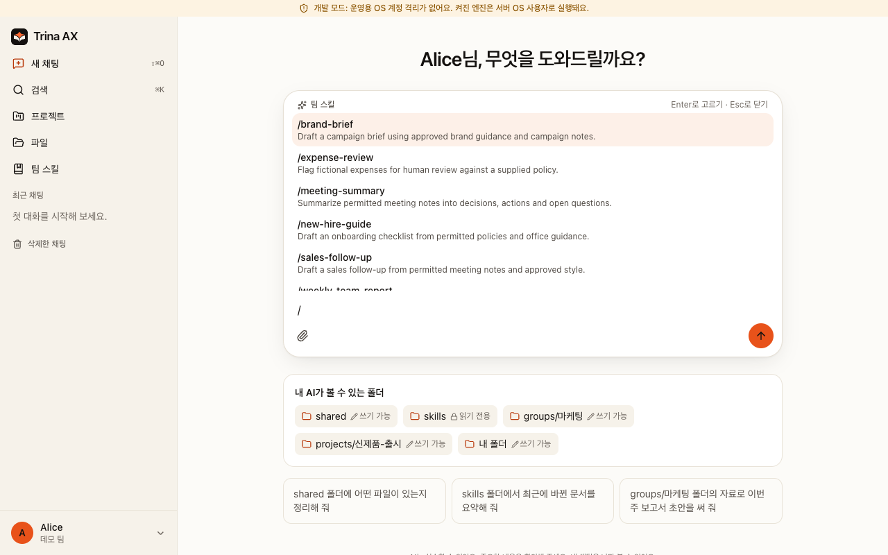
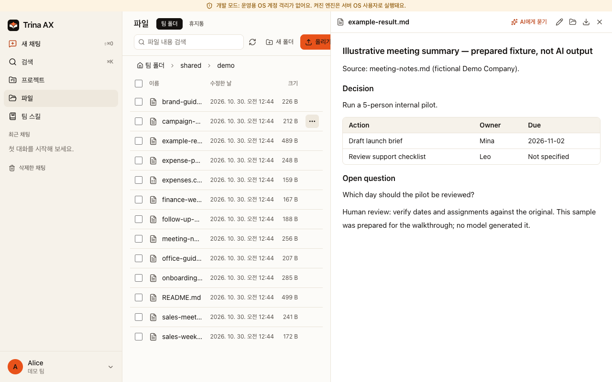
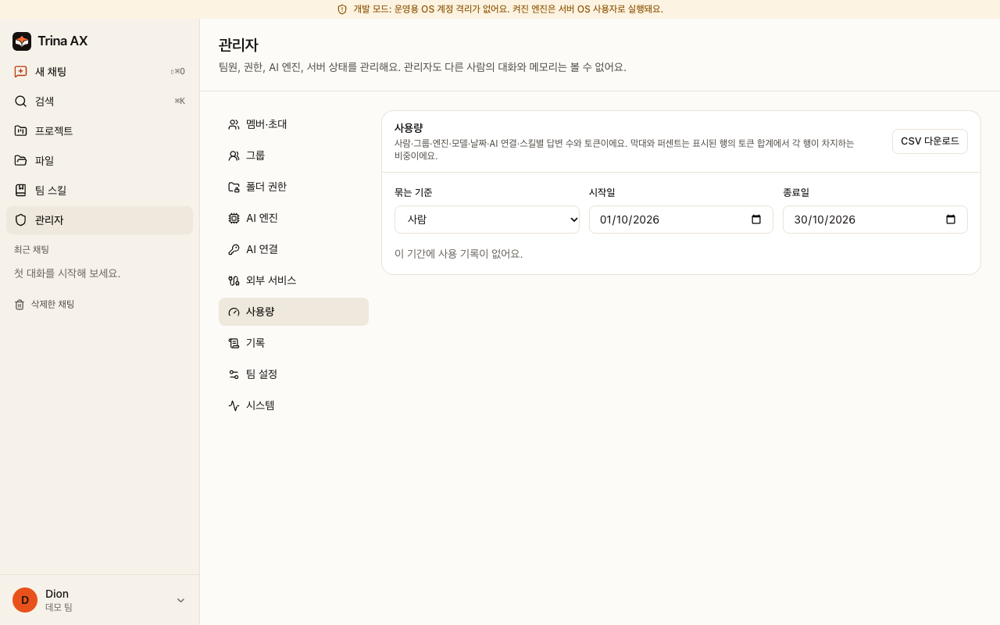
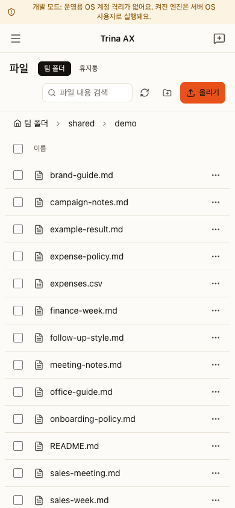

# 대표·팀장용 도입 안내

[English](for-teams.md)

회사 자료와 반복 업무가 있고 자료별 접근 범위를 정하려는 팀을 위한 공간입니다. 개인 AI 채팅에 파일을 매번 붙여 넣는 대신 공통 자료·업무 지침·권한을 준비합니다. 더 좋은 모델이나 즉시 완벽한 결과를 약속하는 것은 아닙니다.

## 업무 하나로 시작하기

[예제 모음](../examples/README.ko.md)에서 대표는 주간 보고, 영업은 후속 연락, 마케팅은 브랜드 기획, 재무는 비용 검토, 인사는 입사 안내를 고르세요. 각 예제에는 가상 입력, 필요한 폴더, 명령과 검토 기준이 있습니다. 운영·고객지원 팀도 회의 요약을 인수인계 기록에 적용할 수 있습니다.

스킬은 반복해서 사용하는 지침입니다. 파일 화면에서 관리자가 `skills/<이름>/SKILL.md`를 만들거나, 팀원이 제안한 내용을 해당 폴더의 스킬 관리자가 검토해 반영합니다. 채팅의 스킬 메뉴에서 선택합니다. 모델 학습은 아닙니다.

## 첫 주 체크리스트

소유자와 서버 운영 담당자를 정한 뒤 계정을 만드세요.

1. **폴더 권한:** 두 가상 계정으로 허용·차단되는 파일을 확인합니다.
2. **AI 연결:** 허용된 제공사 계정·요금제를 선택합니다. 새 팀은 구독 공유 기본 켜짐이지만 약관상 허가는 별개입니다.
3. **팀원 초대:** 소규모 시범 그룹에 초대하고 역할·폴더를 확인합니다.
4. **첫 팀 스킬:** 원본과 결과의 금액·날짜·담당자를 비교하고 사람이 공유를 결정합니다. 사용량은 청구서가 아닌 추정치일 수 있습니다.
5. **첫 백업:** IT와 [복구 연습](BACKUP-RESTORE.md)을 수행합니다. 백업 파일이 있다는 것만으로 복구를 보장하지 않습니다.

[권한과 데이터 이동](security-and-permissions.ko.md)을 읽고, 팀 규모·필요 파일·민감정보 조건·운영 담당자를 정해 [IT 담당자](for-admins.ko.md)에게 전달하세요.

## 비용과 도움

직접 설치 소프트웨어는 무료이며 장비·운영·AI 요금은 별도입니다. AWS 서울 호스팅은 2026-10-30 기준 월 $39/5명, $69/15명, $129/40명(USD, 세금·AI 요금 별도)입니다. 40명 초과는 문의하세요. [현재 요금·상담](https://ax.trina.app/#pricing) · [지원](../SUPPORT.md).

## 실제 데모 화면

가상 자료를 넣은 로컬 개발 모드입니다. AI 호출 없이 캡처했으며 결과 예시는 사람이 준비한 파일입니다.

