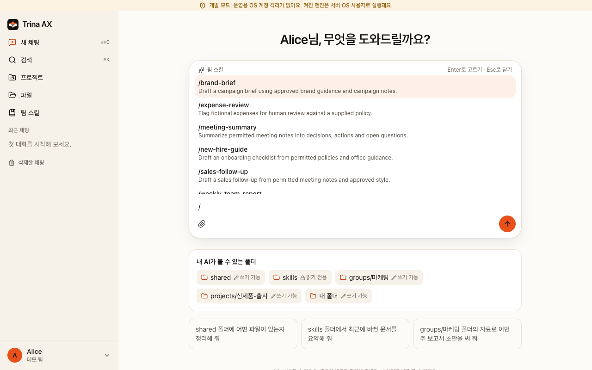
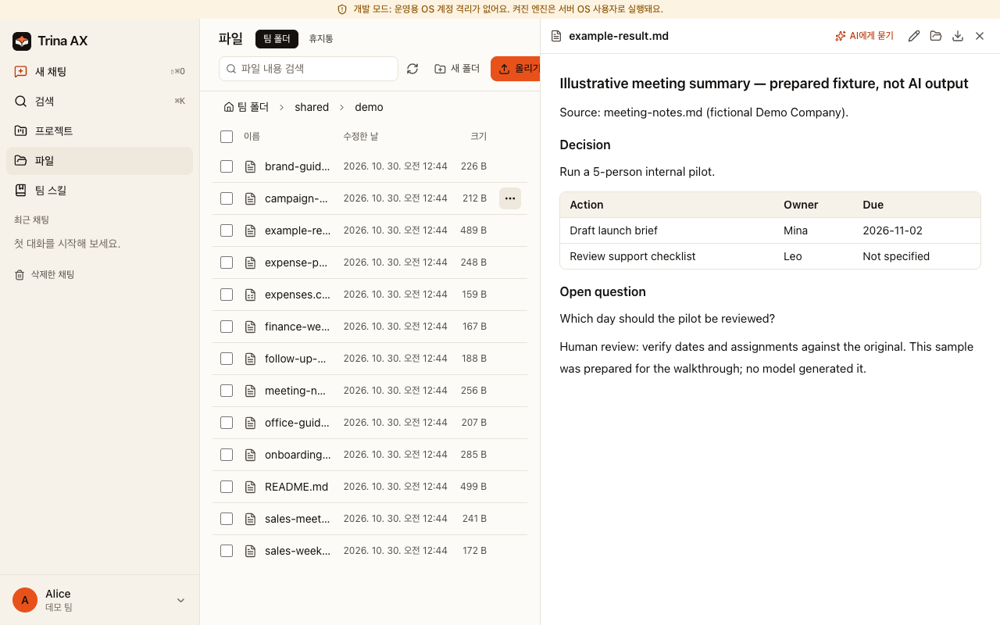
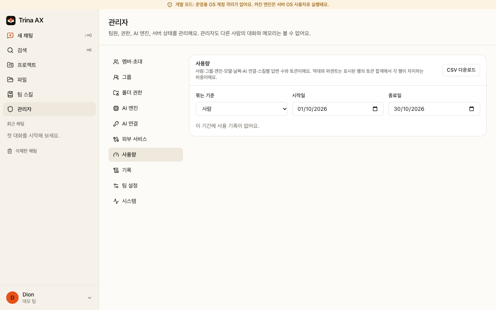
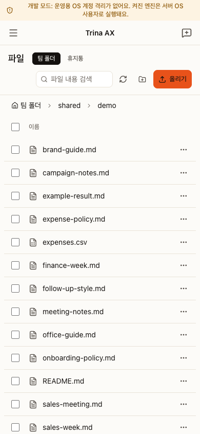

# 대표·팀장용 도입 안내

[English](for-teams.md)

회사 자료와 반복 업무가 있고 자료별 접근 범위를 정하려는 팀을 위한 공간입니다. 개인 AI 채팅에 파일을 매번 붙여 넣는 대신 공통 자료·업무 지침·권한을 준비합니다. 더 좋은 모델이나 즉시 완벽한 결과를 약속하는 것은 아닙니다.

## 업무 하나로 시작하기

팀 폴더 맨 위에는 다섯 폴더가 있고 파일 화면은 이렇게 부릅니다. **전사 공유**(`shared/`)는 팀원 모두가 보는 회사 자료 자리입니다. 시작 단계의 회사 소개·브랜드·회의록과 처음 올린 회사 파일이 여기 들어가고, 견적서·보고서 같은 양식은 `shared/양식/`에 둡니다(AI가 그런 문서를 만들 때 여기서 시작합니다). **부서**(`groups/`)는 부서마다 한 폴더로 그 부서 사람만 보고, **프로젝트**(`projects/`)는 프로젝트마다 한 폴더, **팀 스킬**(`skills/`)은 모두의 AI가 따르는 스킬과 규칙, **개인**(`users/`)은 사람마다 자기 폴더(**내 폴더**)입니다. 끝난 일은 "정리해 줘"라고 하면 AI가 그 자리의 `보관` 폴더로 옮깁니다. 폴더 이름은 화면에서만 바뀌고 실제 경로는 그대로입니다.

[예제 모음](../examples/README.ko.md)에서 대표는 주간 보고, 영업은 후속 연락, 마케팅은 브랜드 기획, 재무는 비용 검토, 인사는 입사 안내를 고르세요. 각 예제에는 가상 입력, 필요한 폴더, 명령과 검토 기준이 있습니다. 운영·고객지원 팀도 회의 요약을 인수인계 기록에 적용할 수 있습니다.

스킬은 반복해서 사용하는 지침입니다. 파일 화면에서 관리자가 `skills/<이름>/SKILL.md`를 만들거나, 팀원이 제안한 내용을 해당 폴더의 스킬 관리자가 검토해 반영합니다. 채팅의 스킬 메뉴에서 선택합니다. 모델 학습은 아닙니다.

프로젝트는 폴더 하나와 지침입니다. 출시 준비·고객사·분기 보고처럼 같은 자료를 계속 쓰는 일에 맞습니다. 프로젝트 화면에서 만드세요. 팀 프로젝트는 `projects/` 안에 새 폴더가 생기고, 함께 일할 사람과 내가 속한 부서를 고릅니다. 내 프로젝트는 내 개인 폴더(`users/<나>/projects/`)에 있고 나만 봅니다. 만들고 고치는 창에는 늘 "볼 수 있는 사람: 영업 부서 · 김소라 · 팀장·관리자 (9명)"처럼 누가 보는지 나옵니다. 만든 사람, 팀장, 관리자는 늘 보고, 고르지 않은 사람은 보지 못합니다. 볼 수 있는 사람은 만든 사람과 관리자가 프로젝트 수정 창에서 바꾸고, 사람을 더할 때는 그 사람들이 무엇을 보게 되는지(파일, 공유 채팅의 지난 대화 전체, 프로젝트 스킬) 먼저 알려 줍니다. 프로젝트에서 시작했거나 채팅 제목 메뉴에서 프로젝트로 옮긴 채팅은 AI에게 그 폴더와 지침을 줍니다. 폴더 하나에는 프로젝트 하나만 둡니다. 파일 화면은 폴더의 프로젝트를 열어 주지만 폴더를 프로젝트로 만들지는 않습니다. 관리자는 팀 프로젝트를 관리자만 만들게 할 수 있습니다(관리자 › 팀 설정). 전에 다른 폴더에 만든 프로젝트는 그대로 쓰입니다. 내가 혼자 쓰지 않은 지침은 바깥 내용으로 다루므로, AI는 그 지침을 읽은 뒤 무언가를 기억하기 전에 먼저 묻습니다.

## 첫 주 체크리스트

소유자와 서버 운영 담당자를 정한 뒤 계정을 만드세요.

1. **폴더 권한:** 두 가상 계정으로 허용·차단되는 파일을 확인합니다.
2. **AI 연결:** 허용된 제공사 계정·요금제를 선택합니다. 새 팀은 회사 연결 하나를 팀 전체가 쓰는 설정이 기본 켜짐이지만 약관상 허가는 별개입니다.
3. **팀원 초대:** 소규모 시범 그룹에 초대하고 역할·폴더를 확인합니다.
4. **첫 팀 스킬:** 원본과 결과의 금액·날짜·담당자를 비교하고 사람이 공유를 결정합니다. 사용량은 청구서가 아닌 추정치일 수 있습니다.
5. **첫 백업:** IT와 [복구 연습](BACKUP-RESTORE.md)을 수행합니다. 백업 파일이 있다는 것만으로 복구를 보장하지 않습니다.

[권한과 데이터 이동](security-and-permissions.ko.md)을 읽고, 팀 규모·필요 파일·민감정보 조건·운영 담당자를 정해 [IT 담당자](for-admins.ko.md)에게 전달하세요.

## 비용과 도움

직접 설치 소프트웨어는 무료이며 장비·운영·AI 요금은 별도입니다. 트리나 호스팅(AWS 서울)은 14일 무료 체험 뒤 월 요금제로 이어지고, AI 이용료는 연결한 계정으로 따로 나갑니다. [현재 가격·상담](https://ax.trina.app/#pricing) · [지원](../SUPPORT.md).

## 실제 데모 화면

가상 자료를 넣은 로컬 개발 모드입니다. AI 호출 없이 캡처했으며 결과 예시는 사람이 준비한 파일입니다.

