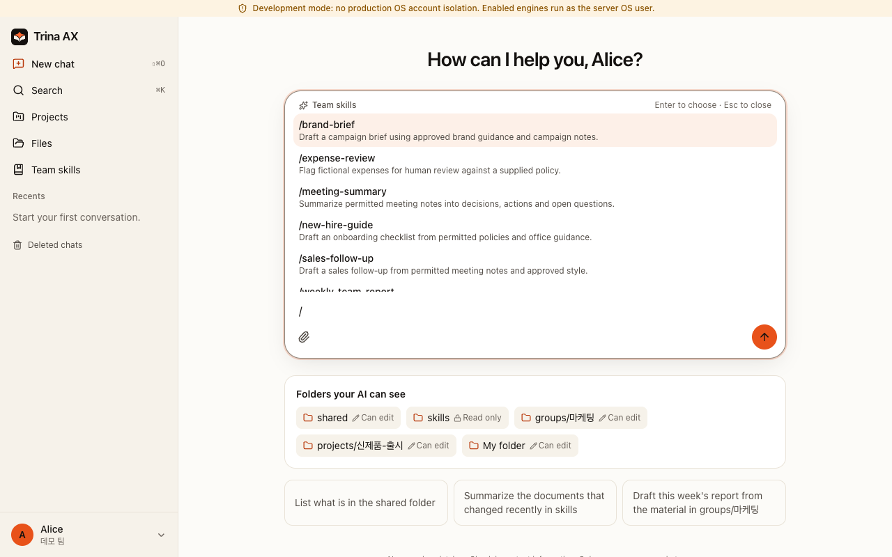
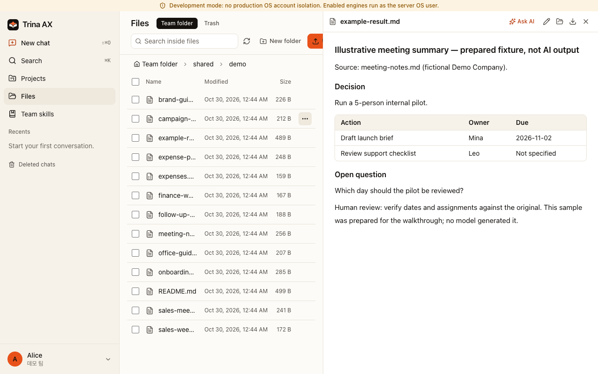
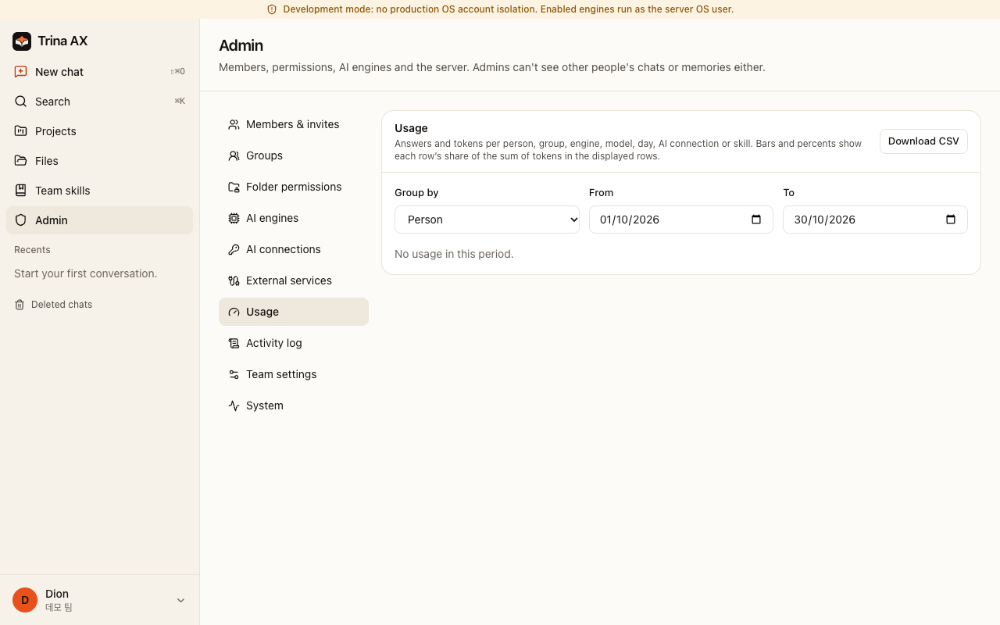
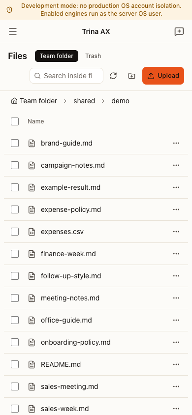

# A guide for CEOs and team leads

[한국어](for-teams.ko.md)

Trina fits teams that have company files, repeatable tasks and different access needs. Prepare shared sources, procedures and permissions instead of attaching the same files to each personal AI chat. This does not promise a better model or immediate high-quality output.

## Start with one task

Use the [example catalog](../examples/README.md): weekly report for leadership, follow-up for sales, brand brief for marketing, expense review for finance, onboarding guide for HR. Each gives fictional input paths, required access, a prompt and review criteria. Operations and support teams can adapt the meeting-summary skill to handovers.

A skill is a reusable procedure. A skill manager creates `skills/<name>/SKILL.md` in Files, or reviews a member's suggestion for that folder. Select it from the chat skill menu. Registering it does not train the model. The folder rules decide who sees a team skill (for example, `skills/finance/` only for the finance group). You can also keep personal skills in `users/<you>/skills/`: only you see them, and you can suggest one to the team.

A project is a folder with instructions, for work that keeps coming back to the same files (a launch, a client, a quarter's report). Make one on the Projects page: a team project gets a new folder in `projects/`, and you choose who works in it (people, and your own groups); a personal project lives in your own folder (`users/<you>/projects/`) and only you see it. The dialog always says who can see it ("Who can see it: Sales group · Sora · Owner and admins (9 people)"). The creator, the owner and admins always see it, and nobody else does unless you choose them. The person who made it and admins change who works in it from the project's edit dialog; adding someone first says what they will see (its files, its shared chats with their whole history, its project skills). A chat started in the project, or moved into it from the chat title's menu, gives the AI that folder and those instructions. A folder holds one project; Files opens a folder's project but no longer turns a folder into one. An admin can let only admins make team projects (Admin › Team settings). Projects made before on other folders keep working as they were. Instructions you did not write all by yourself count as outside content, so the AI asks before it remembers anything after reading them.

## Your first week

Choose an owner and a server operator, then create the owner account.

1. **Permissions:** verify allowed and blocked files with two fictional accounts.
2. **AI connection:** select an authorized provider account and plan. On new teams one company connection can serve the whole team by default, but provider permission is separate.
3. **Invite the team:** invite a small pilot group and confirm roles and folder access.
4. **First skill:** compare figures, dates and owners against source files; a person decides whether to share. Usage costs can be estimates, not invoices.
5. **First backup:** perform a [restore drill](BACKUP-RESTORE.md) with IT. A backup file alone does not prove recoverability.

Read [permissions and data flows](security-and-permissions.md). Give [IT](for-admins.md) your team size, required files, data constraints and an operational owner.

## Cost and help

Self-hosted software is free; hardware, operations and provider costs are separate. Free 14-day trial on Trina hosting (AWS Seoul), then a monthly plan; AI usage is billed separately by the account you connect. [Current prices and enquiries](https://ax.trina.app/#pricing) · [Support](../SUPPORT.md).

## Real demo screens

Local development mode with fictional data. No model calls were made; the example result is a prepared file.

