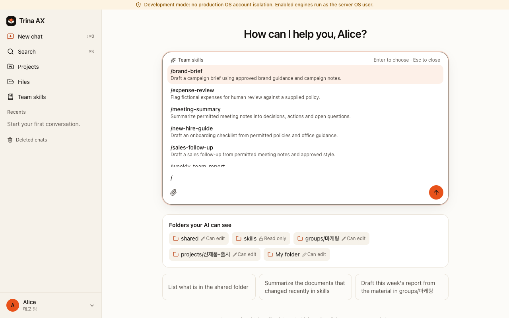
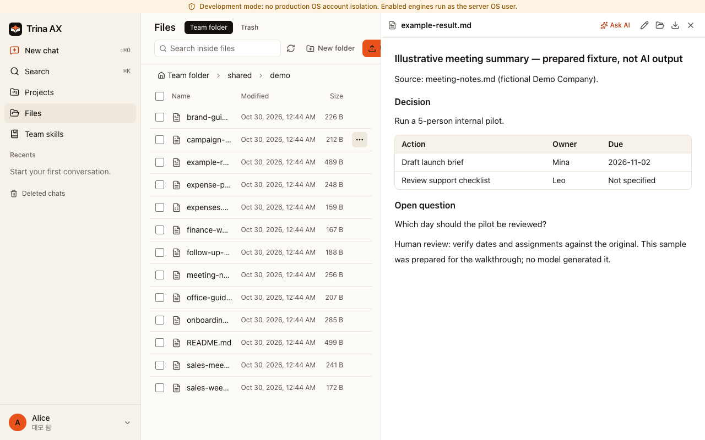
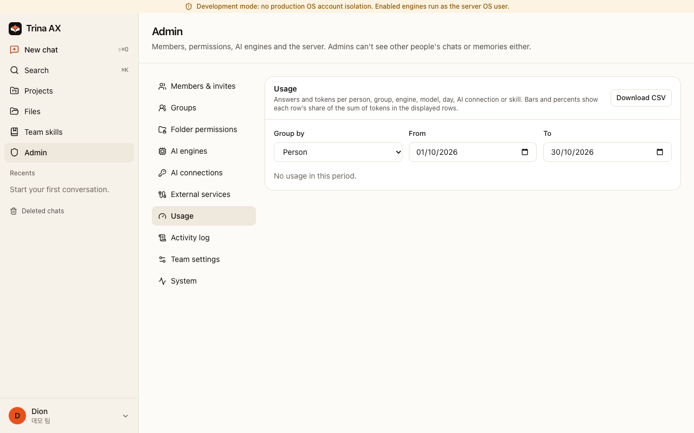
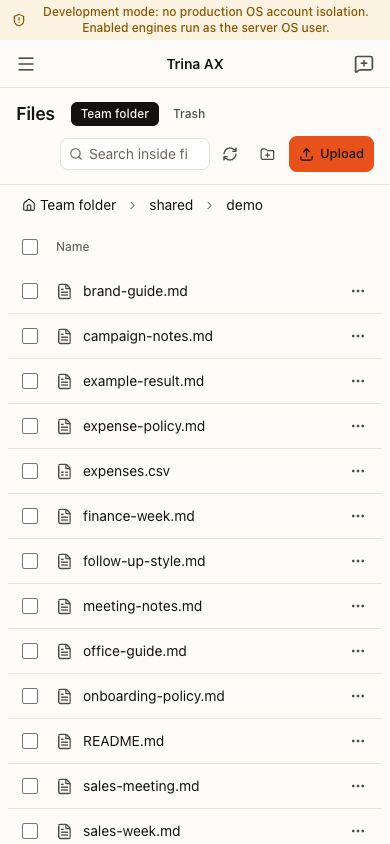

# A guide for CEOs and team leads

[한국어](for-teams.ko.md)

Trina fits teams that have company files, repeatable tasks and different access needs. Prepare shared sources, procedures and permissions instead of attaching the same files to each personal AI chat. This does not promise a better model or immediate high-quality output.

## Start with one task

Use the [example catalog](../examples/README.md): weekly report for leadership, follow-up for sales, brand brief for marketing, expense review for finance, onboarding guide for HR. Each gives fictional input paths, required access, a prompt and review criteria. Operations and support teams can adapt the meeting-summary skill to handovers.

A skill is a reusable procedure. A skill manager creates `skills/<name>/SKILL.md` in Files, or reviews a member's suggestion for that folder. Select it from the chat skill menu. Registering it does not train the model.

## Your first week

Choose an owner and a server operator, then create the owner account.

1. **Permissions:** verify allowed and blocked files with two fictional accounts.
2. **AI connection:** select an authorized provider account and plan. New teams enable subscription sharing by default, but provider permission is separate.
3. **Invite the team:** invite a small pilot group and confirm roles and folder access.
4. **First skill:** compare figures, dates and owners against source files; a person decides whether to share. Usage costs can be estimates, not invoices.
5. **First backup:** perform a [restore drill](BACKUP-RESTORE.md) with IT. A backup file alone does not prove recoverability.

Read [permissions and data flows](security-and-permissions.md). Give [IT](for-admins.md) your team size, required files, data constraints and an operational owner.

## Cost and help

Self-hosted software is free; hardware, operations and provider costs are separate. AWS Seoul hosting, checked 2026-10-30: $39/month for up to 5 people, $69 for 15, $129 for 40, USD before tax and AI costs. Ask about teams above 40. [Current pricing and enquiries](https://ax.trina.app/#pricing) · [Support](../SUPPORT.md).

## Real demo screens

Local development mode with fictional data. No model calls were made; the example result is a prepared file.

