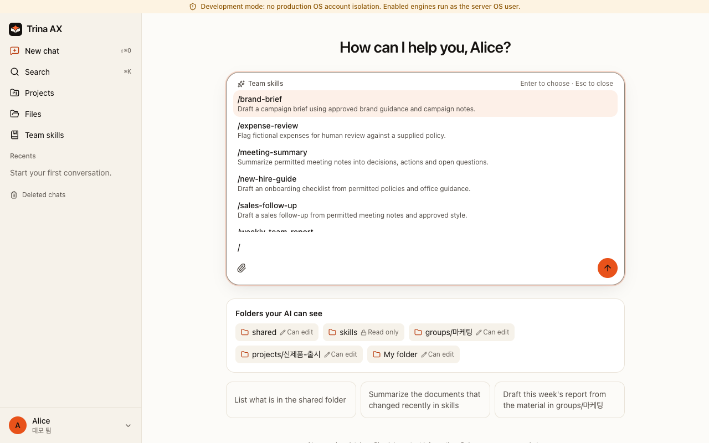
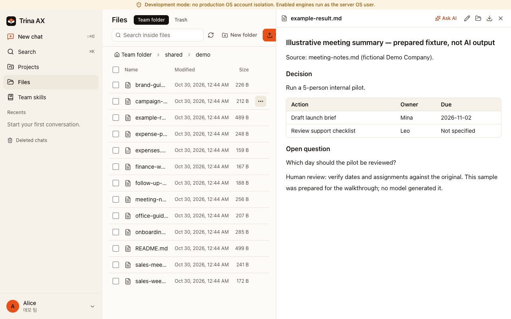
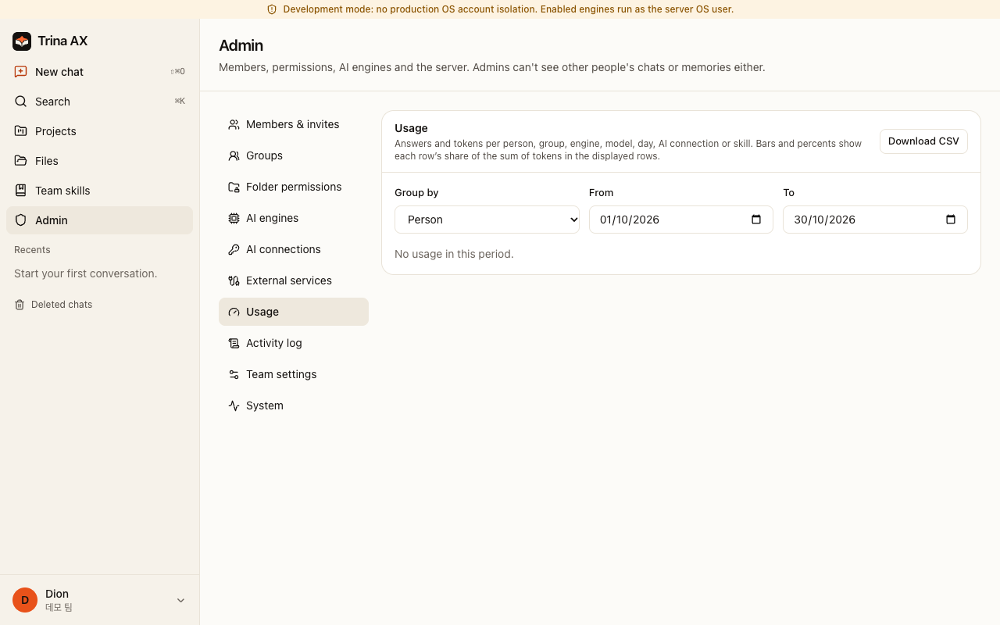
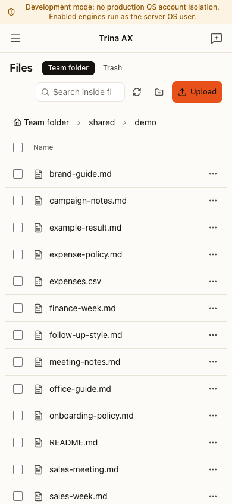

# 写给老板和团队负责人的指南

[English](for-teams.md) · [한국어](for-teams.ko.md)

Trina 适合这样的团队：有公司文件，有反复要做的工作，不同的人能看的资料也不一样。不用在每个人的 AI 聊天里一次次附上同样的文件，而是提前准备好共享的资料、工作做法和权限。它不承诺更好的模型，也不承诺马上就能得到高质量的结果。

## 从一项工作开始

团队文件夹的最上层有五个文件夹，“文件”页面会用你的语言显示它们的名字。**全公司共享**（`shared/`，韩文界面显示为 전사 공유）放的是团队里每个人都能看到的公司资料：初始设置时填写的公司介绍、品牌和会议记录，以及最早的一批公司文件都放在这里；报价单、报告这类表格和模板放在 `shared/Templates/`（韩文团队是 `shared/양식/`；AI 做这类文档时会先从这里找）。
**小组**（`groups/`，韩文为 부서）里每个部门一个文件夹，只有这个部门的人能看到；**项目**（`projects/`）每个项目一个文件夹；**团队技能**（`skills/`）放着每个人的 AI 都会遵循的技能和规则；**个人**（`users/`）是每个人自己的文件夹（**我的文件夹**）。让 AI 帮忙整理时，已完成的工作会移到所在区域的 `Archive` 文件夹（韩文为 `보관`）。变的只是屏幕上显示的名字，实际路径保持不变。

可以参考[示例目录](../examples/README.md)（英文）：给管理层的周报、销售的跟进、市场部的品牌简报、财务的报销审核、人事的入职指南。每个示例都写明了虚构的输入文件路径、需要的访问权限、提示词和审核标准。运营和客服团队可以把会议纪要技能改成交接用。

技能就是一套可以反复使用的做法。技能管理员在“文件”里创建 `skills/<name>/SKILL.md`，或者审核成员为这个文件夹提交的建议。在聊天的技能菜单里选用它。登记技能并不会训练模型。谁能看到某个团队技能，由文件夹规则决定（例如 `skills/finance/` 只给财务小组）。你也可以把个人技能放在 `users/<you>/skills/`：只有你能看到，你也可以把它推荐给团队。

项目是一个带说明的文件夹，适合总要回到同一批文件的工作（一次产品发布、一个客户、一个季度的报告）。在“项目”页面创建：团队项目会在 `projects/` 里得到一个新文件夹，由你选择谁参与（人，以及你所在的小组）；个人项目放在你自己的文件夹里（`users/<you>/projects/`），只有你能看到。在你选好的成员下方，对话框会显示有多少人能看到它（“9人可以看到（包括所有者和管理员）”）。创建者、所有者和管理员始终能看到，除非你选了别人，否则其他人都看不到。创建者和管理员可以在项目页面的**成员**一栏（**管理**）修改成员，也可以在“项目”列表里，从项目卡片的 ⋯ 菜单中选择**成员**：这里显示当前成员，点 × 移除某人，用搜索添加新成员。添加某人之前，会先说明对方将能看到什么（项目的文件、项目里共享的聊天及其全部历史记录、项目的技能）。其他成员能看到有多少人可以看到这个项目，以及是谁修改了成员。在项目里开始的聊天，或者从聊天标题菜单移入项目的聊天，AI 都会用到这个文件夹和这些说明。一个文件夹只对应一个项目；“文件”页面可以打开文件夹所属的项目，但不再能把文件夹变成项目。管理员可以设置只有管理员才能创建团队项目（管理 › 团队设置）。之前在其他文件夹上建的项目照常可用。不是完全由你自己写的说明，会被当作外部内容，所以 AI 读过之后，要记住任何东西之前都会先问你。

## 第一周

先确定一位所有者和一位服务器运维负责人，然后创建所有者账号。

1. **权限：** 用两个虚构账号，确认哪些文件能打开、哪些打不开。
2. **AI连接：** 选择获得授权的服务商账号和套餐。新团队默认一个公司连接可以供全团队使用，但服务商是否允许是另一回事。
3. **邀请团队：** 先邀请一小批试用成员，确认他们的角色和文件夹权限。
4. **第一个技能：** 把结果里的数字、日期和负责人与原始文件核对；是否分享由人来决定。显示的用量费用可能是估算，不是账单。
5. **第一次备份：** 和 IT 一起做一次[恢复演练](BACKUP-RESTORE.md)（英文）。光有备份文件，并不能证明数据能恢复。

请阅读[权限与数据流向](security-and-permissions.zh.md)。把团队人数、需要的文件、数据方面的限制和一位运维负责人告诉 [IT](for-admins.zh.md)。

## 费用与帮助

自托管的软件本身免费；硬件、运维和服务商的费用另算。Trina 托管（AWS 首尔）可以免费试用 14 天，之后按月订阅；AI 用量由你接入的账号另行计费。[当前价格与咨询](https://ax.trina.app/#pricing) · [支持](../SUPPORT.md)。

## 真实的演示画面

使用虚构数据的本地开发模式。没有调用任何模型；示例结果是事先准备好的文件。

