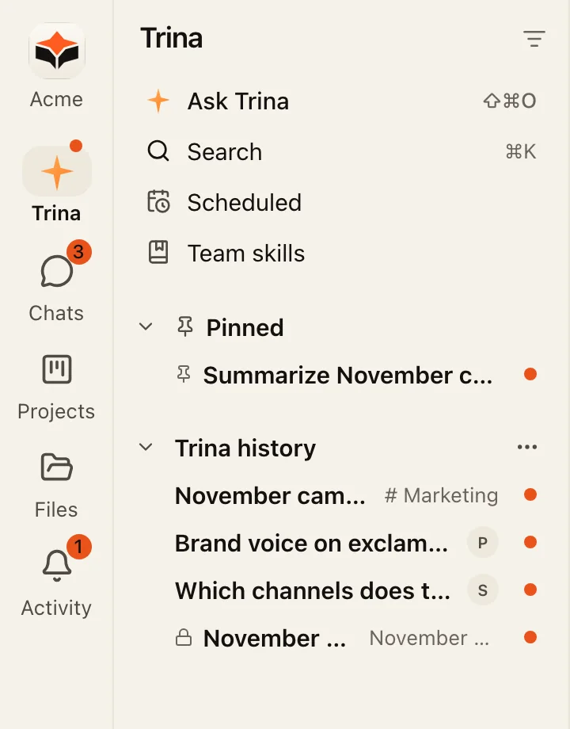

Trina AX se basa en unas pocas piezas. Todas las demás páginas usan estos términos.

## Personas y roles

| Rol | Puede |
|---|---|
| **Propietario** | Todo lo que puede un administrador, más las decisiones del equipo como las actualizaciones, las restauraciones, quitar miembros y el nombre del equipo. |
| **Administrador** | Gestionar miembros, grupos, permisos de carpetas, las conexiones de IA y los motores del equipo, y la configuración del equipo. Los administradores no pueden leer los chats de otras personas. |
| **Miembro** | Chatear con la IA, usar los archivos y las habilidades que puede abrir, y tener carpetas y habilidades personales. |
| **Invitado** | Una persona de fuera del equipo, como máximo en un chat de grupo y en un proyecto. Sin IA, salvo que se elija una IA para ella. No ocupa una plaza. [Más información sobre los invitados](../use/guests.md). |

Un **grupo** es un conjunto de personas, como Ventas o Finanzas. Las reglas de carpetas pueden nombrar grupos o personas.

## La carpeta del equipo

Todo el conocimiento de la empresa vive en una sola carpeta del equipo en el servidor.

| Carpeta | Quién la ve |
|---|---|
| `shared/` | Lo que digan las reglas de carpetas; normalmente todo el equipo. |
| `groups/<group>/` | Las personas de ese grupo, salvo que una regla añada a otras. |
| `projects/<project>/` | Lo que digan las reglas de carpetas. |
| `skills/` | Todos la leen. Los responsables de habilidades la modifican. |
| `users/<id>/` | Solo esa persona. Ni siquiera el propietario ni los administradores. |

Una carpeta o un archivo que usted no puede abrir es invisible: en Archivos, en las respuestas de la IA, en la búsqueda, en las vistas previas, en el historial y en la papelera. [Más información sobre archivos y permisos](../use/files-and-permissions.md).

## Chats y proyectos

Un **chat** es una conversación con la IA. Solo lo ve la persona que lo empezó, hasta que lo comparte con personas o grupos. Los chats de un proyecto del equipo los ven los miembros del proyecto.

Un **proyecto** es una carpeta con instrucciones, para el trabajo que vuelve una y otra vez a los mismos archivos. Un chat dentro de un proyecto le da a la IA esa carpeta y esas instrucciones. [Más información sobre chats y proyectos](../use/chats-and-projects.md).

## Habilidades

Una **habilidad** es un archivo `SKILL.md` con un nombre, una descripción y un procedimiento. Le dice a la IA cómo hace su equipo una tarea. Nunca da acceso adicional. [Más información sobre las habilidades del equipo](../use/team-skills.md).

## Motores y conexiones de IA

Un **motor** es el agente que responde:

| Motor | Notas |
|---|---|
| Claude Code | El motor predeterminado. |
| Codex | El agente de OpenAI. No está disponible en un Mac de la oficina. |
| API | Experimental. Usa una dirección de API, un modelo y una clave configurados. |

Una **conexión de IA** es la cuenta que usa un motor: una suscripción de Claude, una clave de API o un inicio de sesión de ChatGPT. Las conexiones pueden ser personales o compartidas por un grupo o por todo el equipo.

## MCP y otras conexiones

Una **conexión MCP** permite que la IA use un servicio externo, como Notion o Linear, con el inicio de sesión de una persona o del equipo. Trina AX también funciona al revés: su propio Claude puede conectarse a Trina AX como servidor MCP. [Más información sobre MCP](../use/mcp.md).

## Tareas programadas y uso

Una **tarea programada** repite una petición según un horario, en la zona horaria del equipo. El **uso** cuenta las respuestas, los tokens y el coste estimado por persona, con límites opcionales. [Más información sobre las tareas programadas](../use/scheduled-tasks.md).
