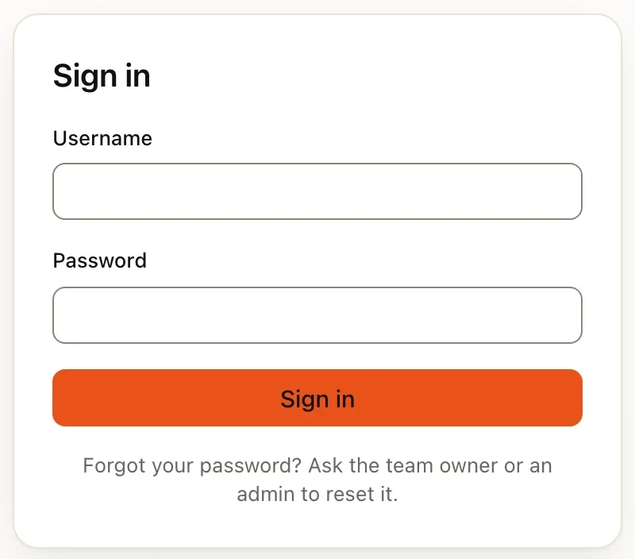
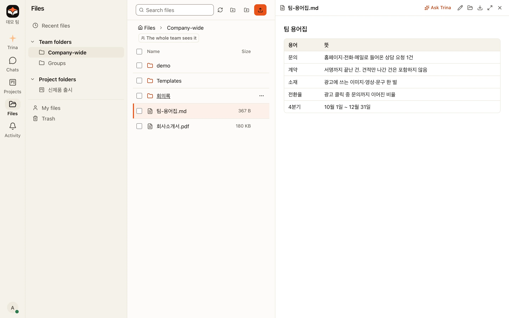

La demostración inicia un equipo ficticio con seis habilidades iniciales. La IA está desactivada, así que no necesita ninguna cuenta de IA.

:::warning
La demostración no es una instalación de producción. No tiene aislamiento a nivel del sistema operativo. Use solo datos ficticios.
:::

## Antes de empezar

| Necesita | Versión |
|---|---|
| macOS o Linux | Los usuarios de Windows abren un servidor ya preparado en el navegador |
| Git | cualquier versión reciente |
| Bun | 1.3.12 (la versión fijada en CI) |
| Go | 1.27 o posterior |
| Herramientas de compilación nativas | Herramientas de línea de comandos de Xcode en macOS |
| Un puerto libre | 19760 |

## Iniciar la demostración

:::steps
#### Clone e instale
```sh
git clone https://github.com/trina-app/trina-ax.git
cd trina-ax
bun install --frozen-lockfile
```

#### Inicie la demostración
```sh
bun run demo
```
Deje esta terminal abierta. Compila, se inicia en http://127.0.0.1:19760 y crea el equipo ficticio.

#### Inicie sesión
Abra http://127.0.0.1:19760 e inicie sesión como `alice` con `teamax-demo-1`. Las otras cuentas son `bob`, `admin1` y el propietario `dion`. La contraseña es pública a propósito.



#### Compruebe los permisos de carpetas
Abra **Archivos → Toda la empresa → 팀-용어집.md**. Luego inicie sesión como `bob` en una ventana privada. Bob ve el grupo de finanzas, pero no el de marketing.


:::

:::tip
Use `127.0.0.1`, no `localhost`. Son orígenes de cookies distintos, así que tendría que volver a iniciar sesión.
:::

## Ir más allá

La demostración es la forma más rápida de empezar. Cuando quiera más, elija una de estas opciones.

:::tabs
@tab Puerto e idioma
Elija otro puerto, una carpeta de datos nueva y la interfaz en coreano:

```sh
bun run demo --port 19761 --data "$HOME/.trina-evaluation-new" --locale ko
```

La carpeta de datos no debe existir todavía. Un puerto ocupado o una carpeta existente se rechazan.

@tab Probar la IA
La demostración no puede usar la IA. Para un servidor de desarrollo que use su propia sesión de Claude Code o Codex, detenga primero la demostración y ejecute:

```sh
TEAM_AX_DEV_DIR="$HOME/.trina-ai-evaluation-new" TEAM_AX_DEV_PORT=19761 bun run dev --no-relay
# In a second terminal, before you create a team:
TEAM_AX_DEV_DIR="$HOME/.trina-ai-evaluation-new" bun run demo:seed --base http://127.0.0.1:19761
```

:::warning
En el modo de desarrollo los motores se ejecutan como su usuario del sistema operativo, sin el aislamiento de producción. Conecte solo cuentas que pueda usar de esta forma.
:::

@tab Compartir en su tailnet
Para que sus compañeros en su red de Tailscale puedan recorrer una vista previa, ejecute un servidor de desarrollo con la IA desactivada y un origen permitido adicional.

:::steps
#### Escriba una configuración con la IA desactivada
Guarde esto como `preview.json` en una carpeta nueva y corta, como `~/.trina-preview`. Es la misma configuración que escribe la demostración.
```json
{"mode":"dev","listen":{"host":"127.0.0.1","port":19780},
 "engine":{"authMode":"local-login","claudeBin":"/nonexistent/trina-demo-no-ai","codexBin":""},
 "relay":{"url":null,"officialAvailable":false},"update":{"feedUrl":null,"auto":false}}
```

#### Inicie el servidor con el origen de su tailnet
Sustituya `<your-tailnet-host>` por el nombre de Tailscale de la máquina.
```sh
MYCEL_CONFIG="$HOME/.trina-preview/preview.json" MYCEL_HOST=127.0.0.1 \
TEAM_AX_DEV_DIR="$HOME/.trina-preview" TEAM_AX_DEV_PORT=19780 \
MYCEL_PUBLIC_ORIGINS="https://<your-tailnet-host>:8443,http://127.0.0.1:19780" \
bun scripts/dev.ts --no-relay
```

#### Cree el equipo ficticio
```sh
TEAM_AX_DEV_DIR="$HOME/.trina-preview" bun run demo:seed --base http://127.0.0.1:19780
```

#### Sírvalo solo en la tailnet
```sh
tailscale serve --bg --https=8443 http://127.0.0.1:19780
```
Use `tailscale serve`, nunca `tailscale funnel`: funnel lo hace público.

#### Cambie las contraseñas de la demostración
La contraseña de la demostración es pública. Cámbiela en todas las cuentas antes de compartir la dirección.
:::

Para detenerlo: pulse Ctrl-C en la terminal del servidor y luego ejecute `tailscale serve --https=8443 off`.
:::

## Siguientes pasos

:::cards cols=2
- icon=book-open | [Conceptos clave](key-concepts.md) | Los términos que usa el resto de esta documentación.
- icon=terminal | [Desarrollo local (en inglés)](../../develop/local-development.md) | Compile, pruebe y modifique el código.
:::
