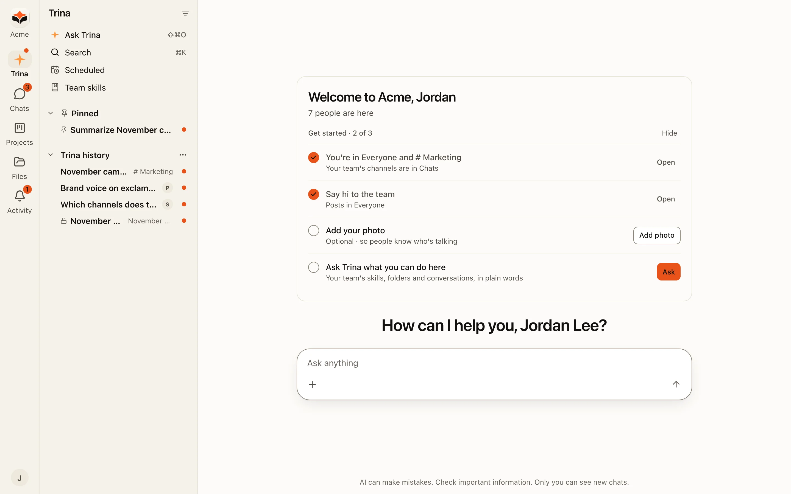

:::note
¿Quiere verlo primero? [Pruébelo en 1 minuto, sin registro](https://demo.trina.app).

¿Solo quiere probarlo? Ejecute la [demostración local](get-started/quickstart.md). No necesita ninguna cuenta de IA.
:::

Trina AX es un espacio de trabajo con IA para la empresa. Usted configura Claude Code una sola vez en un servidor y todo el equipo lo usa desde el navegador.

| | Qué significa |
|---|---|
| **Un solo servidor** | Claude Code y Codex se ejecutan en su servidor, no en cada portátil. |
| **Sus archivos** | La IA trabaja con las carpetas del equipo: `shared/`, `groups/`, `projects/` y las carpetas personales. |
| **Habilidades del equipo** | Un archivo `SKILL.md` convierte la forma de trabajar de su equipo en una instrucción reutilizable. |
| **Permisos** | El servidor comprueba cada archivo que abre la IA, con los permisos de la persona que pregunta. |

---

## Use Trina AX en el trabajo

¿No es desarrollador? Empiece aquí. Cada página tiene pasos numerados con los nombres exactos de los botones e imágenes
de las pantallas.

:::cards cols=2
- icon=message-square | [Chats y proyectos](use/chats-and-projects.md) | Pregunte a la IA, comparta un chat como un archivo de Google Drive y reúna un trabajo en un proyecto.
- icon=folder-lock | [Archivos y permisos](use/files-and-permissions.md) | Comparta un archivo o una carpeta, y reserve una carpeta para menos personas.
- icon=bell | [Configuración y búsqueda](use/settings-and-search.md) | Su perfil, el idioma y las notificaciones, y la búsqueda con ⌘K.
- icon=clock | [Tareas programadas](use/scheduled-tasks.md) | Deje que la IA haga el mismo trabajo cada lunes, en unos pocos clics.
:::

## Ruta recomendada para nuevos desarrolladores

:::steps
#### Ejecute la demostración
Inicie un equipo ficticio en su ordenador en unos 10 minutos. [Ir al inicio rápido](get-started/quickstart.md).

#### Aprenda los términos
Equipos, grupos, carpetas, habilidades, motores y MCP en una sola página. [Leer los conceptos clave](get-started/key-concepts.md).

#### Vea cómo encajan las piezas
El servidor, la app web, los motores y la comprobación de permisos. [Leer la arquitectura](../develop/architecture.md) (en inglés).

#### Haga su primer cambio
Prepare un servidor de desarrollo, ejecute las comprobaciones y abra un pull request. [Leer la guía de desarrollo local](../develop/local-development.md) (en inglés).

#### Póngalo en manos de un equipo
Elija entre alojamiento, un servidor Linux o un Mac de la oficina. [Comparar las instalaciones](../operate/install.md) (en inglés).
:::

---

## Desarrollar con Trina AX

:::cards cols=3
- icon=code | [Guía para desarrolladores (en inglés)](../develop/architecture.md) | Arquitectura, estructura del repositorio, pruebas y convenciones.
- icon=bot | [Para agentes de IA (en inglés)](../agents/overview.md) | Reglas para los agentes de programación y cómo funciona la IA dentro de Trina AX.
- icon=braces | [API HTTP (en inglés)](../reference/http-api.md) | Todos los endpoints, agrupados por área, con quién puede llamarlos.
:::

## Funciones principales

:::cards cols=2
- icon=folder-lock | [Archivos y permisos](use/files-and-permissions.md) | Cada persona y su IA ven solo las carpetas que pueden abrir.
- icon=book-open | [Habilidades del equipo](use/team-skills.md) | Instrucciones reutilizables, gestionadas como archivos.
- icon=plug | [Conexiones MCP](use/mcp.md) | Permita que la IA use Notion, Linear y otros servicios.
- icon=clock | [Tareas programadas](use/scheduled-tasks.md) | Pídalo una vez y deje que la IA repita el trabajo.
:::

## Soporte

:::cards cols=2
- icon=life-buoy | [Soporte (en inglés)](../resources/support.md) | Dónde preguntar, informar de un error o enviar un informe de seguridad.
- icon=wrench | [Solución de problemas (en inglés)](../operate/troubleshooting.md) | Soluciones a problemas comunes, por síntoma.
:::
