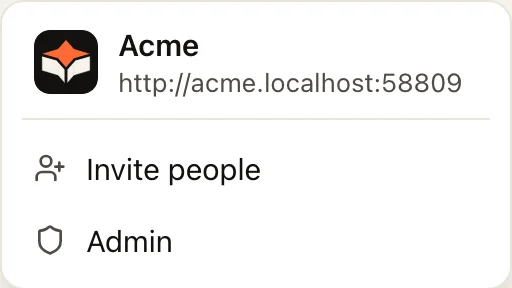
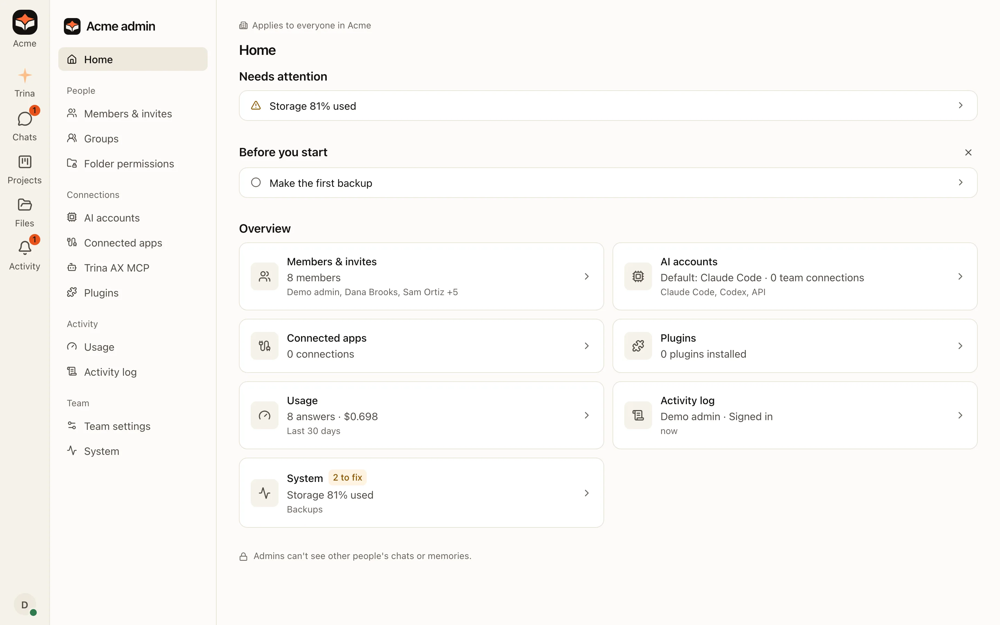
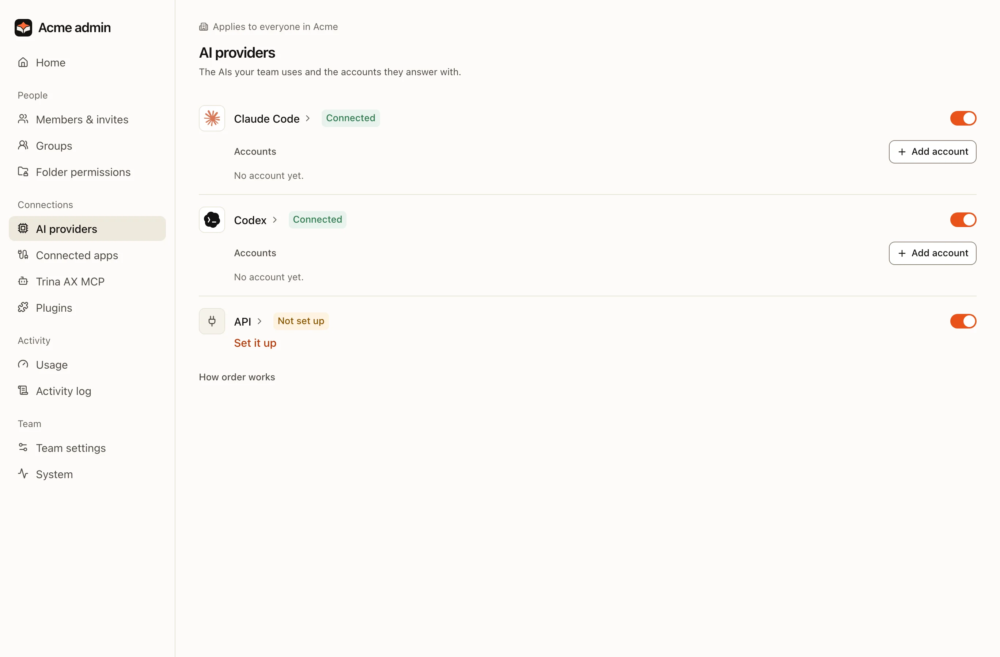
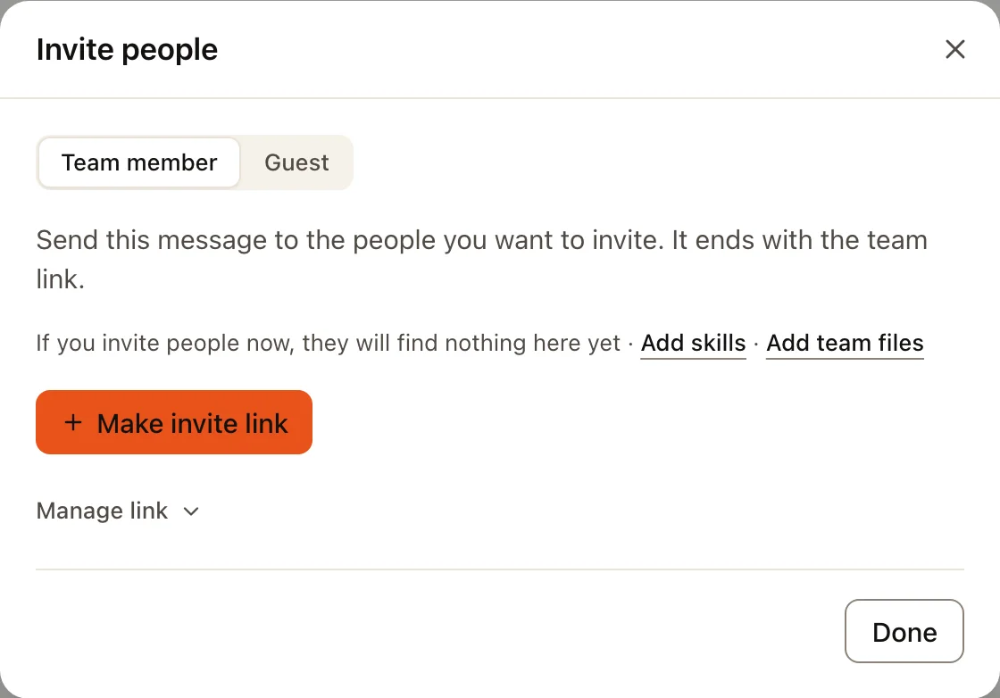
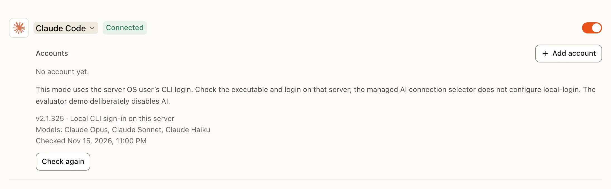
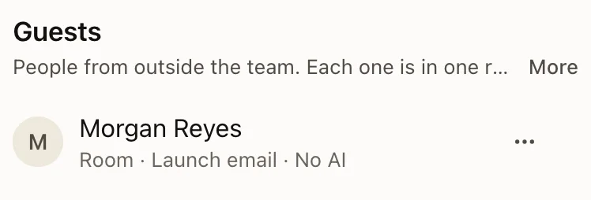
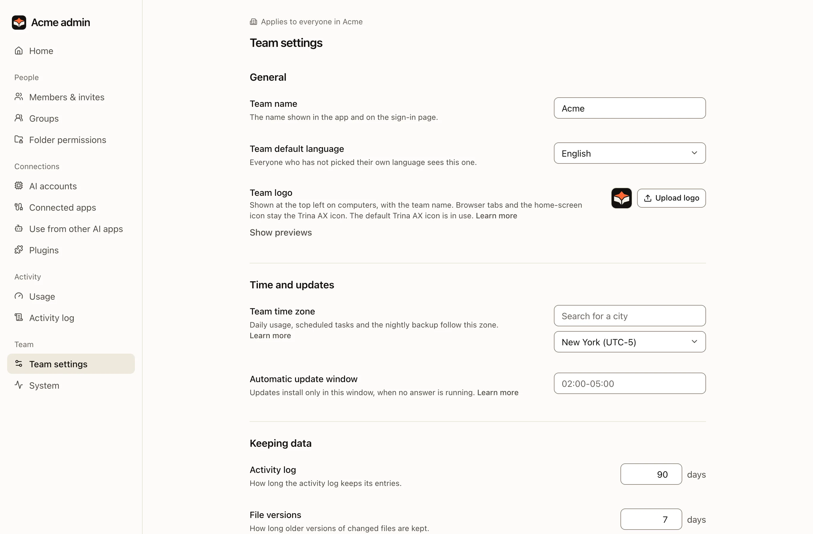
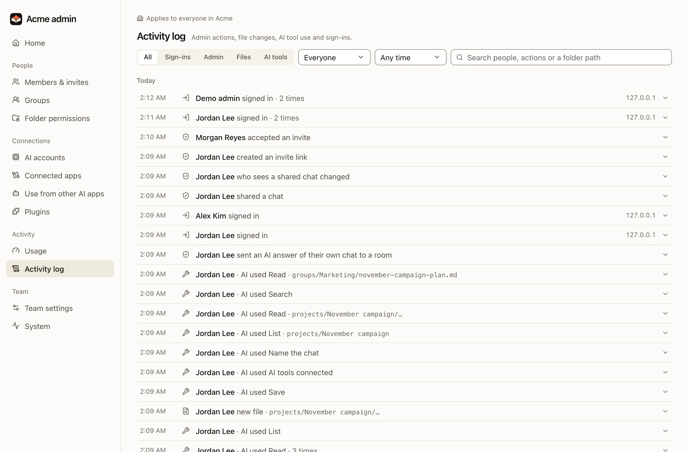
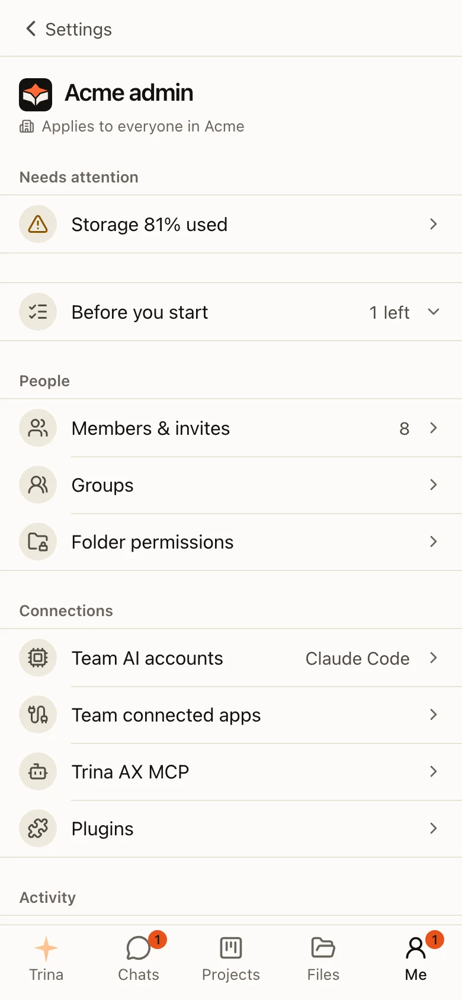

**Administración** es para el propietario y los administradores. Cada página de esta sección es para todo el equipo:
el título del menú es el nombre y el logotipo de su equipo ("Administración de Acme"), y cada página dice "Se aplica a
todos en Acme" encima de su título. Su propia configuración sigue en **Configuración**, con los mismos nombres de
página: Administración › Apps conectadas son las conexiones del equipo; las suyas están en
**Configuración › Conectores**.

Para abrir Administración en un ordenador:

1. Elija el logotipo de su equipo, en la parte superior de la barra de la izquierda. Se abre el menú del equipo: la
   dirección del equipo, **Invitar a personas**, **Administración** y **Cambiar de equipo**. (Los miembros ven solo la
   dirección y **Cambiar de equipo**.)
2. Elija **Administración**. Se abre en **Inicio**, que enumera primero lo que requiere atención.

⌘K (Ctrl+K en Windows) y "Administración" también la encuentran. En un teléfono, abra la pestaña **Yo** y luego
**Administración**.

Para el propietario, Inicio también enumera los primeros pasos de configuración que aún faltan: comprobar la conexión de IA, configurar los
permisos de carpetas, invitar a su equipo, preparar una habilidad del equipo, hacer la primera copia de seguridad. Un paso terminado sale de la lista.

## El menú Administración

| Grupo | Páginas |
|---|---|
| **Personas** | Miembros e invitaciones, Grupos, Permisos de carpetas |
| **Conexiones** | Proveedores de IA, Apps conectadas (apps de Google, [Slack](slack.md) y otros servicios como Notion), Trina AX MCP, Complementos |
| **Actividad** | Uso, Registro de actividad |
| **Equipo** | Configuración del equipo, Sistema |

**Miembros e invitaciones** también enumera a los invitados: personas de fuera del equipo que están, como máximo, en un canal privado o chat de grupo, y en un proyecto. [Más información sobre los invitados](guests.md).

:::note
Las versiones anteriores tenían las cuentas de IA en su propia página **Conexiones de IA**, junto a **Motores de IA**
(AI engines). Ahora las dos son una sola página, **Proveedores de IA** (durante un tiempo se llamó **Cuentas de IA**), y
las direcciones antiguas la abren. Los ajustes de IA del equipo (valores predeterminados, quién elige el motor, cuentas
propias de los miembros, límites de uso) están en **Configuración del equipo**. **Slack** también tenía su propia entrada
en el menú; ahora es una fila de **Apps conectadas**, y su dirección antigua la abre allí.
:::

En una empresa con Google Workspace, las apps de Google pueden iniciar sesión con la app de Google propia de su empresa, configurada una vez para las cinco: [Usar la app de Google de su empresa](google-own-app.md).

## Su primera semana

:::steps
#### Configure los permisos
Asigne carpetas a grupos y compruebe el acceso con dos cuentas de prueba. [Más información sobre los permisos](files-and-permissions.md).

#### Conecte la IA
En **Proveedores de IA**, el propietario o un administrador elige **Añadir cuenta** en la fila de Claude Code o Codex y conecta una cuenta
autorizada de Claude u OpenAI. Cada fila muestra si ese motor está listo.

#### Invite al equipo
Empiece con un grupo piloto pequeño y después confirme los roles y el acceso a las carpetas.

1. Elija el logotipo de su equipo y luego **Invitar a personas**.
2. Deje **Miembro del equipo** (**Invitado** es para alguien de fuera del equipo) y elija **Crear enlace de invitación**.
3. Elija **Copiar mensaje** y péguelo en Slack, Teams o un correo electrónico. Termina con el enlace. Quienes lo abren
   crean su cuenta y entran en el equipo.

**Miembros e invitaciones** también enumera a los [invitados](#invitados) del equipo.
Debajo de la lista, **Enlaces de invitación** muestra solo los enlaces que aún funcionan: el enlace de invitación del equipo y los enlaces de
invitación que nadie ha usado todavía. Un enlace usado o vencido, o un enlace de invitado cuyo canal privado, chat de grupo o proyecto ya no existe, sale de la lista; quién se unió aparece en la lista de miembros y en el [Registro de actividad](#registro-de-actividad).

#### Añada una primera habilidad
Copie una habilidad inicial y revise su resultado comparándolo con las fuentes. [Más información sobre las habilidades](team-skills.md).

#### Haga una primera copia de seguridad
Haga una copia de seguridad y después practique una restauración con TI. [Más información sobre las copias de seguridad](../../operate/backups.md) (en inglés).
:::

## Lo que los administradores no pueden hacer

- Leer los chats de otras personas. El registro de actividad muestra qué archivos leyó la IA, no la conversación.
- Ver las carpetas personales ni las habilidades personales en `users/<id>/`.
- Usar una conexión MCP del equipo, salvo que una regla los nombre.

:::warning
Las personas que gestionan el servidor, su sistema operativo o su almacenamiento pueden leer los archivos y chats guardados. En los planes alojados, eso incluye a los operadores de Trina.
:::

## Proveedores de IA

**Administración › Proveedores de IA**, la primera del grupo Conexiones, tiene una fila por motor (Claude Code, Codex,
API) con su logotipo, su estado y un interruptor de activado/desactivado. Cuando algo falla, una línea corta debajo del
nombre explica cómo arreglarlo. Debajo de Claude Code y Codex están las cuentas con las que responde el equipo, en el
orden en que se prueban, cada una con su logotipo, su plan y su estado, y **Añadir cuenta** para el propietario y los
administradores. Se usa primero la primera cuenta que funcione; si una es rechazada o llega a su límite, se usa la
siguiente. Para cambiar el orden, el propietario y los administradores arrastran una cuenta por su asa (⠿) de la
izquierda, en un ordenador o en un teléfono. Con el teclado: vaya al asa con Tab, pulse Espacio para tomar la cuenta,
las flechas para moverla, Espacio para soltarla y Escape para cancelar.

Haga clic en el nombre de un motor para abrir sus detalles: cómo inicia sesión, todos los modelos, cuándo se comprobó por
última vez, **Volver a comprobar** y, para el propietario y los administradores, el formulario del motor API. Haga clic en
el nombre de una cuenta para ver quién la usa, el uso de este mes y cuándo se usó por última vez. El menú **⋯** de una
cuenta tiene Volver a comprobar, Subir / Bajar, cambiar el nombre, reemplazar, desactivar y eliminar.

## Invitados

**Administración › Miembros e invitaciones** termina con **Invitados**: personas de fuera del equipo, cada una como máximo en un
canal privado o chat de grupo, y en un proyecto, que no ocupan plazas. Cada fila indica dónde está el invitado y qué IA tiene. Su menú **⋯** tiene
**Cambiar IA** (sin IA, su propio inicio de sesión o una cuenta de IA del equipo con un límite mensual), **Hacer miembro
del equipo** y **Quitar invitado**. Los miembros invitan a los invitados ellos mismos desde un canal privado, un chat de grupo o
un proyecto ([Invitados](chats-and-projects.md#invitados)). Los propietarios y los administradores también pueden elegir
aquí **Invitar al equipo** › **Invitado** y elegir el canal privado, el chat de grupo o el proyecto ([Invitados: desde
Administración](guests.md#desde-administración)). Un equipo sin invitados no tiene sección **Invitados**; para
comprobarlo, elija **Invitados** en la lista de roles.

## Apps conectadas

**Administración › Apps conectadas** enumera las conexiones del equipo en **Conectados**, y los servicios que puede añadir
en **Descubrir**. Cada fila muestra el estado de la app (por ejemplo **Activado**, **Conectando** o **Requiere
atención**); toda la fila abre la página de la app, que muestra el mismo estado. Al conectar una app que abre una
ventana del navegador (una app de Google, el inicio de sesión de un servicio, **Añadir a Slack**), siempre se puede salir:
mientras espera están **Volver a intentar** y **Cancelar**, y la espera termina sola a los cinco minutos si se cerró la
ventana. Slack tiene su propia guía: [Slack](slack.md).

## Los ajustes de IA del equipo

**Administración › Configuración del equipo** termina con los ajustes de IA del equipo:

| Grupo | Qué contiene |
|---|---|
| **Valores predeterminados de IA** | El motor y el modelo predeterminados, y cuántas respuestas se ejecutan a la vez. |
| **Quién elige el motor** | Si los miembros pueden elegir otro motor, y el cambio a Codex cuando Claude llega a su límite. |
| **Cuentas propias de los miembros** | Si los miembros pueden añadir sus propias cuentas, si se puede compartir una suscripción, y las cuentas que añadieron. |
| **Límites de uso** | Límites de tokens o de dólares por día o por mes, para una persona, un grupo o el equipo. |

Cancelar y Guardar solo aparecen en un grupo después de cambiar algo en él; cada grupo se guarda por separado.

:::note
Desde la versión 0.4.0. En la 0.3.0 y anteriores, todo esto y los motores están en una sola página, **Motores de IA**
(AI engines).
:::

## Registro de actividad

**Administración › Registro de actividad** enumera los inicios de sesión, las acciones de administración, los cambios en archivos y el uso de herramientas de la IA, agrupados por día. Los filtros se quedan arriba mientras se desplaza. Nunca muestra el contenido de los chats.

## Sistema

**Administración › Sistema** muestra el almacenamiento del equipo, la versión y las actualizaciones, el estado del servidor, cómo llega el equipo al servidor, las carpetas conectadas, las copias de seguridad y la exportación, en secciones simples. El almacenamiento muestra los archivos que las personas envían en las conversaciones en una línea propia, **Archivos en conversaciones**: un solo número para todo el equipo, nunca por persona ni por conversación. Los archivos de los chats y conversaciones eliminados cuentan en **Archivos del equipo** ("En Archivos del equipo hay 120 MB de chats y conversaciones eliminados, que se borran a los 30 días"): se conservan 30 días para poder recuperarlos. Cuando el disco está lleno al 80%, y de nuevo al 95%, el propietario y los administradores encuentran un aviso en **Actividad** (como mucho una vez al día cada uno) que abre esta tarjeta. Cuando un archivo enviado en una conversación no cabe, un miembro o invitado lee que no hay espacio suficiente y que lo pida a un administrador, con **Ver los archivos que envió**; el propietario y los administradores ven **Ver qué ocupa el espacio**. Debajo de las líneas, **Pedir que ordenen archivos** envía un aviso a las personas cuyos archivos en conversaciones ocupan más espacio, para que eliminen lo que ya no necesiten (una vez al día; no verá quiénes). El estado enumera primero lo que requiere atención, como un motor que falta, una comprobación fallida o las actualizaciones automáticas desactivadas; las comprobaciones superadas se pliegan en una línea con **Ver detalles**. Un administrador que no es el propietario ve el plan, el almacenamiento y, en un Mac de la oficina, las actualizaciones automáticas. Para que un disco pequeño no se llene, las copias de seguridad omiten las carpetas que se reconstruyen automáticamente, y se borran las cachés que nadie usó en 14 días. Sus propios archivos nunca se tocan. Cuando una actualización espera a que terminen las tareas en curso, Sistema lo indica; ofrece **Esperar y actualizar** o **Actualizar ahora de todos modos**.

**Reiniciar…**, bajo Estado, reinicia **Solo la IA** (cuando las respuestas no llegan o la IA se queda atascada; unos 10 segundos) o **Todo Trina AX** (cuando la pantalla se congela o va lenta; todos se desconectan unos 30 segundos), después de su contraseña. **Reiniciar cuando terminen las respuestas** espera a las respuestas en curso, como máximo 10 minutos, y solo muestra cuántas hay, nunca de quién son; mientras espera, la fila ofrece **Reiniciar ahora** y **No reiniciar**. Solo el propietario puede elegir también **Reiniciar de inmediato**; un administrador que no es el propietario solo ve esta fila bajo Estado. No se puede reiniciar durante una actualización, una copia de seguridad o con una restauración preparada, y como máximo 5 veces por hora. Cada reinicio queda en el registro de actividad. Si el servidor dejó de responder varias veces y ya no se reinicia solo, la fila lo dice.

Los archivos enviados en una conversación que ya nadie puede abrir (todos salieron del chat de grupo, o se eliminó su grupo) se borran del disco 30 días después de que se cerrara. Sus mensajes se quedan, pero nadie puede leerlos.
