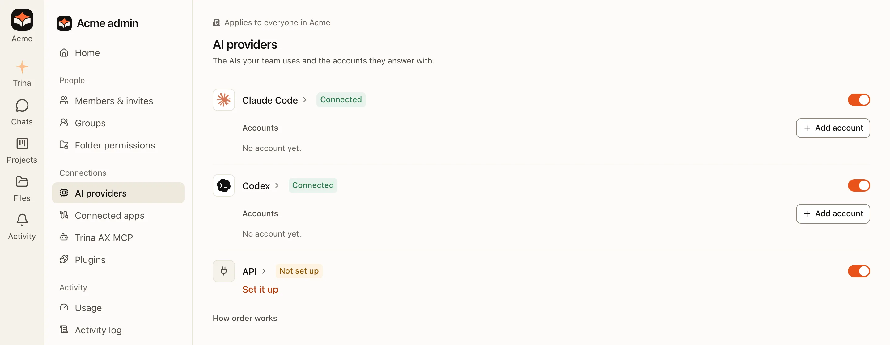
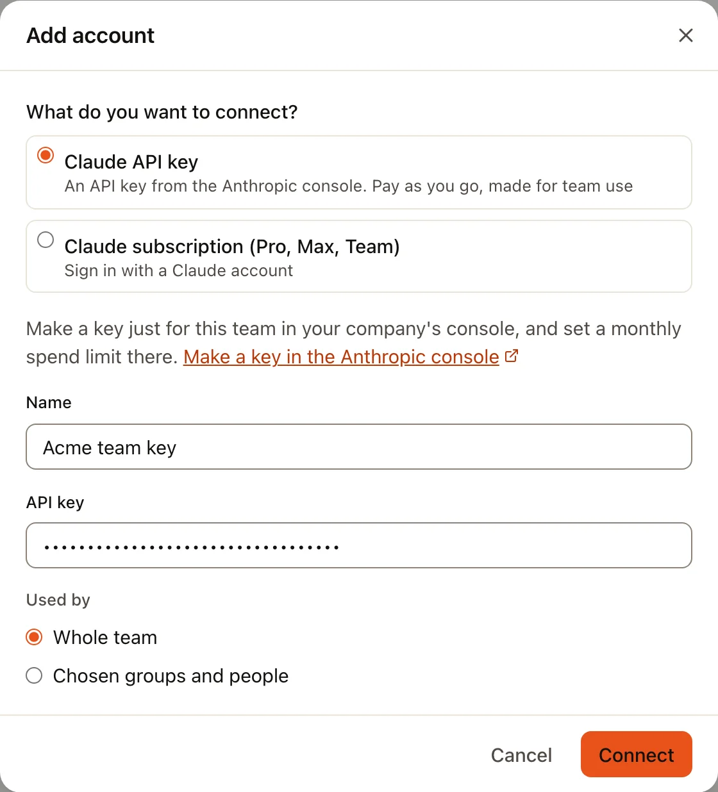
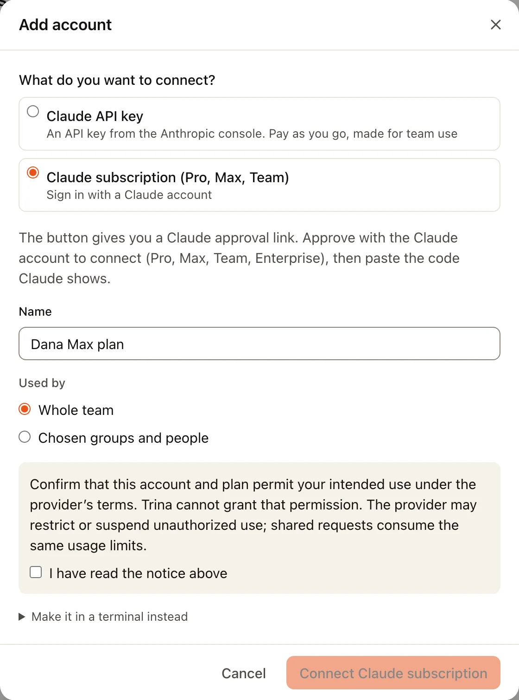
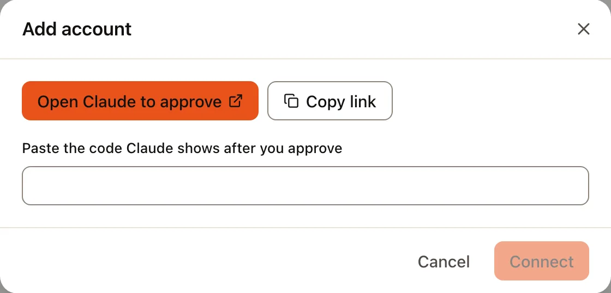
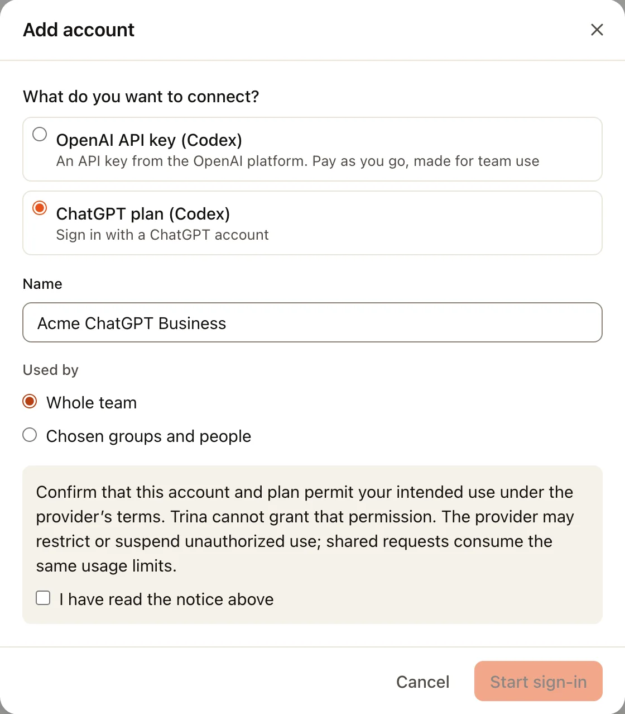
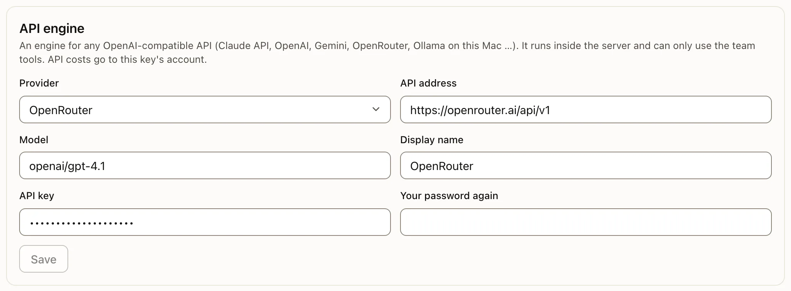
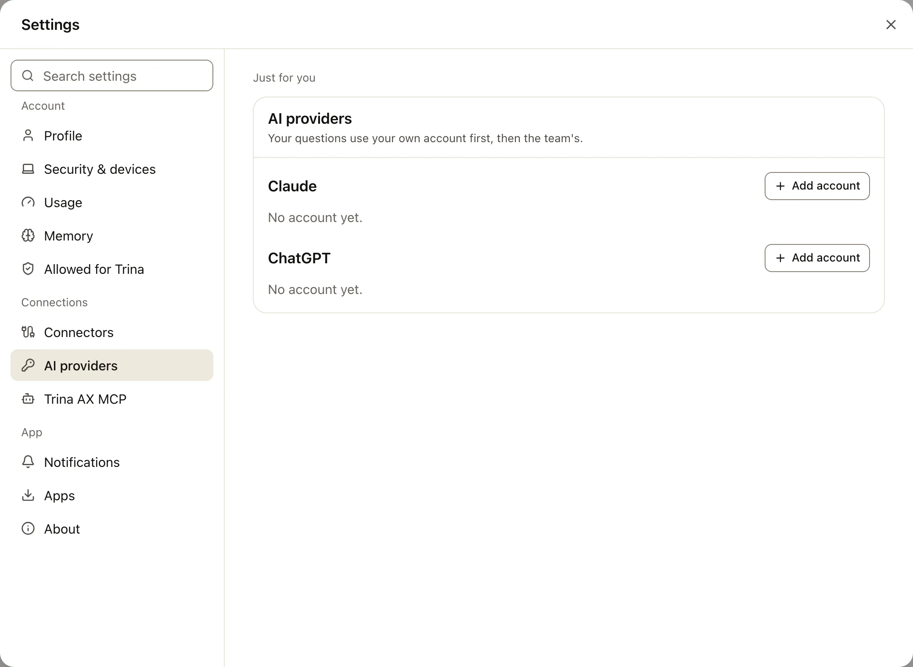

Trina AX responde con una cuenta de IA que conecta su equipo: una cuenta de Claude o ChatGPT, o una clave de API. El uso
de IA no está incluido en Trina AX. Anthropic, OpenAI o la otra empresa de IA cobra el uso a la cuenta o clave que usted
conecta, según las condiciones de esa empresa.

El propietario o un administrador conecta las cuentas del equipo en **Administración › Proveedores de IA**. Si el equipo
lo permite, cada persona también puede añadir la suya en **Configuración › Proveedores de IA**: sus propias preguntas la
usan primero.

## Cuál elegir

| Opción en Trina AX | Qué necesita | Quién factura | Útil para |
|---|---|---|---|
| **Clave de API de Claude** | Una clave de API de Claude Console | Anthropic, por uso | Un equipo, con un límite mensual que usted fija en Anthropic |
| **Suscripción de Claude (Pro, Max, Team)** | Una cuenta de Claude con un plan de pago | Anthropic, su plan | La cuenta propia de una persona |
| **Clave de API de OpenAI (Codex)** | Una clave de API de OpenAI platform | OpenAI, por uso | Un equipo que usa OpenAI |
| **Plan de ChatGPT (Codex)** | Una cuenta de ChatGPT con un plan de pago | OpenAI, su plan | La cuenta propia de una persona |
| **Motor API** | Una dirección, un modelo y una clave de cualquier servicio compatible con OpenAI | Ese servicio | OpenRouter, Gemini o un modelo en su propio ordenador |

:::warning
Una suscripción (de Claude o ChatGPT) está pensada para su titular. Antes de conectar una para otras personas, compruebe
que las condiciones del proveedor lo permiten: el cuadro le pide confirmar **He leído el aviso anterior**. Para un
equipo, una clave de API es la opción más segura.
:::

## Añadir una clave de API de Claude

:::tip
**Qué necesita**

- **Clave de API**: un código largo que empieza por `sk-`. Se crea en [Claude Console](https://platform.claude.com/settings/keys).
- **Nombre**: cualquier nombre que su equipo reconozca, como "Clave del equipo Acme".
:::

:::steps
#### Cree la clave en Anthropic
Inicie sesión en [Claude Console](https://platform.claude.com/settings/keys) con la cuenta de su empresa. Abra
**API keys** y elija **Create Key**. Póngale un nombre como "Trina AX" y copie la clave: Anthropic la muestra una sola
vez. Aproveche para fijar un límite de gasto mensual para su organización en **Limits**. Encontrará más detalles en la
[guía de claves de API](https://docs.claude.com/en/api/admin-api/apikeys/get-api-key) de Anthropic.

#### Abra Añadir cuenta
En Trina AX, abra **Administración › Proveedores de IA**. En la fila **Claude Code**, elija **Añadir cuenta** y después
**Clave de API de Claude**. El cuadro también enlaza con Claude Console: **Crear una clave en la consola de Anthropic**.

#### Pegue y conecte
Rellene **Nombre** y pegue la clave en **Clave de API**. En **Usada por**, deje **Todo el equipo** o elija **Grupos y
personas elegidos**. Elija **Conectar**. Trina AX comprueba la clave con Anthropic y la cuenta muestra **En
funcionamiento**.

:::

## Añadir una suscripción de Claude

:::tip
**Qué necesita**

- Una **cuenta de Claude** con un plan Pro, Max, Team o Enterprise, con la sesión iniciada en su navegador.
- Nada que copiar de una consola: Claude le muestra un **código** después de aprobar, y usted lo pega de vuelta.
:::

:::steps
#### Abra Añadir cuenta
En **Administración › Proveedores de IA** (o en **Configuración › Proveedores de IA** para la suya), elija **Añadir
cuenta** en Claude y después **Suscripción de Claude (Pro, Max, Team)**. Rellene **Nombre**, elija quién la usa, lea el
aviso y marque **He leído el aviso anterior**.

Para el equipo (en Administración), solo se puede elegir una suscripción después de que el propietario active **Permitir
compartir suscripciones** en **Administración › Configuración del equipo**, en **Cuentas propias de los miembros**.
Hasta entonces el diálogo dice "El uso compartido de suscripciones está desactivado."

#### Apruebe en Claude
1. Elija **Conectar suscripción de Claude**. A los pocos segundos el diálogo muestra **Abrir Claude para aprobar**,
   **Copiar enlace** y un cuadro vacío.
2. Elija **Abrir Claude para aprobar**. La propia página de Claude se abre en una pestaña nueva. (Si tiene la sesión de
   Claude iniciada en otro navegador, elija **Copiar enlace** y abra el enlace allí).
3. En la página de Claude, inicie sesión si se lo pide, compruebe que muestra la cuenta que quiere usar y apruebe.
   Claude muestra entonces un código.

#### Pegue el código
1. En la página de Claude, copie el código completo con su botón de copiar (tiene un `#` en medio).
2. Vuelva a la pestaña de Trina AX, péguelo en **Pegue el código que muestra Claude después de aprobar** y elija
   **Conectar**.
3. Trina AX indica **Conectado · Suscripción de Claude**, y la cuenta aparece en la fila de Claude Code.
:::

Su contraseña de Claude nunca llega a Trina AX: usted inicia sesión en la propia página de Claude, y Trina AX solo guarda
el acceso que entrega Claude.

**Crearlo en una terminal** (debajo del aviso) es la otra forma, para quien tiene Claude Code instalado: ejecute
`claude setup-token` en una terminal, apruebe en el navegador que se abre y pegue el token completo que imprime (la
terminal indica qué línea) en **Token**. Funciona durante un año.

## Añadir una clave de API de OpenAI

:::tip
**Qué necesita**

- **Clave de API**: empieza por `sk-`. Se crea en [OpenAI platform](https://platform.openai.com/api-keys).
:::

:::steps
#### Cree la clave en OpenAI
Inicie sesión en [OpenAI platform](https://platform.openai.com/api-keys), abra **API keys** y elija **Create new secret
key**. Elija el proyecto al que pertenece y copie la clave: OpenAI la muestra una sola vez. Fije un presupuesto para ese
proyecto en **Limits**.

#### Péguela en Trina AX
En **Administración › Proveedores de IA**, elija **Añadir cuenta** en la fila **Codex** y después **Clave de API de
OpenAI (Codex)**. Rellene **Nombre**, pegue la clave en **Clave de API**, elija quién la usa y elija **Conectar**.
:::

## Añadir un plan de ChatGPT

:::tip
**Qué necesita**

- Una **cuenta de ChatGPT** con un plan de pago. Nada que copiar de una consola: Trina AX le da una dirección y un
  código que debe escribir en OpenAI.
:::

:::steps
#### Empiece el inicio de sesión
En **Administración › Proveedores de IA**, elija **Añadir cuenta** en la fila **Codex** y después **Plan de ChatGPT
(Codex)**. Rellene **Nombre**, elija quién lo usa, marque **He leído el aviso anterior** y elija **Iniciar sesión**.

#### Escriba el código en OpenAI
1. Trina AX muestra **Abra la página de inicio de sesión de ChatGPT** y, debajo de **Introduzca este código (en 15
   minutos)**, un código corto como `WXYZ-12AB3` con un botón de copiar.
2. Abra la página. Inicie sesión en OpenAI con la cuenta de ChatGPT.
3. Escriba o pegue allí el código y apruebe. Deje abierta la pestaña de Trina AX: avanza sola.

#### Listo
Trina AX muestra **Conectado · ChatGPT** con el nombre del plan. Si inició sesión con otra cuenta distinta de la que
quería, cierre la sesión en chatgpt.com y elija **Volver a empezar**.
:::

## El motor API

El motor API se comunica con cualquier servicio que ofrezca una API compatible con OpenAI. Todavía está marcado como
**Experimental**: las respuestas, las herramientas y los costes pueden ser distintos de los de Claude Code y Codex.

:::tip
**Qué necesita**

- **Proveedor**: elija uno, y Trina AX rellena su **Dirección de la API** y un **Modelo**.
- **Modelo**: el nombre exacto del modelo en ese proveedor.
- **Clave de API**: de la página de claves del proveedor.
- **Su contraseña de nuevo**: su propia contraseña de Trina AX, para confirmar.
:::

| Proveedor | Dirección de la API | Dónde se crea la clave |
|---|---|---|
| OpenAI | `https://api.openai.com/v1` | [platform.openai.com/api-keys](https://platform.openai.com/api-keys) |
| Claude API (Anthropic) | `https://api.anthropic.com/v1` | [platform.claude.com/settings/keys](https://platform.claude.com/settings/keys) |
| Google Gemini | `https://generativelanguage.googleapis.com/v1beta/openai` | [aistudio.google.com/apikey](https://aistudio.google.com/apikey) |
| OpenRouter | `https://openrouter.ai/api/v1` | [openrouter.ai/settings/keys](https://openrouter.ai/settings/keys) |
| Ollama (en el ordenador del servidor) | `http://127.0.0.1:11434/v1` | Sin clave: un modelo que se ejecuta en el mismo ordenador que el servidor. Solo el propietario puede fijar esta dirección |

:::steps
#### Abra la fila de la API
En **Administración › Proveedores de IA**, elija **Configurarlo** en **API**.

#### Rellene el formulario
Elija el **Proveedor**, compruebe el **Modelo**, póngale un **Nombre para mostrar**, pegue la **Clave de API** y escriba
**Su contraseña de nuevo**. Elija **Guardar**.

:::

## Su propia cuenta

Cuando un administrador activa **Permitir que los miembros añadan su propia conexión de IA** (**Administración ›
Configuración del equipo**, **Cuentas propias de los miembros**), todos ven **Configuración › Proveedores de IA**: "Sus
preguntas usan primero su propia cuenta y, si no tiene, la del equipo." Elija **Añadir cuenta** en **Claude** o
**ChatGPT** y siga los mismos pasos de arriba. Solo la usan sus propias preguntas; los administradores no pueden usarla
ni ver su clave.

## Entrada de voz

La entrada de voz convierte lo que dice en texto mediante OpenRouter. En su propio servidor, un administrador añade una
**Clave de API de OpenRouter** en **Administración › Configuración del equipo**, en **Entrada de voz**. Cree la clave en
[openrouter.ai/keys](https://openrouter.ai/keys).

## Problemas

| Qué ve | Qué hacer |
|---|---|
| **No es una clave de API de este tipo.** | La clave es de otro tipo (una clave de OpenAI en el campo de Claude, o al revés), o se copió con un espacio. Cópiela de nuevo. |
| **Pegue el código completo (tiene un # en medio).** | Falta una parte del código de Claude. Cópielo de nuevo con el botón de copiar de Claude. |
| **Ese código no funcionó. Empiece de nuevo, apruebe y pegue el código nuevo.** | El código ya se usó o es demasiado antiguo. Elija **Conectar suscripción de Claude** de nuevo. |
| **Se agotó el tiempo.** (ChatGPT) | El código funciona durante 15 minutos. Elija **Volver a empezar**. |
| **Solo se pueden añadir conexiones mediante una conexión segura (https).** | Abra Trina AX en su dirección `https://`. |
| Una cuenta muestra **Rechazada** o **Se requiere volver a conectar** | La clave se revocó o terminó el inicio de sesión. Abra el menú **⋯** de la cuenta y elija **Reemplazar token o clave** o **Volver a conectar**. |
| Una cuenta muestra **Límite mensual agotado** | Se alcanzó el límite fijado en su **⋯** › **Límite mensual**. Súbalo o espere al mes siguiente. |

Más sobre el orden en que se usan las cuentas, los límites y los motores: [Administración](admin.md#proveedores-de-ia) y
[Uso y límites](usage-and-limits.md).
