Un chat es una conversación con la IA. Un chat nuevo es solo suyo hasta que lo [comparte](#compartir-un-chat); un chat
de un proyecto del equipo se comparte con los miembros del proyecto, salvo que elija **Solo yo**. Los administradores ven
qué archivos leyó la IA, nunca la conversación.

## Empezar un chat

:::steps
#### Abra un chat nuevo
Elija **Preguntar a Trina** arriba de su lista de Trina (**Trina** en la barra de la izquierda), pulse ⇧⌘O (Ctrl+Shift+O en Windows) o escriba en el cuadro de la página de inicio. En un teléfono, la pestaña **Trina** se abre en Inicio: escriba en el cuadro de abajo. La primera vez, bajo el cuadro, **Preparado en su
equipo** muestra lo que su equipo ha preparado: sus habilidades (**Ejemplo** muestra un resultado, **Probar** abre la habilidad) hasta que
haya ejecutado una, y los archivos del equipo (**Preguntar** pone en el cuadro una pregunta sobre ellos, sin enviarla). Si todavía no hay
nada preparado, **Empiece por aquí** ofrece una pregunta para enviar.

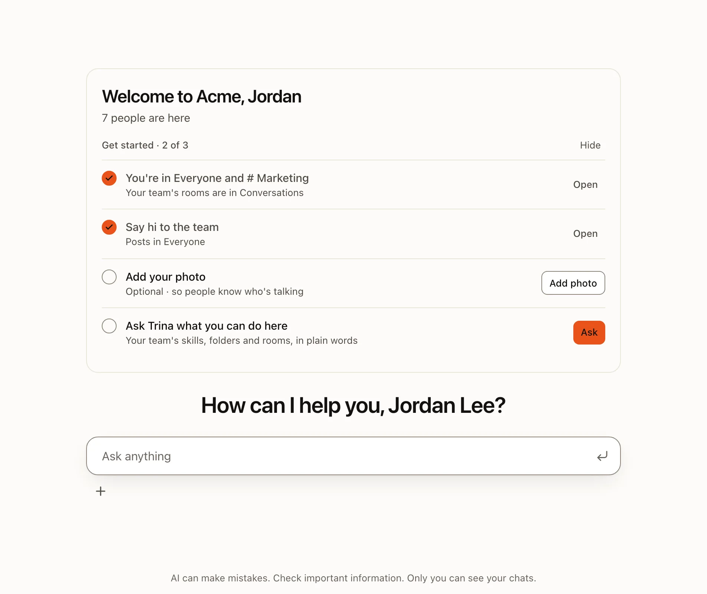

#### Pregunte con sus propias palabras
Por ejemplo: "Resume las notas de ventas de la semana pasada en shared/sales." Escriba `/` para elegir una habilidad del equipo.

El cuadro de mensaje tiene su texto arriba y una fila de botones debajo, dentro del cuadro: **+** a la izquierda añade archivos
(de su ordenador o de los archivos del equipo), y a la derecha están la elección de IA (para las personas que un administrador autoriza), el
micrófono donde está activado, y enviar (**↑**). Intro envía el mensaje.

#### Siga el trabajo
Abra **N pasos** bajo una respuesta para ver cada herramienta que usó la IA y cada archivo que leyó.
:::

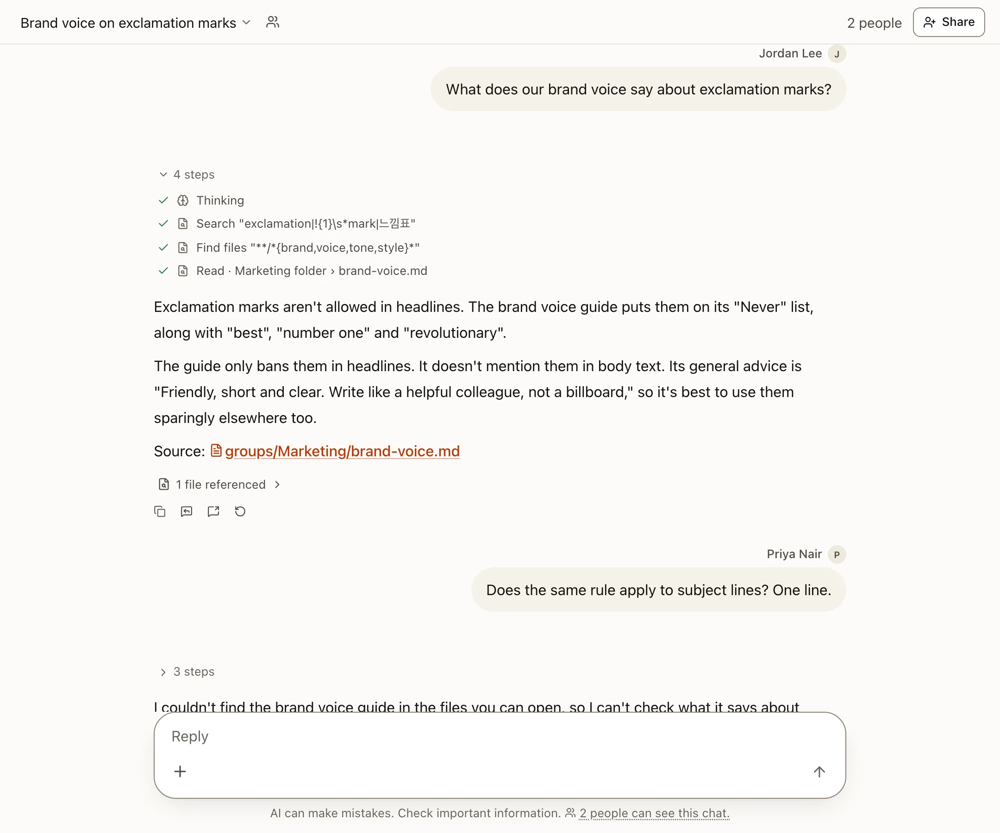

## Cómo funciona una respuesta

| Tema | Qué ocurre |
|---|---|
| **Motor** | Los miembros usan el motor predeterminado del equipo. Las personas que un administrador autoriza pueden elegir un motor y un modelo en el chat. |
| **Archivos** | La IA usa las herramientas de archivos de Trina. Cada llamada se comprueba con sus propios permisos. |
| **Preguntas** | Cuando la IA necesita que usted elija o confirme algo, muestra una tarjeta. No puede responder esa tarjeta por sí misma. |
| **Ayudantes** | Para peticiones grandes, la IA puede dividir el trabajo en subtareas, hasta 4 a la vez. Cada ayudante trabaja como usted. |
| **Extensión** | Una respuesta puede usar herramientas hasta 500 veces de forma predeterminada (los administradores eligen entre 10 y 2000; las tareas programadas, las preguntas desde Slack y los invitados, hasta 150). Al llegar al límite, **Continuar** retoma el trabajo. |
| **Web** | La IA puede abrir páginas web. El servidor comprueba cada dirección y le pregunta antes de abrir las que son arriesgadas. |
| **Ayuda** | Pregunte cómo usar, configurar o arreglar Trina AX: la IA lo busca en esta documentación, que está en su servidor con cada versión, y termina con el enlace a la página. |

:::note
El contexto seleccionado se envía al proveedor de IA que usted conectó. Alojarlo en su propio servidor no significa procesarlo sin conexión. [Leer los flujos de datos](../../operate/security.md) (en inglés).
:::

## Su lista de Trina

En un ordenador, **Trina** en la barra de la izquierda abre su lista de chats de Trina junto a la página. Arriba están
**Preguntar a Trina**, **Buscar**, **Programadas** y **Habilidades del equipo**. Debajo, de arriba abajo:

| Parte | Qué contiene |
|---|---|
| **Esperando su respuesta** | Solo aparece mientras un chat espera su respuesta, y lo abre |
| **Fijado** | Los chats que ha fijado |
| **Historial de Trina** | Todos sus demás chats, del más reciente al más antiguo. Un chat de un proyecto muestra el nombre del proyecto al final de su fila |

Una pequeña marca indica quién ve un chat: un candado antes del título si es un chat de un proyecto del equipo que solo ve usted, y el
icono de personas si es un chat compartido. Un chat compartido en el que otras personas escribieron muestra en su lugar sus caras al final de la fila (hasta 3, 2 en
un teléfono); pase el puntero por encima para ver sus nombres. Esto es igual en su historial, en la página de un proyecto y en la búsqueda.

**Trina** en la barra también abre el chat que espera mientras muestra **?**. Los chats que eliminó están en **Historial eliminado**, en
el menú **⋯** junto a **Historial de Trina**. El botón de filtro arriba de la lista puede mostrar solo algunos chats, por ejemplo los
que están respondiendo o esperan su respuesta. Sus proyectos tienen su propio lugar: **Proyectos** en la barra.

En un teléfono, la pestaña **Trina** se abre en Inicio. **☰** arriba abre su historial: **Buscar**, **Programadas**, **Habilidades
del equipo**, luego **Historial de Trina** (primero sus chats fijados y después del más reciente al más antiguo, por fecha), y **Establecer su estado** y
**Historial eliminado** abajo.

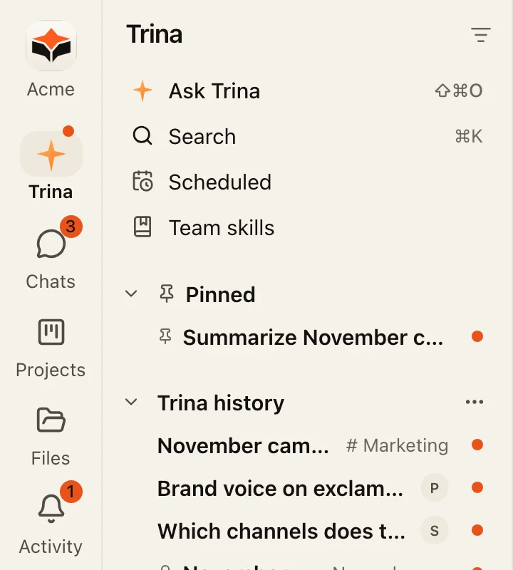

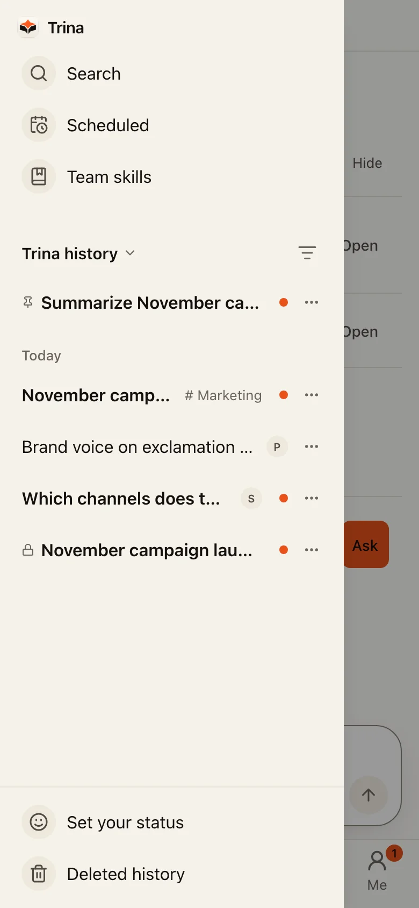

### Secciones

Los chats de Trina no tienen carpetas. Para mantener juntos los chats sobre un mismo trabajo, póngalos en un [proyecto](#proyectos).

En la lista **Chats** puede agrupar canales y mensajes directos en sus propias **secciones**, como las secciones de la
barra lateral de Slack. Una sección solo ordena su propia lista: no contiene archivos, nadie más la ve y nunca cambia
quién está en una conversación.

1. Abra **Chats** en la barra de la izquierda.
2. Pase el puntero sobre **Canales** y pulse el **+** al final de esa línea. Se abre un menú pequeño con **Crear un
   canal** y **Nueva sección**.
3. Elija **Nueva sección**, escriba un nombre (por ejemplo "Clientes") y pulse **Crear**.
4. Se abre una lista de sus conversaciones. Marque las que quiera y pulse **Añadir 2 conversaciones** (el número sigue
   a lo que marque), u **Omitir** para llenarla más tarde.

La nueva sección aparece en su lista Chats, encima de **Canales**, con las conversaciones que eligió.

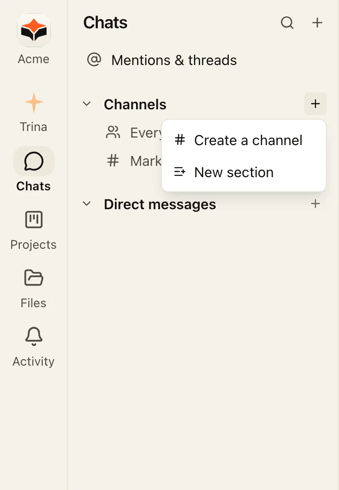

- **Mover una conversación:** en su fila, elija **···** › **Mover a una sección** y elija la sección (o **Nueva
  sección…**). En un ordenador también puede arrastrar la fila hasta una sección. **Quitar de la sección** la devuelve
  a su sitio: **Canales**, **Proyectos** (la sala de chat de un proyecto) o **Mensajes directos**.
- **Cambiar una sección:** su **···** tiene **Añadir conversaciones**, **Cambiar nombre de la sección**, **Subir**,
  **Bajar** y **Eliminar sección**. Eliminar una sección solo quita el encabezado: sus conversaciones vuelven a
  **Canales** y **Mensajes directos**.

## Varios chats a la vez

Cada chat de su lista de chats de Trina muestra como máximo una marca, en el extremo derecho de su fila:

| Marca | Qué significa |
|---|---|
| **?** en ámbar | La IA espera su respuesta: una tarjeta de pregunta o confirmación, o una respuesta que falló o se detuvo en un límite. El **?** de una tarjeta se mantiene hasta que la responde. |
| Anillo gris | La IA está respondiendo, o la respuesta espera su turno. |
| Punto, título en negrita | Una respuesta nueva que todavía no ha abierto. |

Al abrir un chat desaparece su punto, y también el **?** de una respuesta que falló o se detuvo, en todos los dispositivos. Una sección plegada conserva la marca más fuerte de los chats que contiene. Una conversación muestra **?** en lugar de su recuento mientras la IA espera allí su respuesta.

Mientras la pestaña del navegador está en segundo plano, su título cuenta los chats y las conversaciones que le necesitan, por ejemplo "(2) Trina". La app de escritorio muestra el mismo número en el Dock de un Mac, y una notificación cuando se abre una tarjeta o termina una respuesta de más de un minuto mientras usted mira otra cosa; al hacer clic se abre ese chat. Las tareas programadas solo reciben la marca; una pregunta hecha desde Slack se responde allí, así que su chat no recibe punto. **Trina** en la barra de la izquierda (en un teléfono, la pestaña **Trina**) muestra **?** o un punto cuando un chat le necesita, **Chats** muestra **?** mientras la IA espera su respuesta en una conversación, y en un teléfono aparece en la app un mensaje corto con **Abrir**.

## Compartir un chat

Puede compartir cualquier chat suyo con personas y grupos, como un archivo en Google Drive. Ven el chat completo, incluido lo que se dijo antes de que
los añadiera, y pueden preguntar a la IA en él.

:::steps
#### Abra Compartir
En el menú del título del chat, o en **···** en su fila de la lista, elija **Compartir**.

#### Añada personas y grupos
Escriba un nombre en **Agregar personas y grupos**. Usted aparece en la lista como **Inició este chat**. **✕** vuelve a quitar a alguien
(**Deshacer** lo devuelve mientras no guarde).

#### Guarde
Pulse **Compartir** (**Guardar** si ya estaba compartido). Si sale con cambios sin guardar, la app le pregunta antes.
:::

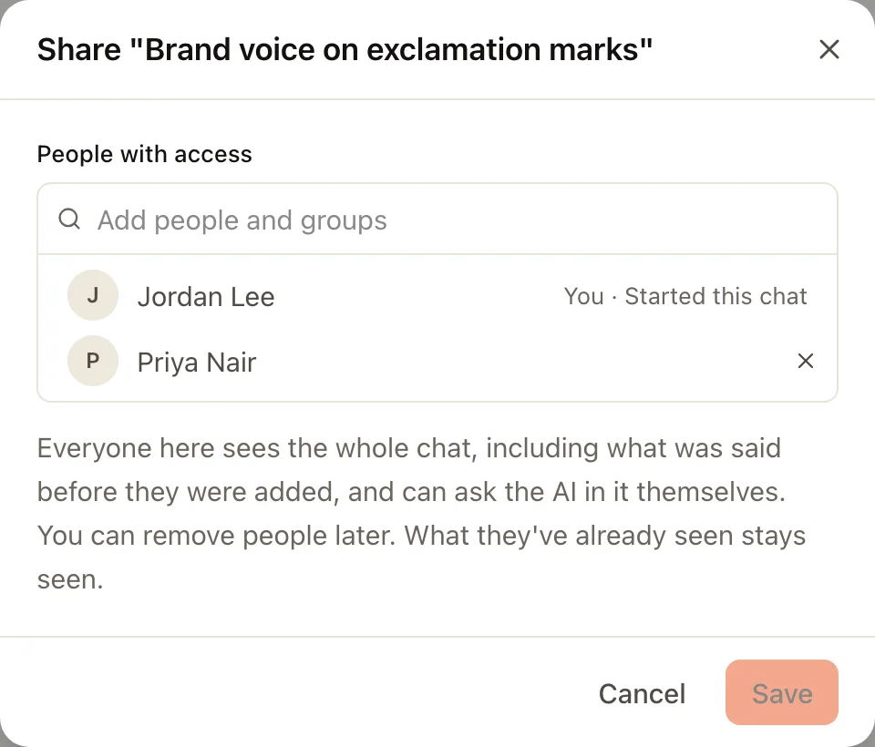

- **Antes de añadir a personas nuevas**, la app comprueba qué empezarían a ver. Si el chat usó lugares que algunas de ellas
  no pueden abrir, lo indica, por ejemplo "1 persona no puede abrir parte de lo que usó este chat: groups/Marketing/". Cuando
  menciona respuestas ("2 respuestas de aquí usaron lugares que Priya no puede abrir"), **Ver respuestas** las muestra. **Compartir de todos modos** comparte
  el chat; **Cancelar** lo deja como estaba.
- **Archivos.** Los archivos que adjuntó desde su ordenador antes de compartir pasan a ser visibles para las personas que añade, y el cuadro
  indica cuántos son. Un archivo que modificó después de adjuntarlo sigue siendo suyo: no se cuenta y los demás no lo ven.
  En un chat compartido, cualquiera que esté en él puede adjuntar un archivo desde el ordenador (50 MB como máximo por archivo): se guarda con el chat,
  y solo las personas que ven el chat pueden abrirlo y preguntar a Trina sobre él. Al eliminar el chat se eliminan.
- **Quién ve las respuestas.** Las respuestas de un chat compartido nunca se ocultan a las personas que están en él, incluidas las que se añaden después.
  Cada respuesta se ejecuta como la persona que preguntó, con lo que esa persona puede abrir. Antes de que la IA lea algo que algunas de ellas no pueden
  abrir, se lo pregunta a usted.
- **Lo que ven los demás.** El chat aparece en su lista de Trina, y **Actividad** dice "Jordan compartió un chat con usted".
  Cuando añade a alguien por su nombre, también recibe una notificación en su teléfono y en su navegador (**Configuración ›
  Notificaciones › Chats compartidos conmigo** la desactiva). Puede continuar el chat con su propio acceso, o elegir
  **Ocultar de mi lista** en su menú; si lo vuelve a abrir, regresa a la lista.
- **Cambiar quién lo ve.** Solo la persona que empezó el chat cambia quién lo ve: con **Compartir** otra vez, o con **Cambiar quién
  lo ve** bajo el cuadro. Quien usted quita pierde el chat y sus archivos al instante y lee "Este chat ya no se comparte con usted",
  también si abre su enlace más tarde; lo que estaba escribiendo en él se queda allí con **Copiar**. Si quita a alguien por su nombre
  pero esa persona también está en un grupo con el que lo compartió, lo conserva a través de ese grupo, y el cuadro lo indica.
  Si quita a todos, el chat vuelve a ser solo suyo.
- **Pedir acceso.** Un compañero que abre el enlace de un chat que no puede ver recibe **Pedir acceso**, con espacio para una
  nota; la página no muestra nada del chat, ni su título ni quién está en él. Después de pulsarlo, el botón dice
  **Solicitado**. Usted recibe la solicitud en **Actividad** con **Compartir** y **Rechazar**, y una notificación en su teléfono y
  en su navegador (**Configuración › Notificaciones › Compartir**; como mucho 10 al día, junto con las solicitudes para abrir
  archivos). **Compartir** lo añade por su nombre, tras la misma comprobación del cuadro Compartir; **Rechazar** solo le dice que
  no se aprobó, y puede volver a pedirlo. El enlace de un proyecto funciona igual: la solicitud llega a quien cambia sus miembros,
  y **Añadir** hace miembro a la persona. Un chat compartido de un proyecto del equipo pide unirse a ese proyecto. Cuando no
  se puede pedir (un chat que nunca se comparte, como uno de un proyecto personal, o nadie que pueda responder), la página
  solo dice que no puede pedirlo, sin el botón y sin decir por qué. Los invitados no pueden pedirlo, y quien ya puede abrirlo simplemente entra.
- **Lo personal se queda fuera.** En un chat compartido la IA no usa sus recuerdos, su navegador, su correo ni sus
  horarios. Para usarlos, elija **Continuar en un chat que solo ve usted** en el menú del chat.
- Un chat de un proyecto personal sigue siendo suyo: **Compartir** le ofrece sacarlo antes del proyecto. Un chat de un proyecto del equipo se comparte
  con los miembros del proyecto (consulte [Proyectos](#proyectos)).

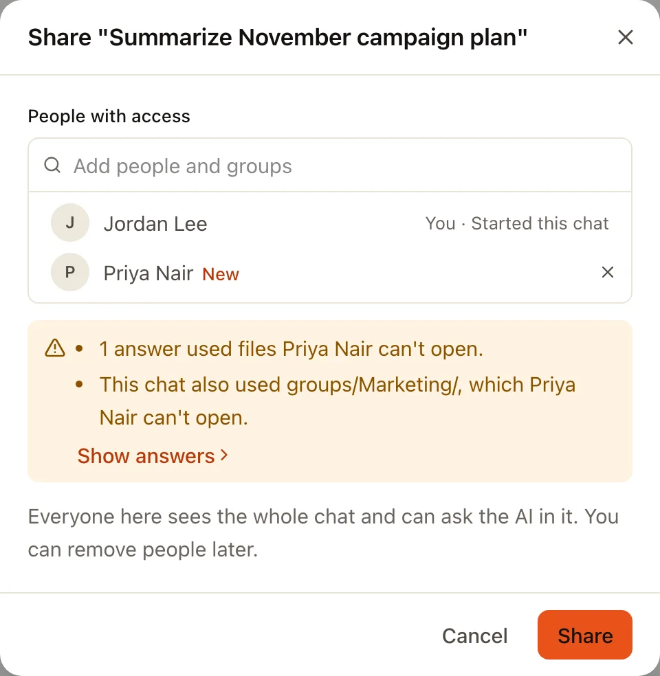

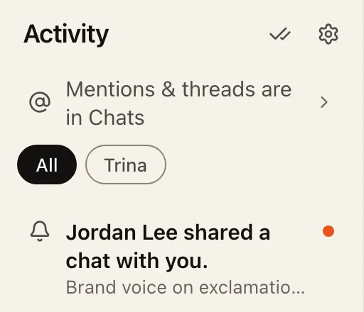

## Fijar un chat

En su lista de chats de Trina, el menú **···** de un chat (o un clic derecho en su fila, o una pulsación larga en un teléfono) tiene **Fijar arriba**.
Los chats fijados aparecen primero en su lista de Trina, el fijado más recientemente en primer lugar, con una pequeña chincheta antes del
título, en un ordenador y en un teléfono. La página de un proyecto también muestra primero sus
chats fijados. **Dejar de fijar** devuelve un chat a su sitio. Un chat fijado lo es solo para usted, también en un chat compartido de un proyecto,
y deja de estarlo cuando el chat se elimina o usted ya no puede verlo. Puede fijar hasta 50 chats.

Las conversaciones de **Chats** (canales y mensajes directos, incluidos los chats de grupo) se fijan de la misma forma, desde el **···** de una fila o el propio
**···** de la conversación: las fijadas aparecen primero, con una pequeña chincheta después del nombre, en todas las listas de conversaciones, en un ordenador y en la pestaña **Chats** del teléfono.
Solo usted ve lo que ha fijado. Una conversación deja de estar fijada cuando sale de la conversación o la oculta. Puede fijar hasta 50 conversaciones.

La lista **Chats** muestra todas las conversaciones: las fijadas, sus secciones y luego **Canales** (primero el canal Todos y después
por nombre; los canales privados llevan un candado) y **Mensajes directos** (los chats 1:1 y los chats de grupo sin nombre juntos, el más reciente primero, cada uno con las caras de sus miembros). Las conversaciones que ocultó están en **Conversaciones ocultas (N)**.

El **+** junto a **Canales** abre un menú pequeño. **Crear un canal**: elija a las personas y póngale un nombre, y será
un canal privado que solo ellas ven. **Nueva sección** crea una de sus propias secciones, como se describe arriba en
Secciones. El **+** junto a **Mensajes directos** es **Nuevo mensaje**: elija a una persona para un mensaje directo,
o a varias para un chat de grupo con sus nombres (si ya tiene uno con exactamente esas personas, se abre ese). Para
convertir un chat de grupo en canal privado, elija **···** › **Convertir en canal privado** y póngale un nombre.

Un chat directo con alguien que dejó el equipo dice "<nombre> dejó el equipo" y no tiene cuadro de mensaje. El historial se puede seguir leyendo.

## Chat del equipo

**Chats** en la barra de la izquierda (en un teléfono, la pestaña **Chats**) es donde las personas hablan entre sí: **Canales**
(uno para todo el equipo, uno por grupo y los canales privados en los que está) y **Mensajes directos** (chats 1:1 y chats de grupo).
Los mensajes que le mencionan y las respuestas nuevas en los hilos que sigue están en **Actividad**, con sus demás avisos.

Para escribir a una sola persona, haga clic en su foto o en su nombre junto a un mensaje (también sirve una @mención o su fila en la lista de miembros de una conversación). Se abre una tarjeta pequeña con su nombre y su cargo: **Enviar mensaje** abre su chat 1:1 con esa persona. En un teléfono la tarjeta se abre desde la parte inferior de la pantalla. Su propia tarjeta tiene **Editar perfil**. Las aplicaciones y las personas que ya no están en el equipo no tienen tarjeta; un invitado solo puede escribir a las personas de su chat de grupo o de su proyecto.

Para traer a alguien de fuera del equipo, elija **Invitar a un invitado** al añadir personas a un canal privado, a un chat de grupo o a un proyecto. [Más información sobre los invitados](guests.md).

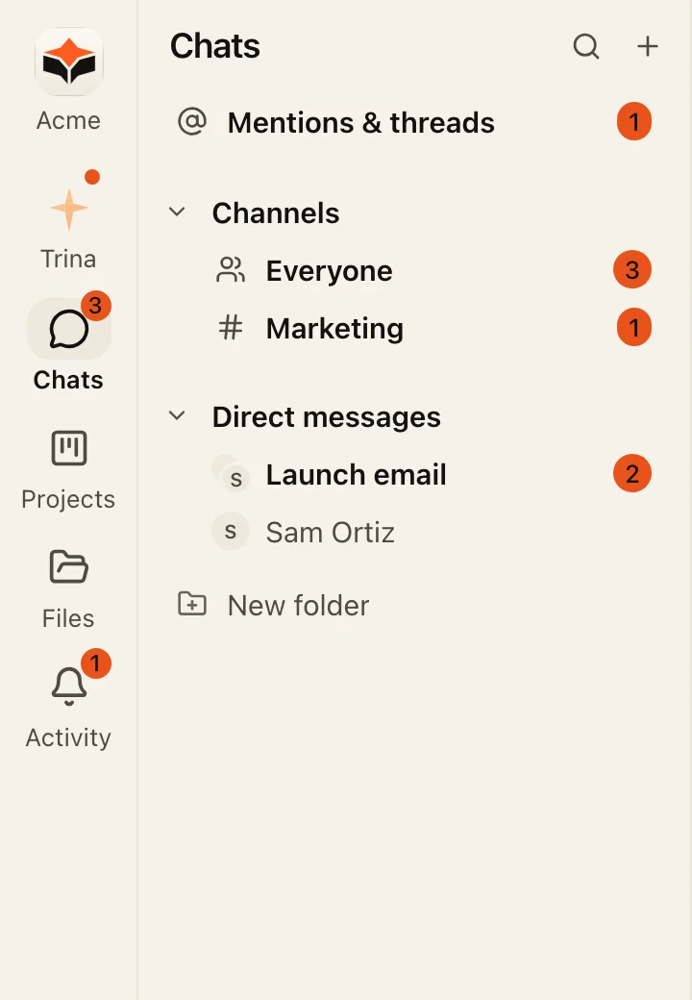

#### Preguntar a Trina junto a una conversación

El botón **✦** arriba de una conversación abre al lado un chat lateral con Trina. Solo usted ve este chat, y la IA
responde con lo que usted puede abrir. Cuando vale la pena compartir una respuesta, **Enviar** debajo de ella la pone en la conversación como mensaje suyo
(**Enviar al hilo** si preguntó sobre un mensaje). Si algunas personas de la conversación no pueden abrir un archivo que usó la respuesta,
la app se lo dice antes y espera su confirmación.

Con un hilo abierto, **✦** abre el chat lateral junto al hilo y los dos siguen en pantalla (en una ventana pequeña la
conversación les deja el sitio). El cuadro del chat lateral dice entonces **Viendo este hilo**: su pregunta trata de ese hilo y la
respuesta puede ir directamente a él. Pulse **✕** en esa línea para preguntar sobre toda la conversación.

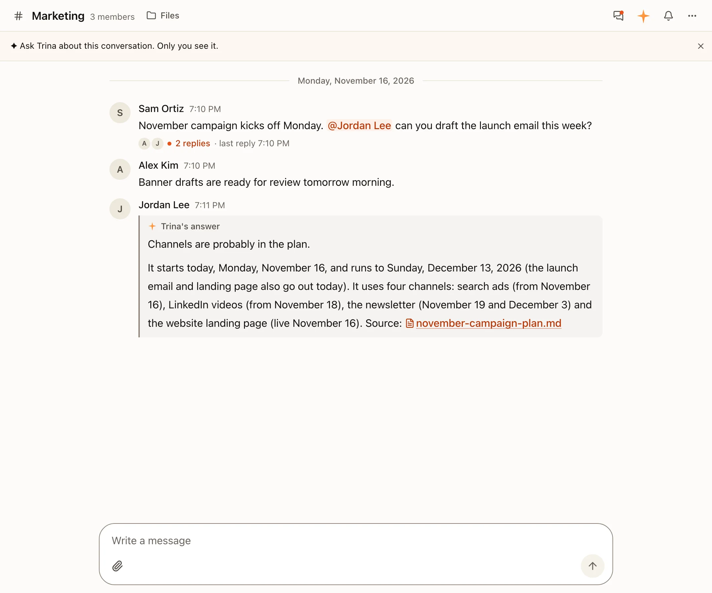

#### Responder en un hilo

**Responder en el hilo** en un mensaje mantiene un intercambio aparte debajo de él, para que la conversación se lea con facilidad. La conversación muestra cuántas
respuestas tiene un hilo; **Enviar también a la conversación** pone una respuesta también en la conversación.

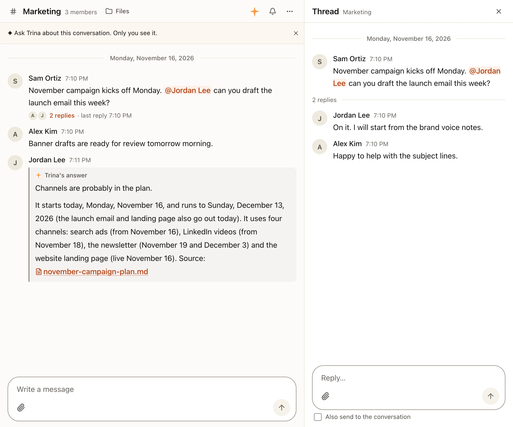

#### Enlazar a un mensaje

**Copiar enlace** en el menú **⋯** de un mensaje (en un teléfono, mantenga pulsado el mensaje) copia su dirección. Péguela en cualquier
canal, chat de grupo, mensaje directo o hilo: se muestra como el nombre de la conversación, y el mensaje aparece debajo
como una tarjeta con quién lo escribió, cuándo, su texto y sus archivos. Haga clic en la tarjeta para abrir el mensaje.

Cada persona ve la tarjeta solo si puede ver ese mensaje. Para los demás, el enlace sigue siendo un enlace normal, y al abrirlo
se indica que no se encuentra la conversación. Cuando algunas personas de la conversación no pueden ver el mensaje, el cuadro lo indica
antes de enviar: **Mostrar solo el enlace** (la opción predeterminada) envía solo el enlace; **Mostrar el mensaje** les muestra una copia del mensaje,
marcada como compartida por usted. La copia desaparece si se elimina el original. Para quitar una tarjeta de su propio mensaje, señálela
y haga clic en **✕** (o elija **Quitar vista previa** en el menú del mensaje).

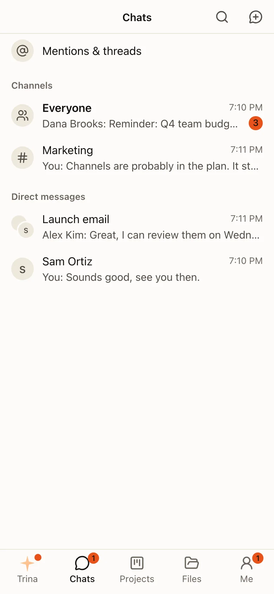

### Dónde aparecen sus conversaciones

La lista de Chats tiene el mismo orden en un ordenador y en un teléfono: **Fijados**, luego sus propias secciones, luego
**Canales**, **Proyectos** y **Mensajes directos**.

- **Proyectos** reúne la conversación de cada proyecto del equipo, por nombre, con un icono de carpeta. Aparece
  cuando alguien escribe en ella; hasta entonces se abre desde el proyecto. No tiene **+**: los proyectos se crean en la
  página Proyectos o desde una conversación (vea [Convertir una conversación en proyecto](#convertir-una-conversación-en-proyecto)).
- Una conversación aparece en un solo lugar. Una conversación de proyecto que fija o arrastra a una de sus secciones sale de
  Proyectos. Arrástrela al encabezado **Proyectos** para devolverla.
- Cuando un proyecto va a la papelera, su conversación sale de la lista. Al restaurar el proyecto, vuelve.

### El canal de un departamento y su carpeta

Cada departamento (un grupo en **Administración › Grupos**) tiene su propio canal. Cuando el departamento tiene una
carpeta que usted puede abrir, arriba en su canal aparece un botón de carpeta con el nombre del departamento: abre esa
carpeta en Archivos.

- **Un archivo que envía allí va a la carpeta Adjuntos del chat de la carpeta del departamento**, así que los archivos
  del departamento están en un solo lugar. Junto al archivo, el chat dice dónde quedó, por ejemplo "Ventas › Adjuntos
  del chat".
- Un archivo se queda solo en la conversación, marcado **Solo en esta conversación**, cuando más personas que el
  departamento pueden abrir la carpeta, cuando alguien del canal no puede abrir Adjuntos del chat o cuando usted solo
  puede ver la carpeta. El canal tiene entonces también **Archivos**, que muestra esos archivos.
- **Eliminar un mensaje elimina solo el mensaje.** Un archivo en la carpeta del departamento se queda allí, y la
  confirmación dice dónde; elimínelo en Archivos si quiere que desaparezca.
- Los administradores pueden abrir todas las carpetas del equipo, así que también pueden abrir estos archivos en
  Archivos aunque no estén en el departamento. No ven la conversación.
- Quienes entran después en el departamento pueden abrir todos los archivos que ya están en su Adjuntos del chat, pero
  no los mensajes anteriores, como en un proyecto.
- Cuando la carpeta del departamento está dentro de un proyecto, los archivos enviados en el canal se quedan en la
  conversación.
- Los archivos enviados antes de este cambio se quedan en el canal, en su lista **Archivos**.

### Invitados

Una persona de fuera del equipo, como una agencia o un cliente, puede unirse a un canal privado, a un chat de grupo o a un proyecto como
invitado, y estar como máximo en un canal privado o chat de grupo, y en un proyecto. En un canal privado o chat de grupo, abra sus miembros (el nombre de arriba), **Invitar personas** y luego **Invitar a un invitado**; en
un proyecto, **Añadir personas** en **Miembros**. Indique para quién es el enlace y si tendrá IA, y luego pulse **Crear enlace**. El enlace
funciona una sola vez: envíeselo usted mismo.

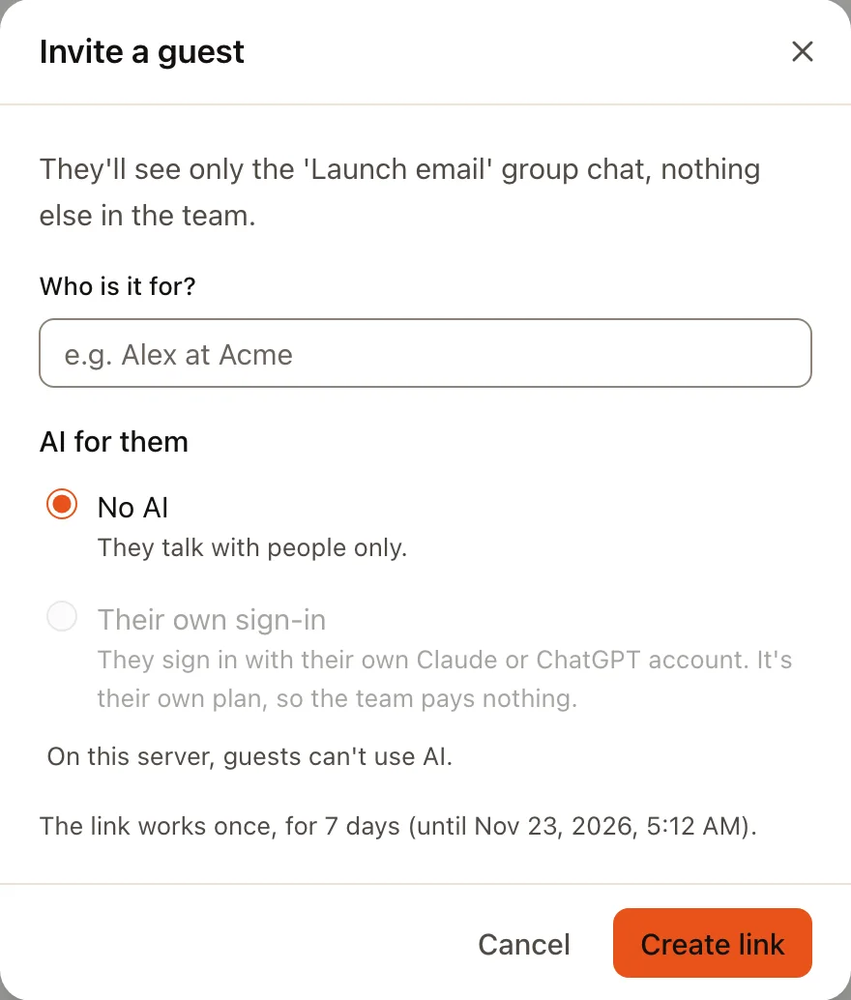

- Un invitado solo ve ese lugar: no tiene Archivos, ni otros chats de grupo o proyectos, ni áreas del equipo.
- Su IA está desactivada, salvo que usted elija **Su propio inicio de sesión** o que un administrador le dé una cuenta de **IA del equipo** con un límite mensual.
- Junto a su nombre aparece la etiqueta **Invitado**, y el encabezado dice **Incluye 1 invitado**.
- Los administradores ven a todos los invitados en **Administración › Miembros e invitaciones › Invitados** ([Administración](admin.md#invitados)).

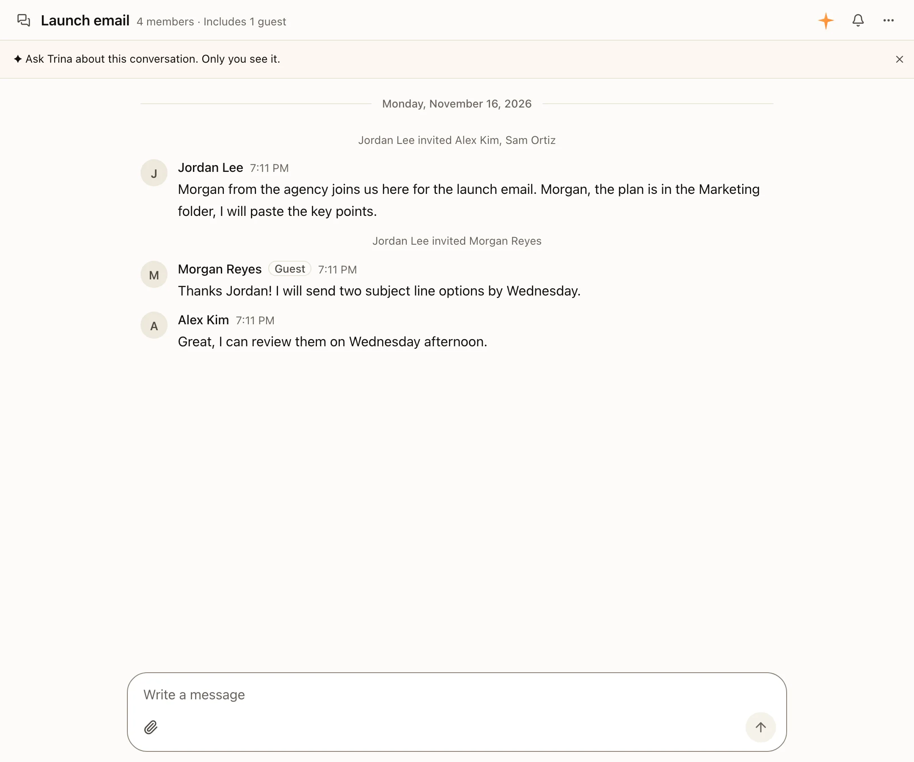

## Proyectos

Un proyecto reúne los chats, los archivos y las instrucciones de un mismo trabajo, para usted o para las personas que añada. Úselo para el trabajo que vuelve una y otra vez a los mismos archivos: un lanzamiento, un cliente, el informe de un trimestre.

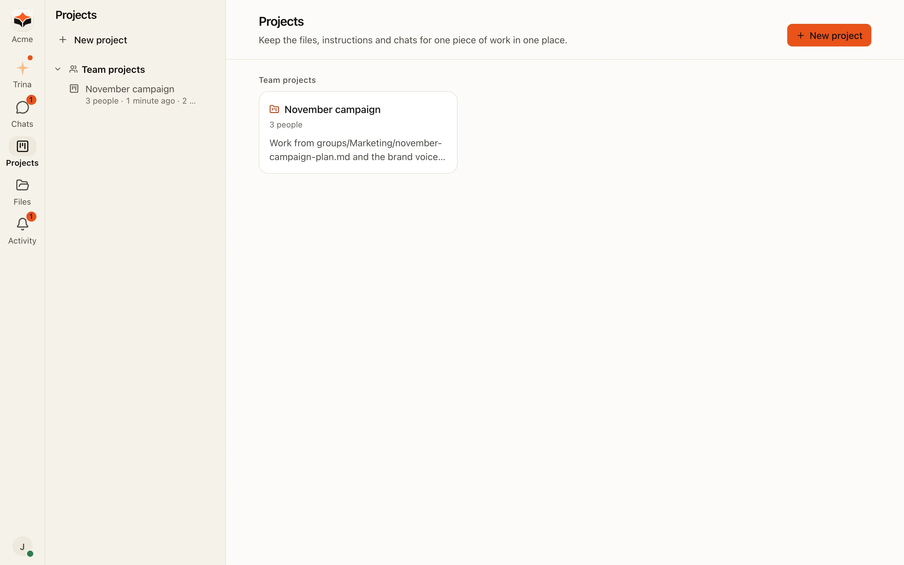

:::steps
#### Cree un proyecto
Abra **Proyectos** en la barra de la izquierda (en un teléfono, la pestaña **Proyectos**) y elija **Nuevo proyecto**. Póngale un nombre.
Un proyecto nuevo es **Solo yo**: solo usted lo ve hasta que añada personas.

#### Escriba las instrucciones
Diga en qué consiste el trabajo y cómo debe ayudar la IA. El primer párrafo aparece bajo el título del proyecto.

#### Chatee en el proyecto
Empiece un chat desde la página del proyecto, o lleve un chat a él con **Mover a un proyecto** en el menú del título del chat. La IA recibe entonces los archivos y las instrucciones del proyecto.

:::

- Sus proyectos están en **Proyectos**, en la barra de la izquierda y en la pestaña **Proyectos** del teléfono: **Proyectos del equipo**
  (otras personas también los ven) y **Mis proyectos** (solo usted). El nombre de un proyecto abre su página. Un chat que abre desde un proyecto
  vuelve a ese proyecto; sus chats también están en **Historial de Trina** en su lista de Trina. La carpeta del equipo y su papelera están
  en **Archivos**.
- Un proyecto tiene miembros. En la página del proyecto, **Miembros** muestra quiénes son, y **Añadir personas** comparte un proyecto
  que es solo suyo. Antes de guardar, le avisa de que podrán ver y editar sus archivos e instrucciones, de que sus
  chats hasta ahora siguen siendo suyos y de que el proyecto no podrá volver a ser solo suyo. En algunos equipos solo el propietario y los administradores comparten
  proyectos.
- Un proyecto también puede tener uno o más invitados: personas de fuera del equipo que solo ven este proyecto. Sus miembros pueden ver los chats que un invitado tiene allí. [Más información sobre los invitados](guests.md).
- Solo los miembros de un proyecto ven lo que contiene. El propietario y los administradores pueden cambiar sus miembros, pero no ven sus
  chats, archivos e instrucciones salvo que sean miembros.
- **Para cambiar el nombre de un proyecto**, haga clic en su nombre arriba de su página, escriba el nuevo nombre y pulse
  Intro (Esc cancela). También puede elegir **Cambiar nombre** en el **···** del proyecto en la lista **Proyectos** (o con
  clic derecho), o en el menú del nombre arriba de la página. En un teléfono, toque el nombre del proyecto en la barra
  superior. Solo pueden hacerlo quien creó el proyecto, el propietario y los administradores; los demás ven el nombre
  como texto normal. Cambiar el nombre del proyecto no cambia el de su carpeta.
- Una carpeta contiene un solo proyecto. Una vez que es un proyecto, solo un administrador mueve, cambia el nombre o elimina la carpeta.
- **Mover a la papelera** en el menú de un proyecto del equipo lo pone en la papelera con sus archivos. Sus miembros conservan su tarjeta, marcada
  **en la papelera**: su página dice quién lo movió allí y cuándo, y que un administrador o quien lo creó puede restaurarlo. Nadie
  abre sus archivos, chats ni instrucciones hasta entonces. Un administrador o quien lo creó lo restaura en su página o en
  **Archivos › Papelera**, donde aparece como una sola fila con el nombre del proyecto. **Eliminar definitivamente** es solo para administradores.
- Las instrucciones que no escribió usted por completo cuentan como contenido externo. La IA pregunta antes de recordar nada después de leerlas.
- **Los chats de un proyecto del equipo se comparten con sus miembros.** Una pequeña etiqueta después de **+** en el cuadro de mensaje del proyecto indica
  quién verá el chat que va a empezar (por ejemplo **👥 3 personas**). Púlsela para que ese chat sea solo suyo (**🔒 Solo
  yo**); el siguiente chat nuevo vuelve a empezar compartido. Un chat que solo ve usted muestra un candado. Cada pregunta muestra la foto y
  el nombre de la persona que la envió. Cada respuesta se ejecuta como la persona que preguntó, con su acceso. Cuando la IA va a
  leer algo que algunas de ellas no pueden abrir, se lo pregunta a usted antes (**Leer y compartir** / **No leer**).
- **Los chats que trae o mueve al proyecto siguen siendo suyos.** La página del proyecto indica cuántos son ("1 chat que solo ve usted"), y **Elegir
  chats para compartir** (o **Compartir** en el menú **⋯** de un chat) los comparte; no se puede deshacer. **Traer chats** mueve otros
  chats al proyecto.
- **Archivos en los chats del proyecto.** Un archivo que adjunta desde su ordenador (**+**, pegándolo o soltándolo) en un chat compartido del proyecto
  se guarda en la subcarpeta **Adjuntos del chat** de la carpeta del proyecto (con el nombre en el idioma del equipo), donde las personas del proyecto
  pueden abrirlo, y una línea debajo lo indica. Necesita permiso de escritura en la carpeta del proyecto (sin él, **+**
  solo ofrece archivos del equipo); **✕** antes de enviar mueve el archivo a la papelera.

### Mantener un chat del proyecto solo para usted

Un chat nuevo en un proyecto del equipo se comparte con todas las personas del proyecto, como un documento que crea en
una carpeta compartida de Google Drive. Para preguntar algo que solo debe ver usted:

1. Abra la página del proyecto.
2. En el cuadro de mensaje, mire justo después de **+**: la etiqueta dice quién verá el chat, por ejemplo **👥 3 personas**.
3. Pulse la etiqueta. Cambia a **🔒 Solo yo**.
4. Escriba su pregunta y envíela.

El chat muestra un candado en la lista del proyecto y en su historial de Trina: solo usted lo ve. El siguiente chat nuevo
del proyecto vuelve a empezar compartido, así que compruebe la etiqueta cada vez. Para compartirlo más tarde, elija
**Compartir** en el menú **⋯** del chat (o **Compartir** arriba a la derecha del chat). Al compartirlo, los miembros del
proyecto ven toda la conversación hasta ahora, y no se puede deshacer.

### La conversación del proyecto

Cada proyecto del equipo tiene su propia conversación. Las personas del proyecto son las personas de la conversación, y sus
archivos son los del proyecto: una sola lista de personas y un solo lugar para los archivos.

- **Conversación** en la página del proyecto (en un teléfono, una fila bajo el nombre del proyecto) abre la conversación. La
  primera vez se crea con el nombre del proyecto. Un pequeño icono de chat en la fila del proyecto en **Proyectos** (con
  un punto si hay algo sin leer) y **Conversación** arriba en los chats de IA del proyecto también la abren.
- Arriba en la conversación, el botón de carpeta con el nombre del proyecto abre la página del proyecto: sus archivos y sus
  chats de IA. La conversación aparece en **Proyectos** en la lista de Chats, con un icono de carpeta, cuando alguien escribe en ella.
- **Quién está en ella sigue al proyecto.** Añadir a alguien al proyecto lo añade a la conversación, y ve todo su historial;
  sacarlo del proyecto lo saca de la conversación. El diálogo de miembros lo dice antes de añadir a nadie. Para cambiarlo, abra
  el nombre de la conversación arriba y luego **Gestionar personas** (para quien puede cambiar las personas del proyecto).
  **Silenciar** deja la conversación en silencio; **Salir del proyecto** sale del proyecto y de su conversación.
- **Un archivo que envía allí va a la carpeta Adjuntos del chat del proyecto**, donde las personas del proyecto lo
  encuentran en Archivos. Quien solo puede ver el proyecto puede escribir mensajes, pero no añadir archivos.
- **Eliminar un mensaje elimina solo el mensaje.** Su archivo se queda en Adjuntos del chat del proyecto; elimínelo en
  Archivos si quiere que desaparezca.
- Trina en el chat lateral de la conversación guarda los documentos nuevos en la carpeta del proyecto, y los chats de IA del
  proyecto pueden leer la conversación. Ambos los ven las mismas personas, así que no se pregunta quién puede verlo.
- El chat lateral **✦** de la conversación es solo suyo. Cuando está vacío, lo dice y enlaza a la página del proyecto, donde las
  personas del proyecto preguntan a Trina juntas.
- Cuando las personas del proyecto son exactamente las de un departamento, el inicio de la conversación y su información dicen
  "Las mismas personas que #Ventas. Hablen de Atlas aquí.", con un enlace al canal del departamento.

### Convertir una conversación en proyecto

Un canal privado o un chat de grupo que se convierte en trabajo real puede pasar a ser un proyecto, con su historial.

1. Abra el **⋯** de la conversación (arriba, en su fila de la lista, o manteniendo pulsada la fila en un teléfono) y
   elija **Convertir en proyecto**. Lo ve si puede crear proyectos del equipo; en un equipo donde solo los
   administradores los crean, un miembro no lo ve.
2. Revise el nombre. Empieza con el nombre de la conversación (en un chat de grupo sin nombre, los nombres de sus
   personas). Si otro proyecto ya tiene ese nombre, la carpeta nueva lleva "-2", y el diálogo lo dice.
3. Lea lo que pasa y elija **Crear proyecto**:
   - Todas las personas de la conversación pasan a ser personas del proyecto.
   - Los archivos enviados en la conversación pasan a la carpeta **Adjuntos del chat** del proyecto. Un archivo que no
     todos en la conversación podían ver (por ejemplo, uno enviado antes de que alguien entrara) se queda en la
     conversación, y el diálogo dice cuántos.
   - Quienes se añadan al proyecto después verán los mensajes desde entonces y podrán abrir los archivos movidos.

La conversación sigue abierta y ahora es la conversación del proyecto, con el botón de carpeta del proyecto arriba y una
línea que dice quién la convirtió en proyecto. Mientras se mueven los archivos, arriba dice **Moviendo archivos…**; una
segunda línea dice cuántos se movieron y cuántos se quedaron. Un archivo que se quedó lleva **Solo en esta
conversación**, y la conversación conserva una lista **Archivos** con esos archivos.

Sus fijados, secciones, notificaciones y lugar de lectura no cambian. Si alguien entra o sale mientras el diálogo está
abierto, dice **Las personas cambiaron** y muestra el nuevo número. Un invitado que ya tiene un proyecto lo impide: un
administrador lo convierte primero en miembro del equipo.

En un mensaje directo, el **⋯** tiene en su lugar **Nuevo proyecto con** y el nombre de la persona. Crea un proyecto
nuevo para los dos, con su propia conversación. El mensaje directo queda como está.

## Encontrar cualquier cosa

Pulse ⌘K (Ctrl+K en Windows) o elija **Buscar** bajo **Preguntar a Trina** para encontrar chats, mensajes de sus conversaciones, proyectos, archivos, habilidades, tareas programadas y conexiones MCP. [Más información sobre la búsqueda y la configuración](settings-and-search.md).

**Archivos que envió.** Escriba "Archivos que envió" en Buscar, o ábralo desde un aviso, para ver los archivos que envió en sus conversaciones, los más grandes primero, con el espacio que ocupan. Eliminar uno elimina el mensaje con el que se envió, para todos en la conversación.

## Chats eliminados

Al eliminar un chat se mueve a **Historial eliminado**, como el álbum Eliminado recientemente de un iPhone: puede
recuperarlo durante 7 días de forma predeterminada. Los administradores pueden elegir de 1 a 365 días.

Para recuperar un chat:

1. Abra **Trina** en la barra de la izquierda. En un teléfono, abra la pestaña **Trina** y pulse **☰** arriba.
2. Pulse el **⋯** al final del encabezado **Historial de Trina** y elija **Historial eliminado**. En un teléfono,
   **Historial eliminado** está al final del menú.
3. Busque el chat (cada fila dice cuándo se eliminó) y pulse **Restaurar**.

La fila sale de la lista y el chat vuelve a su historial de Trina.

- Un chat compartido va al **Historial eliminado** de la persona que lo creó. Cuando quien creó un proyecto o un administrador elimina el chat compartido de otra persona, también está en su propio **Historial eliminado**, mientras todavía pueda recuperarlo.
- Al eliminar un proyecto definitivamente, sus chats compartidos se mueven al **Historial eliminado** de las personas que los crearon. Una vez recuperado, ese chat es solo de quien lo creó, sin proyecto.
