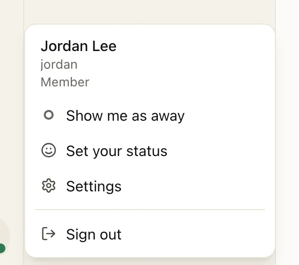
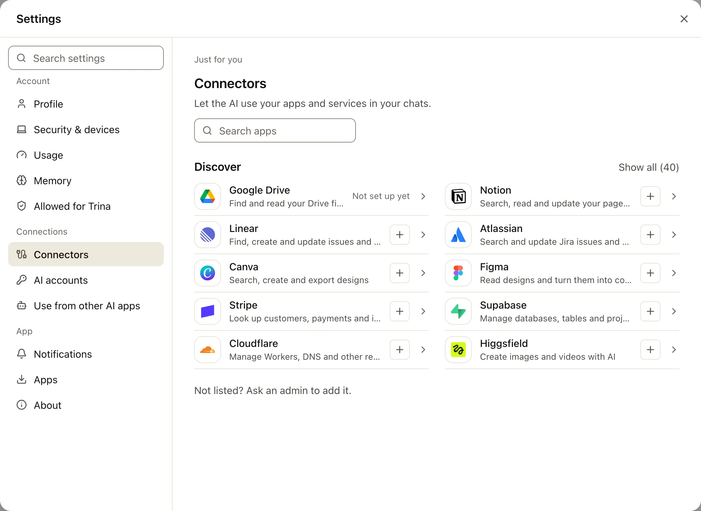
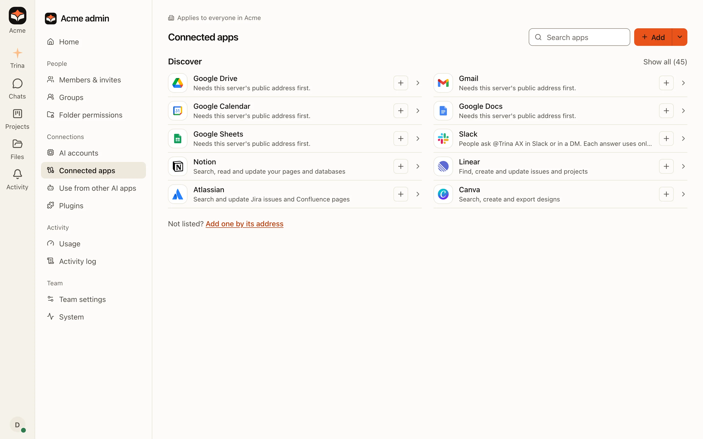

Trina AX se conecta a dos tipos de cosas:

- **Una cuenta de IA** que responde a sus preguntas: una cuenta de Claude o ChatGPT, o una clave de API de Anthropic,
  OpenAI u otra empresa de IA. Trina AX no incluye IA: su equipo conecta su propia cuenta, y esa empresa cobra el uso a la
  cuenta que usted conecta.
- **Apps** que la IA usa por usted: Google Drive, Gmail y las demás apps de Google, Slack, Notion, Linear, GitHub o el
  sistema propio de su empresa.

Esta página le indica qué guía seguir. Cada guía enumera al principio todos los datos que necesita y de dónde los saca.

:::note
Las capturas de estas guías usan una empresa inventada, "Acme", y claves inventadas. Una clave real nunca aparece en una
página ni en una imagen.
:::

## Adónde ir

| Lo que quiere | Quién lo hace | Dónde en Trina AX | Guía |
|---|---|---|---|
| Que la IA pueda responder | El propietario o un administrador | **Administración › Proveedores de IA** | [Proveedores de IA](ai-accounts.md) |
| Usar su propia cuenta de Claude o ChatGPT para sus propias preguntas | Usted (si el equipo lo permite) | **Configuración › Proveedores de IA** | [Proveedores de IA](ai-accounts.md#su-propia-cuenta) |
| Que la IA lea su Google Drive, Gmail, Calendar, Docs o Sheets | Usted | **Configuración › Conectores** | [Apps de Google](google-apps.md) |
| Mostrar el nombre de su empresa en la pantalla de inicio de sesión de Google | Un administrador de una empresa con Google Workspace | **Administración › Apps conectadas** › una app de Google | [La app de Google de su empresa](google-own-app.md) |
| Preguntar a Trina AX desde Slack | Un administrador una vez, y después cada persona una vez | **Administración › Apps conectadas › Slack** | [Slack](slack.md) |
| Que la IA use Notion, Linear, Atlassian, Figma, GitHub y otras apps | Usted para sí mismo, un administrador para el equipo | **Configuración › Conectores** o **Administración › Apps conectadas** | [Notion, Linear y otras apps](mcp.md) |
| Que la IA use el sistema propio de su empresa (una API) o una app que necesita su propia app de inicio de sesión, como NAVER WORKS | Un administrador | **Administración › Apps conectadas** › **Añadir por su dirección** | [La API de su empresa](api-connections.md) |
| Usar sus archivos de Trina AX desde Claude o ChatGPT | Usted | **Configuración › Trina AX MCP** | [Conector MCP de Trina AX](../../agents/mcp-connector.md) (en inglés) |

### Dónde están Configuración y Administración

- **Configuración** (sus propias conexiones): elija su foto en la parte inferior de la barra de la izquierda y después
  **Configuración**. En un teléfono, abra la pestaña **Yo**. Configuración se abre sobre la página, con **Conectores** y
  **Proveedores de IA** en su lista, bajo **Conexiones**.
- **Administración** (las conexiones del equipo, para el propietario y los administradores): elija el logotipo de su
  equipo en la parte superior de la barra de la izquierda y después **Administración**. Consulte
  [Administración](admin.md).

## Cada dato y de dónde sale

Nunca necesita todos. Busque la app que está conectando; el resto de la fila le dice qué debe tener a mano.

| Qué conecta | Qué escribe en Trina AX | De dónde lo saca |
|---|---|---|
| Clave de API de Claude | **Clave de API** (un código largo que empieza por `sk-`) | [Claude Console › API keys](https://platform.claude.com/settings/keys) › **Create Key** |
| Suscripción de Claude | **El código que muestra Claude** después de aprobar (tiene un `#` en medio) | claude.ai, en la ventana que abre **Abrir Claude para aprobar** |
| Clave de API de OpenAI | **Clave de API** (empieza por `sk-`) | [OpenAI platform › API keys](https://platform.openai.com/api-keys) › **Create new secret key** |
| Plan de ChatGPT | Nada: el código se escribe **en OpenAI** | Trina AX muestra la dirección y el código |
| Motor API (OpenRouter, Gemini, …) | **Dirección de la API**, **Modelo**, **Clave de API** | La página de la API de la empresa de IA (vea [el motor API](ai-accounts.md#el-motor-api)) |
| Google Drive, Gmail, Calendar, Docs, Sheets | Nada: usted inicia sesión en Google | Su cuenta de Google |
| La app de Google de su empresa | El **archivo JSON** de Google Cloud (o **ID de cliente** y **Secreto del cliente**) | Google Cloud › Google Auth Platform › **Clients** |
| Slack (equipos alojados) | Nada: **Añadir a Slack** | Un administrador del espacio de trabajo de Slack lo permite |
| Slack (su propia app de Slack) | **Bot User OAuth Token** (`xoxb-`), **App-Level Token** (`xapp-`), **Client ID**, **Client Secret** | api.slack.com › su app |
| Notion, Linear, Atlassian, Figma, Canva y las demás apps de Descubrir | Nada: usted inicia sesión en la página de la propia app | Su cuenta en esa app |
| GitHub | Nada: inicia sesión en GitHub | Su cuenta de GitHub |
| Asana, HubSpot, Box | Un administrador, una vez: el **ID de cliente** y el **secreto de cliente** de una app que el equipo crea allí (el diálogo enlaza la guía de cada servicio). Después, nada: inicia sesión en el servicio | Asana: My apps › **MCP app**. HubSpot: Development › **MCP Connectors**. Box: Admin Console › Integrations › **Box MCP server** |
| Cualquier otra app que da una clave | **Dirección** y **Clave** (a veces **Nombre del encabezado**) | Las páginas de ayuda de la app ("MCP server", "API keys") |
| La API de su empresa | **Dirección**, **Clave**, **Notas de uso** | Quien administra ese sistema |
| NAVER WORKS y otras apps que inician sesión con su propia app | **ID de cliente**, **Secreto de cliente**, **Dirección de inicio de sesión**, **Dirección de token**, **Permisos (scope)** | La consola para desarrolladores de la app |

## Personal o para el equipo

| | Personal | Equipo |
|---|---|---|
| Dónde se crea | **Configuración › Conectores** o **Configuración › Proveedores de IA** | **Administración › Apps conectadas** o **Administración › Proveedores de IA** |
| Quién la usa | Solo usted, en sus propios chats | Las personas que elige el administrador: todos, grupos o personas |
| Quién ve la clave | Nadie, ni siquiera los administradores | Nadie: un administrador ve que hay una clave guardada, nunca la clave |

Las claves y los inicios de sesión se guardan cifrados en el servidor y no se vuelven a mostrar. Para cambiar una clave,
se reemplaza.

## Errores frecuentes

| Qué pasó | Por qué | Qué hacer |
|---|---|---|
| "Introduzca la clave." o "No es una clave de API de este tipo." | La clave se copió con un espacio, un salto de línea o le falta el final | Cópiela de nuevo con el botón de copiar del proveedor, no seleccionando el texto |
| `redirect_uri_mismatch` en Google, o un inicio de sesión que dice que la dirección es incorrecta | La dirección de retorno en la consola del proveedor difiere de la que muestra Trina AX en una letra, en `http` o en una barra | Copie la dirección del cuadro de Trina AX con su botón de copiar y péguela de nuevo en la consola |
| "No se marcaron algunos permisos." | Se desmarcó una casilla en la pantalla de Google | Vuelva a conectar y deje todas las casillas marcadas |
| "Se requiere iniciar sesión" en una conexión | La clave se revocó o caducó, o el inicio de sesión venció | Ábrala y elija **Volver a iniciar sesión**, o reemplace la clave |
| Un miembro ve "¿No aparece? Pida a un administrador que lo añada." | Solo los propietarios y los administradores añaden apps por su dirección | Un administrador la añade para el equipo, o como plantilla que cada miembro conecta |
| La IA "no puede" usar una app que usted conectó | La conexión es de otra persona, o usted no está entre las personas para las que es una conexión del equipo | En **Configuración › Conectores**, compruebe que la app aparece en **Sus conectores** |
